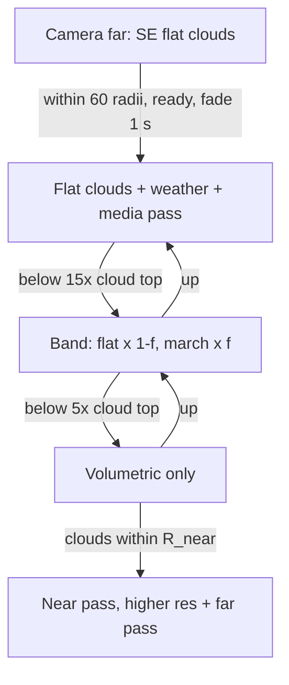

# Cloud hand-over, no popping, sharper clouds

> Status: Implemented 2026-11-03 (see Outcome); the hand-over itself dropped later that day at the user's request (dark rain patches through the flat clouds, no speed-up near the ground): see `spec-clouds-v3.md`. The detail cover and the near pass stay. · Date: 2026-11-03 · Baseline: 45276ff plus the uncommitted volumetric clouds work (clouds plan steps 1-7, step 8 half done)
> Source: conversation (the user's videos `Videos\2026-11-03 08-18-27.mp4` (Earth) and `08-23-20.mp4` (RS 8514-3151-2-61-189 4), and the spec interview)

## Outcome (2026-11-03)

- **Steps:** steps 1 to 7 done, plus 5b (the detail cover). Steps 4 and 5 were built together.
- **The bugs:**
  - B1 was the clouds, not dust: the derived weather was too strong.
  - B2 was scaled space behind a nearer moon.
  - B3 was the weather cells.
  - B4 is gone with the hand-over.
  - B5 is answered by the flat look above the hand-over and the detail cover below it.
- **D4, the cost budget, is not met on planet 2.** The views there cost more than before this spec,
  but before it the weather wrongly cleared the sky at the user's spot. With SE's three thin high
  layers drawn again they cost 2.6, 3.9, 0.64 and 5.5 ms (against 0.87, 0.99, 0.41 and 2.19 ms).
  - The near pass is 0.05 to 0.26 ms of that.
  - Cheaper sun-ward marching far away and skipping the fine erosion noise where it averages out
    brought look-around down from 6.6 ms.
  - From orbit the cost dropped about 25 times.
- **D3, the near pass:** in place, but no difference was visible in still test pictures (the frame
  blend sharpens both).
- **Open:**
  - A faint straight line over Alaska from 11,000 km (body-fixed, in the density; cause not found).
  - The 3D clouds look a little more solid and cream than the flat ones in the hand-over.

## Summary

The volumetric clouds (docs/spec-volumetric-clouds-weather.md) pop in and out as the camera moves to and from a planet, and dust and fog cover worlds from orbit where nothing should be. This spec fixes that. It also makes the clouds sharper at High and Ultra without costing more:
- **From orbit:** SE's sharp flat cloud shells, shaped by the same weather and lit like the volumetric clouds, draw the clouds.
- **Hand-over:** the ray-march fades in only once the camera comes down (150 to 50 km on Earth).
- **Near the surface:** clouds near the camera are traced at a higher resolution than distant ones.

It is for the user playing at Ultra on 3440x1440.

## What the videos show (the bugs)

| # | Seen | Where | Cause (found or suspected) |
|---|------|-------|----------------------------|
| B1 | Earth from 2,500 km: a tan veil over most of the planet, hiding the oceans | video 1, 0-5 s | **Found in step 2: the clouds, not dust.** The derived weather's storm track (×1.33, +0.17 at 55° N) turned SE's sparse map into a cream overcast; fixed with gentler weather terms, SE's 5% cut (`weather_cover`) and the noise averaged out from orbit. Dust and fog were also too widespread (now banks and regional storms). First suspicion, kept for the record: dust (and fog) from the weather cover too much of the planet. Dust's vertical optical depth is 1.2e-3/m × 2,500 m × dust, so 3 × dust; fog's is 0.012 × 120 m × fog, so 1.44 × fog (`volumetric_clouds.wesl` `media`, lines 607 and 631). The dust patch mask and the storm-dust term `0.5·c·dry²` (`weather_sim.wesl:209`) are broad. |
| B2 | Torrid arid world at about 3 radii: flips between its normal look and an opaque pale-blue ball | video 2 | **Found and fixed in step 1.** The ball is the right look: two full-cover decks (38.6-48.9 and 70.9-79.5 km), and SE's flat shells on Medium show the same. The dark globe was the bug. Whenever moon 4.2 was the nearest body, camera.rs `update_nearest` left the planet in scaled space. The passes read its compressed depth as true distance and stopped short of the clouds, while the flat shells were hidden. Fix: `VolumetricClouds::active` stretches the linear radius over the clouds' body. |
| B3 | Earth from 11,000 km: blocky ~100 km squares in the clouds over the ocean | video 1, 6-11 s | The weather cube's 128-texel faces (about 78 km a texel on Earth) cut sharply by `smoothstep(0.08, 0.45, …)` in `sim_out` |
| B4 | The look jumps between SE's sharp flat clouds and the soft volumetric ones | video 1, leaving and returning | A hard switch with no blend: the volumetric pass draws only within 60 radii (`MAX_RANGE_RADII`, `volumetric_clouds.rs:81`), and only once the cover map and catalog maps are ready (`:1176`). The flat shells are hidden as soon as it draws (`terrain.rs:2594`). The two looks differ: the volumetric cover is shaped by the weather, the flat shells' is not; the lighting differs; the volumetric adds dust and fog. |
| B5 | Volumetric clouds from orbit are softer than SE's flat ones | video 1 | The volumetric cover map is 1024 texels a face (about 10 km a texel on Earth) and the trace runs at half (Ultra) or a quarter (High) of the solids' resolution. The flat shells read SE's tiles, which get finer as the camera comes closer, or work out the procedural clouds per screen pixel (`clouds.wesl:113-129`). |

## Goals / Non-goals

**Goals**
1. No visible pop anywhere between the surface and far away, on arrival, or when the volumetric clouds finish loading.
2. A normal world looks clear of dust and fog from space. Only big dust storms (Mars-like) and thick fog banks show.
3. From orbit, High and Ultra show SE's sharp flat clouds, shaped by the weather and lit to match the volumetric clouds.
4. Between 150 and 50 km on Earth (scaled per world), flat and volumetric blend into each other.
5. Near the surface, clouds within a few km are traced at a higher resolution than the rest.
6. No weather squares: the simulation grid goes to 256 a face, and is smoothed.
7. Costs no more than today in every test view at Ultra 3440x1440.

**Non-goals**
- Medium and below: they keep SE's plain flat clouds, unchanged and without weather.
- Gas giants: their decks keep their own fade (`GIANT_NEAR`/`GIANT_FULL`) and clouds plan step 8. Step 8 may reuse this spec's blending later.
- Offscreen views (HD screenshots, projection modes, skybox): flat everywhere, as today (clouds plan step 9).
- New weather features, and changing the derived weather maps' size (256×128 stays).

## Users & permissions

| Role | Can | Cannot |
|------|-----|--------|
| Player | Choose the preset and the clouds/rain/fog/dust switches (Settings), as today | Not affected: no new settings |
| Developer (Claude, tests) | `SE_CLOUD_LOD=0` brings back today's behaviour for comparisons; the existing `SE_WEATHER_DEBUG`, `SE_WEATHER_SIM`, `switch`, `timing` | |

## Data model

No saved data changes. GPU resources:

| Resource | Today | New |
|----------|-------|-----|
| Weather simulation state (2 × Rgba16Float cube) | 6×128² | 6×256² (`weather_sim.rs` `SIM_SIZE`) |
| Weather cube and fx cube (Rgba8Unorm) | 6×128² | 6×256² |
| Derived weather maps (256×128 × 4 layers) | unchanged | unchanged |
| Hand-over fade per body | none | one float per body in the per-frame light pages that terrain.rs already writes, read by `clouds.wesl` and the composite. Never written into a material asset (CLAUDE.md rule). |
| Near-pass targets | none | full-resolution light+transmittance and distance, plus a full-resolution history pair for its resolve. At Ultra 3440×1440 that is about 40 MB; on High, half resolution. |
| Flat shells' weather | none | the weather cube bound to `CloudMaterial` once, as `PlanetMaterial` binding 32 already is |

## Flows

### 1. Flying from far away down to the surface (High/Ultra)

1. **Far, beyond the media range:** SE's flat clouds as today, unchanged.
2. **The body becomes the active clouds body** (within 60 radii, as today):
   - The weather simulation starts and the flat clouds are shaped by the weather cube.
   - Dust and fog draw through a media-only pass, with no cloud ray-march.
   - Both fade in over about 1 s of real time once ready, and the media also by distance, between 60 and 40 radii.
3. **Above the hand-over start** (15 × the highest layer's top; Earth ≈ 150 km): only the upgraded flat clouds and the media.
4. **Inside the band**, from the start down to the end (5 × the top; Earth ≈ 50 km):
   - The fade f = smoothstep(start, end, camera height) × the readiness fade.
   - The flat shells draw with alpha × (1 − f).
   - The ray-marched clouds composite with light × f and transmittance mix(1, T, f).
5. **Below the end:** volumetric only; the flat shells are hidden (f = 1).
6. **Near the clouds:**
   - The near pass traces the ray from 0 to R_near at the higher resolution (Ultra full, High half).
   - The far pass traces from R_near to the scene at today's resolution.
   - They are joined front to back: light = near.light + near.T × far.light, T = near.T × far.T.

Going up reverses each step. f depends on height only, so the same heights give the same picture both ways.

### 2. The volumetric clouds finish loading after arrival

1. The cover map, catalog maps and weather maps are building: the readiness fade stays 0 and the flat clouds stay whole.
2. Once complete, the readiness fade rises from 0 to 1 over 1 s of real time.
3. If they are lost (the body changes, quality is lowered, the clouds switch is turned off), the fade drops to 0 at once. Those are the player's own actions or happen far from any surface.

### 3. The active body changes (planet to moon)

1. With f tied to the height band, two bodies are never both inside their bands at once. When the active body changes, its f is already 0.
2. The media fade out over 1 s on the old body and in on the new one, so a dust storm doesn't pop.

## Edge cases & failure handling

| Case | Expected behaviour |
|------|--------------------|
| Medium and below | SE's flat clouds as before this spec (no weather, no fade); the clouds pass off |
| A body with an atmosphere and no cloud layers (Mars) | No flat shells; from orbit the media-only pass draws its dust storms; no hand-over needed |
| Very high cloud tops (Venus-like decks at 70 km) | start = min(15 × top, 0.05 × radius), end = start / 3; checked on Venus |
| Very low tops (2 km) | start = max(15 × top, 30 km), end = start / 3 |
| Camera inside the band while time runs fast or backwards | f depends on height only; the weather follows its own `SimClock` rules, unchanged |
| Paused | Unchanged; the readiness fade still runs in real time |
| Night side | Flat clouds keep their terminator; media lit only by the star and the sky (no light at night, checked on the torrid world) |
| Offscreen view exists (HD screenshot, projection) | Flat everywhere as today; f forced to 0 |
| Window resize or preset change | Near-pass targets rebuilt at the new size; the near history dropped |
| Camera flying through a cloud fast | The near pass's history is short (fast-moving near clouds must not smear); the jitter's noise is accepted over smear |
| A view over the cost budget | R_near shrinks (constants per preset, tuned by measurement) until the view fits |
| Gas giant | Out of scope: no change to its own fade |
| `SE_CLOUD_LOD=0` | Today's behaviour: hard switch at 60 radii, one trace resolution, flat shells without weather |

## Security & privacy

None. This is a local renderer with no network, input or account surface. It reads only the SpaceEngine install, as today.

## Integrations

None new. The flat shells keep reading SE's cloud tiles from the install.

## Non-functional requirements

| Item | Requirement |
|------|-------------|
| Cost | At Ultra 3440×1440 (`.optimize/bench/rsn_ultra.sh`), each view's `volumetric_clouds/elapsed_gpu` must be at most today's: planet 2 horizon 0.87, looking up 0.99, ground 0.41, looking around 2.19 ms; Earth snow horizon 1.14, looking up 3.72 ms. Views from orbit should get cheaper (no ray-march). |
| Weather simulation | 6×256² with up to 4 steps a frame: measured, expected well under 0.5 ms |
| Memory | About 40 MB more at Ultra 3440×1440 for the near pass; about 7 MB for the bigger weather textures |
| Pop test | A scripted flight (surface, then 30, 50, 80, 100, 120, 150, 300 km, 10 and 40 radii, and back), pictures 5 km apart inside the band: no jump between neighbouring pictures beyond what the camera's move explains (mean difference over the planet within 2× the difference between two pictures outside the band) |
| Look match | At 100 km on Earth the flat and volumetric pictures match in cloud layout, and cloudy pixels' mean brightness within 15% |

## Codebase impact

| File | Change |
|------|--------|
| `crates/se_engine/src/volumetric_clouds.rs` | The active body still within `MAX_RANGE_RADII` (`:81`, `:595-612`). New: the hand-over heights from the highest layer; f and the readiness fade; the media fade by distance; `SE_CLOUD_LOD`. The near pass (targets, pipelines, resolve) next to `draw_clouds` (`:1190`); `cloud_size` (`:995`) also for the near pass. The trace's divisor (`:716`) stays for the far pass. |
| `crates/se_engine/assets/shaders/volumetric_clouds.wesl` | `trace` (`:664`): march only when f > 0, and from R_near (far) or up to R_near (near); `media` (`:587`) always. `composite` (`:916`): scale by f; join near and far. A near `resolve` with a short history. |
| `crates/se_engine/assets/shaders/cloud_cover.wesl` | New shared `weather_cover(cover, w, …)`, the cover shaped by the weather. The march (`layer_density`), the ground shadows (`planet.wesl:199`) and the flat shells all use it. |
| `crates/se_engine/assets/shaders/clouds.wesl` | `fragment` (`:113`): read the weather cube; apply `weather_cover`; light by optical depth (thin clouds translucent, thick opaque, sunset colours through the atmosphere); alpha × (1 − f) from the light page |
| `crates/se_engine/src/terrain.rs` | `CloudMaterial`: the weather cube binding. The flat shells are hidden when f ≥ 1, instead of when `volumetric.body == body` (`:2594`); f per body in the light pages. |
| `crates/se_engine/src/volumetric_clouds/weather_sim.rs` | `SIM_SIZE` 128 to 256 (`:24`); `weather_cube()`, `derived_image()` sizes; dispatch sizes |
| `crates/se_engine/assets/shaders/weather_sim.wesl` | `sim_out` (`:188`): softer cut-outs; storm dust (`:209`) narrowed |
| `crates/se_core/src/weather.rs` | Dust (`:247`) and fog (`:242`) narrowed to real storms and fog banks; tests updated |
| `CLAUDE.md`, `README.md`, `PROGRESS.md`, `docs/spec-volumetric-clouds-weather.md` | The hand-over, the near pass, `SE_CLOUD_LOD`, the new weather size |

## Implementation order

Each step builds and passes `cargo test -p se_core` and `cargo test -p se_engine --release`. Each is checked in the running port with screenshots (after shader edits, wait 2400+ frames and check the run's "Screenshot saved"), measured with `rsn_ultra.sh`, and noted in PROGRESS.md.

| # | Step | Depends on | Done when |
|---|------|-----------|-----------|
| 1 | **Reproduce and fix the torrid world (B2):** go to RS 8514-3151-2-61-189 4 at about 3 radii and log which switch flips (active body, setup rebuild, cover/sim completion). Fix the flip, then check the ball's light (day or night side). | none | The world doesn't flip in a fly-in/fly-out run; the cause is in PROGRESS |
| 2 | **Dust and fog only where real (B1):** narrow the dust patches and the storm dust; keep fog to banks. Keep near-ground densities. | 1 | Earth from 2,500 km shows no tan veil; Mars's storms still show from orbit; the torrid world isn't a ball; fog and dust near the ground look as before |
| 3 | **A finer weather map (B3):** `SIM_SIZE` 256, smoother cut-outs and sampling | none | No squares on Earth from 11,000 km (SE_WEATHER_DEBUG and a picture); simulation cost measured |
| 4 | **The flat shells shaped by the weather and relit:** `weather_cover` shared; `clouds.wesl` reads the weather cube (High/Ultra only, only for the active clouds body) | 3 | At 100 km on Earth, flat and volumetric pictures match (layout and brightness within 15%); Medium unchanged (picture identical to before) |
| 5 | **The hand-over (B4):** f per body, the readiness fade, the media-only pass above the band, the media fade at 60 to 40 radii, `SE_CLOUD_LOD=0` | 4 | The pop test passes on Earth and planet 2; video 1's flight has no jump; orbit views are cheaper |
| 5b | **A detail cover around the camera (added 2026-11-03):** below the hand-over the volumetric clouds' shapes come from the 10 km-a-texel cover map, while the flat shells read SE's tiles down to about 1 km. The descent test at 30° S 100° W showed sharp flat clouds at 125 km turning into soft blobs by 75 km. Add a square cover patch under the camera, about 1 km a texel, re-centred as the camera moves (like the shadow map's frame). For mapped layers it comes from SE's level 4-5 tiles on a worker thread; for generated layers, from the cover generator on the GPU. Read it within the patch, blending to the cover map at its edge. | 5 | The descent shows no loss of detail through the hand-over; cost measured |
| 6 | **The near pass (B5, near the surface):** a higher-resolution near pass up to R_near (Ultra full, High half), its short-history resolve, the front-to-back join | 5 | Flying through clouds is sharper (pictures before and after); every test view costs at most today's; R_near tuned |
| 7 | **Docs and final measurement:** CLAUDE.md, README.md, PROGRESS.md, the clouds plan updated; the full `rsn_ultra.sh` set | 6 | Numbers in PROGRESS; the clouds plan resumes at step 8 |

## Decisions log

| # | Decision | Alternatives considered | Reason |
|---|----------|------------------------|--------|
| D1 | From orbit, SE's flat cloud shells draw the clouds, upgraded with the weather and volumetric-like lighting | A new full-resolution cloud layer in the clouds pass; ray-marching from orbit at full resolution | SE's tiles and per-pixel generator are sharper than the 10 km cover map; cheapest; already there |
| D2 | Hand-over between 15× and 5× the highest cloud top (Earth 150 to 50 km), clamped to 30 km and 0.05 radius | 500 to 200 km; 30 to 15 km | Towers and their shadows only show below about 150 km; at the space station's height the flat clouds are sharper and free |
| D3 | Near clouds traced at a higher resolution than far ones (Ultra full, High half), split by ray distance R_near | Full resolution over several frames (temporal); one resolution | Near clouds move fast on screen, so the frame blend can't sharpen them; far ones move slowly and sharpen over frames |
| D4 | Cost no worse than today in any test view; R_near shrinks to fit | +2 ms; best look first | The user's choice |
| D5 | Only High and Ultra change; Medium and below keep SE's plain flat clouds | All presets get the upgraded flat clouds | The user's choice: safest for slow computers |
| D6 | Dust and fog: only real storms and fog banks show from orbit; near-ground looks kept | Near the ground only; keep amounts | A normal world must look clear from space; Mars's storms should still show |
| D7 | Weather simulation grid 256 a face, plus smoothing | Smoothing only at 128 | The user's choice: smaller, sharper storm cells |
| D8 | Do this before clouds plan step 8; gas giants out of scope | After step 8; fold into step 10 | The pops show in the user's game today |
| D9 | Every switch fades: readiness over 1 s of real time, media by distance (60 to 40 radii) and over 1 s on a body change | Hard switches as today | No pop anywhere |
| D10 | Above the band, a media-only pass (no cloud march) draws dust and fog | Dust and fog only below the band | Worlds without cloud layers (Mars) have no flat shells to carry their storms |
| D11 | Per-frame fade values go in the light pages, never in material assets | Writing `CloudMaterial` each frame | Bevy re-prepares every object using a changed material (CLAUDE.md rule) |
| D12 | `SE_CLOUD_LOD=0` brings back today's behaviour | No switch | Side-by-side checks while building |

## Open questions

| # | Question | Owner | Blocks |
|---|----------|-------|--------|
| Q1 | ~~What flips the torrid world (B2b)?~~ Answered in step 1: scaled space behind a nearer moon | done | |
| Q2 | How close the flat lighting can get to the march (self-shadow, sunset colours) without a march | Claude, step 4 (tuned by pictures) | Nothing; the band hides the remaining difference |
| Q3 | Exact R_near per preset (6 km Ultra / 3 km High as a starting point) | Claude, step 6 (measured) | Nothing |
| Q4 | Whether the derived maps (256×128) need to grow once the simulation is at 256 | Claude, after step 3 | Nothing |
| Q5 | Whether the ground's cloud shadows from orbit should follow the flat clouds' finer shapes | Claude, step 4 | Nothing; they stay as today (cover map + weather) |

## Verification claims

| ID | Claim | Where | How to check |
|----|-------|-------|--------------|
| C1 | `SE_CLOUD_LOD=0` restores today's behaviour | `crates/se_engine/src/volumetric_clouds.rs` | grep `SE_CLOUD_LOD`; a run with it set matches a picture of the baseline |
| C2 | The weather simulation grid is 256 a face | `volumetric_clouds/weather_sim.rs` | grep `const SIM_SIZE: u32 = 256` |
| C3 | One `weather_cover` function shapes the cover in the march, the ground shadows and the flat shells | `assets/shaders/{cloud_cover,volumetric_clouds,planet,clouds}.wesl` | grep `weather_cover` in all four |
| C4 | The flat shells read the weather cube | `clouds.wesl`, `terrain.rs` `CloudMaterial` | grep a cube binding in `clouds.wesl` and `#[texture(…, dimension = "cube")]` in `CloudMaterial` |
| C5 | The fade f reaches the shaders through the light pages, not a material write | `terrain.rs`, `clouds.wesl` | grep: no per-frame `Assets<CloudMaterial>` `get_mut`; f read from `lit[...]` |
| C6 | The flat shells are hidden only when f ≥ 1 | `terrain.rs` (near the old `volumetric.body != Some(body_entity)`) | read the condition |
| C7 | The cloud march runs only when f > 0; the media always | `volumetric_clouds.wesl` `trace` | read |
| C8 | The readiness fade lasts about 1 s of real time | `volumetric_clouds.rs` | grep the fade constant and its `Time<Real>` use |
| C9 | The hand-over heights come from the highest layer's top: 15× and 5×, clamped to 30 km and 0.05 radius | `volumetric_clouds.rs` | grep the constants; unit test of the heights for Earth and Venus |
| C10 | The near pass runs at full resolution on Ultra and half on High, up to R_near per preset | `volumetric_clouds.rs` | grep the R_near constants and the near target size |
| C11 | Medium and below are unchanged | `terrain.rs`, `clouds.wesl` | a Medium picture of Earth from orbit is identical to the baseline |
| C12 | No test view costs more than today at Ultra 3440×1440 | `.optimize/bench/rsn_ultra.sh`, PROGRESS.md | SE_PERF numbers against the table above |
| C13 | Earth from 2,500 km has no tan veil; Mars's dust storms show from orbit | pictures | runport pictures; `SE_WEATHER_DEBUG` dust (orange) limited to deserts |
| C14 | The fly-out/fly-in picture sequence passes the pop test | runport pictures | compare script over neighbouring pictures |
| C15 | The torrid world (RS 8514-3151-2-61-189 4) doesn't flip at 3 radii | pictures | runport pictures while moving in and out |
| C16 | The tests pass | `crates/se_core`, `crates/se_engine` | `cargo test -p se_core`, `cargo test -p se_engine --release` |
