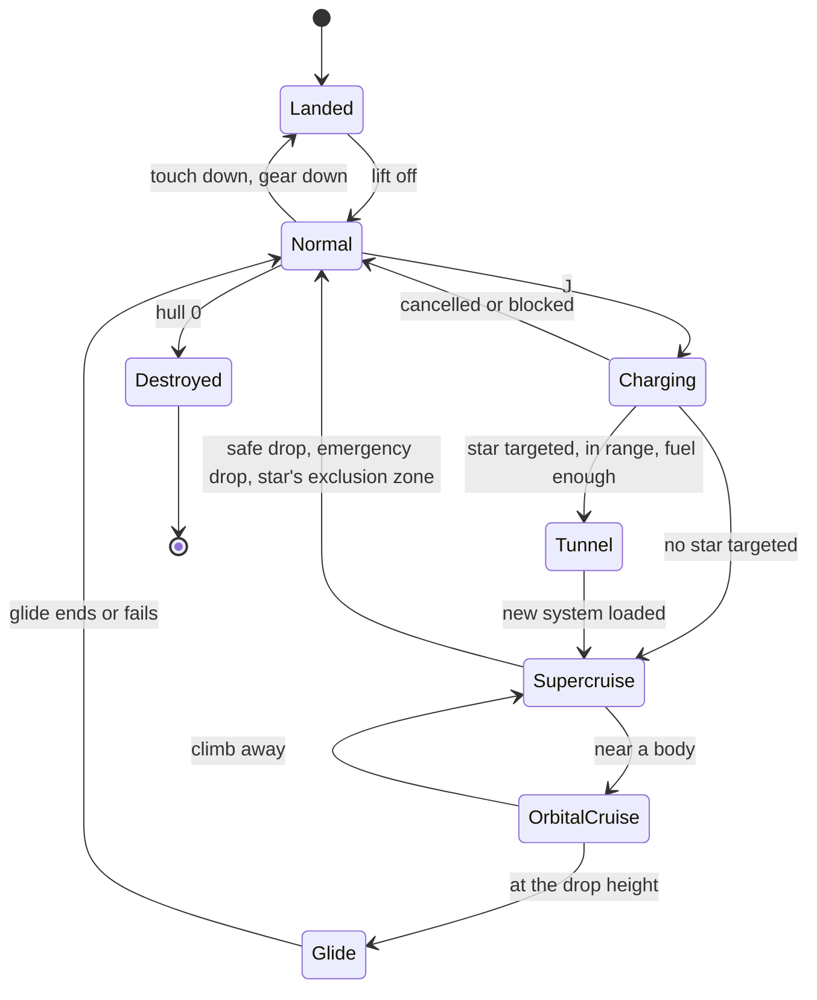

# Faulcon DeLacy Sidewinder mod

> Status: Draft · Date: 2026-11-13 · Baseline: 5f8f796
> Source: the user's request and interview of 2026-11-13, a read-only survey of the user's Elite Dangerous install
> (version `2026.10.23.334925`, Odyssey), and research against the code at the baseline.
> PLAN ONLY: no game code was written. Another session (Opus, with `/rea` then `/leader`) builds it step by step.

Line numbers are as of the baseline; those marked (survey) come from a quick code survey and must be checked before
they are relied on. Every Elite Dangerous number in this file is either quoted from a named source or marked as a
**hint** (community posts, memory): a hint says what to look for, and is never used as a final number.

## Summary

A third mod for the Q menu: the **Faulcon DeLacy Sidewinder** from Elite Dangerous. Clicking it spawns the ship in
front of you, resting on its landing gear; you walk up and press E to sit in its cockpit. From then on every key is
Elite's own default, and the ship flies by Elite's rules: thrusters with flight assist on and off, the blue zone,
boost, power pips, heat, shields and hull, supercruise, hyperspace jumps between SpaceEngine's stars, orbital cruise,
glide and landing on planets, fuel, and the two stock pulse lasers. You get the stock ship a new commander gets.

About half of Elite's data files are encrypted, and the user's rule is never to defeat DRM, so those stay closed. The
plan therefore says, part by part, how close to "byte for byte" each part can honestly get and how that is proven.

## What "byte for byte" honestly means here

The user asked for everything to be byte-for-byte accurate. Elite Dangerous is closed source, so no part of its
simulation can be compared tick by tick as Skate 3's was. Each part of the mod gets one of six grades, and every claim
in a phase's report names its grade:

| Grade | Meaning | How it is proven |
|---|---|---|
| **A. The game's own bytes** | Data taken unchanged from the open (not encrypted) files of the install: mesh vertices, texture blocks, sound packets, key bindings | A test hashes the mod's data against the install's source file |
| **B. The game's own numbers** | Numbers the game itself shows or writes: the outfitting screen (through the community's data files), the Player Journal, `Status.json` | The same number read from the user's own journal or a screenshot |
| **C. The game's own code** | A formula and its constants read out of `EliteDangerous64.exe` by offline study (the user allowed this, D3) | The function's address and our notes on it, plus a measurement that agrees |
| **D. Measured** | No code found: the rule is fitted to recordings of the real game | The mod's number beside the game's, inside the gate below |
| **E. Recreated by eye or ear** | The original is in the encrypted half, or could not be found: redrawn, re-modelled or re-recorded to match | Side-by-side pictures or recordings. No byte claim is made |
| **F. Ours** | Elite has no such thing (thick air, gas giant flight, the restock button, SpaceEngine's galaxy) | Described, tested, and labelled as not Elite's |

**The gate (D10, the user's choice):** for grades C and D a phase is done only when the mod lands inside what the
measurement itself can resolve. Steady numbers must read the same as the real game's (within 1 m/s, 1 degree a
second, 1 % heat) and timed events within 2 video frames or 2 %, whichever is larger. Anything outside is fixed or
reported as failed. **Nothing is ever tuned by feel.** Grades E and F have no gate: the user judges them.

What can never match, by nature: the galaxy (SpaceEngine's stars and planets, not Elite's), anything Elite does on
its servers (other players, missions, markets), the length of a hyperspace tunnel (it lasts as long as loading takes,
in both games), and the exact internal step of Elite's simulation.

### Grade by system

| # | System | Elite behaviour to match | How it maps onto Sandbox Engine | Best grade reachable | Proof |
|---|---|---|---|---|---|
| S1 | Exterior model and textures | The Sidewinder's hull, paint, decals, levels of detail | A sandbox object lit like props; drawn from its own model file | A for vertices and texels if found among the open files (go/no-go G1); the assembly (which texture on which part) is E | Hash test; same-angle picture beside Elite's |
| S2 | Cockpit and seat view | Interior, seat, dashboard, sticks, canopy glass, the commander's body, the eye's place and field of view | Drawn like the weapons' view models, in the nearest depth slice | A for meshes and texels if found; placement, field of view and the pilot's pose D or E | Same-view picture beside Elite's screenshot |
| S3 | Moving parts and effects | Landing gear, hardpoints, cargo scoop, heat vents, thruster flames, lights, shield flash | Part animations and effect passes of our own | E (the rigs and particle effects are not in the open files) | Side-by-side video frames |
| S4 | Sound recordings | Every recording: thrusters, boost, FSD charge, jump, supercruise, gear, alarms, lasers, the cockpit voice | Ogg files holding the game's own Vorbis packets, rewrapped without re-encoding | A for each recording matched to its stream; E (recorded from the speakers) for any that can't be found | Decoded samples equal; a list of found and not found |
| S5 | Sound behaviour | Which recordings play when, how they layer, how loudness and pitch follow thrust and speed | Our own mixer driven by the simulation's state | E, with D checks (loudness and pitch against recordings of the real game) | Recorded loudness and pitch curves side by side |
| S6 | Flight | 6-DOF thrusters, throttle, the blue zone, flight assist on and off, boost, speed and turn against ENG pips and mass | `elite-sim`, a new crate, stepped at a fixed tick | C where the code is found (G2), else D | Trace tests inside the gate |
| S7 | Rotational correction | Believed (a hint) to be the setting that matches a spinning station's turn and to do nothing away from stations | Not built: there are no stations. Step 0.9 checks whether it changes anything in open space or over a planet; if it does, it comes back into the plan | Not built | Step 0.9's check |
| S8 | Power distributor | SYS/ENG/WEP capacitors, pips, recharge, what each capacitor feeds | `elite-sim` | B for capacities and rates, C or D for the pip rule | Trace tests |
| S9 | Heat | Heat percentage, loads from modules, FSD charging, stars; warnings; damage over 100 % | `elite-sim`; hot air added by the same flux rule (F) | C or D | Trace tests |
| S10 | Shields and hull | Shield strength, recharge and rebuild, hull, collision damage, canopy breach and the life support timer, destruction | `elite-sim`; collisions against the ground and buildings | B for the numbers, C or D for the rules | Trace tests, pictures |
| S11 | Supercruise | Charge, speed against throttle and nearby masses, limits, the drop rule, emergency drops, cooldowns | `elite-sim` over SpaceEngine's bodies and their masses | C or D | Trace tests replaying the Elite body's own mass and distance |
| S12 | Hyperspace | Target, charge, countdown, tunnel, arrival at the star, fuel, cooldown | A jump between SpaceEngine's stars; new code that swaps the loaded system | B for fuel (the journal gives it to six digits), C or D for times; the tunnel's look E | Fuel test against the journal; timings |
| S13 | Planet approach | Orbital cruise, glide, the drop to normal flight | The same rules on every solid body and on gas giants (D7) | C or D on worlds Elite allows; F where it doesn't | Trace tests replaying the Elite moon's own radius and gravity |
| S14 | Landing | Gear, speed limits, touchdown and liftoff rules, gravity against thrusters | `elite-sim` against the sandbox's ground | C or D | Trace tests, pictures |
| S15 | Fuel | Tank, reservoir, burn by power draw, fuel per jump. The stock ship has no scoop | `elite-sim`; the restock button is F | B (`Status.json` gives fuel exactly) | Fuel test |
| S16 | HUD and panels | Canopy HUD, radar, left and right panels, lower panel, messages | Redrawn to match screenshots (D12) | E for the look; the numbers shown are the simulation's | Same-view pictures |
| S17 | Controls | Elite's default keyboard, mouse and gamepad schemes | Read from copies of Elite's own `.binds` files | A for the bindings; C or D for how the mouse becomes stick movement | Test against the install's files |
| S18 | Weapons | Hardpoints, two pulse lasers: rate, heat, WEP drain | `elite-sim`; beams hit the ground, props and buildings | B for numbers, E for the beam's look | Trace tests, pictures |
| S19 | Getting in and out | Odyssey's boarding and Disembark | E to board, the lower panel or B to leave (D8) | F with E for look and sounds | Pictures |
| S20 | Thick air, gas giants | Elite has none | Real drag and hot-air heat in thruster flight; giants enterable (D7) | F | Described and tested |

## What the user must do

| # | Step | When | Until it's done |
|---|---|---|---|
| U1 | **Done 2026-11-14.** Buy a stock Sidewinder in Elite (32,000 cr) and leave it stock | Before step 0.7 | Steps 0.1 to 0.6 go ahead without it |
| U2 | For each measuring session: start Elite, log in, enter **Solo**, sit in the Sidewinder where the step asks (open space; a small airless moon; near a star). Then say so. The agent never types a password and never uses a station, so refuelling and repairing the real ship between sessions is yours too | Steps 0.7 to 0.9, 2.4, 5.1, 6.1 and any re-measure | That step waits; the builder works on another |
| U3 | Say yes or no to each install when asked: ffmpeg (already agreed, D4), a Wwise Vorbis decoder (vgmstream or ww2ogg), the REA tools `/rea` needs | Phase 0 | The step that needs the tool waits |
| U4 | Read Frontier's EULA on three points: sharing game files, reverse engineering, and automated input. It could not be fetched from here (403). Decisions D2, D3 and D4 stand unless you change them | Any time | Nothing changes |
| U5 | Fly each phase and say whether it feels like Elite (grades E and F have no other judge) | End of each phase | The builder carries on |
| U6 | Give the go for any push or public release. The mod's files are Frontier's (D2) | When you choose | Nothing is pushed |

## Goals / Non-goals

**Goals**

- A Mods-tab entry that spawns one Sidewinder in front of the player, and E to board it.
- The stock ship (the loadout below), with Elite's rules for everything in the table above.
- Elite's default keyboard and mouse controls first, its default gamepad layout later, both read from Elite's files.
- Free "Refuel, repair, restock" from the Q menu while landed (D5).
- Every solid world and every gas giant can be approached and flown on; stars keep Elite's rules (D7, D11).
- Every claim graded and proven as above. The mod off, or never spawned, costs nothing.

**Non-goals (this plan; the "later" list)**

- Opening, decrypting or working around the encrypted `FREA` files in any way: no key from the exe, no reading the
  running game's memory, no grabbing models off the graphics card. This is not "later": it is never.
- Stations and docking, rotational correction, the galaxy map and system map screens, scanners (honk, FSS, surface
  probes) (D6). Other ships, combat targets, interdiction, missions, credits, cargo trading, the SRV, multicrew, wings.
- Outfitting, engineering, other ships than the Sidewinder, a fuel scoop.
- Elite's outside camera suite; saving the ship between launches; more than one Sidewinder at once (D12).
- Joysticks, HOTAS, a rebinding screen (D9).
- Wind, wind noise, lift, and pressure damage in thick air.

## Users & permissions

| Role | Can | Cannot |
|---|---|---|
| The player | Spawn, board, fly, land, leave, restock; play without Elite installed (the files ship with the mod, D2) | Rebind keys; keep the ship across launches |
| The measuring agent (Sonnet, high effort) | Press flight keys in the user's running Elite in Solo, take Elite's own screenshots (F10), run the recorder, read the journal and `Status.json` | Type credentials; leave Solo; spend credits, buy, sell or change the loadout; open station services; use chat or anything touching other players; use the computer-use screenshot tool (it stalls on this PC); read the game's memory or inject anything. It stops and reports if a menu, another player or anything unexpected appears |
| The builder (Opus) | Read Elite's open files and its exe offline; write the mod | Open `FREA` files; run or change Elite's install; push or release |

## Evidence sources

| # | Source | What it gives | How reliable | Limits |
|---|---|---|---|---|
| E1 | The install's open data files (`Win64/0?/`) | Mesh data, texture data, sound streams | The game's own bytes | No names, no assembly; formats undocumented; see Assets |
| E2 | The install's plain files: `ControlSchemes/*.binds`, `GraphicsConfiguration.xml`, `AudioConfiguration.xml`, `DeviceDefaults.xml` | Default controls for every device; graphics limits; that the audio engine is Wwise | The game's own bytes | The field of view and mouse feel are not in them |
| E3 | `EliteDangerous64.exe`, studied offline with Ghidra through `/rea` | The client's formulas and constants: flight, supercruise, glide, heat | High for what is found. The exe is not packed (code section entropy 6.5, no protector strings) and keeps readable names (`ApproachGlide_FailedTooShallow`, `FlightAssistFinal`, `UpdateSupercruiseState`, `OutfittingFieldType_EngineOptimalMass`) | 98.7 MB of code: slow. Ship and module numbers may be loaded from the encrypted files and so be absent |
| E4 | The Player Journal and `Status.json` (Frontier's own documented files, in `Saved Games\Frontier Developments\Elite Dangerous`) | `Loadout` (every module's exact name, masses, jump range), `FSDJump` (distance, fuel used, fuel left), `StartJump`, `SupercruiseEntry/Exit`, `ApproachBody`, `Touchdown`, `Liftoff`, `HeatWarning`; flags for gear, shields, supercruise, FSD charging, glide; pips; fuel; latitude, longitude, altitude and heading near a body | The game's own numbers | No speed, no turn rate. Events are stamped to the second; `Status.json` is rewritten only when something changes. Re-check the field list against the docs in step 0.8 |
| E5 | Video of the cockpit at 60 frames a second, with the speakers recorded (`.audit/tools/loopback`) | The speed readout (whole m/s), throttle bar, heat %, capacitors, supercruise speed, distance and time to target; turn rates from the stars' motion; every timing to 1/60 s | Good to the readout's own resolution | Readouts may lag or be smoothed: cross-check against distance flown |
| E6 | Elite's own screenshots (F10) | The look of the ship, cockpit and HUD for side-by-side pictures | The game's own pictures | |
| E7 | EDCD `coriolis-data` (GitHub, last commit 2026-04-24; raw files saved in `re/elite/community/coriolis-data/` on 2026-11-13) | Ship and module numbers as the outfitting screen shows them | High for those numbers; confirm the loadout against U1's `Loadout` event | Its formulas (speed against pips and mass, jump range) are the community's own fits: medium, to confirm by measurement |
| E8 | EDSY, the wiki, forum research threads | Hints: what to measure, rough sizes of effects | Low to medium | Never a final number |

**Not sources:** the encrypted files, the running game's memory, a frame capture from the graphics card, fan-made
or ripped models found online.

### The community's numbers for the stock ship (E7, grade B, read from the raw files)

| Thing | Value |
|---|---|
| Sidewinder | hull mass 25 t; speed 220 m/s; boost 320 m/s; minimum thrust 45.454 %; boost cost 7; boost interval 4; pitch 42, roll 110, yaw 16 degrees a second; heat capacity 140; base shield 40; base armour 60; hardness 20; mass lock 6; reserve fuel 0.3 t; 1 seat |
| Bulkheads | Lightweight Alloy: mass 0, hull boost 0.8 |
| Power plant 2E | 6.4 MW; mass 2.5 t |
| Thrusters 2E | minimum, optimal, maximum mass 24, 48, 72 t; multipliers 0.83, 1, 1.03; power 2; mass 2.5 t |
| Frame shift drive 2E | optimal mass 48 t; most fuel a jump 0.6 t; fuel multiplier 0.011; fuel power 2; power 0.16; mass 2.5 t |
| Life support 1E | 300 s; power 0.32; mass 1.3 t |
| Power distributor 1E | SYS 8 at 0.4/s; ENG 8 at 0.4/s; WEP 10 at 1.2/s; power 0.32; mass 1.3 t |
| Sensors 1E | range 4; power 0.16; mass 1.3 t |
| Fuel tank 1C | 2 t |
| Shield generator 2E | regeneration 1, broken regeneration 1.6; distributor draw 0.6; masses 28, 55, 138 t; multipliers 0.3, 0.8, 1.3; power 0.9; mass 2.5 t |
| Pulse laser, small | Coriolis lists the stock pair as gimballed (id 18): damage 1.56, fire interval 0.25 s, distributor draw 0.31, thermal load 0.31, range 3000 m, mass 2 t. Fixed (id 17): 2.05, 0.26 s, 0.30, 0.33. **Which pair a new ship carries is settled by U1's `Loadout` event** |
| Other stock internals | Cargo rack 2E (4 t), Advanced Planetary Approach Suite |
| Worked out, not measured | Mass with a full tank about 44.9 t; longest jump about 7.9 light years (`sqrt(0.6 / 0.011) x 48 / 44.9`) |
| **The user's own ship (journal `Loadout`, 2026-11-14, game 4.4.2.1, grade B)** | Bought stock: unladen mass 42.9 t, cargo 4 t, fuel 2.0 t main and 0.3 t reserve, `MaxJumpRange` 8.149506 ly. That is exactly `sqrt(0.6 / 0.011) x 48 / (42.9 + 0.6)`, so the community's jump formula and the 2E drive's numbers hold. Modules as the table above, the lasers gimballed, plus two the community file does not list as stock: a **supercruise assist** and an **advanced docking computer** in the two size 1 slots. Voice: Verity. The same journal holds 6 `FSDJump`, 3 supercruise entries and exits and 1 `HeatWarning` to use as first data |

## Assets: how Elite stores them (surveyed 2026-11-13, read only)

`D:\SteamLibrary\steamapps\common\Elite Dangerous\Products\elite-dangerous-odyssey-64\Win64` holds 102,957 files in
folders `00` to `0f`, each named by 40 hex digits (the folder is `0` plus the name's first digit). `data.ovx` lists
every name with a 128-digit checksum: an integrity list, not a table of readable names.

| Kind | Files | Size | What the survey found | Usable? |
|---|---|---|---|---|
| `FREA` | 54,320 | 10.9 GB | Every file is a 6-byte header (`FREA`, two zero bytes) plus an exact multiple of 16 bytes, and the bytes are statistically random. That is a block cipher: **encrypted** | **No. Never opened** |
| zlib, inner kind `02 00 01 00` | 22,008 | 12.0 GB unpacked | Runs of 16-bit triangle indices: mesh data. The vertex layout is not yet known | Yes |
| zlib, inner kind `03 00 01 00` | 26,248 | 57.6 GB unpacked | Sizes are sums of block-compressed mip levels (1,310,720 bytes is a 1024 and a 512 level at a byte a pixel), with the byte patterns of such blocks: texture data | Yes |
| RIFF | 381 | 12.5 GB | Wwise Vorbis (format tag `0xFFFF`), many streams back to back in each file on 4,096-byte boundaries | Yes, with a public Wwise Vorbis decoder (a codec, not a lock) |
| Plain files outside `Win64` | | | Bindings and settings XML, shader archives, `.webm` movies | Bindings and settings: yes |

What the open files do **not** hold: any readable name ("sidewinder" appears in none of the 48,256 zlib files, as
ASCII in all of them and as UTF-16 in a sample of 300), any Wwise sound bank, any material, skeleton, animation,
particle effect, font or HUD artwork that the survey could see. By elimination those are in the encrypted half; that
is an inference, since the encrypted half was not opened.

So: **reading the shapes, textures and sound recordings needs no decryption. Knowing which of them are the
Sidewinder, and how they go together, does.** The plan's answer (D1): find them by looking and listening, rebuild the
assembly to match pictures of the real game, and recreate what can't be found, labelled as recreated.

The survey's tools and results are in `re/elite/` (out of git): `tools/survey.py`, `tools/probe_open_files.py`,
`catalog/open_files_2026.10.23.json` (every file's kind and sizes), `catalog/survey_summary.txt`.

**How other games' files were handled before:** Megaton Rainfall, Garry's Mod and Skate 3 were each converted once on
the user's PC into the project and shipped, on the user's decision each time; GTA V's encrypted archives were never
opened. For Elite the user chose the same (D2): converted once into `crates/se_engine/assets/mods/sidewinder`,
committed and shipped. This is the riskiest of the four: Elite is a live paid game and the repository is public
(GPL-3.0). The files are Frontier's whatever licence the code has; `SOURCES.txt` in the mod's folder says so.

## Controls

Read from the install's `ControlSchemes/KeyboardMouseOnly.binds` (grade A). While seated these replace every sandbox
and port key.

| Elite action | Default | Note |
|---|---|---|
| Pitch, roll | Mouse Y, mouse X | `MouseXMode` roll, `MouseYMode` pitch, no decay, dead zone 0.05, sensitivity 1, linearity 1 |
| Yaw | A, D | |
| Thrust left, right, up, down | Q, E, R, F | Q and E are thrust while seated, not menu and board |
| Throttle up, down; zero | W, S; X | |
| Flight assist | Z | |
| Boost | Tab | |
| Frame shift drive (supercruise, or the jump if a star is targeted) | J | |
| Landing gear; cargo scoop; ship lights | L; Home; Insert | |
| Hardpoints; fire primary, secondary; next fire group | U; left, right mouse button; N | |
| Pips to ENG, WEP, SYS; reset | Up, Right, Left; Down arrow | |
| Silent running; heat sink | Delete; V | Delete is `ToggleButtonUpInput` in the file, believed to be silent running: confirm in step 2.2. No heat sink launcher on the stock ship: V does nothing |
| Target ahead; next target; highest threat | T; G; H | Nothing to target but bodies |
| Left, comms, lower, right panel | 1, 2, 3, 4 | |
| UI focus; panel moves; select; back | Left Shift; W A S D; Space; Backspace | Tabs with Q and E |
| Head look | Middle mouse button | |
| Orbit lines | = | |

How it fits beside the game's own keys:

- **On foot:** nothing changes. E boards when you look at the ship from within reach; otherwise E is still "use".
- **Seated:** `sidewinder::read_input` (PreUpdate, placed as `skate::read_pad` is: after the input systems and
  `viltrumite::dev_keys`, before `sandbox::read_input`) takes every bound key and clears its press, so the port's
  readers (1 to 4 flight modes, G, T, H, P, Tab, the arrows, V) never see them.
- **Esc** stays the sandbox's main menu. **B** is the one key added: get out, only when landed (D8). In Elite's
  defaults B has no ship action (checked in the file: it is bound only to three on-foot actions). M (Elite's HUD mode
  switch) does nothing here: the analysis mode belongs with the scanners, on the later list.
- The Q menu is not reachable while seated; get out first. V (free flight) is off while seated.
- **Gamepad (a later phase):** `ControlPad.binds`: left stick pitch and roll, right stick thrust left/right and
  up/down, bumpers throttle, B boost, triggers fire, D-pad pips, X UI focus, Y target, Back hardpoints, right stick
  click head look. Read through the gamepad path the Skate 3 mod uses.

The mod ships copies of the two `.binds` files and reads its key table from them (so a test can compare them with the
install's). How mouse movement becomes stick movement is not in the file: it comes from the exe (C) or from
measurement (D).

## Architecture

```
crates/elite-sim/                 NEW crate. The ship's rules. No Bevy, no files, f64, a fixed tick.
  src/data.rs                     the stock ship's numbers, each with its source and grade in a comment
  src/flight.rs distributor.rs heat.rs shields.rs fuel.rs fsd.rs supercruise.rs approach.rs landing.rs weapons.rs
  src/sim.rs                      Sim::step(input, world) -> events; World is a trait the game implements
  src/trace.rs                    reads and writes trace files (CSV, numbers only)
  tests/traces/                   measured traces of the real game, scrubbed (no commander name), in git
crates/se_core/src/elite.rs       NEW. Readers for Elite's open containers (meshes, textures, sound packs).
                                  Refuses a FREA file by its header. Used only by the converter and tests.
crates/se_core/src/elite_asset.rs NEW. The mod's own model format (.edm) and the .binds reader.
crates/se_engine/src/sidewinder/  NEW module, as skate/ is:
  mod.rs      the plugin, the assets, the parked ship, spawn, board, leave, restock, dev commands
  pilot.rs    seated: frames, camera, ground and building contact, the hand-overs
  input.rs    bindings to simulation input; takes the keys
  draw.rs     exterior, cockpit view model, materials, lights
  hud.rs panels.rs   the canopy HUD and the panels
  sound.rs    the mixer and the voice
  fsd.rs      the tunnel and the swap to the new star system
  fx.rs       thruster flames, shield flash, lasers
  convert.rs  #[cfg(test)]: copy_sidewinder, the converter
crates/se_engine/assets/mods/sidewinder/   the mod's files (below)
crates/se_engine/assets/shaders/sidewinder_*.wesl
re/elite/                         out of git: tools, the catalog, Ghidra notes, raw recordings, the community's files
docs/elite-flight-model.md        in git: each rule in our own words, its formula, constants, grade and source
```

**Why a separate crate:** as `skate-sim`: it runs and is tested without the game (`cargo test --release -p
elite-sim`), cannot reach into Bevy, and its trace tests are the proof.

**Reuse or replace.** The port's own flyable ships (`ship.rs`, `ship/`) are SpaceEngine's ship rules: one 500-line
`ship_physics`, SE's warp, HUD, autopilot and `.sm` models. The Sidewinder **replaces** all of that for itself and
must never set `Flight::active`, because `mods::off_for_pilot_or_script` (`mods.rs:684`) turns every mod off while an
SE ship is flown. What it **reuses**:

| Need | Reused piece |
|---|---|
| Riding a turning, orbiting body; handing over between near-ground and space | `viltrumite/frames.rs` (`Frame::Attached` / `Free`, `carry` then `advance`), `ship.rs:512` `frame_terms`. Its gotchas apply unchanged (CLAUDE.md "The hero's motion") |
| The ground's height | `ship.rs:2091` `ground_on`, and the sandbox's ground field while parked |
| Solid buildings and trees | `scatter/probe.rs` `ProbeAsk`, `viltrumite/solid.rs`, `sandbox/solids.rs` |
| Light on the ship and cockpit | The hero's light pass and `LightProbe` (`viltrumite/draw.rs:317`), as the props and the skater use |
| Air density and temperature | `viltrumite/air.rs:149` `AirModel` |
| A model drawn in front of everything with its own field of view | `sandbox/viewmodel.rs` |
| Spawning where you look; the parked ship as a solid thing | `sandbox/props.rs:41` `handle_requests`, `sandbox/world.rs` |
| Mods list, file checks, grey rows | `mods.rs` (`KNOWN_CODES` :28, `apply_request` :692, `check_inside` :215) |
| Stars within reach | The star browser's search (`search LY`) |
| Loading another star's system | `system.rs:561` `select_active_system` (it follows the camera's nearest star and builds in the background) |
| Key presses in tests | `hero keys` (`viltrumite::dev_keys`) |

**Hyperspace is new work.** The port has no jump between stars: only the camera's Go To. A jump moves the ship and
camera to the arrival point by the target star while the tunnel hides the view, waits until `select_active_system`
has entered the new system, then ends the tunnel. Go/no-go G4 is whether that swap can be made to wait cleanly.

**The mod's files** (`crates/se_engine/assets/mods/sidewinder/`, written only by the converter, never by hand):

| File | Holds | Grade |
|---|---|---|
| `mod.cfg` | `Name "Faulcon DeLacy Sidewinder"`, `Description`, `Code "sidewinder"`, a `Need` for every file | |
| `SOURCES.txt` | For every file: the Elite file names it came from, Elite's version, its grade; or "recreated" and how. States that the files are Frontier Developments' | |
| `ship.edm`, `cockpit.edm` | Parts with names and parents, draws, vertices and indices as Elite has them, materials naming textures, keyed part animations | A for geometry, E for assembly and animation |
| `tex/*.dds` | Elite's own block-compressed data and mips in a DDS wrapper, read by `se_core::dds::parse_dds` | A |
| `sfx/*.ogg`, `voice/*.ogg` | Elite's Vorbis packets rewrapped as standard Ogg, not re-encoded | A; E for re-recorded ones |
| `hud/*` | The HUD's redrawn artwork and fonts | E |
| `binds/KeyboardMouseOnly.binds`, `binds/ControlPad.binds` | Copies of Elite's files | A |

No file over 90 MB (GitHub refuses 100 MB): bigger sets become packs in pieces, as `assets/gmod` is. The converter is
`cargo test -p se_engine --release copy_sidewinder -- --ignored --nocapture`; `ELITE_PATH` names the install. It
reads every file back and fails if anything is missing. Elite's install is never read while the game runs.

**Run-time state:** one `Sidewinder` resource: the parked ship's body and place in the body's frame, the
`elite_sim::Sim`, whether the player is seated, and the loaded `SidewinderAssets`. `sandbox::Mode` gets `Pilot`;
`ModControl` gets `pilot` (so `panels_hidden`, the cursor and the menus behave as for the other mods).

## Flows

### F1. Spawn

1. In the Q menu's Mods tab the row "Faulcon DeLacy Sidewinder" shows **Spawn**. First use checks every `Need` and
   loads the files on a worker thread (the Skate 3 mod's 0.3 s hitch came from loading on the main thread).
2. A click turns any other mod off, then puts the ship where you look: on the ground, gear down, nose towards you,
   its middle at least 18 m away, at the first place along the view within 60 m that is clear of buildings. If none
   is, a message says there is no room. A second click removes the old ship and spawns a fresh one (D12).
3. Parked, it is a solid object in the sandbox's world: you can walk round it, under it and onto it; props bounce off.
4. With a ship parked and landed the row also shows **Refuel, repair, restock** (free: fuel, hull, modules, canopy
   and shields back to full).

### F2. Boarding and leaving

1. On foot within 6 m of the hull, looking at it, a prompt shows as in Odyssey; E boards. The screen fades, Elite's
   boarding sounds play, and you are in the seat with the ship powered and landed.
2. Leaving: only when landed. Either the Disembark entry on the lower panel (its exact place and wording are copied
   from the real game in step 4.3) or B. You stand beside the ship; the sandbox sets the walker down there, on
   whatever body it is.
3. Both hand-overs follow the sandbox's camera rule: whoever stops writing the camera writes it once more in that
   frame and leaves it bound to the body (CLAUDE.md, the 500 m a frame gotcha).

### F3. Flight modes



Each rule inside these modes (speeds, limits, times, what blocks the drive, when a glide fails) is taken from the exe
or from measurement in the step that builds it. The hints the builder starts from, none of them final: FSD charge
about 15 s; countdown 5 to 1; supercruise from 30 km/s to 2001 c, slowed by nearby masses; the drop rule (under about
1,000 km and 1,000 km/s; keeping about 7 s to target at 75 % throttle); glide at 2,500 m/s between about -5 and -60
degrees from about 25 km; cooldown about 10 s after a drop; best turning at half throttle.

### F4. Where Elite's rules are stretched (F: ours)

- **Every solid world** is treated as Elite treats a landable one, Earth included. The sea is ground, as on foot.
- **Gas giants** have no exclusion zone. Orbital cruise and glide work against the giant's radius; below it the ship
  flies on thrusters in ever denser, hotter air down to the port's own floor (10 scale heights under the radius),
  which stops it. It can't land there.
- **Real air acts only in thruster flight**, never in supercruise, orbital cruise or glide. Drag is
  `0.5 x density x speed² x area x 1.0` against the motion, with the area taken from the converted hull's own outline
  along that direction and density from `AirModel`. Flight assist fights drag as it fights gravity, so the top speed
  in thick air comes out lower by itself. Nothing here is tuned.
- **Hot air heats the ship** through Elite's own rule for a star's heat: the air's heat flow is turned into a flux
  and fed to the same function. If that rule can't be recovered from the exe (step 5.1), hot-air heat is left out and
  reported, not invented.
- **Stars** keep Elite's rules: heat by distance, the exclusion zone that ends supercruise (D11).
- **Time:** the ship runs on real seconds, as the hero does. The game clock's keys are off while seated.

### F5. Hyperspace over SpaceEngine's stars

1. The left panel's Navigation tab lists the bodies of this system and the stars within the ship's jump range, from
   SpaceEngine's catalog, nearest first. Selecting a star targets it.
2. J charges the drive if the star is in range for the fuel aboard and not hidden behind a body. Fuel for the jump is
   Elite's formula with SpaceEngine's distance: `0.011 x (distance x mass / 48)^2` tonnes, at most 0.6.
3. Countdown, then the tunnel. Behind it the camera moves to the arrival point and the new system loads. The tunnel
   lasts until it has, as Elite's lasts until its own loading ends.
4. Arrival in supercruise facing the star, at the distance Elite's rule gives for a star of that size, then the
   cooldown.

### F6. Damage and the end of a ship

Collisions with the ground and buildings take shields, then hull, by Elite's rule. Heat over the limits damages
modules and hull. A broken canopy starts the life support timer (300 s on the stock ship). Hull 0 or the timer's end
destroys the ship with Elite's sequence; the player is then on foot on Earth (the main menu's own way back) and
spawns a new ship from the Q menu.

## Edge cases & failure handling

| Case | Expected behaviour |
|---|---|
| The mod's folder or a `Need` is missing or wrong | The row is grey with the reason, as the other mods |
| Elite not installed on a player's PC | No effect: the mod runs from its shipped files |
| A `FREA` file is handed to the reader | Refused by its header, with a message; a test proves it |
| Elite updates and its file names change | The converter reports which sources are gone and stops; `SOURCES.txt` names the version it was made from |
| No room to spawn | Message; nothing spawned |
| Spawn while seated | Not possible: the Q menu is closed while seated |
| Another mod turned on while the ship is parked | The ship stays parked. Boarding turns the other mod off first |
| E pressed near the ship while holding a prop | Boarding wins only when the look ray hits the ship; otherwise "use" as before |
| B or Disembark while flying or in space | Refused with Elite's own kind of message; nothing happens |
| Esc, then Play, while seated | The player is put on Earth on foot (as today). The ship stays where it was; if that was in flight it is lost and a new one is spawned |
| The player walks or flies far from the parked ship | It keeps its place on its body and is drawn again when near. Like props it is not simulated far away |
| Landing on a slope too steep, or too fast | Elite's rule: no touchdown, or damage. On F-grade worlds the same rule |
| Fuel runs out | Elite's rule (the ship loses power). Restock needs a landing, so in space the ship is lost |
| Jump target out of range, hidden, or too little fuel | The drive refuses, with Elite's message |
| The new system fails to load within 60 s | The tunnel ends back at the old star with a message; fuel is not taken |
| The game clock is paused or sped up when boarding | It is set to real time, running, and given back on leaving |
| Frame rate drops | The simulation keeps its fixed tick, at most 6 ticks a frame (as the Skate 3 mod), the rest dropped |
| Alt-tab while seated | Mouse input stops; the ship flies on by its own rules (Elite does not pause either) |
| A test run | The row works with `mods on sidewinder`; no dialog, nothing written to the user's folders |
| `SE_MODS=0` | The mod is hidden with the others |

## Security & privacy

| Risk | Handling |
|---|---|
| Defeating Elite's encryption | Never. The reader refuses `FREA`; no key search in the exe; no memory reads; no graphics capture. The exe study is of code only |
| The user's Elite account | The agent acts only as the Users table allows, in Solo, after the user has logged in. Automated key presses in a live game may be against Frontier's terms: the user's decision (D4), and U4 asks them to read the terms |
| The user's journal holds their commander's name and account details | Raw journals, `Status.json`, videos and screenshots stay in `re/elite/measure/raw` (out of git). Only numbers go into `tests/traces/`; a test fails if a trace holds the word "Commander" or any letters outside its header |
| Publishing Frontier's files and notes on its code | The user's decision (D2, D3). `SOURCES.txt` and the README credit Frontier Developments. Decompiled code stays in `re/` (out of git); `docs/elite-flight-model.md` holds formulas in our own words. Pushing and releasing are the user's step (U6) |
| Files the mod loads | Checked on first enable as the other mods' are (`check_inside` gets the new extensions); a sound goes through `mods::check_sound` |
| Installs | Asked one at a time (U3), from official sources, logged in PROGRESS.md |

## Integrations

- Elite Dangerous's install: read only, by the converter and tests. Never at run time. Never changed.
- Elite Dangerous running: only in measuring steps, driven as the Users table says.
- SpaceEngine's install: as today.
- No network use by the mod.

## Non-functional requirements

- The mod never spawned: no systems run (run conditions), nothing loaded, the picture bit for bit as before.
- A parked ship: aim under 0.2 ms a frame. Seated with the full HUD: aim under 1.5 ms at the user's settings
  (3440x1440, Ultra clouds), measured with `SE_PERF`.
- No GPU objects made per frame; per-frame values go in buffers written in place (CLAUDE.md "Never change a Bevy
  material asset every frame", "Slowdowns over a session").
- Loading on a worker thread; no hitch over 50 ms when spawning or boarding.
- Plain-language notes: README gets a "Faulcon DeLacy Sidewinder" section with the keys; CLAUDE.md its gotchas;
  PROGRESS.md the state after every step.

## Codebase impact

| Where | Change |
|---|---|
| `Cargo.toml` (workspace) | Add `crates/elite-sim` |
| `crates/se_core/src/lib.rs` | `elite`, `elite_asset` modules |
| `crates/se_engine/src/mods.rs:28` | `"sidewinder"` in `KNOWN_CODES` |
| `mods.rs:115` `ModControl`, `:168` `off` (survey) | A `pilot` flag, cleared by `off` |
| `mods.rs:215` `check_inside` | Checks for `.edm` and `.binds` |
| `mods.rs:692` `apply_request` | The first-enable branch: load `SidewinderAssets`, then ask the sandbox to spawn |
| `sandbox/menu.rs:143` `mod_rows` (survey) | The row's Spawn and Restock buttons |
| `sandbox/mod.rs:109` `Mode` | `Pilot` |
| `sandbox/mod.rs:153` `Request` | A request to spawn the ship |
| `sandbox/mod.rs:497` `read_input`, its `HIS` list near :603 (survey) | E boards before "use" when the ray hits the ship |
| `sandbox/mod.rs:756` `sandbox_step` | The hand-over to and from `Pilot`, at the end of the step as for V |
| `sandbox/weapons.rs:426` (survey) | "Use" yields to boarding |
| `sandbox/world.rs:18` | A collision group or collider kind for the parked ship |
| `sandbox/main_menu.rs:269` `restart_on_earth` | Leaves the seat first |
| `camera.rs` near :1769 (survey) | The `sw` dev command |
| `viltrumite/frames.rs` | Used as it is; if it must move to a shared place, the hero's traces must stay identical |
| `system.rs:561` | A way to ask "has the system at this star been entered?" |
| New | `crates/elite-sim`, `se_core/src/elite.rs`, `elite_asset.rs`, `se_engine/src/sidewinder/`, the shaders, the mod's folder, `docs/elite-flight-model.md` |

Dev commands (`sw ...`): `spawn`, `board`, `leave`, `state`, `restock`, `trace FILE` (a line a tick, the same columns
as the measured traces), `stick PITCH ROLL YAW SECS`, `throttle X`, `pips S E W`, `fa on|off`, `gear`, `sc on|off`,
`jump NAME`, `heat X`, `hull X`. Keys are pressed with `hero keys`.

## Implementation order

Each step is one session: it builds, passes the tests, is checked and committed before the next (CLAUDE.md). A step's
report lists every claim with its grade and, for C and D, the game's number beside the mod's.

### Phase 0: evidence (run with `/rea`). Nothing playable yet

| # | Step | Proven by | Done when | Needs |
|---|---|---|---|---|
| 0.1 | The mesh reader (`se_core/src/elite.rs`): unpack the `02 00 01 00` kind and work out its vertex layout from the data alone. A catalog of every mesh with its size | A contact sheet of a few hundred meshes drawn from three sides | **G1:** meshes draw as recognisable things. If the layout is not worked out in this one session, the model goes to the recreate route (step 0.5) and the user is told | |
| 0.2 | The texture reader (the `03 00 01 00` kind: formats and sizes from the data) and the sound-pack reader (split a pack into its streams, decode one) | Contact sheets of textures; one sound decoded and played | Textures open as pictures and a stream plays, or each is named as not readable | U3 (the decoder) |
| 0.3 | Find the Sidewinder's exterior: filter meshes by size (the ship is about 15 x 21 x 5 m: a hint), draw candidates, pick by eye against Elite's screenshots; then its gear, hardpoints, scoop | The found hull drawn from the same angle beside Elite's own screenshot; the source file names listed in `re/elite/notes/` | The hull and its parts are found, or named as not found | 0.1 |
| 0.4 | Find the cockpit (interior, seat, sticks, canopy, the pilot's body) and the textures of hull and cockpit, by how each texture's features fit a mesh's UV layout and by eye | Textured pictures beside screenshots | Each piece is found or named as not found | 0.2, 0.3 |
| 0.5 | Only if something was not found: recreate it in Blender to match Elite's screenshots (a session a piece: hull, cockpit). **Until a piece is done a stand-in is used** (a plain grey hull of the ship's size; a bare seat and canopy frame), so Phase 1 never waits on this step | The recreated piece from the same angle beside Elite's screenshot, marked "recreated" in `SOURCES.txt` | The user says it will do | 0.3, 0.4 |
| 0.6 | The sound index: split every pack, decode every stream, store a short fingerprint of each | Counts: streams found, decoded, failed | The index covers all 381 packs | 0.2 |
| 0.7 | Match the sounds: record each wanted sound and voice line from the real game with the loopback tool, find its stream in the index by correlation | For each sound: found (its file, offset and match score) or not found | **G3:** the list covers every sound named in S4. One session; what is not matched by its end is re-recorded from the speakers (grade E) | 0.6, U1, U2 |
| 0.8 | The measuring rig: ffmpeg at 60 frames a second with the speakers, a reader for the cockpit's digits and bars, a journal and `Status.json` logger, the agent's script and its stop rules; settle how pitch and roll are driven (Q11) | One manoeuvre (full throttle from rest, then stop) measured three times agrees with itself inside the gate | The rig repeats itself, or the report says by how much it doesn't | U1, U2, U3 |
| 0.9 | First measurements, normal space: speed at 0 to 4 ENG pips, acceleration and braking, boost, pitch, roll and yaw rates against throttle, flight assist off, sideways, vertical and reverse speeds; whether rotational correction does anything away from stations (S7) | Each manoeuvre flown twice, agreeing inside the gate | The traces and a table of results exist in `re/elite/measure/normal-space` and, scrubbed, in `crates/elite-sim/tests/traces` | 0.8 |
| 0.10 | Exe study, first session: a Ghidra project for Elite's exe; from the names it keeps, find where the ship's motion is stepped: thrusters, flight assist, the speed limit | Each rule found predicts 0.9's traces inside the gate | `docs/elite-flight-model.md` has a row for each rule looked for: C with its address, or "not found yet" | 0.9 |
| 0.11 | Exe study, second session: the blue zone, boost, the pip rule, the mass curve, how the mouse becomes stick movement | As 0.10 | **G2:** every flight rule is C (found) or D (to be fitted from 0.9's traces). **A rule not found by the end of this session is D**: no third session is spent on it. Either way Phase 1 can start | 0.10 |

### Phase 1: the smallest playable slice

| # | Step | Proven by | Done when | Needs |
|---|---|---|---|---|
| 1.1 | The converter and the parked ship: `copy_sidewinder`, the `.edm` format, `mod.cfg`, `KNOWN_CODES`; the Mods row; the ship spawned in front of you, lit like the props, solid | Hash tests (geometry and texels equal the install's, for every piece that was found); pictures by day, at night and under cloud beside Elite's screenshots | You can spawn it and walk round it | 0.3, 0.4 (0.5's stand-ins if needed) |
| 1.2 | `elite-sim`: normal-space flight only (thrusters, throttle, blue zone, flight assist, boost with the ENG capacitor at Elite's default pips, gravity, speed limits), fixed tick | `cargo test --release -p elite-sim`: every trace of 0.9 replayed inside the gate | All traces pass, or each failure is listed with its numbers | 0.9, 0.11 |
| 1.3 | Boarding and flying: E, the fade, `Mode::Pilot`, the cockpit drawn with head look, Elite's keyboard and mouse from the `.binds` copy, frames, contact with ground and buildings, a plain touchdown, B to leave, a bare speed and throttle readout | The mod's own `sw trace` of 0.9's manoeuvres, flown in the game, inside the gate; pictures from the seat beside Elite's; a flight Earth to 5 km up and back with a landing | **The user flies it** | 1.1, 1.2 |

**Done, for every step from here on:** its traces replay inside the gate (grades C and D); its pictures or recordings
are in the report beside Elite's (grades E and F); the build and all tests pass; and at the end of each phase `checker`
has passed it and the user has flown it. A step that misses the gate is reported as failed with its numbers, not
closed.

**Traces near bodies:** every trace taken in supercruise, orbital cruise, glide or landing carries the Elite body's
mass, radius and surface gravity (from the journal's scan of it and `Status.json`'s `PlanetRadius`), and `elite-sim`
replays that same body, not a SpaceEngine one that happens to be alike.

### Phase 2: the ship's systems

| # | Step | Proven by | Needs |
|---|---|---|---|
| 2.1 | Power distributor: pips, three capacitors, recharge, what draws on each | Traces of capacitor levels against pips | 1.3 |
| 2.2 | Heat: loads, cooling, warnings, damage; silent running | Traces of heat % idle, boosting, charging the drive | 2.1 |
| 2.3 | Shields and hull: strength, recharge, rebuild, collisions, canopy breach and the timer, destruction and the return to walking | Traces of shield recharge; measured bumps; pictures | 2.1 |
| 2.4 | Landing: gear and its speed limits, touchdown and liftoff rules, slopes, gravity against thrusters, cargo scoop, lights | Traces on an airless moon (`Touchdown`, `Liftoff`, altitude) ; landings on the Moon and on Earth here | 1.3, U2 |
| 2.5 | Fuel: tank, reservoir, burn by power draw; the restock button | `Status.json` fuel over 20 minutes against the mod's | 2.2 |
| 2.6 | Weapons: hardpoints, the two lasers, WEP drain, heat, beams and hits | Traces of fire rate, capacitor and heat; pictures | 2.1, 2.2 |

### Phase 3: sound

| # | Step | Proven by | Needs |
|---|---|---|---|
| 3.1 | Engine, thruster, boost and cockpit loops, driven by the simulation | Loudness and pitch against throttle, recorded from both games | 0.7, 1.3 |
| 3.2 | One-shots and alarms: gear, scoop, hardpoints, flight assist, heat, shields, hull, lasers, panel sounds | Each cue logged when it fires; recordings side by side | 3.1, Phase 2 |
| 3.3 | The cockpit voice, its lines and when each is said | Each line logged; its timing against the real game's | 3.2 |

### Phase 4: HUD and panels

| # | Step | Proven by | Needs |
|---|---|---|---|
| 4.1 | How holograms are drawn in cockpit space (panels as quads with their content drawn to textures; a flat overlay is the fallback), then the canopy HUD: radar frame, speed and throttle with the blue zone, pips, fuel, heat, shields and the ship's hologram, the indicators | Same-view pictures beside Elite's at the same resolution | 1.3, Phase 2 |
| 4.2 | Left panel (Navigation) and right panel (Home, Modules with on and off, Fire groups, Ship functions, Status), head-look focus, UI keys | Pictures; each function works | 4.1 |
| 4.3 | The lower panel with Disembark, the message panel, the planet HUD (altimeter, attitude, heading, the landing display) | Pictures; Disembark works | 4.2, 2.4 |

### Phase 5: the frame shift drive

| # | Step | Proven by | Needs |
|---|---|---|---|
| 5.1 | Measure and study: supercruise speed against throttle and distance to masses, the drop rules, emergency drops, charge and cooldown times, star heat and the exclusion zone; the jump's fuel and times from the journal | Tables in `re/elite/measure/fsd`; the code found or not (one session of exe study; a rule not found by its end is D) | 0.8, 0.11, U2 |
| 5.2 | Supercruise in `elite-sim` and in the game: charge, flight, the HUD's target display, drops, effects and sound | Traces inside the gate, replaying the Elite bodies' own masses and distances; a trip Earth to the Moon here | 5.1, 4.1, 3.1 |
| 5.3 | Hyperspace: targets from the Navigation tab, charge, countdown, the tunnel, **the system swap (G4)**, arrival, cooldown, fuel | Fuel against the journal's `FSDJump` to six digits; a jump Sol to Alpha Centauri and back | 5.2 |
| 5.4 | Stars: heat by distance, the exclusion zone, damage | Traces of heat against distance | 5.2, 2.2 |

### Phase 6: planets

| # | Step | Proven by | Needs |
|---|---|---|---|
| 6.1 | Measure and study: orbital cruise heights and speeds, the glide's entry, angles, speed, end and failures, on two bodies of different size | Tables; `Status.json` altitude and the glide flag over time; each body's radius and gravity recorded (one session of exe study; a rule not found by its end is D) | 5.1, U2 |
| 6.2 | Orbital cruise and glide in `elite-sim` and the game, on every solid body | Traces inside the gate, replaying the measured bodies; orbit to a landing on the Moon and on Earth here | 6.1, 5.2, 2.4 |
| 6.3 | Ours: drag and hot-air heat in thruster flight; gas giants down to the floor | Tests of the formulas; Earth, Venus and Jupiter flown; the report says plainly this is not Elite | 6.2, 5.4 |

### Phase 7: finishing

| # | Step | Proven by | Needs |
|---|---|---|---|
| 7.1 | Gamepad from `ControlPad.binds` | The table test; a flight with the pad | 1.3 |
| 7.2 | Costs with `SE_PERF`, the never-spawned picture compare, file sizes (nothing over 90 MB), README, notes, a release zip tested as a player gets it | The numbers | all |
| 7.3 | The independent check (`checker`) of the whole mod against this spec's claims | Its report | all |

**Go/no-go points, in the order they bite:** G1 mesh decoding (0.1); G3 how many sounds can be matched (0.7); G2 the
flight code in the exe (0.11); G4 the system swap (5.3). Each has its fallback written in its step.

## Team

- **Phase 0 under `/rea`:** Opus leads. Its limits already say no DRM, no third-party services, ask before installs.
  `Explore` (Haiku) for searches; a Sonnet agent drives Elite for recordings (U2).
- **Phases 1 to 7 under `/leader`:** Opus writes all final code. The advisor (Fable) before each phase's design and
  before a phase is called done. `checker` (Opus) tests each finished phase and never edits. `Explore` for searches.
  A Sonnet agent for every run of Elite and of SpaceEngine. Never Fable as a subagent.

## Decisions log

| # | Decision | Alternatives considered | Reason |
|---|---|---|---|
| D1 | Assets: hunt the open files for the real shapes, textures and sounds; recreate what can't be found, labelled | Open files only and stop if stuck; recreate everything; pause the project | User's pick. The encrypted half stays closed |
| D2 | The mod's files are converted once, committed and shipped in the public release | Made on each player's PC from their own Elite (recommended); kept private | User's pick, as Skate 3. The risk of a takedown was stated |
| D3 | The exe's code may be studied offline with Ghidra through `/rea` | Measure only; measure first and ask per rule | User's pick. The only route to the real formulas |
| D4 | A Sonnet agent flies the test manoeuvres in the user's Elite, in Solo, after the user logs in; ffmpeg may be installed | The user flies from a checklist; no live measuring | User's pick |
| D5 | The stock ship; free "Refuel, repair, restock" in the Q menu while landed | Stock plus a fuel scoop; a free outfitting menu; strict Elite with no help | User's pick. There are no stations to refuel at |
| D6 | Weapons are in. The galaxy and system maps, stations and docking, and scanners are on the later list | Each of them in | User's pick |
| D7 | Elite's rules plus real air; gas giants and every planet can be entered, no restrictions | Elite's rules everywhere with air only seen; strict Elite | The user: "i want to also be able to go onto gas giants and all planets, no restrictions" |
| D8 | Leaving: Elite's Disembark on the lower panel, or B; both only when landed | Elite's way only; B at any time | User's pick |
| D9 | Keyboard and mouse first, then Elite's default gamepad. No rebinding, no joysticks | Keyboard and mouse only; the user's own bindings file | User's pick |
| D10 | The gate: inside the measuring error, never tuned by feel | Within 5 % and feel; feel only (the first pick, withdrawn when its clash with the Skate 3 lesson was put) | User's pick |
| D11 | Stars keep Elite's rules | No limit at stars | User's pick |
| D12 | One ship at a time; not saved between launches; destroyed means back on foot; cockpit view with head look only; real time while seated; air only in thruster flight; the tunnel lasts until the system has loaded; the HUD redrawn from screenshots | Saving the ship; the outside camera | User: "All fine" |
| T1 | A separate crate for the rules, tested by replaying measured traces | Rules inside `se_engine` | Fast tests, no Bevy, as `skate-sim` |
| T2 | The Sidewinder is not an SE `Ship` and never sets `Flight::active` | Reuse `ship_physics` | `off_for_pilot_or_script` would turn the mod off; SE's rules are not Elite's |
| T3 | Textures keep Elite's block-compressed bytes in DDS; sounds keep its Vorbis packets in Ogg | PNG; re-encoding | Grade A needs the bytes unchanged |
| T4 | Bindings read from copies of Elite's `.binds` | A key table in code | Grade A, and the gamepad comes for free |
| T5 | Hot-air heat goes through Elite's own star-heat rule or is left out | A constant chosen by hand | Nothing tuned by feel (D10) |
| T6 | Decompiled code stays out of git; the docs hold formulas in our words | Commit the Ghidra output | The repository is public |

## Open questions

| # | Question | Owner | Blocks |
|---|---|---|---|
| Q1 | What do Frontier's terms say about D2, D3 and D4? | User (U4) | Nothing unless the user changes a decision |
| Q2 | Can the mesh vertex layout be worked out from the data alone? | Builder, step 0.1 (G1) | The grade of S1 and S2, not the mod |
| Q3 | Are ship and module numbers in the exe, or only in the encrypted files? | Builder, step 0.10 | Nothing: E7 and E4 give them at grade B |
| Q4 | Do new Sidewinders carry fixed or gimballed pulse lasers? | **Settled 2026-11-14 by the user's `Loadout` event: gimballed** (`hpt_pulselaser_gimbal_small` twice) | Nothing |
| Q5 | Does `Status.json` carry anything usable for speed? Believed not | Builder, step 0.8 | Nothing: video is the plan |
| Q6 | Elite's field of view and eye position in the seat | Builder, step 1.3, from screenshots | Nothing |
| Q7 | Is the pilot's body among the open meshes, and can it be posed without its skeleton? | Builder, step 0.4 | Nothing: an empty seat is the fallback, reported |
| Q8 | Elite's own simulation rate | Builder, step 0.10 | Nothing: 60 Hz if not found |
| Q9 | How large the mod's files come out (textures above all) | Builder, step 1.1 | The pack layout only |
| Q10 | Can `select_active_system` be made to report "entered" for a chosen star? | Builder, step 5.3 (G4) | Hyperspace only |
| Q11 | Pitch and roll are on the mouse in Elite's defaults. Do the agent's made-up mouse movements reach Elite, and with a known stick deflection? | Builder, step 0.8. Fallback: for measuring only, the user picks Elite's own keyboard preset (`ClassicKeyboardOnly`), where pitch and roll are keys at full deflection; the mouse's mapping then comes from the exe (0.11) or stays D | Turn-rate traces only |

## Verification claims

| ID | Claim | Where | How to check |
|---|---|---|---|
| C1 | `sidewinder` is a known mod code | `crates/se_engine/src/mods.rs` | grep `KNOWN_CODES` |
| C2 | The mod's folder has `mod.cfg` with `Code "sidewinder"` and a `Need` for every other file in it | `crates/se_engine/assets/mods/sidewinder/` | Compare the file list with the `Need` lines |
| C3 | The Elite reader refuses `FREA` files and nothing decrypts anything | `crates/se_core/src/elite.rs` | A test named `refuses_frea`; grep for `aes`, `decrypt`, `cipher` in `crates/` finds nothing of ours |
| C4 | Elite's install is read only by tests | `crates/se_engine/src/sidewinder/` | `ELITE_PATH` and the install path appear only under `#[cfg(test)]` |
| C5 | Every shipped file names its source | `assets/mods/sidewinder/SOURCES.txt` | One line per file, with grade A or "recreated" |
| C6 | Geometry and texels are Elite's bytes | `sidewinder/convert.rs` | Ignored tests `geometry_is_elites`, `texels_are_elites` re-read the install and compare |
| C7 | Sounds are rewrapped, not re-encoded | `sidewinder/convert.rs` | Ignored test `sounds_are_elites`: decoded samples equal |
| C8 | `elite-sim` does not depend on Bevy | `crates/elite-sim/Cargo.toml` | No `bevy` in it |
| C9 | Every measured trace replays inside the gate | `crates/elite-sim/tests/` | `cargo test --release -p elite-sim` |
| C10 | The gate's numbers are those of D10 | `crates/elite-sim/src/trace.rs` | Constants: 1 m/s, 1 deg/s, 1 %, 2 frames or 2 % |
| C11 | The Sidewinder never flies as an SE ship | `crates/se_engine/src/sidewinder/` | grep `Flight` finds no write to `active` |
| C12 | The key table is Elite's | `assets/mods/sidewinder/binds/`, `sidewinder/input.rs` | Ignored test `bindings_match_elite` compares the copies with the install's |
| C13 | Leaving works only when landed | `crates/elite-sim` or `sidewinder/pilot.rs` | A test |
| C14 | No exclusion zone at planets or gas giants; one at stars | `crates/elite-sim/src/supercruise.rs` | Tests |
| C15 | Air acts only in thruster flight | `crates/elite-sim/src/flight.rs` | A test in supercruise and in glide with air present |
| C16 | Jump fuel is `0.011 x (distance x mass / 48)^2`, capped at 0.6 t, and matches the journal | `crates/elite-sim/src/fsd.rs` | A test with `FSDJump` values from the traces |
| C17 | Each rule has its grade and source written down | `docs/elite-flight-model.md` | One row per rule, grade C or D, with an address or a trace name |
| C18 | No journal, video or commander name is in git | repository | `git ls-files` has no `Journal.*` or `Status.json`; the trace scrub test passes |
| C19 | No shipped file is over 90 MB | `assets/mods/sidewinder/` | List sizes |
| C20 | Never spawned, the mod changes nothing | `crates/se_engine/src/sidewinder/mod.rs` | Its systems have run conditions; `.optimize/bench/pixel_scenes.sh` unchanged |

## Build log

(Each step's report goes here: what was built, the claims with their grades, the numbers.)
