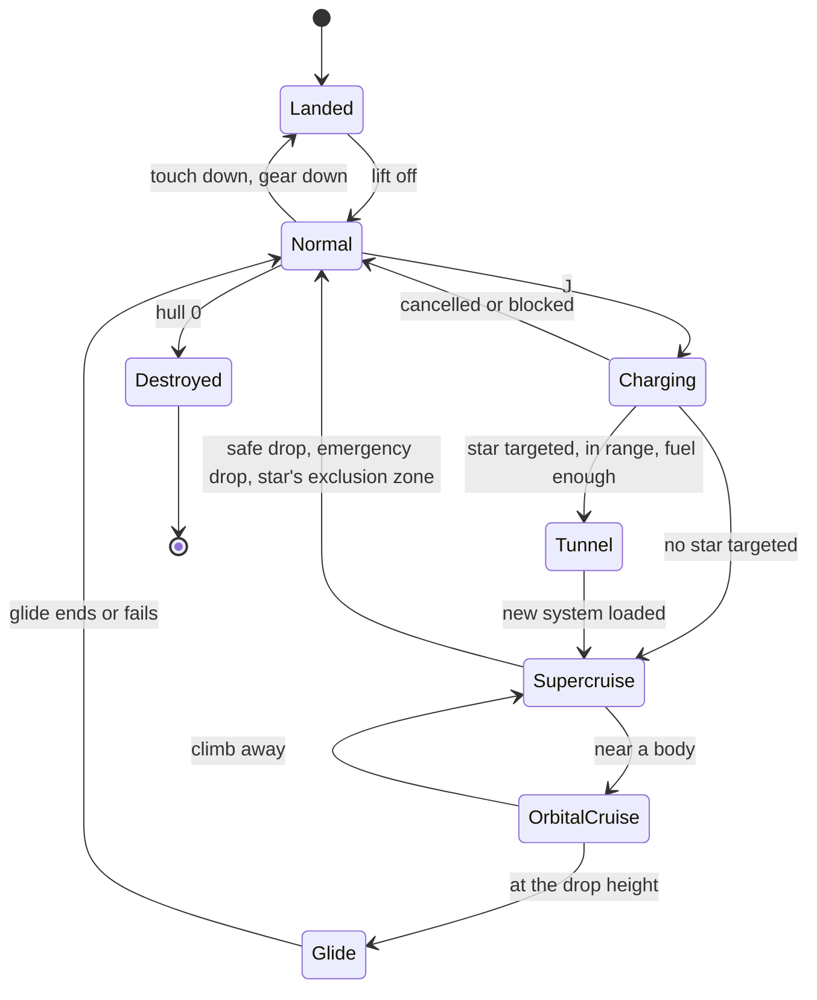

# Faulcon DeLacy Sidewinder mod

> Status: Draft · Date: 2026-11-13 · Baseline: 5f8f796
> Source: the user's request and interview of 2026-11-13, a read-only survey of the user's Elite Dangerous install
> (version `2026.10.23.334925`, Odyssey), and research against the code at the baseline.
> PLAN ONLY: no game code was written. Another session (Opus, with `/rea` then `/leader`) builds it step by step.

Line numbers are as of the baseline; those marked (survey) come from a quick code survey and must be checked before
they are relied on. Every Elite Dangerous number in this file is either quoted from a named source or marked as a
**hint** (community posts, memory): a hint says what to look for, and is never used as a final number.

## Summary

A third mod for the Q menu: the **Faulcon DeLacy Sidewinder** from Elite Dangerous. Clicking it spawns the ship in
front of you, resting on its landing gear; you walk up and press E to sit in its cockpit. From then on every key is
Elite's own default, and the ship flies by Elite's rules: thrusters with flight assist on and off, the blue zone,
boost, power pips, heat, shields and hull, supercruise, hyperspace jumps between SpaceEngine's stars, orbital cruise,
glide and landing on planets, fuel, and the two stock pulse lasers. You get the stock ship a new commander gets.

About half of Elite's data files are encrypted, and the user's rule is never to defeat DRM, so those stay closed. The
plan therefore says, part by part, how close to "byte for byte" each part can honestly get and how that is proven.

## What "byte for byte" honestly means here

The user asked for everything to be byte-for-byte accurate. Elite Dangerous is closed source, so no part of its
simulation can be compared tick by tick as Skate 3's was. Each part of the mod gets one of six grades, and every claim
in a phase's report names its grade:

| Grade | Meaning | How it is proven |
|---|---|---|
| **A. The game's own bytes** | Data taken unchanged from the open (not encrypted) files of the install: mesh vertices, texture blocks, sound packets, key bindings | A test hashes the mod's data against the install's source file |
| **B. The game's own numbers** | Numbers the game itself shows or writes: the outfitting screen (through the community's data files), the Player Journal, `Status.json` | The same number read from the user's own journal or a screenshot |
| **C. The game's own code** | A formula and its constants read out of `EliteDangerous64.exe` by offline study (the user allowed this, D3) | The function's address and our notes on it, plus a measurement that agrees |
| **D. Measured** | No code found: the rule is fitted to recordings of the real game | The mod's number beside the game's, inside the gate below |
| **E. Recreated by eye or ear** | The original is in the encrypted half, or could not be found: redrawn, re-modelled or re-recorded to match | Side-by-side pictures or recordings. No byte claim is made |
| **F. Ours** | Elite has no such thing (thick air, gas giant flight, the restock button, SpaceEngine's galaxy) | Described, tested, and labelled as not Elite's |

**The gate (D10, the user's choice):** for grades C and D a phase is done only when the mod lands inside what the
measurement itself can resolve. Steady numbers must read the same as the real game's (within 1 m/s, 1 degree a
second, 1 % heat) and timed events within 2 video frames or 2 %, whichever is larger. Anything outside is fixed or
reported as failed. **Nothing is ever tuned by feel.** Grades E and F have no gate: the user judges them.

What can never match, by nature: the galaxy (SpaceEngine's stars and planets, not Elite's), anything Elite does on
its servers (other players, missions, markets), the length of a hyperspace tunnel (it lasts as long as loading takes,
in both games), and the exact internal step of Elite's simulation.

### Grade by system

| # | System | Elite behaviour to match | How it maps onto Sandbox Engine | Best grade reachable | Proof |
|---|---|---|---|---|---|
| S1 | Exterior model and textures | The Sidewinder's hull, paint, decals, levels of detail | A sandbox object lit like props; drawn from its own model file | A for vertices and texels if found among the open files (go/no-go G1); the assembly (which texture on which part) is E | Hash test; same-angle picture beside Elite's |
| S2 | Cockpit and seat view | Interior, seat, dashboard, sticks, canopy glass, the commander's body, the eye's place and field of view | Drawn like the weapons' view models, in the nearest depth slice | A for meshes and texels if found; placement, field of view and the pilot's pose D or E | Same-view picture beside Elite's screenshot |
| S3 | Moving parts and effects | Landing gear, hardpoints, cargo scoop, heat vents, thruster flames, lights, shield flash | Part animations and effect passes of our own | E (the rigs and particle effects are not in the open files) | Side-by-side video frames |
| S4 | Sound recordings | Every recording: thrusters, boost, FSD charge, jump, supercruise, gear, alarms, lasers, the cockpit voice | Ogg files holding the game's own Vorbis packets, rewrapped without re-encoding | A for each recording matched to its stream; E (recorded from the speakers) for any that can't be found | Decoded samples equal; a list of found and not found |
| S5 | Sound behaviour | Which recordings play when, how they layer, how loudness and pitch follow thrust and speed | Our own mixer driven by the simulation's state | E, with D checks (loudness and pitch against recordings of the real game) | Recorded loudness and pitch curves side by side |
| S6 | Flight | 6-DOF thrusters, throttle, the blue zone, flight assist on and off, boost, speed and turn against ENG pips and mass | `elite-sim`, a new crate, stepped at a fixed tick | C where the code is found (G2), else D | Trace tests inside the gate |
| S7 | Rotational correction | Believed (a hint) to be the setting that matches a spinning station's turn and to do nothing away from stations | Not built: there are no stations. Step 0.9 checks whether it changes anything in open space or over a planet; if it does, it comes back into the plan | Not built | Step 0.9's check |
| S8 | Power distributor | SYS/ENG/WEP capacitors, pips, recharge, what each capacitor feeds | `elite-sim` | B for capacities and rates, C or D for the pip rule | Trace tests |
| S9 | Heat | Heat percentage, loads from modules, FSD charging, stars; warnings; damage over 100 % | `elite-sim`; hot air added by the same flux rule (F) | C or D | Trace tests |
| S10 | Shields and hull | Shield strength, recharge and rebuild, hull, collision damage, canopy breach and the life support timer, destruction | `elite-sim`; collisions against the ground and buildings | B for the numbers, C or D for the rules | Trace tests, pictures |
| S11 | Supercruise | Charge, speed against throttle and nearby masses, limits, the drop rule, emergency drops, cooldowns | `elite-sim` over SpaceEngine's bodies and their masses | C or D | Trace tests replaying the Elite body's own mass and distance |
| S12 | Hyperspace | Target, charge, countdown, tunnel, arrival at the star, fuel, cooldown | A jump between SpaceEngine's stars; new code that swaps the loaded system | B for fuel (the journal gives it to six digits), C or D for times; the tunnel's look E | Fuel test against the journal; timings |
| S13 | Planet approach | Orbital cruise, glide, the drop to normal flight | The same rules on every solid body and on gas giants (D7) | C or D on worlds Elite allows; F where it doesn't | Trace tests replaying the Elite moon's own radius and gravity |
| S14 | Landing | Gear, speed limits, touchdown and liftoff rules, gravity against thrusters | `elite-sim` against the sandbox's ground | C or D | Trace tests, pictures |
| S15 | Fuel | Tank, reservoir, burn by power draw, fuel per jump. The stock ship has no scoop | `elite-sim`; the restock button is F | B (`Status.json` gives fuel exactly) | Fuel test |
| S16 | HUD and panels | Canopy HUD, radar, left and right panels, lower panel, messages | Redrawn to match screenshots (D12) | E for the look; the numbers shown are the simulation's | Same-view pictures |
| S17 | Controls | Elite's default keyboard, mouse and gamepad schemes | Read from copies of Elite's own `.binds` files | A for the bindings; C or D for how the mouse becomes stick movement | Test against the install's files |
| S18 | Weapons | Hardpoints, two pulse lasers: rate, heat, WEP drain | `elite-sim`; beams hit the ground, props and buildings | B for numbers, E for the beam's look | Trace tests, pictures |
| S19 | Getting in and out | Odyssey's boarding and Disembark | E to board, the lower panel or B to leave (D8) | F with E for look and sounds | Pictures |
| S20 | Thick air, gas giants | Elite has none | Real drag and hot-air heat in thruster flight; giants enterable (D7) | F | Described and tested |

## What the user must do

| # | Step | When | Until it's done |
|---|---|---|---|
| U1 | **Done 2026-11-14.** Buy a stock Sidewinder in Elite (32,000 cr) and leave it stock | Before step 0.7 | Steps 0.1 to 0.6 go ahead without it |
| U2 | For each measuring session: start Elite, log in, enter **Solo**, sit in the Sidewinder where the step asks (open space; a small airless moon; near a star). Then say so. The agent never types a password and never uses a station, so refuelling and repairing the real ship between sessions is yours too | Steps 0.7 to 0.9, 2.4, 5.1, 6.1 and any re-measure | That step waits; the builder works on another |
| U3 | Say yes or no to each install when asked: ffmpeg (already agreed, D4), a Wwise Vorbis decoder (vgmstream or ww2ogg), the REA tools `/rea` needs | Phase 0 | The step that needs the tool waits |
| U4 | Read Frontier's EULA on three points: sharing game files, reverse engineering, and automated input. It could not be fetched from here (403). Decisions D2, D3 and D4 stand unless you change them | Any time | Nothing changes |
| U5 | Fly each phase and say whether it feels like Elite (grades E and F have no other judge) | End of each phase | The builder carries on |
| U6 | Give the go for any push or public release. The mod's files are Frontier's (D2) | When you choose | Nothing is pushed |

## Goals / Non-goals

**Goals**

- A Mods-tab entry that spawns one Sidewinder in front of the player, and E to board it.
- The stock ship (the loadout below), with Elite's rules for everything in the table above.
- Elite's default keyboard and mouse controls first, its default gamepad layout later, both read from Elite's files.
- Free "Refuel, repair, restock" from the Q menu while landed (D5).
- Every solid world and every gas giant can be approached and flown on; stars keep Elite's rules (D7, D11).
- Every claim graded and proven as above. The mod off, or never spawned, costs nothing.

**Non-goals (this plan; the "later" list)**

- Opening, decrypting or working around the encrypted `FREA` files in any way: no key from the exe, no reading the
  running game's memory, no grabbing models off the graphics card. This is not "later": it is never.
- Stations and docking, rotational correction, the galaxy map and system map screens, scanners (honk, FSS, surface
  probes) (D6). Other ships, combat targets, interdiction, missions, credits, cargo trading, the SRV, multicrew, wings.
- Outfitting, engineering, other ships than the Sidewinder, a fuel scoop.
- Elite's outside camera suite; saving the ship between launches; more than one Sidewinder at once (D12).
- Joysticks, HOTAS, a rebinding screen (D9).
- Wind, wind noise, lift, and pressure damage in thick air.

## Users & permissions

| Role | Can | Cannot |
|---|---|---|
| The player | Spawn, board, fly, land, leave, restock; play without Elite installed (the files ship with the mod, D2) | Rebind keys; keep the ship across launches |
| The measuring agent (Sonnet, high effort) | Press flight keys in the user's running Elite in Solo, take Elite's own screenshots (F10), run the recorder, read the journal and `Status.json` | Type credentials; leave Solo; spend credits, buy, sell or change the loadout; open station services; use chat or anything touching other players; use the computer-use screenshot tool (it stalls on this PC); read the game's memory or inject anything. It stops and reports if a menu, another player or anything unexpected appears |
| The builder (Opus) | Read Elite's open files and its exe offline; write the mod | Open `FREA` files; run or change Elite's install; push or release |

## Evidence sources

| # | Source | What it gives | How reliable | Limits |
|---|---|---|---|---|
| E1 | The install's open data files (`Win64/0?/`) | Mesh data, texture data, sound streams | The game's own bytes | No names, no assembly; formats undocumented; see Assets |
| E2 | The install's plain files: `ControlSchemes/*.binds`, `GraphicsConfiguration.xml`, `AudioConfiguration.xml`, `DeviceDefaults.xml` | Default controls for every device; graphics limits; that the audio engine is Wwise | The game's own bytes | The field of view and mouse feel are not in them |
| E3 | `EliteDangerous64.exe`, studied offline with Ghidra through `/rea` | The client's formulas and constants: flight, supercruise, glide, heat | High for what is found. The exe is not packed (code section entropy 6.5, no protector strings) and keeps readable names (`ApproachGlide_FailedTooShallow`, `FlightAssistFinal`, `UpdateSupercruiseState`, `OutfittingFieldType_EngineOptimalMass`) | 98.7 MB of code: slow. Ship and module numbers may be loaded from the encrypted files and so be absent |
| E4 | The Player Journal and `Status.json` (Frontier's own documented files, in `Saved Games\Frontier Developments\Elite Dangerous`) | `Loadout` (every module's exact name, masses, jump range), `FSDJump` (distance, fuel used, fuel left), `StartJump`, `SupercruiseEntry/Exit`, `ApproachBody`, `Touchdown`, `Liftoff`, `HeatWarning`; flags for gear, shields, supercruise, FSD charging, glide; pips; fuel; latitude, longitude, altitude and heading near a body | The game's own numbers | No speed, no turn rate. Events are stamped to the second; `Status.json` is rewritten only when something changes. Re-check the field list against the docs in step 0.8 |
| E5 | Video of the cockpit at 60 frames a second, with the speakers recorded (`.audit/tools/loopback`) | The speed readout (whole m/s), throttle bar, heat %, capacitors, supercruise speed, distance and time to target; turn rates from the stars' motion; every timing to 1/60 s | Good to the readout's own resolution | Readouts may lag or be smoothed: cross-check against distance flown |
| E6 | Elite's own screenshots (F10) | The look of the ship, cockpit and HUD for side-by-side pictures | The game's own pictures | |
| E7 | EDCD `coriolis-data` (GitHub, last commit 2026-04-24; raw files saved in `re/elite/community/coriolis-data/` on 2026-11-13) | Ship and module numbers as the outfitting screen shows them | High for those numbers; confirm the loadout against U1's `Loadout` event | Its formulas (speed against pips and mass, jump range) are the community's own fits: medium, to confirm by measurement |
| E8 | EDSY, the wiki, forum research threads | Hints: what to measure, rough sizes of effects | Low to medium | Never a final number |

**Not sources:** the encrypted files, the running game's memory, a frame capture from the graphics card, fan-made
or ripped models found online.

### The community's numbers for the stock ship (E7, grade B, read from the raw files)

| Thing | Value |
|---|---|
| Sidewinder | hull mass 25 t; speed 220 m/s; boost 320 m/s; minimum thrust 45.454 %; boost cost 7; boost interval 4; pitch 42, roll 110, yaw 16 degrees a second; heat capacity 140; base shield 40; base armour 60; hardness 20; mass lock 6; reserve fuel 0.3 t; 1 seat |
| Bulkheads | Lightweight Alloy: mass 0, hull boost 0.8 |
| Power plant 2E | 6.4 MW; mass 2.5 t |
| Thrusters 2E | minimum, optimal, maximum mass 24, 48, 72 t; multipliers 0.83, 1, 1.03; power 2; mass 2.5 t |
| Frame shift drive 2E | optimal mass 48 t; most fuel a jump 0.6 t; fuel multiplier 0.011; fuel power 2; power 0.16; mass 2.5 t |
| Life support 1E | 300 s; power 0.32; mass 1.3 t |
| Power distributor 1E | SYS 8 at 0.4/s; ENG 8 at 0.4/s; WEP 10 at 1.2/s; power 0.32; mass 1.3 t |
| Sensors 1E | range 4; power 0.16; mass 1.3 t |
| Fuel tank 1C | 2 t |
| Shield generator 2E | regeneration 1, broken regeneration 1.6; distributor draw 0.6; masses 28, 55, 138 t; multipliers 0.3, 0.8, 1.3; power 0.9; mass 2.5 t |
| Pulse laser, small | Coriolis lists the stock pair as gimballed (id 18): damage 1.56, fire interval 0.25 s, distributor draw 0.31, thermal load 0.31, range 3000 m, mass 2 t. Fixed (id 17): 2.05, 0.26 s, 0.30, 0.33. **Which pair a new ship carries is settled by U1's `Loadout` event** |
| Other stock internals | Cargo rack 2E (4 t), Advanced Planetary Approach Suite |
| Worked out, not measured | Mass with a full tank about 44.9 t; longest jump about 7.9 light years (`sqrt(0.6 / 0.011) x 48 / 44.9`) |
| **The user's own ship (journal `Loadout`, 2026-11-14, game 4.4.2.1, grade B)** | Bought stock: unladen mass 42.9 t, cargo 4 t, fuel 2.0 t main and 0.3 t reserve, `MaxJumpRange` 8.149506 ly. That is exactly `sqrt(0.6 / 0.011) x 48 / (42.9 + 0.6)`, so the community's jump formula and the 2E drive's numbers hold. Modules as the table above, the lasers gimballed, plus two the community file does not list as stock: a **supercruise assist** and an **advanced docking computer** in the two size 1 slots. Voice: Verity. The same journal holds 6 `FSDJump`, 3 supercruise entries and exits and 1 `HeatWarning` to use as first data |

## Assets: how Elite stores them (surveyed 2026-11-13, read only)

`D:\SteamLibrary\steamapps\common\Elite Dangerous\Products\elite-dangerous-odyssey-64\Win64` holds 102,957 files in
folders `00` to `0f`, each named by 40 hex digits (the folder is `0` plus the name's first digit). `data.ovx` lists
every name with a 128-digit checksum: an integrity list, not a table of readable names.

| Kind | Files | Size | What the survey found | Usable? |
|---|---|---|---|---|
| `FREA` | 54,320 | 10.9 GB | Every file is a 6-byte header (`FREA`, two zero bytes) plus an exact multiple of 16 bytes, and the bytes are statistically random. That is a block cipher: **encrypted** | **No. Never opened** |
| zlib, inner kind `02 00 01 00` | 22,008 | 12.0 GB unpacked | Runs of 16-bit triangle indices: mesh data. The vertex layout is not yet known | Yes |
| zlib, inner kind `03 00 01 00` | 26,248 | 57.6 GB unpacked | Sizes are sums of block-compressed mip levels (1,310,720 bytes is a 1024 and a 512 level at a byte a pixel), with the byte patterns of such blocks: texture data | Yes |
| RIFF | 381 | 12.5 GB | Wwise Vorbis (format tag `0xFFFF`), many streams back to back in each file on 4,096-byte boundaries | Yes, with a public Wwise Vorbis decoder (a codec, not a lock) |
| Plain files outside `Win64` | | | Bindings and settings XML, shader archives, `.webm` movies | Bindings and settings: yes |

What the open files do **not** hold: any readable name ("sidewinder" appears in none of the 48,256 zlib files, as
ASCII in all of them and as UTF-16 in a sample of 300), any Wwise sound bank, any material, skeleton, animation,
particle effect, font or HUD artwork that the survey could see. By elimination those are in the encrypted half; that
is an inference, since the encrypted half was not opened.

So: **reading the shapes, textures and sound recordings needs no decryption. Knowing which of them are the
Sidewinder, and how they go together, does.** The plan's answer (D1): find them by looking and listening, rebuild the
assembly to match pictures of the real game, and recreate what can't be found, labelled as recreated.

The survey's tools and results are in `re/elite/` (out of git): `tools/survey.py`, `tools/probe_open_files.py`,
`catalog/open_files_2026.10.23.json` (every file's kind and sizes), `catalog/survey_summary.txt`.

**How other games' files were handled before:** Megaton Rainfall, Garry's Mod and Skate 3 were each converted once on
the user's PC into the project and shipped, on the user's decision each time; GTA V's encrypted archives were never
opened. For Elite the user chose the same (D2): converted once into `crates/se_engine/assets/mods/sidewinder`,
committed and shipped. This is the riskiest of the four: Elite is a live paid game and the repository is public
(GPL-3.0). The files are Frontier's whatever licence the code has; `SOURCES.txt` in the mod's folder says so.

## Controls

Read from the install's `ControlSchemes/KeyboardMouseOnly.binds` (grade A). While seated these replace every sandbox
and port key.

| Elite action | Default | Note |
|---|---|---|
| Pitch, roll | Mouse Y, mouse X | `MouseXMode` roll, `MouseYMode` pitch, no decay, dead zone 0.05, sensitivity 1, linearity 1 |
| Yaw | A, D | |
| Thrust left, right, up, down | Q, E, R, F | Q and E are thrust while seated, not menu and board |
| Throttle up, down; zero | W, S; X | |
| Flight assist | Z | |
| Boost | Tab | |
| Frame shift drive (supercruise, or the jump if a star is targeted) | J | |
| Landing gear; cargo scoop; ship lights | L; Home; Insert | |
| Hardpoints; fire primary, secondary; next fire group | U; left, right mouse button; N | |
| Pips to ENG, WEP, SYS; reset | Up, Right, Left; Down arrow | |
| Silent running; heat sink | Delete; V | Delete is `ToggleButtonUpInput` in the file, believed to be silent running: confirm in step 2.2. No heat sink launcher on the stock ship: V does nothing |
| Target ahead; next target; highest threat | T; G; H | Nothing to target but bodies |
| Left, comms, lower, right panel | 1, 2, 3, 4 | |
| UI focus; panel moves; select; back | Left Shift; W A S D; Space; Backspace | Tabs with Q and E |
| Head look | Middle mouse button | |
| Orbit lines | = | |

How it fits beside the game's own keys:

- **On foot:** nothing changes. E boards when you look at the ship from within reach; otherwise E is still "use".
- **Seated:** `sidewinder::read_input` (PreUpdate, placed as `skate::read_pad` is: after the input systems and
  `viltrumite::dev_keys`, before `sandbox::read_input`) takes every bound key and clears its press, so the port's
  readers (1 to 4 flight modes, G, T, H, P, Tab, the arrows, V) never see them.
- **Esc** stays the sandbox's main menu. **B** is the one key added: get out, only when landed (D8). In Elite's
  defaults B has no ship action (checked in the file: it is bound only to three on-foot actions). M (Elite's HUD mode
  switch) does nothing here: the analysis mode belongs with the scanners, on the later list.
- The Q menu is not reachable while seated; get out first. V (free flight) is off while seated.
- **Gamepad (a later phase):** `ControlPad.binds`: left stick pitch and roll, right stick thrust left/right and
  up/down, bumpers throttle, B boost, triggers fire, D-pad pips, X UI focus, Y target, Back hardpoints, right stick
  click head look. Read through the gamepad path the Skate 3 mod uses.

The mod ships copies of the two `.binds` files and reads its key table from them (so a test can compare them with the
install's). How mouse movement becomes stick movement is not in the file: it comes from the exe (C) or from
measurement (D).

## Architecture

```
crates/elite-sim/                 NEW crate. The ship's rules. No Bevy, no files, f64, a fixed tick.
  src/data.rs                     the stock ship's numbers, each with its source and grade in a comment
  src/flight.rs distributor.rs heat.rs shields.rs fuel.rs fsd.rs supercruise.rs approach.rs landing.rs weapons.rs
  src/sim.rs                      Sim::step(input, world) -> events; World is a trait the game implements
  src/trace.rs                    reads and writes trace files (CSV, numbers only)
  tests/traces/                   measured traces of the real game, scrubbed (no commander name), in git
crates/se_core/src/elite.rs       NEW. Readers for Elite's open containers (meshes, textures, sound packs).
                                  Refuses a FREA file by its header. Used only by the converter and tests.
crates/se_core/src/elite_asset.rs NEW. The mod's own model format (.edm) and the .binds reader.
crates/se_engine/src/sidewinder/  NEW module, as skate/ is:
  mod.rs      the plugin, the assets, the parked ship, spawn, board, leave, restock, dev commands
  pilot.rs    seated: frames, camera, ground and building contact, the hand-overs
  input.rs    bindings to simulation input; takes the keys
  draw.rs     exterior, cockpit view model, materials, lights
  hud.rs panels.rs   the canopy HUD and the panels
  sound.rs    the mixer and the voice
  fsd.rs      the tunnel and the swap to the new star system
  fx.rs       thruster flames, shield flash, lasers
  convert.rs  #[cfg(test)]: copy_sidewinder, the converter
crates/se_engine/assets/mods/sidewinder/   the mod's files (below)
crates/se_engine/assets/shaders/sidewinder_*.wesl
re/elite/                         out of git: tools, the catalog, Ghidra notes, raw recordings, the community's files
docs/elite-flight-model.md        in git: each rule in our own words, its formula, constants, grade and source
```

**Why a separate crate:** as `skate-sim`: it runs and is tested without the game (`cargo test --release -p
elite-sim`), cannot reach into Bevy, and its trace tests are the proof.

**Reuse or replace.** The port's own flyable ships (`ship.rs`, `ship/`) are SpaceEngine's ship rules: one 500-line
`ship_physics`, SE's warp, HUD, autopilot and `.sm` models. The Sidewinder **replaces** all of that for itself and
must never set `Flight::active`, because `mods::off_for_pilot_or_script` (`mods.rs:684`) turns every mod off while an
SE ship is flown. What it **reuses**:

| Need | Reused piece |
|---|---|
| Riding a turning, orbiting body; handing over between near-ground and space | `viltrumite/frames.rs` (`Frame::Attached` / `Free`, `carry` then `advance`), `ship.rs:512` `frame_terms`. Its gotchas apply unchanged (CLAUDE.md "The hero's motion") |
| The ground's height | `ship.rs:2091` `ground_on`, and the sandbox's ground field while parked |
| Solid buildings and trees | `scatter/probe.rs` `ProbeAsk`, `viltrumite/solid.rs`, `sandbox/solids.rs` |
| Light on the ship and cockpit | The hero's light pass and `LightProbe` (`viltrumite/draw.rs:317`), as the props and the skater use |
| Air density and temperature | `viltrumite/air.rs:149` `AirModel` |
| A model drawn in front of everything with its own field of view | `sandbox/viewmodel.rs` |
| Spawning where you look; the parked ship as a solid thing | `sandbox/props.rs:41` `handle_requests`, `sandbox/world.rs` |
| Mods list, file checks, grey rows | `mods.rs` (`KNOWN_CODES` :28, `apply_request` :692, `check_inside` :215) |
| Stars within reach | The star browser's search (`search LY`) |
| Loading another star's system | `system.rs:561` `select_active_system` (it follows the camera's nearest star and builds in the background) |
| Key presses in tests | `hero keys` (`viltrumite::dev_keys`) |

**Hyperspace is new work.** The port has no jump between stars: only the camera's Go To. A jump moves the ship and
camera to the arrival point by the target star while the tunnel hides the view, waits until `select_active_system`
has entered the new system, then ends the tunnel. Go/no-go G4 is whether that swap can be made to wait cleanly.

**The mod's files** (`crates/se_engine/assets/mods/sidewinder/`, written only by the converter, never by hand):

| File | Holds | Grade |
|---|---|---|
| `mod.cfg` | `Name "Faulcon DeLacy Sidewinder"`, `Description`, `Code "sidewinder"`, a `Need` for every file | |
| `SOURCES.txt` | For every file: the Elite file names it came from, Elite's version, its grade; or "recreated" and how. States that the files are Frontier Developments' | |
| `ship.edm`, `cockpit.edm` | Parts with names and parents, draws, vertices and indices as Elite has them, materials naming textures, keyed part animations | A for geometry, E for assembly and animation |
| `tex/*.dds` | Elite's own block-compressed data and mips in a DDS wrapper, read by `se_core::dds::parse_dds` | A |
| `sfx/*.ogg`, `voice/*.ogg` | Elite's Vorbis packets rewrapped as standard Ogg, not re-encoded | A; E for re-recorded ones |
| `hud/*` | The HUD's redrawn artwork and fonts | E |
| `binds/KeyboardMouseOnly.binds`, `binds/ControlPad.binds` | Copies of Elite's files | A |

No file over 90 MB (GitHub refuses 100 MB): bigger sets become packs in pieces, as `assets/gmod` is. The converter is
`cargo test -p se_engine --release copy_sidewinder -- --ignored --nocapture`; `ELITE_PATH` names the install. It
reads every file back and fails if anything is missing. Elite's install is never read while the game runs.

**Run-time state:** one `Sidewinder` resource: the parked ship's body and place in the body's frame, the
`elite_sim::Sim`, whether the player is seated, and the loaded `SidewinderAssets`. `sandbox::Mode` gets `Pilot`;
`ModControl` gets `pilot` (so `panels_hidden`, the cursor and the menus behave as for the other mods).

## Flows

### F1. Spawn

1. In the Q menu's Mods tab the row "Faulcon DeLacy Sidewinder" shows **Spawn**. First use checks every `Need` and
   loads the files on a worker thread (the Skate 3 mod's 0.3 s hitch came from loading on the main thread).
2. A click turns any other mod off, then puts the ship where you look: on the ground, gear down, nose towards you,
   its middle at least 18 m away, at the first place along the view within 60 m that is clear of buildings. If none
   is, a message says there is no room. A second click removes the old ship and spawns a fresh one (D12).
3. Parked, it is a solid object in the sandbox's world: you can walk round it, under it and onto it; props bounce off.
4. With a ship parked and landed the row also shows **Refuel, repair, restock** (free: fuel, hull, modules, canopy
   and shields back to full).

### F2. Boarding and leaving

1. On foot within 6 m of the hull, looking at it, a prompt shows as in Odyssey; E boards. The screen fades, Elite's
   boarding sounds play, and you are in the seat with the ship powered and landed.
2. Leaving: only when landed. Either the Disembark entry on the lower panel (its exact place and wording are copied
   from the real game in step 4.3) or B. You stand beside the ship; the sandbox sets the walker down there, on
   whatever body it is.
3. Both hand-overs follow the sandbox's camera rule: whoever stops writing the camera writes it once more in that
   frame and leaves it bound to the body (CLAUDE.md, the 500 m a frame gotcha).

### F3. Flight modes



Each rule inside these modes (speeds, limits, times, what blocks the drive, when a glide fails) is taken from the exe
or from measurement in the step that builds it. The hints the builder starts from, none of them final: FSD charge
about 15 s; countdown 5 to 1; supercruise from 30 km/s to 2001 c, slowed by nearby masses; the drop rule (under about
1,000 km and 1,000 km/s; keeping about 7 s to target at 75 % throttle); glide at 2,500 m/s between about -5 and -60
degrees from about 25 km; cooldown about 10 s after a drop; best turning at half throttle.

### F4. Where Elite's rules are stretched (F: ours)

- **Every solid world** is treated as Elite treats a landable one, Earth included. The sea is ground, as on foot.
- **Gas giants** have no exclusion zone. Orbital cruise and glide work against the giant's radius; below it the ship
  flies on thrusters in ever denser, hotter air down to the port's own floor (10 scale heights under the radius),
  which stops it. It can't land there.
- **Real air acts only in thruster flight**, never in supercruise, orbital cruise or glide. Drag is
  `0.5 x density x speed² x area x 1.0` against the motion, with the area taken from the converted hull's own outline
  along that direction and density from `AirModel`. Flight assist fights drag as it fights gravity, so the top speed
  in thick air comes out lower by itself. Nothing here is tuned.
- **Hot air heats the ship** through Elite's own rule for a star's heat: the air's heat flow is turned into a flux
  and fed to the same function. If that rule can't be recovered from the exe (step 5.1), hot-air heat is left out and
  reported, not invented.
- **Stars** keep Elite's rules: heat by distance, the exclusion zone that ends supercruise (D11).
- **Time:** the ship runs on real seconds, as the hero does. The game clock's keys are off while seated.

### F5. Hyperspace over SpaceEngine's stars

1. The left panel's Navigation tab lists the bodies of this system and the stars within the ship's jump range, from
   SpaceEngine's catalog, nearest first. Selecting a star targets it.
2. J charges the drive if the star is in range for the fuel aboard and not hidden behind a body. Fuel for the jump is
   Elite's formula with SpaceEngine's distance: `0.011 x (distance x mass / 48)^2` tonnes, at most 0.6.
3. Countdown, then the tunnel. Behind it the camera moves to the arrival point and the new system loads. The tunnel
   lasts until it has, as Elite's lasts until its own loading ends.
4. Arrival in supercruise facing the star, at the distance Elite's rule gives for a star of that size, then the
   cooldown.

### F6. Damage and the end of a ship

Collisions with the ground and buildings take shields, then hull, by Elite's rule. Heat over the limits damages
modules and hull. A broken canopy starts the life support timer (300 s on the stock ship). Hull 0 or the timer's end
destroys the ship with Elite's sequence; the player is then on foot on Earth (the main menu's own way back) and
spawns a new ship from the Q menu.

## Edge cases & failure handling

| Case | Expected behaviour |
|---|---|
| The mod's folder or a `Need` is missing or wrong | The row is grey with the reason, as the other mods |
| Elite not installed on a player's PC | No effect: the mod runs from its shipped files |
| A `FREA` file is handed to the reader | Refused by its header, with a message; a test proves it |
| Elite updates and its file names change | The converter reports which sources are gone and stops; `SOURCES.txt` names the version it was made from |
| No room to spawn | Message; nothing spawned |
| Spawn while seated | Not possible: the Q menu is closed while seated |
| Another mod turned on while the ship is parked | The ship stays parked. Boarding turns the other mod off first |
| E pressed near the ship while holding a prop | Boarding wins only when the look ray hits the ship; otherwise "use" as before |
| B or Disembark while flying or in space | Refused with Elite's own kind of message; nothing happens |
| Esc, then Play, while seated | The player is put on Earth on foot (as today). The ship stays where it was; if that was in flight it is lost and a new one is spawned |
| The player walks or flies far from the parked ship | It keeps its place on its body and is drawn again when near. Like props it is not simulated far away |
| Landing on a slope too steep, or too fast | Elite's rule: no touchdown, or damage. On F-grade worlds the same rule |
| Fuel runs out | Elite's rule (the ship loses power). Restock needs a landing, so in space the ship is lost |
| Jump target out of range, hidden, or too little fuel | The drive refuses, with Elite's message |
| The new system fails to load within 60 s | The tunnel ends back at the old star with a message; fuel is not taken |
| The game clock is paused or sped up when boarding | It is set to real time, running, and given back on leaving |
| Frame rate drops | The simulation keeps its fixed tick, at most 6 ticks a frame (as the Skate 3 mod), the rest dropped |
| Alt-tab while seated | Mouse input stops; the ship flies on by its own rules (Elite does not pause either) |
| A test run | The row works with `mods on sidewinder`; no dialog, nothing written to the user's folders |
| `SE_MODS=0` | The mod is hidden with the others |

## Security & privacy

| Risk | Handling |
|---|---|
| Defeating Elite's encryption | Never. The reader refuses `FREA`; no key search in the exe; no memory reads; no graphics capture. The exe study is of code only |
| The user's Elite account | The agent acts only as the Users table allows, in Solo, after the user has logged in. Automated key presses in a live game may be against Frontier's terms: the user's decision (D4), and U4 asks them to read the terms |
| The user's journal holds their commander's name and account details | Raw journals, `Status.json`, videos and screenshots stay in `re/elite/measure/raw` (out of git). Only numbers go into `tests/traces/`; a test fails if a trace holds the word "Commander" or any letters outside its header |
| Publishing Frontier's files and notes on its code | The user's decision (D2, D3). `SOURCES.txt` and the README credit Frontier Developments. Decompiled code stays in `re/` (out of git); `docs/elite-flight-model.md` holds formulas in our own words. Pushing and releasing are the user's step (U6) |
| Files the mod loads | Checked on first enable as the other mods' are (`check_inside` gets the new extensions); a sound goes through `mods::check_sound` |
| Installs | Asked one at a time (U3), from official sources, logged in PROGRESS.md |

## Integrations

- Elite Dangerous's install: read only, by the converter and tests. Never at run time. Never changed.
- Elite Dangerous running: only in measuring steps, driven as the Users table says.
- SpaceEngine's install: as today.
- No network use by the mod.

## Non-functional requirements

- The mod never spawned: no systems run (run conditions), nothing loaded, the picture bit for bit as before.
- A parked ship: aim under 0.2 ms a frame. Seated with the full HUD: aim under 1.5 ms at the user's settings
  (3440x1440, Ultra clouds), measured with `SE_PERF`.
- No GPU objects made per frame; per-frame values go in buffers written in place (CLAUDE.md "Never change a Bevy
  material asset every frame", "Slowdowns over a session").
- Loading on a worker thread; no hitch over 50 ms when spawning or boarding.
- Plain-language notes: README gets a "Faulcon DeLacy Sidewinder" section with the keys; CLAUDE.md its gotchas;
  PROGRESS.md the state after every step.

## Codebase impact

| Where | Change |
|---|---|
| `Cargo.toml` (workspace) | Add `crates/elite-sim` |
| `crates/se_core/src/lib.rs` | `elite`, `elite_asset` modules |
| `crates/se_engine/src/mods.rs:28` | `"sidewinder"` in `KNOWN_CODES` |
| `mods.rs:115` `ModControl`, `:168` `off` (survey) | A `pilot` flag, cleared by `off` |
| `mods.rs:215` `check_inside` | Checks for `.edm` and `.binds` |
| `mods.rs:692` `apply_request` | The first-enable branch: load `SidewinderAssets`, then ask the sandbox to spawn |
| `sandbox/menu.rs:143` `mod_rows` (survey) | The row's Spawn and Restock buttons |
| `sandbox/mod.rs:109` `Mode` | `Pilot` |
| `sandbox/mod.rs:153` `Request` | A request to spawn the ship |
| `sandbox/mod.rs:497` `read_input`, its `HIS` list near :603 (survey) | E boards before "use" when the ray hits the ship |
| `sandbox/mod.rs:756` `sandbox_step` | The hand-over to and from `Pilot`, at the end of the step as for V |
| `sandbox/weapons.rs:426` (survey) | "Use" yields to boarding |
| `sandbox/world.rs:18` | A collision group or collider kind for the parked ship |
| `sandbox/main_menu.rs:269` `restart_on_earth` | Leaves the seat first |
| `camera.rs` near :1769 (survey) | The `sw` dev command |
| `viltrumite/frames.rs` | Used as it is; if it must move to a shared place, the hero's traces must stay identical |
| `system.rs:561` | A way to ask "has the system at this star been entered?" |
| New | `crates/elite-sim`, `se_core/src/elite.rs`, `elite_asset.rs`, `se_engine/src/sidewinder/`, the shaders, the mod's folder, `docs/elite-flight-model.md` |

Dev commands (`sw ...`): `spawn`, `board`, `leave`, `state`, `restock`, `trace FILE` (a line a tick, the same columns
as the measured traces), `stick PITCH ROLL YAW SECS`, `throttle X`, `pips S E W`, `fa on|off`, `gear`, `sc on|off`,
`jump NAME`, `heat X`, `hull X`. Keys are pressed with `hero keys`.

## Implementation order

Each step is one session: it builds, passes the tests, is checked and committed before the next (CLAUDE.md). A step's
report lists every claim with its grade and, for C and D, the game's number beside the mod's.

### Phase 0: evidence (run with `/rea`). Nothing playable yet

| # | Step | Proven by | Done when | Needs |
|---|---|---|---|---|
| 0.1 | The mesh reader (`se_core/src/elite.rs`): unpack the `02 00 01 00` kind and work out its vertex layout from the data alone. A catalog of every mesh with its size | A contact sheet of a few hundred meshes drawn from three sides | **G1:** meshes draw as recognisable things. If the layout is not worked out in this one session, the model goes to the recreate route (step 0.5) and the user is told | |
| 0.2 | The texture reader (the `03 00 01 00` kind: formats and sizes from the data) and the sound-pack reader (split a pack into its streams, decode one) | Contact sheets of textures; one sound decoded and played | Textures open as pictures and a stream plays, or each is named as not readable | U3 (the decoder) |
| 0.3 | Find the Sidewinder's exterior: filter meshes by size (the ship is about 15 x 21 x 5 m: a hint), draw candidates, pick by eye against Elite's screenshots; then its gear, hardpoints, scoop | The found hull drawn from the same angle beside Elite's own screenshot; the source file names listed in `re/elite/notes/` | The hull and its parts are found, or named as not found | 0.1 |
| 0.4 | Find the cockpit (interior, seat, sticks, canopy, the pilot's body) and the textures of hull and cockpit, by how each texture's features fit a mesh's UV layout and by eye | Textured pictures beside screenshots | Each piece is found or named as not found | 0.2, 0.3 |
| 0.5 | Only if something was not found: recreate it in Blender to match Elite's screenshots (a session a piece: hull, cockpit). **Until a piece is done a stand-in is used** (a plain grey hull of the ship's size; a bare seat and canopy frame), so Phase 1 never waits on this step | The recreated piece from the same angle beside Elite's screenshot, marked "recreated" in `SOURCES.txt` | The user says it will do | 0.3, 0.4 |
| 0.6 | The sound index: split every pack, decode every stream, store a short fingerprint of each | Counts: streams found, decoded, failed | The index covers all 381 packs | 0.2 |
| 0.7 | Match the sounds: record each wanted sound and voice line from the real game with the loopback tool, find its stream in the index by correlation | For each sound: found (its file, offset and match score) or not found | **G3:** the list covers every sound named in S4. One session; what is not matched by its end is re-recorded from the speakers (grade E) | 0.6, U1, U2 |
| 0.8 | The measuring rig: ffmpeg at 60 frames a second with the speakers, a reader for the cockpit's digits and bars, a journal and `Status.json` logger, the agent's script and its stop rules; settle how pitch and roll are driven (Q11) | One manoeuvre (full throttle from rest, then stop) measured three times agrees with itself inside the gate | The rig repeats itself, or the report says by how much it doesn't | U1, U2, U3 |
| 0.9 | First measurements, normal space: speed at 0 to 4 ENG pips, acceleration and braking, boost, pitch, roll and yaw rates against throttle, flight assist off, sideways, vertical and reverse speeds; whether rotational correction does anything away from stations (S7) | Each manoeuvre flown twice, agreeing inside the gate | The traces and a table of results exist in `re/elite/measure/normal-space` and, scrubbed, in `crates/elite-sim/tests/traces` | 0.8 |
| 0.10 | Exe study, first session: a Ghidra project for Elite's exe; from the names it keeps, find where the ship's motion is stepped: thrusters, flight assist, the speed limit | Each rule found predicts 0.9's traces inside the gate | `docs/elite-flight-model.md` has a row for each rule looked for: C with its address, or "not found yet" | 0.9 |
| 0.11 | Exe study, second session: the blue zone, boost, the pip rule, the mass curve, how the mouse becomes stick movement | As 0.10 | **G2:** every flight rule is C (found) or D (to be fitted from 0.9's traces). **A rule not found by the end of this session is D**: no third session is spent on it. Either way Phase 1 can start | 0.10 |

### Phase 1: the smallest playable slice

| # | Step | Proven by | Done when | Needs |
|---|---|---|---|---|
| 1.1 | The converter and the parked ship: `copy_sidewinder`, the `.edm` format, `mod.cfg`, `KNOWN_CODES`; the Mods row; the ship spawned in front of you, lit like the props, solid | Hash tests (geometry and texels equal the install's, for every piece that was found); pictures by day, at night and under cloud beside Elite's screenshots | You can spawn it and walk round it | 0.3, 0.4 (0.5's stand-ins if needed) |
| 1.2 | `elite-sim`: normal-space flight only (thrusters, throttle, blue zone, flight assist, boost with the ENG capacitor at Elite's default pips, gravity, speed limits), fixed tick | `cargo test --release -p elite-sim`: every trace of 0.9 replayed inside the gate | All traces pass, or each failure is listed with its numbers | 0.9, 0.11 |
| 1.3 | Boarding and flying: E, the fade, `Mode::Pilot`, the cockpit drawn with head look, Elite's keyboard and mouse from the `.binds` copy, frames, contact with ground and buildings, a plain touchdown, B to leave, a bare speed and throttle readout | The mod's own `sw trace` of 0.9's manoeuvres, flown in the game, inside the gate; pictures from the seat beside Elite's; a flight Earth to 5 km up and back with a landing | **The user flies it** | 1.1, 1.2 |

**Done, for every step from here on:** its traces replay inside the gate (grades C and D); its pictures or recordings
are in the report beside Elite's (grades E and F); the build and all tests pass; and at the end of each phase `checker`
has passed it and the user has flown it. A step that misses the gate is reported as failed with its numbers, not
closed.

**Traces near bodies:** every trace taken in supercruise, orbital cruise, glide or landing carries the Elite body's
mass, radius and surface gravity (from the journal's scan of it and `Status.json`'s `PlanetRadius`), and `elite-sim`
replays that same body, not a SpaceEngine one that happens to be alike.

### Phase 2: the ship's systems

| # | Step | Proven by | Needs |
|---|---|---|---|
| 2.1 | Power distributor: pips, three capacitors, recharge, what draws on each | Traces of capacitor levels against pips | 1.3 |
| 2.2 | Heat: loads, cooling, warnings, damage; silent running | Traces of heat % idle, boosting, charging the drive | 2.1 |
| 2.3 | Shields and hull: strength, recharge, rebuild, collisions, canopy breach and the timer, destruction and the return to walking | Traces of shield recharge; measured bumps; pictures | 2.1 |
| 2.4 | Landing: gear and its speed limits, touchdown and liftoff rules, slopes, gravity against thrusters, cargo scoop, lights | Traces on an airless moon (`Touchdown`, `Liftoff`, altitude) ; landings on the Moon and on Earth here | 1.3, U2 |
| 2.5 | Fuel: tank, reservoir, burn by power draw; the restock button | `Status.json` fuel over 20 minutes against the mod's | 2.2 |
| 2.6 | Weapons: hardpoints, the two lasers, WEP drain, heat, beams and hits | Traces of fire rate, capacitor and heat; pictures | 2.1, 2.2 |

### Phase 3: sound

| # | Step | Proven by | Needs |
|---|---|---|---|
| 3.1 | Engine, thruster, boost and cockpit loops, driven by the simulation | Loudness and pitch against throttle, recorded from both games | 0.7, 1.3 |
| 3.2 | One-shots and alarms: gear, scoop, hardpoints, flight assist, heat, shields, hull, lasers, panel sounds | Each cue logged when it fires; recordings side by side | 3.1, Phase 2 |
| 3.3 | The cockpit voice, its lines and when each is said | Each line logged; its timing against the real game's | 3.2 |

### Phase 4: HUD and panels

| # | Step | Proven by | Needs |
|---|---|---|---|
| 4.1 | How holograms are drawn in cockpit space (panels as quads with their content drawn to textures; a flat overlay is the fallback), then the canopy HUD: radar frame, speed and throttle with the blue zone, pips, fuel, heat, shields and the ship's hologram, the indicators | Same-view pictures beside Elite's at the same resolution | 1.3, Phase 2 |
| 4.2 | Left panel (Navigation) and right panel (Home, Modules with on and off, Fire groups, Ship functions, Status), head-look focus, UI keys | Pictures; each function works | 4.1 |
| 4.3 | The lower panel with Disembark, the message panel, the planet HUD (altimeter, attitude, heading, the landing display) | Pictures; Disembark works | 4.2, 2.4 |

### Phase 5: the frame shift drive

| # | Step | Proven by | Needs |
|---|---|---|---|
| 5.1 | Measure and study: supercruise speed against throttle and distance to masses, the drop rules, emergency drops, charge and cooldown times, star heat and the exclusion zone; the jump's fuel and times from the journal | Tables in `re/elite/measure/fsd`; the code found or not (one session of exe study; a rule not found by its end is D) | 0.8, 0.11, U2 |
| 5.2 | Supercruise in `elite-sim` and in the game: charge, flight, the HUD's target display, drops, effects and sound | Traces inside the gate, replaying the Elite bodies' own masses and distances; a trip Earth to the Moon here | 5.1, 4.1, 3.1 |
| 5.3 | Hyperspace: targets from the Navigation tab, charge, countdown, the tunnel, **the system swap (G4)**, arrival, cooldown, fuel | Fuel against the journal's `FSDJump` to six digits; a jump Sol to Alpha Centauri and back | 5.2 |
| 5.4 | Stars: heat by distance, the exclusion zone, damage | Traces of heat against distance | 5.2, 2.2 |

### Phase 6: planets

| # | Step | Proven by | Needs |
|---|---|---|---|
| 6.1 | Measure and study: orbital cruise heights and speeds, the glide's entry, angles, speed, end and failures, on two bodies of different size | Tables; `Status.json` altitude and the glide flag over time; each body's radius and gravity recorded (one session of exe study; a rule not found by its end is D) | 5.1, U2 |
| 6.2 | Orbital cruise and glide in `elite-sim` and the game, on every solid body | Traces inside the gate, replaying the measured bodies; orbit to a landing on the Moon and on Earth here | 6.1, 5.2, 2.4 |
| 6.3 | Ours: drag and hot-air heat in thruster flight; gas giants down to the floor | Tests of the formulas; Earth, Venus and Jupiter flown; the report says plainly this is not Elite | 6.2, 5.4 |

### Phase 7: finishing

| # | Step | Proven by | Needs |
|---|---|---|---|
| 7.1 | Gamepad from `ControlPad.binds` | The table test; a flight with the pad | 1.3 |
| 7.2 | Costs with `SE_PERF`, the never-spawned picture compare, file sizes (nothing over 90 MB), README, notes, a release zip tested as a player gets it | The numbers | all |
| 7.3 | The independent check (`checker`) of the whole mod against this spec's claims | Its report | all |

**Go/no-go points, in the order they bite:** G1 mesh decoding (0.1); G3 how many sounds can be matched (0.7); G2 the
flight code in the exe (0.11); G4 the system swap (5.3). Each has its fallback written in its step.

## Team

- **Phase 0 under `/rea`:** Opus leads. Its limits already say no DRM, no third-party services, ask before installs.
  `Explore` (Haiku) for searches; a Sonnet agent drives Elite for recordings (U2).
- **Phases 1 to 7 under `/leader`:** Opus writes all final code. The advisor (Fable) before each phase's design and
  before a phase is called done. `checker` (Opus) tests each finished phase and never edits. `Explore` for searches.
  A Sonnet agent for every run of Elite and of SpaceEngine. Never Fable as a subagent.

## Decisions log

| # | Decision | Alternatives considered | Reason |
|---|---|---|---|
| D1 | Assets: hunt the open files for the real shapes, textures and sounds; recreate what can't be found, labelled | Open files only and stop if stuck; recreate everything; pause the project | User's pick. The encrypted half stays closed |
| D2 | The mod's files are converted once, committed and shipped in the public release | Made on each player's PC from their own Elite (recommended); kept private | User's pick, as Skate 3. The risk of a takedown was stated |
| D3 | The exe's code may be studied offline with Ghidra through `/rea` | Measure only; measure first and ask per rule | User's pick. The only route to the real formulas |
| D4 | A Sonnet agent flies the test manoeuvres in the user's Elite, in Solo, after the user logs in; ffmpeg may be installed | The user flies from a checklist; no live measuring | User's pick |
| D5 | The stock ship; free "Refuel, repair, restock" in the Q menu while landed | Stock plus a fuel scoop; a free outfitting menu; strict Elite with no help | User's pick. There are no stations to refuel at |
| D6 | Weapons are in. The galaxy and system maps, stations and docking, and scanners are on the later list | Each of them in | User's pick |
| D7 | Elite's rules plus real air; gas giants and every planet can be entered, no restrictions | Elite's rules everywhere with air only seen; strict Elite | The user: "i want to also be able to go onto gas giants and all planets, no restrictions" |
| D8 | Leaving: Elite's Disembark on the lower panel, or B; both only when landed | Elite's way only; B at any time | User's pick |
| D9 | Keyboard and mouse first, then Elite's default gamepad. No rebinding, no joysticks | Keyboard and mouse only; the user's own bindings file | User's pick |
| D10 | The gate: inside the measuring error, never tuned by feel | Within 5 % and feel; feel only (the first pick, withdrawn when its clash with the Skate 3 lesson was put) | User's pick |
| D11 | Stars keep Elite's rules | No limit at stars | User's pick |
| D12 | One ship at a time; not saved between launches; destroyed means back on foot; cockpit view with head look only; real time while seated; air only in thruster flight; the tunnel lasts until the system has loaded; the HUD redrawn from screenshots | Saving the ship; the outside camera | User: "All fine" |
| T1 | A separate crate for the rules, tested by replaying measured traces | Rules inside `se_engine` | Fast tests, no Bevy, as `skate-sim` |
| T2 | The Sidewinder is not an SE `Ship` and never sets `Flight::active` | Reuse `ship_physics` | `off_for_pilot_or_script` would turn the mod off; SE's rules are not Elite's |
| T3 | Textures keep Elite's block-compressed bytes in DDS; sounds keep its Vorbis packets in Ogg | PNG; re-encoding | Grade A needs the bytes unchanged |
| T4 | Bindings read from copies of Elite's `.binds` | A key table in code | Grade A, and the gamepad comes for free |
| T5 | Hot-air heat goes through Elite's own star-heat rule or is left out | A constant chosen by hand | Nothing tuned by feel (D10) |
| T6 | Decompiled code stays out of git; the docs hold formulas in our words | Commit the Ghidra output | The repository is public |

## Open questions

| # | Question | Owner | Blocks |
|---|---|---|---|
| Q1 | What do Frontier's terms say about D2, D3 and D4? | User (U4) | Nothing unless the user changes a decision |
| Q2 | Can the mesh vertex layout be worked out from the data alone? | Builder, step 0.1 (G1) | The grade of S1 and S2, not the mod |
| Q3 | Are ship and module numbers in the exe, or only in the encrypted files? | Builder, step 0.10 | Nothing: E7 and E4 give them at grade B |
| Q4 | Do new Sidewinders carry fixed or gimballed pulse lasers? | **Settled 2026-11-14 by the user's `Loadout` event: gimballed** (`hpt_pulselaser_gimbal_small` twice) | Nothing |
| Q5 | Does `Status.json` carry anything usable for speed? Believed not | Builder, step 0.8 | Nothing: video is the plan |
| Q6 | Elite's field of view and eye position in the seat | Builder, step 1.3, from screenshots | Nothing |
| Q7 | Is the pilot's body among the open meshes, and can it be posed without its skeleton? | Builder, step 0.4 | Nothing: an empty seat is the fallback, reported |
| Q8 | Elite's own simulation rate | Builder, step 0.10 | Nothing: 60 Hz if not found |
| Q9 | How large the mod's files come out (textures above all) | Builder, step 1.1 | The pack layout only |
| Q10 | Can `select_active_system` be made to report "entered" for a chosen star? | Builder, step 5.3 (G4) | Hyperspace only |
| Q11 | Pitch and roll are on the mouse in Elite's defaults. Do the agent's made-up mouse movements reach Elite, and with a known stick deflection? | Builder, step 0.8. Fallback: for measuring only, the user picks Elite's own keyboard preset (`ClassicKeyboardOnly`), where pitch and roll are keys at full deflection; the mouse's mapping then comes from the exe (0.11) or stays D | Turn-rate traces only |

## Verification claims

| ID | Claim | Where | How to check |
|---|---|---|---|
| C1 | `sidewinder` is a known mod code | `crates/se_engine/src/mods.rs` | grep `KNOWN_CODES` |
| C2 | The mod's folder has `mod.cfg` with `Code "sidewinder"` and a `Need` for every other file in it | `crates/se_engine/assets/mods/sidewinder/` | Compare the file list with the `Need` lines |
| C3 | The Elite reader refuses `FREA` files and nothing decrypts anything | `crates/se_core/src/elite.rs` | A test named `refuses_frea`; grep for `aes`, `decrypt`, `cipher` in `crates/` finds nothing of ours |
| C4 | Elite's install is read only by tests | `crates/se_engine/src/sidewinder/` | `ELITE_PATH` and the install path appear only under `#[cfg(test)]` |
| C5 | Every shipped file names its source | `assets/mods/sidewinder/SOURCES.txt` | One line per file, with grade A or "recreated" |
| C6 | Geometry and texels are Elite's bytes | `sidewinder/convert.rs` | Ignored tests `geometry_is_elites`, `texels_are_elites` re-read the install and compare |
| C7 | Sounds are rewrapped, not re-encoded | `sidewinder/convert.rs` | Ignored test `sounds_are_elites`: decoded samples equal |
| C8 | `elite-sim` does not depend on Bevy | `crates/elite-sim/Cargo.toml` | No `bevy` in it |
| C9 | Every measured trace replays inside the gate | `crates/elite-sim/tests/` | `cargo test --release -p elite-sim` |
| C10 | The gate's numbers are those of D10 | `crates/elite-sim/src/trace.rs` | Constants: 1 m/s, 1 deg/s, 1 %, 2 frames or 2 % |
| C11 | The Sidewinder never flies as an SE ship | `crates/se_engine/src/sidewinder/` | grep `Flight` finds no write to `active` |
| C12 | The key table is Elite's | `assets/mods/sidewinder/binds/`, `sidewinder/input.rs` | Ignored test `bindings_match_elite` compares the copies with the install's |
| C13 | Leaving works only when landed | `crates/elite-sim` or `sidewinder/pilot.rs` | A test |
| C14 | No exclusion zone at planets or gas giants; one at stars | `crates/elite-sim/src/supercruise.rs` | Tests |
| C15 | Air acts only in thruster flight | `crates/elite-sim/src/flight.rs` | A test in supercruise and in glide with air present |
| C16 | Jump fuel is `0.011 x (distance x mass / 48)^2`, capped at 0.6 t, and matches the journal | `crates/elite-sim/src/fsd.rs` | A test with `FSDJump` values from the traces |
| C17 | Each rule has its grade and source written down | `docs/elite-flight-model.md` | One row per rule, grade C or D, with an address or a trace name |
| C18 | No journal, video or commander name is in git | repository | `git ls-files` has no `Journal.*` or `Status.json`; the trace scrub test passes |
| C19 | No shipped file is over 90 MB | `assets/mods/sidewinder/` | List sizes |
| C20 | Never spawned, the mod changes nothing | `crates/se_engine/src/sidewinder/mod.rs` | Its systems have run conditions; `.optimize/bench/pixel_scenes.sh` unchanged |

## Build log

(Each step's report goes here: what was built, the claims with their grades, the numbers.)

### Step 0.1: the mesh reader (2026-11-14). **G1 passed**

Built: `crates/se_core/src/elite.rs`: `unpack` (refuses `FREA` by its tag before anything else), `file_kind`, `data_file`,
`parse_mesh` with `MeshFile` / `MeshChunk` / `MeshPart` / `Vertex` (the 40 bytes kept as they are, read by its methods).
Tests: `refuses_frea` (C3, in memory), `reads_a_built_mesh`, `refuses_a_bad_mesh`, `reads_meshes_of_the_install` (every
200th file of the install; skips without it) and the ignored `every_mesh_of_the_install`. A Python twin written first and
the tools are in `re/elite/tools/` (`elite_mesh.py`, `mesh_catalog.py`, `mesh_sheet.py`); the catalog of every mesh (name,
unpacked size, each chunk's kind, its parts' triangles and vertices, raw bounds) is `re/elite/catalog/meshes.json`; five
contact sheets of 60 meshes each, drawn from front, side and top, are `re/elite/sheets/meshes_sample_{a,2,3,4,5}.png`.

The layout (worked out from the data alone; the module's notes have it field by field):

| Claim | Grade | How it was shown |
|---|---|---|
| A mesh's geometry is read as Elite's own bytes, unchanged | A | The reader keeps each vertex's 40 bytes and each index as stored |
| Container: header words, `n` chunk descriptors, the chunks' data back to back at the file's end; a chunk is 24-byte rows (triangles, vertices per part), each part's u16 indices padded to 4 bytes, then 40-byte vertices | A (layout seen in the data) | Every file of the install that reads ends exactly at its last vertex; every index is inside its part |
| Position: three 21-bit fields in bytes 0-7, each minus 2^20; Y is up | A for the bits; Y up seen | A box mesh gives exactly two values per axis; the sheets draw recognisable things; a wine glass, a helmet and trousers stand on Y |
| Normal bytes 8-10, tangent bytes 12-14 (unorm8) | A | Unit length (median 1.000, 5th percentile 0.998); normal against tangent: median abs dot 0.004 |
| UV bytes 16-19, `(v - 32767) / 2047` | A | A quad's corners read exactly 0 and 1 |
| Bone weights bytes 36-39 | A | They sum to 255 in every vertex of 400 sampled meshes |
| Colour (20-23), second and third UV (24-31), bone indices (32-35), byte 11's top bit as handedness, byte 15, the chunk kind (2 or 3) | assumed | Patterns only (constants, per-part constants, 0x80 flags); not needed to draw |
| The position's unit (metres per step) | not found | Not in the open files: two thirds of the models fill 2^19 to 2^20 and a quarter 2^18 to 2^19, so the scale is believed to be in the model's assembly, in the encrypted half (an inference). The Sidewinder's size has to come from Elite's own pictures or numbers (step 0.3) |

Numbers (install 2026.10.23.334925): 102,957 files; 54,320 encrypted, never read past their tag; 22,008 meshes, **21,896
read (99.5 %)**, 215,351,280 triangles, 267,544,373 vertices. The Rust reader and the Python twin agree on every count. Not
read yet: 91 files whose rows are not 24 bytes (another kind), 21 whose bodies don't fit the layout. 21,562 files hold one
chunk; the rest 2 to 23 (levels of detail or pieces). G1: a few hundred meshes (the sheets) draw as ships, a wine glass, a
helmet, suit parts, trousers, rocks, asteroids, plants and station pieces. `grep -i "aes\|decrypt\|cipher"` finds nothing in
`elite.rs` (C3).

### Step 0.3: the Sidewinder's exterior (2026-11-14). **Not found; the stand-in route of step 0.5 is taken**

Searched by shape over the open meshes (an agent's session: wide, flat, mirror-symmetric candidates drawn from six sides;
notes `re/elite/notes/sidewinder_meshes.md`, pictures `re/elite/sheets/sidewinder/`, tools `re/elite/tools/sw_*.py`).

| Piece | Status | Grade of the claim |
|---|---|---|
| Hull | **Not found.** One low-confidence candidate: `4387928be519b4cfc8aa67be4113e19e2fbb09f5` (and a near twin `e56d2bc0...`), a wide flat wedge (width/length 1.54, height/length 0.29; the hint was 1.4 and 0.35), one material, the same hull at two levels of detail (about 2.3k and 1.1k triangles), no canopy glass or gear. It belongs to a set of about seven simplified single-material ship models (each with a twin) whose use is unknown (holograms or map models?). It could as well be a Cobra Mk III | Picked by shape, unconfirmed: needs Elite's own top and side screenshots of the Sidewinder |
| Landing gear, hardpoints, cargo scoop, thruster nozzles | Not found | |
| A full in-game-style ship model (many materials, landing struts) | One found, `7655c69e...`, not the Sidewinder (too tall and narrow). From it: ships here have Y up, the mirror plane at x = 0, +Z probably forward | Seen in the data |

Almost every open mesh is from the Odyssey era (suits, weapons, settlements, rocks, plants), so the older ships' models are
believed to be in the encrypted half (an inference from a search with limits: 252 of 312 single-part candidates were not
drawn one by one). Decision (the spec's fallback, D1): **the stand-in is used** until step 0.5's recreation is done: the
candidate above, drawn plain grey and scaled to the hint's size, labelled "stand-in" in `SOURCES.txt`. If Elite's
screenshots show the candidate is the Sidewinder, its geometry becomes grade A.

### Step 0.4 (meshes): the cockpit and the pilot (2026-11-14). **Not found; stand-in**

| Piece | Status |
|---|---|
| Cockpit interior, seat, dashboard, stick, throttle, canopy frame and glass | Not found among the open meshes |
| The pilot's body (Q7) | Odyssey's on-foot suit pieces are open and skinned (one model space, an A-pose), but no skeleton is in the open files, so he can't be posed in the seat: **the empty seat is the fallback** (Q7), reported here |

The cockpit's stand-in (a bare seat and canopy frame, step 0.5) is used until a recreation is done; the recreation is
matched to Elite's own cockpit screenshots (waiting for the user's F10 pictures). The textures half of 0.4 follows step 0.2.

**Step 0.3, checked against the user's screenshots (2026-11-14, after the restart).** The user's nine F10 pictures (kept in
`re/elite/screenshots/2026-11-14_user/`, out of git) settle two things:

- **The candidate `4387928b...` is Elite's simplified Sidewinder, not the in-game hull.** Its outline from above matches the
  user's top shot: width/length 1.537 against 1.536, overlap 0.80 (`re/elite/tools/sw_silhouette.py`; the Cobra Mk III would
  be 1.62). Seen from behind it is flatter than the real hull: width/height 5.2 against 4.23 for the hull without its gear in
  the user's back shot. The cockpit shots show a red hologram of the ship on the dashboard, and the candidate belongs to a set
  of single-material ship models, each with a twin: they are believed to be the HUD's holograms (an inference). Grade: A for
  its bytes, identified by measurement against the user's pictures (E-level evidence); it is used as the **stand-in hull** and
  for the ship's own hologram later (step 4.1).
- **The in-game hull is not among the open meshes.** With the real proportions measured (width/length 1.537, width/height
  about 4.2), every chunk of all 21,896 files was filtered (within 4 % and 3.0-4.8): 47 hits, none the Sidewinder
  (`re/elite/sheets/sidewinder/proportion_hits.png`). The one full in-game ship found keeps its hull in one file, so a whole
  Sidewinder would have passed the filter. Still an inference (a hull split across files would not), but a much firmer one.
- Frontier's own published sizes (elitedangerous.com: 14.9 m long, 21.4 m wide, 5.4 m high) give width/length 1.44, against
  1.537 in both the user's picture and the model. The stand-in is scaled so its plan's area matches the published length
  times width (each side then within 3.5 % of its published number); a hint until a measurement settles it.

### Step 0.2: textures and sound packs (2026-11-14). **Both read**

An agent's two sessions (notes `re/elite/notes/textures.md`, `sounds.md`; tools `re/elite/tools/elite_tex.py`, `tex_guess.py`,
`tex_catalog.py`, `elite_snd.py`; catalog `re/elite/catalog/textures.json`; sheets `re/elite/sheets/textures_*.png`; decoded
sounds `re/elite/sound_test/`).

| Claim | Grade | How it was shown |
|---|---|---|
| Texture files: a header of `52 + 64 n` bytes (n entries), then each entry's mip levels back to back, largest first, unpadded | A (layout) | Holds in all 26,248 files, 42,243 entries |
| **The files hold no format, width, height or mip count** (believed to be in the encrypted material files). They are worked out from the bytes: the level sizes must sum to the entry's size, then the smoothest reading wins | method | A reading is **proven** when level 1 decodes to level 0 halved (error at most 0.3): 29,545 entries. 968 more very likely, 8,729 single-level (unchecked), 1,969 one-colour (size unknowable) |
| Formats: BC7 13,650, BC5 10,275, BC4 7,046, BC1 5,131, RGBA8 3,486 (all confirmed by thousands of mip-proven entries and recognisable sheets: logos, posters, portraits, normal maps); R8 likely; BC2, BC3, BC6H, the float formats suspected misreadings | A for the texels of proven entries | Sheets; slot hashes agree with the guesses 9,103 to 17 (the guesser never reads them) |
| Sound packs: the 381 RIFF files hold 245,156 Wwise Vorbis streams back to back on 4,096-byte boundaries, no table of contents | A (layout) | All packs split |
| A stream decodes (vgmstream) to a game sound | A | WAVs in `re/elite/sound_test/` |
| A stream is rewrapped into a standard Ogg Vorbis file **without re-encoding** by ww2ogg with its `packed_codebooks_aoTuV_603.bin` | A for the decoded samples (C7) | The audio bits are the game's; the packets' bytes shift as they are re-framed, so the byte check belongs on the raw stream and C7's check on decoded samples |

Installs (logged in PROGRESS.md): vgmstream r2168 (`C:\Users\liamw\tools\vgmstream`), ww2ogg 0.24 (`C:\Users\liamw\tools\ww2ogg`).
Open: where the textures' format and sRGB flags really live, the missing smallest and largest mip levels, which stream is
which sound (the packs hold no names: step 0.7 matches them by recording).

### Step 0.10: the exe's first study session (2026-11-14). Flight rules found (C); the tick rate not found

An agent's session (resumed once after a restart; one session in all): notes `re/elite/ghidra/notes/0.10-flight.md`
(decompiled code in `re/elite/ghidra/dec/`, out of git). Every rule is now a row of **`docs/elite-flight-model.md`** (C17)
with its address. Found, grade C: the speed cap and target velocity, flight assist on and off (thrust and rotation), the
flight assist's time constants (with the code's floors 0.5 s and the 4/3, 1/3, 10/9, 1/9 terms), the acceleration limits
(and the 0.25 reverse rule), the jerk limits, the speed guards (the 500 m/s rule with flight assist off), the over-speed
drag, the counter-drift force (partly), turn rates and angular acceleration limits, the blue-zone curve
(`0x142E50650`), turning during and after boost, the thrusters' mass curve and which nine values it scales
(`0x142CAC400`), the distributor's blend of a base and a full-power block (`0x142E86E20`; `t` believed to be the ENG
share), boost's states and costs (`0x142E4A820`), the frame order (physics steps before the flight step, which uses the
frame's dt), and the physics sub-step rule (n equal sub-steps of the frame, at most N, of size about 1/f).

**Not found (become D or wait for 0.11):** the simulation's rate f and N (Q8: 60 Hz is the plan's fallback), mass lock,
glide, the mouse-to-stick mapping, what writes the speed multipliers. **The ship's own numbers are not in the exe**: the
rules read a 51-value performance block loaded at run time. `docs/elite-flight-model.md` lists where each value comes from:
speeds and turn rates B (coriolis; EDSY disagrees on pitch and yaw by 1 deg/s), the accelerations **provisional** from
EDSY (E8, a hint) until measured, the time constants and blue-zone curves unknown until measured (step 0.9, waiting for
the user's session). The gate cannot be run on any of it until 0.9's traces exist.

**Step 0.4 (meshes), the search's power checked (A04, 2026-11-14).** A second search, for models seen from inside, found a real
cockpit (`82afa63a...`: a radar in the dashboard's middle with a hologram pad each side, screens overhead) stored as its own
file in the same coordinate space as the structure round it (`36a32c59...` wraps exactly round it): so the method can find a
cockpit, and Elite keeps a cockpit as a file of its own. It is not the Sidewinder's (no struts meeting overhead, as in the
user's cockpit shots); 161 inside views of 5,133 scored models were looked at. The one full in-game ship in the open files
(`7655c69e...`) keeps its seat and gear leg inside its hull file. No gimballed small laser matched the user's underside shot
among 134 small symmetric models. Verdict, firmer than before: the Sidewinder's hull, cockpit, gear and hardpoints are believed
to be in the encrypted files (still an inference). Notes: `re/elite/notes/sidewinder_meshes.md` ("A04").

### Step 1.1: the converter and the parked ship (2026-11-14). **Built; pictures at night and under cloud not yet taken**

Built: `se_engine/src/sidewinder/` (`mod.rs` the plugin, files, `Parked`, spawn, solid pieces, `sw` commands; `draw.rs`;
`convert.rs` the converter `copy_sidewinder` and the ignored checks), `sidewinder` in `KNOWN_CODES`, `.edm` and `.binds`
checks in `check_inside`, `ModControl::{pilot, ship_request, ship_parked, board}`, the Mods row's Spawn and Restock rows,
`assets/mods/sidewinder/` (`ship.edm` 161 KB, `cockpit.edm`, `binds/`, `SOURCES.txt`, `mod.cfg`).

| Claim | Grade | Shown by |
|---|---|---|
| The hull's vertices and indices are Elite's bytes (its simplified Sidewinder) | A | `geometry_is_elites` passes |
| The key files are Elite's, byte for byte (C12) | A | `bindings_match_elite` passes |
| The hull's scale (14.4 x 22.2 x 4.2 m), the gear's place and height (1.29 m from the user's back shot), the cockpit, the materials (plain greys, no textures yet) | E (stand-ins) | Pictures; `SOURCES.txt` says so |
| Spawn: 18 to 60 m along the view, level enough, clear of ground, buildings and props, nose towards the player; no room: a message | F (the spec's F1) | Test run: spawned 18.0 m ahead on the Serengeti, 4 solid pieces in the world |
| Solid: one convex piece per draw, in the world while within 1.5 km, added again after a rebase; out while it flies | F | Test run: 4 pieces parked, 0 flying, 4 again after landing elsewhere |
| Lit as the props are | F | Day picture (`.optimize/scratch/sw/a_parked.png`); night and cloud not yet |
| Files read on a worker thread at the first spawn; a bad file greys the row | F | Test run: an old `cockpit.edm` without its eye point was refused and greyed the row |

### Steps 1.2 and 1.3, first cut (2026-11-14). **Flies; the gate not run (no traces yet)**

`crates/elite-sim/src/flight.rs`: the flight step of `docs/elite-flight-model.md` (grade C rules), with the ship's block in
`data.rs` (`sidewinder_block`: speeds and turn rates B, accelerations EDSY hints, the rest stand-ins listed in
`data::stand_in`, the pips' blend t = ENG/4 inferred). Tests: the mass curve's three points, the blue-zone curve, flight
assist on reaching the cap without passing it and within the forward acceleration, holding against gravity, assist off
drifting, the lateral cap, the turn rates. `se_engine/src/sidewinder/seat.rs` (E boards from within 6 m looking at the ship,
`Mode::Pilot`, the seat's camera with head look on the middle button, Elite's bound keys taken from everyone else, B out only
when landed, a bare readout) and `pilot.rs` (60 Hz ticks, at most 6 a frame, in the body's turning frame, the body's gravity,
the ground from the terrain's loaded heights, liftoff on up thrust, touchdown with the gear down under 10 m/s: a stand-in
until step 2.4).

A test run (`sw board`, `sw thrust`, `sw throttle`, `sw gear`, `sw leave`) flew it: liftoff, 96.4 m/s at 60 % throttle (60 %
of the 160.6 m/s cap at 2 ENG pips and 45.2 t: the rules as written), stopped by flight assist to 0.13 m/s, touchdown at 9.6
m/s down, B out beside it, the ship solid again where it landed. **Not yet:** the gate (no measured traces: step 0.9 waits
for the user), boost and the pips (2.1), building contact and damage (2.3), Elite's touchdown and liftoff rules (2.4), the
fade on boarding and Elite's eye place and field of view (Q6), a real mouse and keyboard (only test commands so far), a flight
to 5 km and back. Step 1.3's "the user flies it" is on the waiting list.

### Step 0.11: the exe's second study session (2026-11-14). **G2 passed**

An agent's session (notes `re/elite/ghidra/notes/0.11-flight.md`; the rows in `docs/elite-flight-model.md`, "step 0.11").
Found, grade C: **the mouse's virtual stick** (`0x1408F2210`: each frame v += counts x sensitivity / R; in the ship's mode v
is clamped to plus or minus 1 and holds; decay halves it every 1/rate s when on; stick = sign(v) x ((|v| - dead zone) /
(1 - dead zone)) ^ linearity; mouse right gives negative roll), **the pips' share** t = ENG pips / most pips
(`0x1437FEF60`, settling step 0.10's inference), **the capacitors' recharge** rate = lo + (hi - lo) x (pips / most)^p per
channel (`0x1437FD920`), the speed multipliers' start values (1.0, writer not found), **the torque** f x M x alpha(assist) +
(1 - f) x M x alpha(raw) (settling A10's scalar), and **flight assist off's damping** of a centred axis while another is
steered (block 0xC0..0xC8). Not found, grade D (to be fitted from step 0.9's traces): R (the mouse's counts for full
deflection), the pips' counts (most, starting, step), the simulation's rate and sub-step cap, mass lock (not studied).

**G2: passed.** Every flight rule is C or D, as the gate asks; Phase 1 starts. The mod's code now follows the mouse rule
(dead zone, linearity and sensitivity from the shipped `.binds` copy) and has the damping rule (its K a stand-in, 0, until
measured).

### Studies A20 and A21: the ship's systems in the exe (2026-11-14). **Rules found (C); the ships' numbers are data (D)**

Two agents' sessions, for Phase 2 (notes `re/elite/ghidra/notes/2.x-systems-a.md` and `2.x-systems-b.md`; the rows in
`docs/elite-flight-model.md`, "A20" and "A21"). Found, grade C: the distributor's channels (0 WEP, 1 ENG, 2 SYS; the
outfitting "Recharge" is the rate with every pip in that channel), all-or-nothing energy draws, **the boost's cost taken once
at the press** (refused with `boost_denied_not_enough_energy` when ENG holds less, the capacitor untouched) and **its heat
while it fires** (field 6: step 0.10's row read it as a capacitor drain, corrected), planetary flight's ENG drain and heat,
**heat** (capacity from the ship's record, starting at 0.4 of it; the radiator's dissipation k x (min + (max - min) s^2) by
the heat fraction; the drive's charging heat, a star's heat by distance in radii; `HeatWarning` when heat / capacity rises
through 1.5, heat damage over a threshold), **fuel** (every burn from the reservoir, refilled a reservoir's worth from the
main tank with `ReservoirReplenished`; warnings at 25, 10 and 5 %; a plant out of fuel gives what the last fuel pays for),
**shields** (strength = the generator's mass curve x the ship's base shield; regeneration blended by the SYS share, a delay
restarted by any hit, 16 s to rebuild a broken shield when the record has none; collapse and return at a share of the
maximum; a hit beyond the shield goes on scaled), **touchdown** (allowed within a height and speed of the landing component's
data and a tilt of at most 60 degrees; four rays from the landing points must agree within 0.5 m). Not found (D): the
distributor's lo and p and the starting pips, what SYS and WEP power, the plant's and the thrusters' heat, heat sinks, silent
running's switch, the fuel multiplier, the shields' resistances, collisions, canopy and life support, the lasers' interval
and drain, the gear's limits. Open: whether the HUD's heat % is heat / capacity (if so `HeatWarning100` fires at 150 %);
the measuring sessions settle it.

### Study A50: the frame shift drive in the exe (2026-11-14). **Rules found (C); the drive's numbers are data (D)**

An agent's session for Phase 5 (notes `re/elite/ghidra/notes/5.1-fsd.md`; the rows in `docs/elite-flight-model.md`, "A50").
Found, grade C: **the gravity well's slowdown** (each body gives one, the largest wins; stars by distance over 12 AU with a
logarithmic term to 10,000 AU, planets within (M^0.1 + 1) x 20 AU, M a value of the body's: mass inferred, its unit open; a
floor speed for each kind), **supercruise's speed** (V = Vsc (1 - s) plainly, the throttle and accelerations by assist on's
rule with the supercruise block, a braking mode while over the cap: it settles A11's two open writers, +0x670 and +0x688),
**the safe drop** (a window Dmin < distance < Dmax, too close fails too; a speed limit; the nose within an angle of the
target; a moving target widens both; three of its constants are kept scrambled in the code and were read from the code that
computes them: no file and no key involved), emergency drops' kick, spin and module damage, **the drive's states and its
refusals in order** (mass lock, hardpoints, gear, scoop, ...; mass lock only slows supercruise's charge), the charge times
(hyperspace from the module's data, supercruise from the component's), **the countdown** (about 5 s) and the cooldowns
(Arriving 5 s after a drop, 1 s after a jump, then the data's cooldown), the jump's fuel and range in the exe's own form
(fsd.rs's formulas with no booster: now C as well as B), the star's heat and the exclusion zone's registration (x 1.05). Not
found (D): mass lock's own rule, what triggers an emergency drop, the speed condition for a jump, where a jump arrives, the
overcharge. Open: which ship axis the slowdown's angle uses, whether the drop is measured to the centre or the surface, M's
unit.

### Step 0.8, session 1: the measuring rig's shakedown (2026-11-14). **The rig works; the first numbers read**

The user allowed an agent to open Elite and drive it (2026-11-14: "You are allowed to use computer use with a sonnet 5.5 at
high agent to open and drive elite yourself"; and the launcher's "LOG IN WITH STEAM", which the main session clicked:
"it is ok to log in for me"). A Sonnet agent at high effort (ticket `.rea/tickets/measure/01-shakedown.md`, log
`re/elite/measure/raw/session1/log.md`, out of git) started Elite through Steam, chose Solo, found the stock Sidewinder
already in open space (the system Synuefe XM-K b28-1, near its star), and checked the rig:

- Scan-code keys reach the game: the pips (Up arrow twice: 4/4/4 to 3/6/3 to 2/8/2 half-pips, SYS/ENG/WEP, in
  `Status.json`; Down back to 4/4/4), the gear (L: Flags bit 2), flight assist (Z: bit 5). **The starting pips are 2/2/2 and
  one press moves a whole pip into the channel, half a pip from each other one** (grade B: Elite's own `Status.json`; it
  settles step 0.11's "pips' counts" for the starting pips and the step).
- **Q11 answered (D):** a made-up relative mouse movement reaches the game, and it is a held stick deflection (a steady
  turn until moved back), as the exe's virtual-stick rule says. Its counts for full deflection (R) are still to measure.
- **The HUD's speed readout is readable** in a recording (on the radar's top-right arc, 1 to 3 orange digits about 25 px
  tall at 3440x1440): **161 m/s at full throttle with 2 ENG pips (D)**, where the mod's simulation gives 160.6 m/s (the
  coriolis top speed and minimum-thrust share with the pip blend: within the gate's 1 m/s). Heat read 34 to 36 % idling near
  the star.
- The rig's fix: `capture.py`'s window grab gave a frozen picture, so it records the desktop (about 38 frames a second at
  3440x1440); it now takes a region (`X,Y,W,H`) so a crop round the HUD can keep 60. The digit reader (`hud_read.py`) is
  being built from this recording.
- Left safe: Solo, in open space, throttle zero, flight assist on, gear up.

### Checker 1's fixes (Phases 0 and 1, 2026-11-14)

The checker's report (`.rea/tickets/verify/01-phase0-1-report.md`): FAIL, one high finding. Fixed:

1. **High: a ship flying when the mod went off hung in the air as a solid thing.** Getting out now follows one rule
   (`seat.rs` `leave_rule`): landed, out beside the ship; B while flying, refused with Elite's message; the mod off by any
   other way while flying (`mods off`, a script, the main menu's Play), **the ship is lost** (the spec's edge cases: "if that
   was in flight it is lost"), its solid pieces taken out, the message "The Sidewinder was lost"; a new one comes from the Q
   menu's Spawn. C13's test: `leaving_works_only_when_landed`.
2. **Medium: the port's own keys acted while seated** (K slowed the clock, I opened the wiki, F2-F8 windows, the exposure
   keys). Seated, every key's press is now taken from the frame's input once Elite's bindings are read, but Esc (the menu)
   and F11 (a screenshot); and **the game clock is set to real time and running on boarding and given back on getting out**
   (the spec's edge cases; it wasn't built).
3. Low: a new sandbox world started its solid pieces' count at 0, so a count kept from an earlier world could match: each
   world now starts a million counts from the last (`world.rs` `WORLD_COUNTS`; it also covers the buildings' solids).
4. Low: the ground contact was one point under the ship's middle. Now the gear's feet (while it's down) and the belly's
   lowest points (a 3 x 3 grid over the hull's plan, `ShipShape::belly`) each meet the ground, and touchdown is **Elite's
   rule** (`0x1430ECE00`, A21, grade C): the gear down, the ship's down within 60 degrees of gravity's, the feet's heights
   within 0.5 m of each other, and a speed limit (the landing component's data: still the stand-in 10 m/s). The log gives
   the whole speed and the downward speed.
5. Low: a damaged `.edm` could crash the game: `parse_edm` now refuses an animation with no length or a track with no keys
   (the row greys), and the gear's time is kept above 0.1 s.
6. Low: the `sw` commands crashed with `SE_SANDBOX=0`: they now say the mod plays in the sandbox.
7. Low (claims): the install test's reader looks at an encrypted file's first four bytes alone and reads no further;
   `flight.rs` now says which parts are ours (the integration, the turn applied without the torque rule's inertia); the pad
   and the mouse now give whichever is larger, as the exe's rule; `SOURCES.txt` gives the version alone. The 160.6 m/s at
   2 pips leans on the coriolis top speed and minimum-thrust share with the exe's blend: session 1 measured 161 (step 0.8).
8. C20: the mod's systems now have run conditions (nothing runs until a spawn is asked for and its files are read)
   instead of early returns. `pixel_scenes.sh` was not run (it needs a build from before the mod to compare with): Phase 7.

### Step 0.5 (cockpit): recreated in Blender (2026-11-14). **Done (E)**

An agent built the cockpit by script in Blender (background mode only; ticket `.rea/tickets/build/05-recreate-cockpit.md`):
3,212 flat triangles in the pilot's eye's space (the canopy frame's crossbar, the beams down to the side rails and up to the
arch over the head, the dashboard with the radar's well and the two hologram pedestals, side consoles with arm rests,
throttle and stick, the seat, the floor, and the glass as its own one-sided draw), matched to the user's three cockpit
screenshots: straight ahead within about 5 px, left within 3 to 15 px, right within about 20 px but one beam's top 44 px
(at 2000 x 821). Its files are in the source tree (`crates/se_engine/src/sidewinder/cockpit/`: `make_cockpit.py`,
`cockpit.obj`, `cockpit.mtl`, `notes.md`) and the converter reads the OBJ into `cockpit.edm`. The glass is in the file
but not drawn until step 4 gives it a see-through material.

**Q6 (the field of view):** the user's own Elite has `<FOV>56.249001</FOV>` in its graphics settings (grade B: its
`Options/Graphics/Settings.xml`); the cockpit's fit off the pictures found about 61 degrees vertical (E, with head look's
few centimetres in it). Which axis Elite's setting is, and so which number is right, a measured full turn settles (step
0.9's r01: a known 360 degrees against the stars' motion in pixels).

**The user's controls:** the user plays with their own bindings (`Custom.4.2.binds`, read only): the flight keys are
Elite's defaults (W, S, X, Tab, A, D, Q, E, R, F, the arrows, Z, L) but the mouse's sensitivity is 0.2725 (the default
file's is 1.0). The mod ships Elite's default file (A); measurements made with the user's sensitivity are converted.

### Step 2.1, first cut: the distributor and boost (2026-11-14). **Built; boost's times and the recharge curve not yet measured**

`crates/elite-sim/src/power.rs` and `boost.rs`, wired into the seat (`pilot.rs`): the pips in halves (4/4/4 at the start,
8 a channel at most, a press moving a whole pip: grade B/D from `Status.json`; the share between the two others when one is
short: E), Elite's keys from the shipped binds (the arrows; Tab), three capacitors (coriolis's sizes, B) recharging by the
exe's rule `lo + (hi - lo) x (pips / most)^p` (C) with `hi` the outfitting rate (A20's reading) and `lo` 0, `p` 1
(stand-ins, E, until a recharge measurement), draws all or nothing (C); boost: the press draws coriolis's 7 MJ from ENG or is
refused (C: `0x142E4A820`), then warm-up, firing (the flight's cap the boost speed, the forward demand pushed to full), cool-
down; the times are stand-ins (E: coriolis's 4 s interval split evenly between firing and cooling). The pips feed the flight
block's blend (`t = ENG pips / 4`, C). Tests: `pips_move_as_measured`, `draws_and_recharge`, `boost_cycle_and_refusals`; in
a test run four ENG pips gave 220.98 m/s (Elite: 221, session 2) and a boost drained 7 MJ and fired; a second, with 2.7 MJ
left, was refused. `sw pip eng|sys|wep|reset`, `sw boost`. Also drafted for later steps: `heat.rs` (2.2: the exe's rules,
the ship's numbers stand-ins), `supercruise.rs` (5.2: the wells' slowdown, the cap, the drop, from A50; numbers stand-ins),
`replay.rs` and `tests/traces.rs` (the gate's replay of measured traces, one fitted latency a trace, and a fit of the
unmeasured numbers).

### Step 0.9, session 2: the first flight measurements (2026-11-14). **Recorded; partly fitted**

A Sonnet agent flew twelve scripted runs in the user's Elite (ticket `.rea/tickets/measure/02-first-flight-measurements.md`;
log and files `re/elite/measure/raw/session2/`, out of git), in Solo in open space; nothing went wrong (heat never past 44 %).
The HUD's speed was read off 60-frame crops by `hud_read.py` (33 of 33 frames checked by eye agree; it leaves a frame empty
rather than guess) and the rotations off whole-desktop recordings by `rot_read.py` (star tracking, its angle scale closed by
whole turns). All grade D:

- **Top speeds, flight assist on** (a full tank less 0.6 t): 0 ENG pips 101 m/s, 2 pips 161, 4 pips 221; reverse 97 (2 pips),
  lateral and vertical 129 (2 pips). The simulation gives 100.6, 160.9 and 221.2 at this session's mass (44.6 t: the
  coriolis speeds and minimum-thrust share with the exe's blend and mass curve; `print_top_speeds`): inside the gate, and
  each rounds to the HUD's number. **The reverse and side shares are 0.6 and 0.8 of the cap** (block 0x04, 0x08: they were
  stand-ins of 1): 0.6 x 160.9 = 96.5 and 0.8 x 160.9 = 128.7 round to the HUD's 97 and 129.
- **Boost** (4 pips): from rest it peaks at 272 m/s, at full throttle at 308; the stand-in boost (2 s firing) reaches 276
  and 320: the boost's times and acceleration are still to fit.
- **Rotation at rest** (2 pips, throttle zero): yaw on A 7.70 +- 0.03 deg/s (coriolis's 16 is the rate in the blue zone);
  the mouse's pitch rises 3.52 deg/s per 100 counts from a dead zone of 59 counts and stops at 17.6 deg/s from 560 counts;
  roll rises 9.88 deg/s per 100 counts from the same 59 counts, unbounded to 800 (73 deg/s). At the user's sensitivity
  (0.2725) the stick's full deflection is near 1,180 counts (59 / 0.05), about 320 at the default file's 1.0. That the
  pitch stops at 17.6 while its stick is under half deflected, and roll does not stop, means the turn's cap at rest is
  smaller than the stick's scale: the exe's rule as step 0.10 read it (`clamp(stick x W, +-W)`, one W) does not fit both,
  and session 3 measures the rates at several throttles to separate them.
- **Q6 settled:** a pitch through whole turns (the stars back in place, 0.03 degrees off) gives a focal length of 1,347 px
  on the 1,440-line screen: **the user's FOV setting of 56.249 degrees is the vertical field of view** (D).
- **Odd, re-measured next:** with flight assist off, X (throttle to zero) left the throttle at full (s08); whether Elite
  ignores it then or the press was lost is open (held out of the gate's traces).
- **The fit so far:** the traces replay through the simulation (`tests/traces.rs`), but a fit of speed alone cannot tell the
  throttle's movement from the thrust: it lands on a slow throttle with a strong, jerk-limited thrust and latencies scattered
  from 0 to 0.9 s, while the capture's own start is known to 35 ms (capture.py now logs the first frame's time). The
  HUD's throttle arc is being read so the two separate. The forward acceleration's straight part reads 43.5 m/s^2 and the
  braking 29-30 m/s^2 off the traces by hand, near EDSY's 44.39 and 29.96.

### Step 0.9, session 2's fit: normal flight's numbers measured (2026-11-14). **Steady speeds inside the gate; the fast changes 3.5 frames out**

The speed traces (seven runs and session 1's) are scrubbed into `crates/elite-sim/tests/traces/` (numbers only, made by
`make_trace.py`) and replayed through the simulation (`replay.rs`, `tests/traces.rs`). The shapes follow the exe's rules
(C) once the right numbers are in: a jerk-limited start (12 m/s after 1 s, 28 after 1.5 s at every pip setting), a straight
part at the acceleration's limit, then flight assist's exponential approach to the cap with the time constant
`max(0.5, D (4/3 s / Vfull - 1/3))` (read off the traces: 0.87 s at 4 pips, 0.58 at 2, the 0.5 s floor at 0, all from one
D). The keyboard's throttle rate comes straight from the HUD's throttle marker (`hud_read.py` now reads it: full 1.9 s after
W, so 0.526 a second). A fit of the rest to all the traces without a boost (`fit`, `FIT_SKIP=boost`, the throttle held at
the marker's) gives, grade D: **forward acceleration 44.38 m/s^2 at 4 pips and 44.20 at 0** (EDSY's hint 44.39), **reverse
30.00, lateral 30.05** (EDSY 29.96), **flight assist's D 0.991** (block 0x2C), **the jerk limit 25.05 m/s^3** (block 0x28),
the reverse and side shares 0.6 and 0.8; and the measuring chain's latency (0.04 s for session 2's crops, 0 for session 1's
whole-desktop capture, each trace within 0.05 s of its chain's). A HUD display lag was tried and dropped (the fit took it to
0.013 s). These are now `elite_sim::data::measured` and the flight uses them.

**The gate (C10):** replayed from the data alone, every run is within 0.46 to 0.57 m/s rms, and all its steady speeds within
the gate; but 15 to 45 rows a run (0.5 to 3 %, with the gate's time window a flat 2 frames a sample: the 2 % is for timed
events) miss it, by up to 3 m/s (about 3.5 frames at 44 m/s^2), all in the fast changes just after a control (the corners of
the start and of braking: after W the simulation runs ahead of Elite, after X behind, which no single latency removes). So **the gate is not passed yet**:
`measured_traces_pass_the_gate` is kept, ignored, as the open item; `traces_replay_no_worse` guards today's accuracy.
Boost (s05, s06) and flight assist off (s08) are out of the gate until measured again (session 3).

### Steps 2.2, 2.3, 2.5 first cuts, the HUD's fallback (4.1), the turn rates at rest (2026-11-14). **Built; the turn rates at rest inside the gate**

- **The turn rule corrected (C):** a look at the disassembly of `0x142E6E960` (`re/elite/ghidra/notes/rotation-clamp.md`)
  showed the stick scales the raw turn rate and only the clamp's bound carries the speed curve:
  `target = clamp(stick x W_raw, +-F x W_raw)`, the roll on its own curve (step 0.10's row had one W). With it, session 2's
  rotation at rest gives, grade D: the raw rates (pitch 39.28, yaw 17.18, roll 110.1 deg/s at the optimal mass: the stick's
  scales, yaw's from its cap) and the turn curve's standstill factor 0.4456 (pitch caps at 17.6 deg/s against 39.5); the
  roll curve's is at least 0.66. `tests/rotation.rs`: all nine pitch steps, nine roll steps and yaw on A are within the
  gate's 1 deg/s. Not yet: how the pips change the turn rates (a four-pip run), the curves' b and p (rates at speed).
- **Heat (2.2, first cut):** `elite_sim::heat` in the seat: the exe's store, radiator, warning and damage rules (C) with the
  ship's numbers as stand-ins, and one idle load fitted to session 2's idle (36 %, near the star): it holds there.
- **Shields and hull (2.3, first cut):** `elite_sim::shields`: the generator's mass curve times the base shield, hits through
  the shield to the hull, the broken shield's 16 s delay and return at half (C; coriolis's numbers, B; the delay while up and
  the return share stand-ins). A crash against the ground does damage by a stand-in rule (E: Elite's collision rule was not
  studied): nothing under 10 m/s, then half the mass times the excess speed squared over 1,000. A hull at zero destroys the
  ship: he is set down where it was, the ship lost.
- **Fuel (2.5, first cut):** `elite_sim::fuel`: every burn from the reservoir, refilled a reservoir's worth from the main tank,
  the warnings at 25, 10 and 5 %, a dry ship's plant giving nothing (C); the burn at the HUD's own idle rate, 0.42 t an hour
  (D, read off the user's Elite), whatever the load (a stand-in for the load's effect). The fuel aboard sets the flight's
  mass. The restock fills fuel, shields and hull; the systems stay with the ship between boardings.
- **The HUD (4.1's fallback):** a flat egui overlay laid out from the user's own Elite screenshot (`sidewinder/hud.rs`):
  the radar's rings, heat, the speed and the throttle gauge (the fill the speed, the marker the throttle, the blue band
  the blue zone), the shield ring with the shields' and hull's percentages, the pip bars (the capacitor's fill, the pips as
  notches), fuel, the three indicators. Elite's holograms in the cockpit are 4.1's first part, not built.
- **Liftoff:** with the measured jerk limit the thrusters started from nothing and the ship sank back for 0.4 s, touching
  down again at once; liftoff now starts from the thrust that holds the ship (E: Elite doesn't fly a landed ship).
- Checked in test runs: liftoff and climb over a town at 221 m/s with the HUD (speed, heat 36 %, pips, shields), a boost;
  a dive into the ground at 120.8 m/s: 277 MJ, shields and hull to 0, the ship destroyed, he set down where it was.
