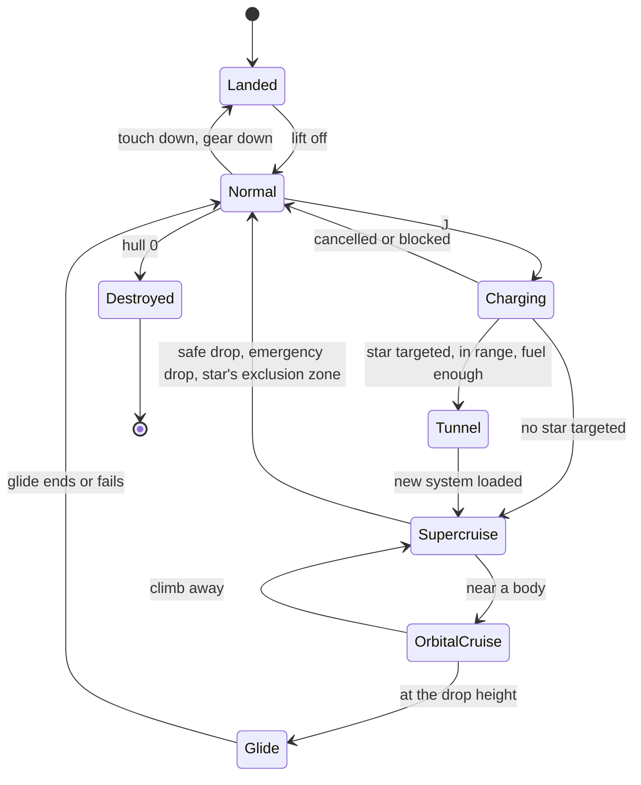

# Faulcon DeLacy Sidewinder mod

> Status: Draft · Date: 2026-11-13 · Baseline: 5f8f796
> Source: the user's request and interview of 2026-11-13, a read-only survey of the user's Elite Dangerous install
> (version `2026.10.23.334925`, Odyssey), and research against the code at the baseline.
> The original plan is followed by the Build log. Asset access and 1:1 requirements were revised on 2026-11-14.

Line numbers are as of the baseline; those marked (survey) come from a quick code survey and must be checked before
they are relied on. Every Elite Dangerous number in this file is either quoted from a named source or marked as a
**hint** (community posts, memory): a hint says what to look for, and is never used as a final number.

## Summary

A third mod for the Q menu: the **Faulcon DeLacy Sidewinder** from Elite Dangerous. Clicking it spawns the ship in
front of you, resting on its landing gear; you walk up and press E to sit in its cockpit. From then on every key is
Elite's own default, and the ship flies by Elite's rules: thrusters with flight assist on and off, the blue zone,
boost, power pips, heat, shields and hull, supercruise, hyperspace jumps between SpaceEngine's stars, orbital cruise,
glide and landing on planets, fuel, and the two stock pulse lasers. You get the stock ship a new commander gets.

The target is a 1:1 match for the stock Sidewinder's in-scope assets and behavior. Start with the Build log and
replace the current stand-ins as better source files or measurements become available.

### Asset access for Claude (D1)

Claude can inspect, unpack, decode, or decrypt local files needed for the Sidewinder, including FREA and
other encrypted formats. Use an authorized key with an offline reader, or import a decrypted copy.
Open the game install in read-only mode and handle decryption during offline conversion.
Label temporary replacements and grade their evidence. D2 and U6 cover distribution.

## How to verify a 1:1 match

Verify each asset or rule at the level the evidence supports. A mesh, texture or sound stream can match its source
byte for byte even when Sandbox Engine needs a different container. Flight and other rules must reproduce Elite's
observed behavior under the same starting conditions and inputs. Give each claim in a phase report one of these grades:

| Grade | Meaning | How it is proven |
|---|---|---|
| **A. The game's own bytes** | Original mesh vertices, indices, texture blocks, sound packets, bindings or other payload bytes from any source allowed by D1 | Compare hashes of the same payload region after unpacking or decoding the container and after writing the mod asset |
| **B. The game's own numbers** | Values from verified game data, the outfitting screen, the Player Journal or Status.json | Record the source and game version, and compare the value directly |
| **C. The game's own code** | A formula and its constants read out of `EliteDangerous64.exe` by offline study (the user allowed this, D3) | The function's address and our notes on it, plus a measurement that agrees |
| **D. Measured** | No code found: the rule is fitted to recordings of the real game | The mod's number beside the game's, inside the gate below |
| **E. Recreated by eye or ear** | An original could not be read or identified, so the mod uses a recreated visual or rerecorded sound | Compare the results side by side and log the remaining differences |
| **F. Ours** | Elite has no such thing (thick air, gas giant flight, the restock button, SpaceEngine's galaxy) | Described, tested, and labelled as not Elite's |

**The gate (D10, the user's choice):** for grades C and D a phase is done only when the mod lands inside what the
measurement itself can resolve. Steady numbers must read the same as the real game's (within 1 m/s, 1 degree a
second, 1 % heat) and timed events within 2 video frames or 2 %, whichever is larger. Anything outside is fixed or
reported as failed. **Nothing is ever tuned by feel.** Grades E and F have no gate: the user judges them.

Treat the current hull stand-in, rebuilt cockpit, flat HUD, missing sounds and unverified flight constants as
open items. For visual checks, match ship configuration, camera angle, field of view, distance and lighting. For
sounds, check the source stream separately from playback cues, pitch and volume. For flight, replay the same loadout,
mass, pips, inputs and world conditions and apply D10. Record the source, game version and test or comparison for each
claim. Call a result 1:1 only at the level that passed its check. List any remaining differences before calling the mod done.

SpaceEngine supplies the galaxy and controls system loading times. Elite's servers and internal simulation step
are outside the scope of the comparison.

### Grade by system

| # | System | Elite behaviour to match | How it maps onto Sandbox Engine | Best grade reachable | Proof |
|---|---|---|---|---|---|
| S1 | Exterior model and textures | The Sidewinder's hull, paint, decals, levels of detail | A sandbox object lit like props; drawn from its own model file | A for verified geometry, texels and source assembly data where available; E for reconstructed assembly | Payload hashes and same-angle pictures beside Elite's |
| S2 | Cockpit and seat view | Interior, seat, dashboard, sticks, canopy glass, the commander's body, the eye's place and field of view | Drawn like the weapons' view models, in the nearest depth slice | A for verified asset bytes; B or D for placement and field of view; E for recreated pieces | Payload hashes and same-view pictures beside Elite's screenshots |
| S3 | Moving parts and effects | Landing gear, hardpoints, cargo scoop, heat vents, thruster flames, lights, shield flash | Import verified rig, animation and effect data where available; implement the playback in Sandbox Engine | A for verified asset bytes, D for measured timing, E for recreated visuals | Payload hashes and side-by-side video frames |
| S4 | Sound recordings | Every recording: thrusters, boost, FSD charge, jump, supercruise, gear, alarms, lasers, the cockpit voice | Ogg files holding the game's own Vorbis packets, rewrapped without re-encoding | A for each recording matched to its stream; E (recorded from the speakers) for any that can't be found | Decoded samples equal; a list of found and not found |
| S5 | Sound behaviour | Which recordings play when, how they layer, how loudness and pitch follow thrust and speed | Use source event and mix data where available; drive playback from the simulation's state | A or B for verified source data, D for measured playback behavior, E for effects matched by ear | Recorded event timing, loudness and pitch curves side by side |
| S6 | Flight | 6-DOF thrusters, throttle, the blue zone, flight assist on and off, boost, speed and turn against ENG pips and mass | `elite-sim`, a new crate, stepped at a fixed tick | C where the code is found (G2), else D | Trace tests inside the gate |
| S7 | Rotational correction | Believed (a hint) to be the setting that matches a spinning station's turn and to do nothing away from stations | Not built: there are no stations. Step 0.9 checks whether it changes anything in open space or over a planet; if it does, it comes back into the plan | Not built | Step 0.9's check |
| S8 | Power distributor | SYS/ENG/WEP capacitors, pips, recharge, what each capacitor feeds | `elite-sim` | B for capacities and rates, C or D for the pip rule | Trace tests |
| S9 | Heat | Heat percentage, loads from modules, FSD charging, stars; warnings; damage over 100 % | `elite-sim`; hot air added by the same flux rule (F) | C or D | Trace tests |
| S10 | Shields and hull | Shield strength, recharge and rebuild, hull, collision damage, canopy breach and the life support timer, destruction | `elite-sim`; collisions against the ground and buildings | B for the numbers, C or D for the rules | Trace tests, pictures |
| S11 | Supercruise | Charge, speed against throttle and nearby masses, limits, the drop rule, emergency drops, cooldowns | `elite-sim` over SpaceEngine's bodies and their masses | C or D | Trace tests replaying the Elite body's own mass and distance |
| S12 | Hyperspace | Target, charge, countdown, tunnel, arrival at the star, fuel, cooldown | A jump between SpaceEngine's stars; new code that swaps the loaded system | B for fuel (the journal gives it to six digits), C or D for times; the tunnel's look E | Fuel test against the journal; timings |
| S13 | Planet approach | Orbital cruise, glide, the drop to normal flight | The same rules on every solid body and on gas giants (D7) | C or D on worlds Elite allows; F where it doesn't | Trace tests replaying the Elite moon's own radius and gravity |
| S14 | Landing | Gear, speed limits, touchdown and liftoff rules, gravity against thrusters | `elite-sim` against the sandbox's ground | C or D | Trace tests, pictures |
| S15 | Fuel | Tank, reservoir, burn by power draw, fuel per jump. The stock ship has no scoop | `elite-sim`; the restock button is F | B (`Status.json` gives fuel exactly) | Fuel test |
| S16 | HUD and panels | Canopy HUD, radar, left and right panels, lower panel, messages | Use verified artwork, fonts and layout data where available; use screenshots to fill gaps (D12) | A for verified asset bytes, D for measured layout or timing, E for recreated artwork | Payload hashes and same-view pictures |
| S17 | Controls | Elite's default keyboard, mouse and gamepad schemes | Read from copies of Elite's own `.binds` files | A for the bindings; C or D for how the mouse becomes stick movement | Test against the install's files |
| S18 | Weapons | Hardpoints, two pulse lasers: rate, heat, WEP drain | `elite-sim`; beams hit the ground, props and buildings | B for numbers, E for the beam's look | Trace tests, pictures |
| S19 | Getting in and out | Odyssey's boarding and Disembark | E to board, the lower panel or B to leave (D8, D8a) | F with E for look and sounds | Pictures |
| S20 | Thick air, gas giants | Elite has none | Real drag and hot-air heat in thruster flight; giants enterable (D7) | F | Described and tested |

## What the user must do

| # | Step | When | Until it's done |
|---|---|---|---|
| U1 | **Done 2026-11-14.** Buy a stock Sidewinder in Elite (32,000 cr) and leave it stock | Before step 0.7 | Steps 0.1 to 0.6 go ahead without it |
| U2 | For each measuring session: start Elite, log in, enter **Solo**, sit in the Sidewinder where the step asks (open space; a small airless moon; near a star). Then say so. The agent never types a password and never uses a station, so refuelling and repairing the real ship between sessions is yours too | Steps 0.7 to 0.9, 2.4, 5.1, 6.1 and any re-measure | That step waits; the builder works on another |
| U3 | Say yes or no to each install when asked: ffmpeg (already agreed, D4), a Wwise Vorbis decoder (vgmstream or ww2ogg), the REA tools `/rea` needs | Phase 0 | The step that needs the tool waits |
| U4 | Read Frontier's EULA on three points: sharing game files, reverse engineering, and automated input. It could not be fetched from here (403). Decisions D2, D3 and D4 stand unless you change them | Any time | Nothing changes |
| U5 | Fly each phase and say whether it feels like Elite (grades E and F have no other judge) | End of each phase | The builder carries on |
| U6 | Give the go for any push or public release. The mod's files are Frontier's (D2) | When you choose | Nothing is pushed |

## Goals / Non-goals

**Goals**

- A Mods-tab entry that spawns one Sidewinder in front of the player, and E to board it.
- The stock ship (the loadout below), with Elite's rules for everything in the table above.
- Elite's default keyboard and mouse controls first, its default gamepad layout later, both read from Elite's files.
- Free "Refuel, repair, restock" from the Q menu while landed (D5).
- Every solid world and every gas giant can be approached and flown on; stars keep Elite's rules (D7, D11).
- Every claim graded and proven as above. The mod off, or never spawned, costs nothing.

**Non-goals (this plan; the "later" list)**

- Stations and docking, rotational correction, the galaxy map and system map screens, scanners (honk, FSS, surface
  probes) (D6). Other ships, combat targets, interdiction, missions, credits, cargo trading, the SRV, multicrew, wings.
- Outfitting, engineering, other ships than the Sidewinder, a fuel scoop.
- Elite's outside camera suite; saving the ship between launches; more than one Sidewinder at once (D12).
- Joysticks, HOTAS, a rebinding screen (D9).
- Wind, wind noise, lift, and pressure damage in thick air.

## Users & permissions

| Role | Can | Cannot |
|---|---|---|
| The player | Spawn, board, fly, land, leave, restock; play without Elite installed (the files ship with the mod, D2) | Rebind keys; keep the ship across launches |
| The measuring agent (Sonnet, high effort) | Press flight keys in the user's running Elite in Solo, take Elite's own screenshots (F10), run the recorder, read the journal and `Status.json` | Type credentials; leave Solo; spend credits, buy, sell or change the loadout; open station services; use chat or anything touching other players; use the computer-use screenshot tool (it stalls on this PC); read the game's memory or inject anything. It stops and reports if a menu, another player or anything unexpected appears |
| The builder (Opus) | Read local Sidewinder sources under D1, study Elite's exe offline under D3, and write the mod | Change Elite's install or publish the mod |

## Evidence sources

| # | Source | What it gives | How reliable | Limits |
|---|---|---|---|---|
| E1 | The install's data files and authorized exports (D1) | Meshes, textures, materials, animations, sound streams, artwork and game data where present | The game's own bytes when verified against the source | Record which assets the evidence identifies |
| E2 | The install's plain files: `ControlSchemes/*.binds`, `GraphicsConfiguration.xml`, `AudioConfiguration.xml`, `DeviceDefaults.xml` | Default controls for every device; graphics limits; that the audio engine is Wwise | The game's own bytes | The field of view and mouse feel are not in them |
| E3 | `EliteDangerous64.exe`, studied offline with Ghidra through `/rea` | The client's formulas and constants: flight, supercruise, glide, heat | High for what is found. The exe is not packed (code section entropy 6.5, no protector strings) and keeps readable names (`ApproachGlide_FailedTooShallow`, `FlightAssistFinal`, `UpdateSupercruiseState`, `OutfittingFieldType_EngineOptimalMass`) | 98.7 MB of code: slow. Ship and module numbers may be loaded from the encrypted files and so be absent |
| E4 | The Player Journal and `Status.json` (Frontier's own documented files, in `Saved Games\Frontier Developments\Elite Dangerous`) | `Loadout` (every module's exact name, masses, jump range), `FSDJump` (distance, fuel used, fuel left), `StartJump`, `SupercruiseEntry/Exit`, `ApproachBody`, `Touchdown`, `Liftoff`, `HeatWarning`; flags for gear, shields, supercruise, FSD charging, glide; pips; fuel; latitude, longitude, altitude and heading near a body | The game's own numbers | No speed, no turn rate. Events are stamped to the second; `Status.json` is rewritten only when something changes. Re-check the field list against the docs in step 0.8 |
| E5 | Video of the cockpit at 60 frames a second, with the speakers recorded (`.audit/tools/loopback`) | The speed readout (whole m/s), throttle bar, heat %, capacitors, supercruise speed, distance and time to target; turn rates from the stars' motion; every timing to 1/60 s | Good to the readout's own resolution | Readouts may lag or be smoothed: cross-check against distance flown |
| E6 | Elite's own screenshots (F10) | The look of the ship, cockpit and HUD for side-by-side pictures | The game's own pictures | |
| E7 | EDCD `coriolis-data` (GitHub, last commit 2026-04-24; raw files saved in `re/elite/community/coriolis-data/` on 2026-11-13) | Ship and module numbers as the outfitting screen shows them | High for those numbers; confirm the loadout against U1's `Loadout` event | Its formulas (speed against pips and mass, jump range) are the community's own fits: medium, to confirm by measurement |
| E8 | EDSY, the wiki, forum research threads | Hints: what to measure, rough sizes of effects | Low to medium | Never a final number |

Use local source files and reference material supplied for this mod. Use Elite's own screenshots, journals and
recordings for evidence that the files alone cannot provide.

### The community's numbers for the stock ship (E7, grade B, read from the raw files)

| Thing | Value |
|---|---|
| Sidewinder | hull mass 25 t; speed 220 m/s; boost 320 m/s; minimum thrust 45.454 %; boost cost 7; boost interval 4; pitch 42, roll 110, yaw 16 degrees a second; heat capacity 140; base shield 40; base armour 60; hardness 20; mass lock 6; reserve fuel 0.3 t; 1 seat |
| Bulkheads | Lightweight Alloy: mass 0, hull boost 0.8 |
| Power plant 2E | 6.4 MW; mass 2.5 t |
| Thrusters 2E | minimum, optimal, maximum mass 24, 48, 72 t; multipliers 0.83, 1, 1.03; power 2; mass 2.5 t |
| Frame shift drive 2E | optimal mass 48 t; most fuel a jump 0.6 t; fuel multiplier 0.011; fuel power 2; power 0.16; mass 2.5 t |
| Life support 1E | 300 s; power 0.32; mass 1.3 t |
| Power distributor 1E | SYS 8 at 0.4/s; ENG 8 at 0.4/s; WEP 10 at 1.2/s; power 0.32; mass 1.3 t |
| Sensors 1E | range 4; power 0.16; mass 1.3 t |
| Fuel tank 1C | 2 t |
| Shield generator 2E | regeneration 1, broken regeneration 1.6; distributor draw 0.6; masses 28, 55, 138 t; multipliers 0.3, 0.8, 1.3; power 0.9; mass 2.5 t |
| Pulse laser, small | Coriolis lists the stock pair as gimballed (id 18): damage 1.56, fire interval 0.25 s, distributor draw 0.31, thermal load 0.31, range 3000 m, mass 2 t. Fixed (id 17): 2.05, 0.26 s, 0.30, 0.33. **Which pair a new ship carries is settled by U1's `Loadout` event** |
| Other stock internals | Cargo rack 2E (4 t), Advanced Planetary Approach Suite |
| Worked out, not measured | Mass with a full tank about 44.9 t; longest jump about 7.9 light years (`sqrt(0.6 / 0.011) x 48 / 44.9`) |
| **The user's own ship (journal `Loadout`, 2026-11-14, game 4.4.2.1, grade B)** | Bought stock: unladen mass 42.9 t, cargo 4 t, fuel 2.0 t main and 0.3 t reserve, `MaxJumpRange` 8.149506 ly. That is exactly `sqrt(0.6 / 0.011) x 48 / (42.9 + 0.6)`, so the community's jump formula and the 2E drive's numbers hold. Modules as the table above, the lasers gimballed, plus two the community file does not list as stock: a **supercruise assist** and an **advanced docking computer** in the two size 1 slots. Voice: Verity. The same journal holds 6 `FSDJump`, 3 supercruise entries and exits and 1 `HeatWarning` to use as first data |

## Assets: how Elite stores them (surveyed 2026-11-13, read only)

`D:\SteamLibrary\steamapps\common\Elite Dangerous\Products\elite-dangerous-odyssey-64\Win64` holds 102,957 files in
folders `00` to `0f`, each named by 40 hex digits (the folder is `0` plus the name's first digit). `data.ovx` lists
every name with a 128-digit checksum: an integrity list, not a table of readable names.

| Kind | Files | Size | What the survey found | Usable? |
|---|---|---|---|---|
| FREA | 54,320 | 10.9 GB | Encrypted archive format | Use the offline reader or a decrypted export (D1) |
| zlib, inner kind `02 00 01 00` | 22,008 | 12.0 GB unpacked | Runs of 16-bit triangle indices: mesh data. The vertex layout is not yet known | Yes |
| zlib, inner kind `03 00 01 00` | 26,248 | 57.6 GB unpacked | Sizes are sums of block-compressed mip levels (1,310,720 bytes is a 1024 and a 512 level at a byte a pixel), with the byte patterns of such blocks: texture data | Yes |
| RIFF | 381 | 12.5 GB | Wwise Vorbis (format tag `0xFFFF`), many streams back to back in each file on 4,096-byte boundaries | Yes, with a public Wwise Vorbis decoder (a codec, not a lock) |
| Plain files outside `Win64` | | | Bindings and settings XML, shader archives, `.webm` movies | Bindings and settings: yes |

The survey found unnamed mesh, texture and sound payloads in the open containers. It did not verify the source of
the Sidewinder's material assignments, mesh scale, rigs, animation, effects, sound event banks, fonts or HUD artwork.
Search authorized sources for those dependencies before keeping a recreation. Start with the original exterior and
cockpit, including their material assignments, textures and levels of detail. Then check animated parts, effects,
sound banks and HUD assets. Use Elite's screenshots and recordings for anything that remains unavailable.

The survey's tools and results are in `re/elite/` (out of git): `tools/survey.py`, `tools/probe_open_files.py`,
`catalog/open_files_2026.10.23.json` (every file's kind and sizes), `catalog/survey_summary.txt`.

**How other games' files were handled before:** Megaton Rainfall, Garry's Mod and Skate 3 were each converted once on
the user's PC into the project and shipped, on the user's decision each time; GTA V's encrypted archives were never
opened. For Elite the user chose the same (D2): converted once into `crates/se_engine/assets/mods/sidewinder`,
committed and shipped. This is the riskiest of the four: Elite is a live paid game and the repository is public
(GPL-3.0). The files are Frontier's whatever licence the code has; `SOURCES.txt` in the mod's folder says so.

## Controls

Read from the install's `ControlSchemes/KeyboardMouseOnly.binds` (grade A). While seated these replace every sandbox
and port key.

| Elite action | Default | Note |
|---|---|---|
| Pitch, roll | Mouse Y, mouse X | `MouseXMode` roll, `MouseYMode` pitch, no decay, dead zone 0.05, sensitivity 1, linearity 1 |
| Yaw | A, D | |
| Thrust left, right, up, down | Q, E, R, F | Q and E are thrust while seated, not menu and board |
| Throttle up, down; zero | W, S; X | |
| Flight assist | Z | |
| Boost | Tab | |
| Frame shift drive (supercruise, or the jump if a star is targeted) | J | |
| Landing gear; cargo scoop; ship lights | L; Home; Insert | |
| Hardpoints; fire primary, secondary; next fire group | U; left, right mouse button; N | |
| Pips to ENG, WEP, SYS; reset | Up, Right, Left; Down arrow | |
| Silent running; heat sink | Delete; V | Delete is `ToggleButtonUpInput` in the file, believed to be silent running: confirm in step 2.2. No heat sink launcher on the stock ship: V does nothing |
| Target ahead; next target; highest threat | T; G; H | Nothing to target but bodies |
| Left, comms, lower, right panel | 1, 2, 3, 4 | |
| UI focus; panel moves; select; back | Left Shift; W A S D; Space; Backspace | Tabs with Q and E |
| Head look | Middle mouse button | |
| Orbit lines | = | |

How it fits beside the game's own keys:

- **On foot:** nothing changes. E boards when you look at the ship from within reach; otherwise E is still "use".
- **Seated:** `sidewinder::read_input` (PreUpdate, placed as `skate::read_pad` is: after the input systems and
  `viltrumite::dev_keys`, before `sandbox::read_input`) takes every bound key and clears its press, so the port's
  readers (1 to 4 flight modes, G, T, H, P, Tab, the arrows, V) never see them.
- **Esc** stays the sandbox's main menu. **B** is the one key added: get out: anywhere since 2026-11-24 (D8a); first only when landed (D8). In Elite's
  defaults B has no ship action (checked in the file: it is bound only to three on-foot actions). M (Elite's HUD mode
  switch) does nothing here: the analysis mode belongs with the scanners, on the later list.
- The Q menu is not reachable while seated; get out first. V (free flight) is off while seated.
- **Gamepad (a later phase):** `ControlPad.binds`: left stick pitch and roll, right stick thrust left/right and
  up/down, bumpers throttle, B boost, triggers fire, D-pad pips, X UI focus, Y target, Back hardpoints, right stick
  click head look. Read through the gamepad path the Skate 3 mod uses.

The mod ships copies of the two `.binds` files and reads its key table from them (so a test can compare them with the
install's). How mouse movement becomes stick movement is not in the file: it comes from the exe (C) or from
measurement (D).

## Architecture

```
crates/elite-sim/                 NEW crate. The ship's rules. No Bevy, no files, f64, a fixed tick.
  src/data.rs                     the stock ship's numbers, each with its source and grade in a comment
  src/flight.rs distributor.rs heat.rs shields.rs fuel.rs fsd.rs supercruise.rs approach.rs landing.rs weapons.rs
  src/sim.rs                      Sim::step(input, world) -> events; World is a trait the game implements
  src/trace.rs                    reads and writes trace files (CSV, numbers only)
  tests/traces/                   measured traces of the real game, scrubbed (no commander name), in git
crates/se_core/src/elite.rs       NEW. Readers for Elite's open containers (meshes, textures, sound packs).
                                  FREA exports enter through offline conversion.
crates/se_core/src/elite_asset.rs NEW. The mod's own model format (.edm) and the .binds reader.
crates/se_engine/src/sidewinder/  NEW module, as skate/ is:
  mod.rs      the plugin, the assets, the parked ship, spawn, board, leave, restock, dev commands
  pilot.rs    seated: frames, camera, ground and building contact, the hand-overs
  input.rs    bindings to simulation input; takes the keys
  draw.rs     exterior, cockpit view model, materials, lights
  hud.rs panels.rs   the canopy HUD and the panels
  sound.rs    the mixer and the voice
  fsd.rs      the tunnel and the swap to the new star system
  fx.rs       thruster flames, shield flash, lasers
  convert.rs  #[cfg(test)]: copy_sidewinder, the converter
crates/se_engine/assets/mods/sidewinder/   the mod's files (below)
crates/se_engine/assets/shaders/sidewinder_*.wesl
re/elite/                         out of git: tools, the catalog, Ghidra notes, raw recordings, the community's files
docs/elite-flight-model.md        in git: each rule in our own words, its formula, constants, grade and source
```

**Why a separate crate:** as `skate-sim`: it runs and is tested without the game (`cargo test --release -p
elite-sim`), cannot reach into Bevy, and its trace tests are the proof.

**Reuse or replace.** The port's own flyable ships (`ship.rs`, `ship/`) are SpaceEngine's ship rules: one 500-line
`ship_physics`, SE's warp, HUD, autopilot and `.sm` models. The Sidewinder **replaces** all of that for itself and
must never set `Flight::active`, because `mods::off_for_pilot_or_script` (`mods.rs:684`) turns every mod off while an
SE ship is flown. What it **reuses**:

| Need | Reused piece |
|---|---|
| Riding a turning, orbiting body; handing over between near-ground and space | `viltrumite/frames.rs` (`Frame::Attached` / `Free`, `carry` then `advance`), `ship.rs:512` `frame_terms`. Its gotchas apply unchanged (CLAUDE.md "The hero's motion") |
| The ground's height | `ship.rs:2091` `ground_on`, and the sandbox's ground field while parked |
| Solid buildings and trees | `scatter/probe.rs` `ProbeAsk`, `viltrumite/solid.rs`, `sandbox/solids.rs` |
| Light on the ship and cockpit | The hero's light pass and `LightProbe` (`viltrumite/draw.rs:317`), as the props and the skater use |
| Air density and temperature | `viltrumite/air.rs:149` `AirModel` |
| A model drawn in front of everything with its own field of view | `sandbox/viewmodel.rs` |
| Spawning where you look; the parked ship as a solid thing | `sandbox/props.rs:41` `handle_requests`, `sandbox/world.rs` |
| Mods list, file checks, grey rows | `mods.rs` (`KNOWN_CODES` :28, `apply_request` :692, `check_inside` :215) |
| Stars within reach | The star browser's search (`search LY`) |
| Loading another star's system | `system.rs:561` `select_active_system` (it follows the camera's nearest star and builds in the background) |
| Key presses in tests | `hero keys` (`viltrumite::dev_keys`) |

**Hyperspace is new work.** The port has no jump between stars: only the camera's Go To. A jump moves the ship and
camera to the arrival point by the target star while the tunnel hides the view, waits until `select_active_system`
has entered the new system, then ends the tunnel. Go/no-go G4 is whether that swap can be made to wait cleanly.

**The mod's files** (`crates/se_engine/assets/mods/sidewinder/`, written only by the converter, never by hand):

| File | Holds | Grade |
|---|---|---|
| `mod.cfg` | `Name "Faulcon DeLacy Sidewinder"`, `Description`, `Code "sidewinder"`, a `Need` for every file | |
| SOURCES.txt | For each asset: source file or export and entry, game version, grade, and payload hash where byte equality is claimed; record recreations and their reference | |
| `models/*.edm` | Elite's own models (the real hull `sidewinder`, the real cockpit `sidewinder_cockpit`, the gear, the chair): vertices, indices, bones and draws, every byte checked against the export (as shipped since 2026-11-16; the stand-ins `ship.edm` and `cockpit.edm` are gone) | A |
| `materials.json`, `ship.json` | Elite's materials; the assembly: rigs, state machines, lights, the paint job, the sound emitters | A |
| `chair/clips.json`, `chair/clips.bin`, `chair/graph.json` | The pilot chair's clips and motion graph | A |
| `tex/*.dds` | Elite's own block-compressed data and mips in a DDS wrapper, read by `se_core::dds::parse_dds` | A |
| `sounds.json` | The ship's sound events, containers, curves, states, buses and effects (the master plug-in's block and the buses' compressors included), format 3 | A |
| `sfx/*.ogg`, `sfx/*.wav` | 786 recordings as Elite's Vorbis packets rewrapped as standard Ogg, not re-encoded; 63 whose stream cannot be rewrapped as their exact decoded samples (PCM). The ship's voice lines are among them: there is no `voice/` folder | A |
| (no `hud/` folder) | The HUD and the side panels are drawn by the game as flat text and lines at Elite's places; Elite's own HUD artwork is not shipped | F |
| `binds/KeyboardMouseOnly.binds`, `binds/ControlPad.binds` | Copies of Elite's files | A |

No file over 90 MB (GitHub refuses 100 MB): bigger sets become packs in pieces, as `assets/gmod` is. The converter is
`cargo test -p se_engine --release copy_sidewinder -- --ignored --nocapture`; `ELITE_PATH` names the install. It
reads every file back and fails if anything is missing. Feed any exports from D1 to the converter offline.
Sandbox Engine runs from the resulting mod files.

**Run-time state:** one `Sidewinder` resource: the parked ship's body and place in the body's frame, the
`elite_sim::Sim`, whether the player is seated, and the loaded `SidewinderAssets`. `sandbox::Mode` gets `Pilot`;
`ModControl` gets `pilot` (so `panels_hidden`, the cursor and the menus behave as for the other mods).

## Flows

### F1. Spawn

1. In the Q menu's Mods tab the row "Faulcon DeLacy Sidewinder" shows **Spawn**. First use checks every `Need` and
   loads the files on a worker thread (the Skate 3 mod's 0.3 s hitch came from loading on the main thread).
2. A click turns any other mod off, then puts the ship where you look: on the ground, gear down, nose towards you,
   its middle at least 18 m away, at the first place along the view within 60 m that is clear of buildings. If none
   is, a message says there is no room. A second click removes the old ship and spawns a fresh one (D12).
3. Parked, it is a solid object in the sandbox's world: you can walk round it, under it and onto it; props bounce off.
4. With a ship parked and landed the row also shows **Refuel, repair, restock** (free: fuel, hull, modules, canopy
   and shields back to full).

### F2. Boarding and leaving

1. On foot within 6 m of the hull, looking at it, a prompt shows as in Odyssey; E boards. The screen fades, Elite's
   boarding sounds play, and you are in the seat with the ship powered and landed.
2. Leaving: anywhere since 2026-11-24 (D8a: the Decisions log says what happens where); first only when landed. Either the Disembark entry on the lower panel (its exact place and wording are copied
   from the real game in step 4.3) or B. You stand beside the ship; the sandbox sets the walker down there, on
   whatever body it is.
3. Both hand-overs follow the sandbox's camera rule: whoever stops writing the camera writes it once more in that
   frame and leaves it bound to the body (CLAUDE.md, the 500 m a frame gotcha).

### F3. Flight modes



Each rule inside these modes (speeds, limits, times, what blocks the drive, when a glide fails) is taken from the exe
or from measurement in the step that builds it. The hints the builder starts from, none of them final: FSD charge
about 15 s; countdown 5 to 1; supercruise from 30 km/s to 2001 c, slowed by nearby masses; the drop rule (under about
1,000 km and 1,000 km/s; keeping about 7 s to target at 75 % throttle); glide at 2,500 m/s between about -5 and -60
degrees from about 25 km; cooldown about 10 s after a drop; best turning at half throttle.

### F4. Where Elite's rules are stretched (F: ours)

- **Every solid world** is treated as Elite treats a landable one, Earth included. The sea is ground, as on foot.
- **Gas giants** have no exclusion zone. Orbital cruise and glide work against the giant's radius; below it the ship
  flies on thrusters in ever denser, hotter air down to the port's own floor (10 scale heights under the radius),
  which stops it. It can't land there.
- **Real air acts only in thruster flight**, never in supercruise, orbital cruise or glide. Drag is
  `0.5 x density x speed² x area x 1.0` against the motion, with the area taken from the converted hull's own outline
  along that direction and density from `AirModel`. Flight assist fights drag as it fights gravity, so the top speed
  in thick air comes out lower by itself. Nothing here is tuned.
- **Hot air heats the ship** through Elite's own rule for a star's heat: the air's heat flow is turned into a flux
  and fed to the same function. If that rule can't be recovered from the exe (step 5.1), hot-air heat is left out and
  reported, not invented.
- **Stars** keep Elite's rules: heat by distance, the exclusion zone that ends supercruise (D11).
- **Time:** the ship runs on real seconds, as the hero does. The game clock's keys are off while seated.

### F5. Hyperspace over SpaceEngine's stars

1. The left panel's Navigation tab lists the bodies of this system and the stars within the ship's jump range, from
   SpaceEngine's catalog, nearest first. Selecting a star targets it.
2. J charges the drive if the star is in range for the fuel aboard and not hidden behind a body. Fuel for the jump is
   Elite's formula with SpaceEngine's distance: `0.011 x (distance x mass / 48)^2` tonnes, at most 0.6.
3. Countdown, then the tunnel. Behind it the camera moves to the arrival point and the new system loads. The tunnel
   lasts until it has, as Elite's lasts until its own loading ends.
4. Arrival in supercruise facing the star, at the distance Elite's rule gives for a star of that size, then the
   cooldown.

### F6. Damage and the end of a ship

Collisions with the ground and buildings take shields, then hull, by Elite's rule. Heat over the limits damages
modules and hull. A broken canopy starts the life support timer (300 s on the stock ship). Hull 0 or the timer's end
destroys the ship with Elite's sequence; the player is then on foot on Earth (the main menu's own way back) and
spawns a new ship from the Q menu. (Changed in building, step 1.3 and checker 2: destroyed where there is ground, he is
set down beside where the ship was, as getting out does; far from any ground (supercruise, a star, the tunnel) he goes
back on Earth on foot. Elite's destruction sequence, the canopy and the life support timer are not built yet.)

## Edge cases & failure handling

| Case | Expected behaviour |
|---|---|
| The mod's folder or a `Need` is missing or wrong | The row is grey with the reason, as the other mods |
| Elite not installed on a player's PC | No effect: the mod runs from its shipped files |
| Elite updates and its file names change | The converter reports which sources are gone and stops; `SOURCES.txt` names the version it was made from |
| No room to spawn | Message; nothing spawned |
| Spawn while seated | Not possible: the Q menu is closed while seated |
| Another mod turned on while the ship is parked | The ship stays parked. Boarding turns the other mod off first |
| E pressed near the ship while holding a prop | Boarding wins only when the look ray hits the ship; otherwise "use" as before |
| B or Disembark while flying or in space | Refused with Elite's own kind of message; nothing happens |
| Esc, then Play, while seated | The player is put on Earth on foot (as today). The ship stays where it was; if that was in flight out of reach of the ground (D8a) it is lost and a new one is spawned |
| The player walks or flies far from the parked ship | It keeps its place on its body and is drawn again when near. Like props it is not simulated far away |
| Landing on a slope too steep, or too fast | Elite's rule: no touchdown, or damage. On F-grade worlds the same rule |
| Fuel runs out | Elite's rule (the ship loses power). Restock needs a landing, so in space the ship is lost |
| Jump target out of range, hidden, or too little fuel | The drive refuses, with Elite's message |
| The new system fails to load within 60 s | The tunnel ends back at the old star with a message; fuel is not taken |
| The game clock is paused or sped up when boarding | It is set to real time, running, and given back on leaving |
| Frame rate drops | The simulation keeps its fixed tick, at most 6 ticks a frame (as the Skate 3 mod), the rest dropped |
| Alt-tab while seated | Mouse input stops; the ship flies on by its own rules (Elite does not pause either) |
| A test run | The row works with `mods on sidewinder`; no dialog, nothing written to the user's folders |
| `SE_MODS=0` | The mod is hidden with the others |

## Security & privacy

| Risk | Handling |
|---|---|
| Encrypted source data | D1 allows authorized offline decryption and decrypted exports. Keep keys and raw working files out of the repo and release archives |
| The user's Elite account | The agent acts only as the Users table allows, in Solo, after the user has logged in. Automated key presses in a live game may be against Frontier's terms: the user's decision (D4), and U4 asks them to read the terms |
| The user's journal holds their commander's name and account details | Raw journals, `Status.json`, videos and screenshots stay in `re/elite/measure/raw` (out of git). Only numbers go into `tests/traces/`; a test fails if a trace holds the word "Commander" or any letters outside its header |
| Publishing Frontier's files and notes on its code | The user's decision (D2, D3). `SOURCES.txt` and the README credit Frontier Developments. Decompiled code stays in `re/` (out of git); `docs/elite-flight-model.md` holds formulas in our own words. Pushing and releasing are the user's step (U6) |
| Files the mod loads | Checked on first enable as the other mods' are (`check_inside` gets the new extensions); a sound goes through `mods::check_sound` |
| Installs | Asked one at a time (U3), from official sources, logged in PROGRESS.md |

## Integrations

- Elite Dangerous's install: read only, by the converter and tests. Never at run time. Never changed.
- Elite Dangerous running: only in measuring steps, driven as the Users table says.
- SpaceEngine's install: as today.
- No network use by the mod.

## Non-functional requirements

- The mod never spawned: no systems run (run conditions), nothing loaded, the picture bit for bit as before.
- A parked ship: aim under 0.2 ms a frame. Seated with the full HUD: aim under 1.5 ms at the user's settings
  (3440x1440, Ultra clouds), measured with `SE_PERF`.
- No GPU objects made per frame; per-frame values go in buffers written in place (CLAUDE.md "Never change a Bevy
  material asset every frame", "Slowdowns over a session").
- Loading on a worker thread; no hitch over 50 ms when spawning or boarding.
- Plain-language notes: README gets a "Faulcon DeLacy Sidewinder" section with the keys; CLAUDE.md its gotchas;
  PROGRESS.md the state after every step.

## Codebase impact

| Where | Change |
|---|---|
| `Cargo.toml` (workspace) | Add `crates/elite-sim` |
| `crates/se_core/src/lib.rs` | `elite`, `elite_asset` modules |
| `crates/se_engine/src/mods.rs:28` | `"sidewinder"` in `KNOWN_CODES` |
| `mods.rs:115` `ModControl`, `:168` `off` (survey) | A `pilot` flag, cleared by `off` |
| `mods.rs:215` `check_inside` | Checks for `.edm` and `.binds` |
| `mods.rs:692` `apply_request` | The first-enable branch: load `SidewinderAssets`, then ask the sandbox to spawn |
| `sandbox/menu.rs:143` `mod_rows` (survey) | The row's Spawn and Restock buttons |
| `sandbox/mod.rs:109` `Mode` | `Pilot` |
| `sandbox/mod.rs:153` `Request` | A request to spawn the ship |
| `sandbox/mod.rs:497` `read_input`, its `HIS` list near :603 (survey) | E boards before "use" when the ray hits the ship |
| `sandbox/mod.rs:756` `sandbox_step` | The hand-over to and from `Pilot`, at the end of the step as for V |
| `sandbox/weapons.rs:426` (survey) | "Use" yields to boarding |
| `sandbox/world.rs:18` | A collision group or collider kind for the parked ship |
| `sandbox/main_menu.rs:269` `restart_on_earth` | Leaves the seat first |
| `camera.rs` near :1769 (survey) | The `sw` dev command |
| `viltrumite/frames.rs` | Used as it is; if it must move to a shared place, the hero's traces must stay identical |
| `system.rs:561` | A way to ask "has the system at this star been entered?" |
| New | `crates/elite-sim`, `se_core/src/elite.rs`, `elite_asset.rs`, `se_engine/src/sidewinder/`, the shaders, the mod's folder, `docs/elite-flight-model.md` |

Dev commands (`sw ...`): `spawn`, `board`, `leave`, `state`, `restock`, `trace FILE` (a line a tick, the same columns
as the measured traces), `stick PITCH ROLL YAW SECS`, `throttle X`, `pips S E W`, `fa on|off`, `gear`, `sc on|off`,
`jump NAME`, `heat X`, `hull X`. Keys are pressed with `hero keys`.

## Implementation order

Each step is one session: it builds, passes the tests, is checked and committed before the next (CLAUDE.md). A step's
report lists every claim with its grade and, for C and D, the game's number beside the mod's.

### Phase 0: evidence (run with /rea)

For the next pass, review the Build log and list each stand-in or unverified claim with its missing source or test.
Work through the existing steps for those gaps. Reopen completed searches when a new input under D1 becomes available,
and update the evidence for each replacement.

| # | Step | Proven by | Done when | Needs |
|---|---|---|---|---|
| 0.1 | The mesh reader (`se_core/src/elite.rs`): unpack the `02 00 01 00` kind and work out its vertex layout from the data alone. A catalog of every mesh with its size | A contact sheet of a few hundred meshes drawn from three sides | **G1:** meshes draw as recognisable things. If the layout is not worked out in this one session, the model goes to the recreate route (step 0.5) and the user is told | |
| 0.2 | The texture reader (the `03 00 01 00` kind: formats and sizes from the data) and the sound-pack reader (split a pack into its streams, decode one) | Contact sheets of textures; one sound decoded and played | Textures open as pictures and a stream plays, or each is named as not readable | U3 (the decoder) |
| 0.3 | Identify the stock exterior, gear, hardpoints, scoop and thrusters from the source assembly if available. Use mesh shape and Elite's screenshots if the assembly is missing | Source entries and payload hashes for confirmed parts; same-angle pictures | Each part is verified or listed as a stand-in | 0.1 |
| 0.4 | Identify the cockpit, pilot, hull and cockpit materials and textures. Use source references first, then match texture features to mesh UVs and compare against screenshots | Source entries, payload hashes and textured pictures beside screenshots | Each piece is verified or listed as a stand-in | 0.2, 0.3 |
| 0.5 | Use a Blender stand-in where the source still cannot be read or identified. Replace it when verified original data is available | The same view beside Elite's screenshot, marked as recreated in SOURCES.txt | The recreation has evidence and any path to the original stays on the gap list | 0.3, 0.4 |
| 0.6 | The sound index: split every pack, decode every stream, store a short fingerprint of each | Counts: streams found, decoded, failed | The index covers all 381 packs | 0.2 |
| 0.7 | Check available sound banks for event and stream mappings. Correlate game recordings against the indexed streams where mappings are missing | For each sound, list the event, source entry and match evidence, or record what is missing | **G3:** account for each S4 sound. Mark any use of speaker recordings as grade E | 0.6, U1, U2 |
| 0.8 | The measuring rig: ffmpeg at 60 frames a second with the speakers, a reader for the cockpit's digits and bars, a journal and `Status.json` logger, the agent's script and its stop rules; settle how pitch and roll are driven (Q11) | One manoeuvre (full throttle from rest, then stop) measured three times agrees with itself inside the gate | The rig repeats itself, or the report says by how much it doesn't | U1, U2, U3 |
| 0.9 | First measurements, normal space: speed at 0 to 4 ENG pips, acceleration and braking, boost, pitch, roll and yaw rates against throttle, flight assist off, sideways, vertical and reverse speeds; whether rotational correction does anything away from stations (S7) | Each manoeuvre flown twice, agreeing inside the gate | The traces and a table of results exist in `re/elite/measure/normal-space` and, scrubbed, in `crates/elite-sim/tests/traces` | 0.8 |
| 0.10 | Exe study, first session: a Ghidra project for Elite's exe; from the names it keeps, find where the ship's motion is stepped: thrusters, flight assist, the speed limit | Each rule found predicts 0.9's traces inside the gate | `docs/elite-flight-model.md` has a row for each rule looked for: C with its address, or "not found yet" | 0.9 |
| 0.11 | Exe study, second session: the blue zone, boost, the pip rule, the mass curve, how the mouse becomes stick movement | As 0.10 | **G2:** every flight rule is C (found) or D (to be fitted from 0.9's traces). **A rule not found by the end of this session is D**: no third session is spent on it. Either way Phase 1 can start | 0.10 |

### Phase 1: the smallest playable slice

| # | Step | Proven by | Done when | Needs |
|---|---|---|---|---|
| 1.1 | The converter and the parked ship: `copy_sidewinder`, the `.edm` format, `mod.cfg`, `KNOWN_CODES`; the Mods row; the ship spawned in front of you, lit like the props, solid | Hash tests (geometry and texels equal the install's, for every piece that was found); pictures by day, at night and under cloud beside Elite's screenshots | You can spawn it and walk round it | 0.3, 0.4 (0.5's stand-ins if needed) |
| 1.2 | `elite-sim`: normal-space flight only (thrusters, throttle, blue zone, flight assist, boost with the ENG capacitor at Elite's default pips, gravity, speed limits), fixed tick | `cargo test --release -p elite-sim`: every trace of 0.9 replayed inside the gate | All traces pass, or each failure is listed with its numbers | 0.9, 0.11 |
| 1.3 | Boarding and flying: E, the fade, `Mode::Pilot`, the cockpit drawn with head look, Elite's keyboard and mouse from the `.binds` copy, frames, contact with ground and buildings, a plain touchdown, B to leave, a bare speed and throttle readout | The mod's own `sw trace` of 0.9's manoeuvres, flown in the game, inside the gate; pictures from the seat beside Elite's; a flight Earth to 5 km up and back with a landing | **The user flies it** | 1.1, 1.2 |

**Done, for every step from here on:** its traces replay inside the gate (grades C and D); its pictures or recordings
are in the report beside Elite's (grades E and F); the build and all tests pass; and at the end of each phase `checker`
has passed it and the user has flown it. A step that misses the gate is reported as failed with its numbers, not
closed.

**Traces near bodies:** every trace taken in supercruise, orbital cruise, glide or landing carries the Elite body's
mass, radius and surface gravity (from the journal's scan of it and `Status.json`'s `PlanetRadius`), and `elite-sim`
replays that same body, not a SpaceEngine one that happens to be alike.

### Phase 2: the ship's systems

| # | Step | Proven by | Needs |
|---|---|---|---|
| 2.1 | Power distributor: pips, three capacitors, recharge, what draws on each | Traces of capacitor levels against pips | 1.3 |
| 2.2 | Heat: loads, cooling, warnings, damage; silent running | Traces of heat % idle, boosting, charging the drive | 2.1 |
| 2.3 | Shields and hull: strength, recharge, rebuild, collisions, canopy breach and the timer, destruction and the return to walking | Traces of shield recharge; measured bumps; pictures | 2.1 |
| 2.4 | Landing: gear and its speed limits, touchdown and liftoff rules, slopes, gravity against thrusters, cargo scoop, lights | Traces on an airless moon (`Touchdown`, `Liftoff`, altitude) ; landings on the Moon and on Earth here | 1.3, U2 |
| 2.5 | Fuel: tank, reservoir, burn by power draw; the restock button | `Status.json` fuel over 20 minutes against the mod's | 2.2 |
| 2.6 | Weapons: hardpoints, the two lasers, WEP drain, heat, beams and hits | Traces of fire rate, capacitor and heat; pictures | 2.1, 2.2 |

### Phase 3: sound

| # | Step | Proven by | Needs |
|---|---|---|---|
| 3.1 | Engine, thruster, boost and cockpit loops, driven by the simulation | Loudness and pitch against throttle, recorded from both games | 0.7, 1.3 |
| 3.2 | One-shots and alarms: gear, scoop, hardpoints, flight assist, heat, shields, hull, lasers, panel sounds | Each cue logged when it fires; recordings side by side | 3.1, Phase 2 |
| 3.3 | The cockpit voice, its lines and when each is said | Each line logged; its timing against the real game's | 3.2 |

### Phase 4: HUD and panels

| # | Step | Proven by | Needs |
|---|---|---|---|
| 4.1 | Build the canopy HUD and cockpit-space panels. Use original HUD artwork, fonts and layout when available. Compare the radar, speed, throttle, blue zone, pips, fuel, heat, shields and indicators. Use the flat overlay as a stand-in while the cockpit rendering is incomplete | Same-view pictures at the same resolution, with differences logged | 1.3, Phase 2 |
| 4.2 | Left panel (Navigation) and right panel (Home, Modules with on and off, Fire groups, Ship functions, Status), head-look focus, UI keys | Pictures; each function works | 4.1 |
| 4.3 | The lower panel with Disembark, the message panel, the planet HUD (altimeter, attitude, heading, the landing display) | Pictures; Disembark works | 4.2, 2.4 |

### Phase 5: the frame shift drive

| # | Step | Proven by | Needs |
|---|---|---|---|
| 5.1 | Measure and study: supercruise speed against throttle and distance to masses, the drop rules, emergency drops, charge and cooldown times, star heat and the exclusion zone; the jump's fuel and times from the journal | Tables in `re/elite/measure/fsd`; the code found or not (one session of exe study; a rule not found by its end is D) | 0.8, 0.11, U2 |
| 5.2 | Supercruise in `elite-sim` and in the game: charge, flight, the HUD's target display, drops, effects and sound | Traces inside the gate, replaying the Elite bodies' own masses and distances; a trip Earth to the Moon here | 5.1, 4.1, 3.1 |
| 5.3 | Hyperspace: targets from the Navigation tab, charge, countdown, the tunnel, **the system swap (G4)**, arrival, cooldown, fuel | Fuel against the journal's `FSDJump` to six digits; a jump Sol to Alpha Centauri and back | 5.2 |
| 5.4 | Stars: heat by distance, the exclusion zone, damage | Traces of heat against distance | 5.2, 2.2 |

### Phase 6: planets

| # | Step | Proven by | Needs |
|---|---|---|---|
| 6.1 | Measure and study: orbital cruise heights and speeds, the glide's entry, angles, speed, end and failures, on two bodies of different size | Tables; `Status.json` altitude and the glide flag over time; each body's radius and gravity recorded (one session of exe study; a rule not found by its end is D) | 5.1, U2 |
| 6.2 | Orbital cruise and glide in `elite-sim` and the game, on every solid body | Traces inside the gate, replaying the measured bodies; orbit to a landing on the Moon and on Earth here | 6.1, 5.2, 2.4 |
| 6.3 | Ours: drag and hot-air heat in thruster flight; gas giants down to the floor | Tests of the formulas; Earth, Venus and Jupiter flown; the report says plainly this is not Elite | 6.2, 5.4 |

### Phase 7: finishing

| # | Step | Proven by | Needs |
|---|---|---|---|
| 7.1 | Gamepad from `ControlPad.binds` | The table test; a flight with the pad | 1.3 |
| 7.2 | Costs with `SE_PERF`, the never-spawned picture compare, file sizes (nothing over 90 MB), README, notes, a release zip tested as a player gets it | The numbers | all |
| 7.3 | The independent check (`checker`) of the whole mod against this spec's claims | Its report | all |

**Go/no-go points, in the order they bite:** G1 mesh decoding (0.1); G3 how many sounds can be matched (0.7); G2 the
flight code in the exe (0.11); G4 the system swap (5.3). Each has its fallback written in its step.

## Team

- **Phase 0 under `/rea`:** Opus leads. Follow D1 for offline asset access and U3 for installs.
  `Explore` (Haiku) for searches; a Sonnet agent drives Elite for recordings (U2).
- **Phases 1 to 7 under `/leader`:** Opus writes all final code. The advisor (Fable) before each phase's design and
  before a phase is called done. `checker` (Opus) tests each finished phase and never edits. `Explore` for searches.
  A Sonnet agent for every run of Elite and of SpaceEngine. Never Fable as a subagent.

## Decisions log

| # | Decision | Alternatives considered | Reason |
|---|---|---|---|
| D1 | Read, decode, or decrypt any local file needed for the Sidewinder when the user has authorized access, including FREA with an authorized offline reader and key or a decrypted copy | | Use original Sidewinder assets and data wherever they can be verified. Mark stand-ins in the report |
| D2 | The mod's files are converted once, committed and shipped in the public release | Made on each player's PC from their own Elite (recommended); kept private | User's pick, as Skate 3. The risk of a takedown was stated |
| D3 | The exe's code may be studied offline with Ghidra through `/rea` | Measure only; measure first and ask per rule | User's pick. The only route to the real formulas |
| D4 | A Sonnet agent flies the test manoeuvres in the user's Elite, in Solo, after the user logs in; ffmpeg may be installed | The user flies from a checklist; no live measuring | User's pick |
| D5 | The stock ship; free "Refuel, repair, restock" in the Q menu while landed | Stock plus a fuel scoop; a free outfitting menu; strict Elite with no help | User's pick. There are no stations to refuel at |
| D6 | Weapons are in. The galaxy and system maps, stations and docking, and scanners are on the later list | Each of them in | User's pick |
| D7 | Elite's rules plus real air; gas giants and every planet can be entered, no restrictions | Elite's rules everywhere with air only seen; strict Elite | The user: "i want to also be able to go onto gas giants and all planets, no restrictions" |
| D8 | Leaving: Elite's Disembark on the lower panel, or B; both only when landed | Elite's way only; B at any time | User's pick |
| D8a | 2026-11-24, after playing: B and Disembark get you out anywhere. Landed, or with the ship's lowest point within 6 m of ground you can stand on, you step out beside it and the ship stays; anywhere else (higher, space, supercruise, hyperspace) the ship disappears and you are in the port's free flight where it was. Replaces D8's "only when landed"; the user's rule, not Elite's (F) | Keep D8 (Elite's rule) | The user: "you can press B to disembark anywhere and disembarking in space makes the sidewinder despawn and since the rule of the garrys mod movement is that you cant be in garrys mod mode while in space, just make it so the when you disembark, you are in the regular flying mode like when you press V to enter flying mode" |
| D9 | Keyboard and mouse first, then Elite's default gamepad. No rebinding, no joysticks | Keyboard and mouse only; the user's own bindings file | User's pick |
| D10 | The gate: inside the measuring error, never tuned by feel | Within 5 % and feel; feel only (the first pick, withdrawn when its clash with the Skate 3 lesson was put) | User's pick |
| D11 | Stars keep Elite's rules | No limit at stars | User's pick |
| D12 | One ship at a time; not saved between launches; destroyed means back on foot; cockpit view with head look only; real time while seated; air only in thruster flight; the tunnel lasts until the system has loaded; the HUD uses original data where verified and screenshots where needed | Saving the ship; the outside camera | User: "All fine" |
| T1 | A separate crate for the rules, tested by replaying measured traces | Rules inside `se_engine` | Fast tests, no Bevy, as `skate-sim` |
| T2 | The Sidewinder is not an SE `Ship` and never sets `Flight::active` | Reuse `ship_physics` | `off_for_pilot_or_script` would turn the mod off; SE's rules are not Elite's |
| T3 | Textures keep Elite's block-compressed bytes in DDS; sounds keep its Vorbis packets in Ogg | PNG; re-encoding | Grade A needs the bytes unchanged |
| T4 | Bindings read from copies of Elite's `.binds` | A key table in code | Grade A, and the gamepad comes for free |
| T5 | Hot-air heat goes through Elite's own star-heat rule or is left out | A constant chosen by hand | Nothing tuned by feel (D10) |
| T6 | Decompiled code stays out of git; the docs hold formulas in our words | Commit the Ghidra output | The repository is public |
| T7 | The gate's reading of D10 (2026-11-17): each HUD reading is compared with the simulated speed taken as straight lines between adjacent simulated ticks (no extrapolation, no smoothing of measured rows), rounded as the HUD rounds its number (to the nearest m/s, measured); a row passes if that comes within 1 m/s of it anywhere inside D10's window (2 video frames, or 2 % of the time since the last control change before the row, whichever is larger). The measuring rig's delay is one number per recording session, the middle of the bound measured from the throttle marker in the videos, never fitted per trace | Comparing with the simulated samples, one a tick; a delay fitted per trace | The game's tick phase against ours is arbitrary and the HUD is read between ticks (in a boost the samples step 3 m/s a tick against a 1 m/s band); a delay fitted per trace hides a model error as time; the HUD's number cannot show less than its own rounding |

- **UI scope (2026-11-23, the user, while Elite's ship UI was being planned):** "i simply just want the UI/screens and
  sounds from the Elite Ship. dont make the scope to complex that adds any crazy features". So: Elite's HUD, panels
  and screens are shown and fed by what the mod already simulates, with Elite's UI sounds; no new game system is made
  to fill a page (other ships, missions, cargo, scanning gameplay): such a page shows empty, as Elite's does. The FSS
  and the surface scanner come last, as plain screens. The galaxy and system maps stay cut.

## Open questions

| # | Question | Owner | Blocks |
|---|---|---|---|
| Q1 | What do Frontier's terms say about D2, D3 and D4? | User (U4) | Nothing unless the user changes a decision |
| Q2 | Can the mesh vertex layout be worked out from the data alone? | Builder, step 0.1 (G1) | The grade of S1 and S2, not the mod |
| Q3 | Can verified ship and module data replace any of the remaining stand-in constants? | Builder, check available D1 assets, E3 and measured traces | Verification of the affected flight rules |
| Q4 | Do new Sidewinders carry fixed or gimballed pulse lasers? | **Settled 2026-11-14 by the user's `Loadout` event: gimballed** (`hpt_pulselaser_gimbal_small` twice) | Nothing |
| Q5 | Does `Status.json` carry anything usable for speed? Believed not | Builder, step 0.8 | Nothing: video is the plan |
| Q6 | Elite's field of view and eye position in the seat | Builder, step 1.3, from screenshots | Nothing |
| Q7 | Is the pilot's body among the open meshes, and can it be posed without its skeleton? | Builder, step 0.4 | Nothing: an empty seat is the fallback, reported |
| Q8 | Elite's own simulation rate | Builder, step 0.10 | Nothing: 60 Hz if not found |
| Q9 | How large the mod's files come out (textures above all) | Builder, step 1.1 | The pack layout only |
| Q10 | Can `select_active_system` be made to report "entered" for a chosen star? | Builder, step 5.3 (G4) | Hyperspace only |
| Q11 | Pitch and roll are on the mouse in Elite's defaults. Do the agent's made-up mouse movements reach Elite, and with a known stick deflection? | Builder, step 0.8. Fallback: for measuring only, the user picks Elite's own keyboard preset (`ClassicKeyboardOnly`), where pitch and roll are keys at full deflection; the mouse's mapping then comes from the exe (0.11) or stays D | Turn-rate traces only |

## Verification claims

| ID | Claim | Where | How to check |
|---|---|---|---|
| C1 | `sidewinder` is a known mod code | `crates/se_engine/src/mods.rs` | grep `KNOWN_CODES` |
| C2 | The mod's folder has `mod.cfg` with `Code "sidewinder"` and a `Need` for every other file in it | `crates/se_engine/assets/mods/sidewinder/` | Compare the file list with the `Need` lines |
| C3 | Source conversion reads supported open files and authorized exports offline | crates/se_core/src/elite.rs and the converter | Run the existing reader tests. Check each imported export against its recorded source and keep keys out of generated assets |
| C4 | The running mod reads only converted assets | `crates/se_engine/src/sidewinder/` (not `convert/`, which is `#[cfg(test)]`) | grep for `CARGO_MANIFEST_DIR`, `ELITE_PATH` and `re/elite` outside test modules finds none |
| C5 | Every shipped asset has a source or recreation reference | assets/mods/sidewinder/SOURCES.txt | Compare the asset list with source entries, versions, grades and any remaining gaps |
| C6 | Each grade A model and texture matches the export | `sidewinder/convert/models.rs` (`verify`, `check_model`, `check_texture`) | `cargo test --profile agent -p se_engine shipped_files_are_the_exports -- --ignored --nocapture` |
| C7 | Each grade A sound is the export's media: Elite's own packets rewrapped in Ogg, or (63 recordings whose stream cannot be rewrapped) its exact decoded samples as PCM | `sidewinder/convert/sound.rs` (`read_back`, written by `copy_sidewinder`) | Compare `sfx/*` with the export's `media/` and check `decode_identical` in `media/index.json`; check the event mapping separately |
| C8 | `elite-sim` does not depend on Bevy | `crates/elite-sim/Cargo.toml` | No `bevy` in it |
| C9 | Every measured trace replays inside the gate (OPEN: 10 of 18,344 rows miss, all at the moment the throttle reaches full; the test is `#[ignore]`; see N2, N2b) | `crates/elite-sim/tests/` | `cargo test --profile agent -p elite-sim`; the gate: `-- --ignored measured_traces_pass_the_gate` |
| C10 | The gate's numbers are those of D10 | `crates/elite-sim/src/trace.rs` | Constants: 1 m/s, 1 deg/s, 1 %, 2 frames or 2 % |
| C11 | The Sidewinder never flies as an SE ship | `crates/se_engine/src/sidewinder/` | grep `Flight` finds no write to `active` |
| C12 | The key table is Elite's | `assets/mods/sidewinder/binds/`, read by `sidewinder/assets.rs` (`KEYS_FILE`, `PAD_FILE`) and `pilot.rs` `read_keys` | `cargo test --profile agent -p se_engine bindings_match_elite -- --ignored --nocapture` |
| C13 | Leaving works anywhere (D8a; it was "only when landed") | `sidewinder/seat.rs` (`leave_rule`, test `leaving_works_anywhere`) | `cargo test --profile agent -p se_engine leaving_works_anywhere` |
| C14 | No exclusion zone at planets or gas giants; one at stars | `crates/elite-sim/src/supercruise.rs` | Tests |
| C15 | Air acts only in thruster flight | `crates/elite-sim/src/air.rs` (`air_acts_only_in_thruster_flight`) | `cargo test --profile agent -p elite-sim air` |
| C16 | Jump fuel is `0.011 x (distance x mass / 48)^2`, capped at 0.6 t; the range matches the journal's `MaxJumpRange` (the check against a real `FSDJump` waits for a Sidewinder jump: the user's step) | `crates/elite-sim/src/fsd.rs` | `cargo test --profile agent -p elite-sim fsd` |
| C17 | Each rule has its grade and source written down | `docs/elite-flight-model.md` | One row per rule, grade C or D, with an address or a trace name |
| C18 | No journal, video or commander name is in git | repository | `git ls-files` has no `Journal.*` or `Status.json`; the trace scrub test passes |
| C19 | No shipped file is over 90 MB | `assets/mods/sidewinder/` | List sizes |
| C20 | Never spawned, the mod changes nothing | `crates/se_engine/src/sidewinder/mod.rs` | Its systems have run conditions; `.optimize/bench/pixel_scenes.sh` unchanged |

## Build log

(Each step's report goes here: what was built, the claims with their grades, the numbers.)

### Step 0.1: the mesh reader (2026-11-14). **G1 passed**

Built: `crates/se_core/src/elite.rs`: `unpack`, `file_kind`, `data_file`,
`parse_mesh` with `MeshFile` / `MeshChunk` / `MeshPart` / `Vertex` (the 40 bytes kept as they are, read by its methods).
Tests: `refuses_frea` (C3, in memory), `reads_a_built_mesh`, `refuses_a_bad_mesh`, `reads_meshes_of_the_install` (every
200th file of the install; skips without it) and the ignored `every_mesh_of_the_install`. A Python twin written first and
the tools are in `re/elite/tools/` (`elite_mesh.py`, `mesh_catalog.py`, `mesh_sheet.py`); the catalog of every mesh (name,
unpacked size, each chunk's kind, its parts' triangles and vertices, raw bounds) is `re/elite/catalog/meshes.json`; five
contact sheets of 60 meshes each, drawn from front, side and top, are `re/elite/sheets/meshes_sample_{a,2,3,4,5}.png`.

The layout (worked out from the data alone; the module's notes have it field by field):

| Claim | Grade | How it was shown |
|---|---|---|
| A mesh's geometry is read as Elite's own bytes, unchanged | A | The reader keeps each vertex's 40 bytes and each index as stored |
| Container: header words, `n` chunk descriptors, the chunks' data back to back at the file's end; a chunk is 24-byte rows (triangles, vertices per part), each part's u16 indices padded to 4 bytes, then 40-byte vertices | A (layout seen in the data) | Every file of the install that reads ends exactly at its last vertex; every index is inside its part |
| Position: three 21-bit fields in bytes 0-7, each minus 2^20; Y is up | A for the bits; Y up seen | A box mesh gives exactly two values per axis; the sheets draw recognisable things; a wine glass, a helmet and trousers stand on Y |
| Normal bytes 8-10, tangent bytes 12-14 (unorm8) | A | Unit length (median 1.000, 5th percentile 0.998); normal against tangent: median abs dot 0.004 |
| UV bytes 16-19, `(v - 32767) / 2047` | A | A quad's corners read exactly 0 and 1 |
| Bone weights bytes 36-39 | A | They sum to 255 in every vertex of 400 sampled meshes |
| Colour (20-23), second and third UV (24-31), bone indices (32-35), byte 11's top bit as handedness, byte 15, the chunk kind (2 or 3) | assumed | Patterns only (constants, per-part constants, 0x80 flags); not needed to draw |
| The position's unit (metres per step) | not found | Not in the open files: two thirds of the models fill 2^19 to 2^20 and a quarter 2^18 to 2^19, so the scale is believed to be in the model's assembly, in the encrypted half (an inference). The Sidewinder's size has to come from Elite's own pictures or numbers (step 0.3) |

Numbers (install 2026.10.23.334925): 102,957 files; 54,320 FREA archives; 22,008 meshes, **21,896
read (99.5 %)**, 215,351,280 triangles, 267,544,373 vertices. The Rust reader and the Python twin agree on every count. Not
read yet: 91 files whose rows are not 24 bytes (another kind), 21 whose bodies don't fit the layout. 21,562 files hold one
chunk; the rest 2 to 23 (levels of detail or pieces). G1: a few hundred meshes (the sheets) draw as ships, a wine glass, a
helmet, suit parts, trousers, rocks, asteroids, plants and station pieces. `grep -i "aes\|decrypt\|cipher"` finds nothing in
`elite.rs` (C3).

### Step 0.3: the Sidewinder's exterior (2026-11-14). **Not found; the stand-in route of step 0.5 is taken**

Searched by shape over the open meshes (an agent's session: wide, flat, mirror-symmetric candidates drawn from six sides;
notes `re/elite/notes/sidewinder_meshes.md`, pictures `re/elite/sheets/sidewinder/`, tools `re/elite/tools/sw_*.py`).

| Piece | Status | Grade of the claim |
|---|---|---|
| Hull | **Not found.** One low-confidence candidate: `4387928be519b4cfc8aa67be4113e19e2fbb09f5` (and a near twin `e56d2bc0...`), a wide flat wedge (width/length 1.54, height/length 0.29; the hint was 1.4 and 0.35), one material, the same hull at two levels of detail (about 2.3k and 1.1k triangles), no canopy glass or gear. It belongs to a set of about seven simplified single-material ship models (each with a twin) whose use is unknown (holograms or map models?). It could as well be a Cobra Mk III | Picked by shape, unconfirmed: needs Elite's own top and side screenshots of the Sidewinder |
| Landing gear, hardpoints, cargo scoop, thruster nozzles | Not found | |
| A full in-game-style ship model (many materials, landing struts) | One found, `7655c69e...`, not the Sidewinder (too tall and narrow). From it: ships here have Y up, the mirror plane at x = 0, +Z probably forward | Seen in the data |

Almost every open mesh is from the Odyssey era (suits, weapons, settlements, rocks, plants), so the older ships' models are
believed to be in the encrypted half (an inference from a search with limits: 252 of 312 single-part candidates were not
drawn one by one). Decision (the spec's fallback, D1): **the stand-in is used** until step 0.5's recreation is done: the
candidate above, drawn plain grey and scaled to the hint's size, labelled "stand-in" in `SOURCES.txt`. If Elite's
screenshots show the candidate is the Sidewinder, its geometry becomes grade A.

### Step 0.4 (meshes): the cockpit and the pilot (2026-11-14). **Not found; stand-in**

| Piece | Status |
|---|---|
| Cockpit interior, seat, dashboard, stick, throttle, canopy frame and glass | Not found among the open meshes |
| The pilot's body (Q7) | Odyssey's on-foot suit pieces are open and skinned (one model space, an A-pose), but no skeleton is in the open files, so he can't be posed in the seat: **the empty seat is the fallback** (Q7), reported here |

The cockpit's stand-in (a bare seat and canopy frame, step 0.5) is used until a recreation is done; the recreation is
matched to Elite's own cockpit screenshots. The textures half of 0.4 follows step 0.2.

**Step 0.3, checked against the user's screenshots (2026-11-14).** The user's nine F10 pictures (kept in
`re/elite/screenshots/2026-11-14_user/`, out of git) settle two things:

- **The candidate `4387928b...` is Elite's simplified Sidewinder, not the in-game hull.** Its outline from above matches the
  user's top shot: width/length 1.537 against 1.536, overlap 0.80 (`re/elite/tools/sw_silhouette.py`; the Cobra Mk III would
  be 1.62). Seen from behind it is flatter than the real hull: width/height 5.2 against 4.23 for the hull without its gear in
  the user's back shot. The cockpit shots show a red hologram of the ship on the dashboard, and the candidate belongs to a set
  of single-material ship models, each with a twin: they are believed to be the HUD's holograms (an inference). Grade: A for
  its bytes, identified by measurement against the user's pictures (E-level evidence); it is used as the **stand-in hull** and
  for the ship's own hologram later (step 4.1).
- **The in-game hull is not among the open meshes.** With the real proportions measured (width/length 1.537, width/height
  about 4.2), every chunk of all 21,896 files was filtered (within 4 % and 3.0-4.8): 47 hits, none the Sidewinder
  (`re/elite/sheets/sidewinder/proportion_hits.png`). The one full in-game ship found keeps its hull in one file, so a whole
  Sidewinder would have passed the filter. Still an inference (a hull split across files would not), but a much firmer one.
- Frontier's own published sizes (elitedangerous.com: 14.9 m long, 21.4 m wide, 5.4 m high) give width/length 1.44, against
  1.537 in both the user's picture and the model. The stand-in is scaled so its plan's area matches the published length
  times width (each side then within 3.5 % of its published number); a hint until a measurement settles it.

### Step 0.2: textures and sound packs (2026-11-14). **Both read**

An agent's two sessions (notes `re/elite/notes/textures.md`, `sounds.md`; tools `re/elite/tools/elite_tex.py`, `tex_guess.py`,
`tex_catalog.py`, `elite_snd.py`; catalog `re/elite/catalog/textures.json`; sheets `re/elite/sheets/textures_*.png`; decoded
sounds `re/elite/sound_test/`).

| Claim | Grade | How it was shown |
|---|---|---|
| Texture files: a header of `52 + 64 n` bytes (n entries), then each entry's mip levels back to back, largest first, unpadded | A (layout) | Holds in all 26,248 files, 42,243 entries |
| **The files hold no format, width, height or mip count** (believed to be in the encrypted material files). They are worked out from the bytes: the level sizes must sum to the entry's size, then the smoothest reading wins | method | A reading is **proven** when level 1 decodes to level 0 halved (error at most 0.3): 29,545 entries. 968 more very likely, 8,729 single-level (unchecked), 1,969 one-colour (size unknowable) |
| Formats: BC7 13,650, BC5 10,275, BC4 7,046, BC1 5,131, RGBA8 3,486 (all confirmed by thousands of mip-proven entries and recognisable sheets: logos, posters, portraits, normal maps); R8 likely; BC2, BC3, BC6H, the float formats suspected misreadings | A for the texels of proven entries | Sheets; slot hashes agree with the guesses 9,103 to 17 (the guesser never reads them) |
| Sound packs: the 381 RIFF files hold 245,156 Wwise Vorbis streams back to back on 4,096-byte boundaries, no table of contents | A (layout) | All packs split |
| A stream decodes (vgmstream) to a game sound | A | WAVs in `re/elite/sound_test/` |
| A stream is rewrapped into a standard Ogg Vorbis file **without re-encoding** by ww2ogg with its `packed_codebooks_aoTuV_603.bin` | A for the decoded samples (C7) | The audio bits are the game's; the packets' bytes shift as they are re-framed, so the byte check belongs on the raw stream and C7's check on decoded samples |

Installs (logged in PROGRESS.md): vgmstream r2168 (`C:\Users\liamw\tools\vgmstream`), ww2ogg 0.24 (`C:\Users\liamw\tools\ww2ogg`).
Open: where the textures' format and sRGB flags really live, the missing smallest and largest mip levels, which stream is
which sound (the packs hold no names: step 0.7 matches them by recording).

### Step 0.10: the exe's first study session (2026-11-14). Flight rules found (C); the tick rate not found

An agent's session (resumed once after a restart; one session in all): notes `re/elite/ghidra/notes/0.10-flight.md`
(decompiled code in `re/elite/ghidra/dec/`, out of git). Every rule is now a row of **`docs/elite-flight-model.md`** (C17)
with its address. Found, grade C: the speed cap and target velocity, flight assist on and off (thrust and rotation), the
flight assist's time constants (with the code's floors 0.5 s and the 4/3, 1/3, 10/9, 1/9 terms), the acceleration limits
(and the 0.25 reverse rule), the jerk limits, the speed guards (the 500 m/s rule with flight assist off), the over-speed
drag, the counter-drift force (partly), turn rates and angular acceleration limits, the blue-zone curve
(`0x142E50650`), turning during and after boost, the thrusters' mass curve and which nine values it scales
(`0x142CAC400`), the distributor's blend of a base and a full-power block (`0x142E86E20`; `t` believed to be the ENG
share), boost's states and costs (`0x142E4A820`), the frame order (physics steps before the flight step, which uses the
frame's dt), and the physics sub-step rule (n equal sub-steps of the frame, at most N, of size about 1/f).

**Not found (become D or wait for 0.11):** the simulation's rate f and N (Q8: 60 Hz is the plan's fallback), mass lock,
glide, the mouse-to-stick mapping, what writes the speed multipliers. **The ship's own numbers are not in the exe**: the
rules read a 51-value performance block loaded at run time. `docs/elite-flight-model.md` lists where each value comes from:
speeds and turn rates B (coriolis; EDSY disagrees on pitch and yaw by 1 deg/s), the accelerations **provisional** from
EDSY (E8, a hint) until measured, the time constants and blue-zone curves unknown until measured (step 0.9, waiting for
the user's session). The gate cannot be run on any of it until 0.9's traces exist.

**Step 0.4 (meshes), the search's power checked (A04, 2026-11-14).** A second search, for models seen from inside, found a real
cockpit (`82afa63a...`: a radar in the dashboard's middle with a hologram pad each side, screens overhead) stored as its own
file in the same coordinate space as the structure round it (`36a32c59...` wraps exactly round it): so the method can find a
cockpit, and Elite keeps a cockpit as a file of its own. It is not the Sidewinder's (no struts meeting overhead, as in the
user's cockpit shots); 161 inside views of 5,133 scored models were looked at. The one full in-game ship in the open files
(`7655c69e...`) keeps its seat and gear leg inside its hull file. No gimballed small laser matched the user's underside shot
among 134 small symmetric models. Verdict, firmer than before: the Sidewinder's hull, cockpit, gear and hardpoints are believed
to be in the encrypted files (still an inference). Notes: `re/elite/notes/sidewinder_meshes.md` ("A04").

### Step 1.1: the converter and the parked ship (2026-11-14). **Built; pictures at night and under cloud not yet taken**

Built: `se_engine/src/sidewinder/` (`mod.rs` the plugin, files, `Parked`, spawn, solid pieces, `sw` commands; `draw.rs`;
`convert.rs` the converter `copy_sidewinder` and the ignored checks), `sidewinder` in `KNOWN_CODES`, `.edm` and `.binds`
checks in `check_inside`, `ModControl::{pilot, ship_request, ship_parked, board}`, the Mods row's Spawn and Restock rows,
`assets/mods/sidewinder/` (`ship.edm` 161 KB, `cockpit.edm`, `binds/`, `SOURCES.txt`, `mod.cfg`).

| Claim | Grade | Shown by |
|---|---|---|
| The hull's vertices and indices are Elite's bytes (its simplified Sidewinder) | A | `geometry_is_elites` passes |
| The key files are Elite's, byte for byte (C12) | A | `bindings_match_elite` passes |
| The hull's scale (14.4 x 22.2 x 4.2 m), the gear's place and height (1.29 m from the user's back shot), the cockpit, the materials (plain greys, no textures yet) | E (stand-ins) | Pictures; `SOURCES.txt` says so |
| Spawn: 18 to 60 m along the view, level enough, clear of ground, buildings and props, nose towards the player; no room: a message | F (the spec's F1) | Test run: spawned 18.0 m ahead on the Serengeti, 4 solid pieces in the world |
| Solid: one convex piece per draw, in the world while within 1.5 km, added again after a rebase; out while it flies | F | Test run: 4 pieces parked, 0 flying, 4 again after landing elsewhere |
| Lit as the props are | F | Day picture (`.optimize/scratch/sw/a_parked.png`); night and cloud not yet |
| Files read on a worker thread at the first spawn; a bad file greys the row | F | Test run: an old `cockpit.edm` without its eye point was refused and greyed the row |

### Steps 1.2 and 1.3, first cut (2026-11-14). **Flies; the gate not run (no traces yet)**

`crates/elite-sim/src/flight.rs`: the flight step of `docs/elite-flight-model.md` (grade C rules), with the ship's block in
`data.rs` (`sidewinder_block`: speeds and turn rates B, accelerations EDSY hints, the rest stand-ins listed in
`data::stand_in`, the pips' blend t = ENG/4 inferred). Tests: the mass curve's three points, the blue-zone curve, flight
assist on reaching the cap without passing it and within the forward acceleration, holding against gravity, assist off
drifting, the lateral cap, the turn rates. `se_engine/src/sidewinder/seat.rs` (E boards from within 6 m looking at the ship,
`Mode::Pilot`, the seat's camera with head look on the middle button, Elite's bound keys taken from everyone else, B out only
when landed, a bare readout) and `pilot.rs` (60 Hz ticks, at most 6 a frame, in the body's turning frame, the body's gravity,
the ground from the terrain's loaded heights, liftoff on up thrust, touchdown with the gear down under 10 m/s: a stand-in
until step 2.4).

A test run (`sw board`, `sw thrust`, `sw throttle`, `sw gear`, `sw leave`) flew it: liftoff, 96.4 m/s at 60 % throttle (60 %
of the 160.6 m/s cap at 2 ENG pips and 45.2 t: the rules as written), stopped by flight assist to 0.13 m/s, touchdown at 9.6
m/s down, B out beside it, the ship solid again where it landed. **Not yet:** the gate (no measured traces: step 0.9 waits
for the user), boost and the pips (2.1), building contact and damage (2.3), Elite's touchdown and liftoff rules (2.4), the
fade on boarding and Elite's eye place and field of view (Q6), a real mouse and keyboard (only test commands so far), a flight
to 5 km and back. Step 1.3's "the user flies it" is on the waiting list.

### Step 0.11: the exe's second study session (2026-11-14). **G2 passed**

An agent's session (notes `re/elite/ghidra/notes/0.11-flight.md`; the rows in `docs/elite-flight-model.md`, "step 0.11").
Found, grade C: **the mouse's virtual stick** (`0x1408F2210`: each frame v += counts x sensitivity / R; in the ship's mode v
is clamped to plus or minus 1 and holds; decay halves it every 1/rate s when on; stick = sign(v) x ((|v| - dead zone) /
(1 - dead zone)) ^ linearity; mouse right gives negative roll), **the pips' share** t = ENG pips / most pips
(`0x1437FEF60`, settling step 0.10's inference), **the capacitors' recharge** rate = lo + (hi - lo) x (pips / most)^p per
channel (`0x1437FD920`), the speed multipliers' start values (1.0, writer not found), **the torque** f x M x alpha(assist) +
(1 - f) x M x alpha(raw) (settling A10's scalar), and **flight assist off's damping** of a centred axis while another is
steered (block 0xC0..0xC8). Not found, grade D (to be fitted from step 0.9's traces): R (the mouse's counts for full
deflection), the pips' counts (most, starting, step), the simulation's rate and sub-step cap, mass lock (not studied).

**G2: passed.** Every flight rule is C or D, as the gate asks; Phase 1 starts. The mod's code now follows the mouse rule
(dead zone, linearity and sensitivity from the shipped `.binds` copy) and has the damping rule (its K a stand-in, 0, until
measured).

### Studies A20 and A21: the ship's systems in the exe (2026-11-14). **Rules found (C); the ships' numbers are data (D)**

Two agents' sessions, for Phase 2 (notes `re/elite/ghidra/notes/2.x-systems-a.md` and `2.x-systems-b.md`; the rows in
`docs/elite-flight-model.md`, "A20" and "A21"). Found, grade C: the distributor's channels (0 WEP, 1 ENG, 2 SYS; the
outfitting "Recharge" is the rate with every pip in that channel), all-or-nothing energy draws, **the boost's cost taken once
at the press** (refused with `boost_denied_not_enough_energy` when ENG holds less, the capacitor untouched) and **its heat
while it fires** (field 6: step 0.10's row read it as a capacitor drain, corrected), planetary flight's ENG drain and heat,
**heat** (capacity from the ship's record, starting at 0.4 of it; the radiator's dissipation k x (min + (max - min) s^2) by
the heat fraction; the drive's charging heat, a star's heat by distance in radii; `HeatWarning` when heat / capacity rises
through 1.5, heat damage over a threshold), **fuel** (every burn from the reservoir, refilled a reservoir's worth from the
main tank with `ReservoirReplenished`; warnings at 25, 10 and 5 %; a plant out of fuel gives what the last fuel pays for),
**shields** (strength = the generator's mass curve x the ship's base shield; regeneration blended by the SYS share, a delay
restarted by any hit, 16 s to rebuild a broken shield when the record has none; collapse and return at a share of the
maximum; a hit beyond the shield goes on scaled), **touchdown** (allowed within a height and speed of the landing component's
data and a tilt of at most 60 degrees; four rays from the landing points must agree within 0.5 m). Not found (D): the
distributor's lo and p and the starting pips, what SYS and WEP power, the plant's and the thrusters' heat, heat sinks, silent
running's switch, the fuel multiplier, the shields' resistances, collisions, canopy and life support, the lasers' interval
and drain, the gear's limits. Open: whether the HUD's heat % is heat / capacity (if so `HeatWarning100` fires at 150 %);
the measuring sessions settle it.

### Study A50: the frame shift drive in the exe (2026-11-14). **Rules found (C); the drive's numbers are data (D)**

An agent's session for Phase 5 (notes `re/elite/ghidra/notes/5.1-fsd.md`; the rows in `docs/elite-flight-model.md`, "A50").
Found, grade C: **the gravity well's slowdown** (each body gives one, the largest wins; stars by distance over 12 AU with a
logarithmic term to 10,000 AU, planets within (M^0.1 + 1) x 20 AU, M a value of the body's: mass inferred, its unit open; a
floor speed for each kind), **supercruise's speed** (V = Vsc (1 - s) plainly, the throttle and accelerations by assist on's
rule with the supercruise block, a braking mode while over the cap: it settles A11's two open writers, +0x670 and +0x688),
**the safe drop** (a window Dmin < distance < Dmax, too close fails too; a speed limit; the nose within an angle of the
target; a moving target widens both; three of its constants are kept scrambled in the code and were read from the code that
computes them: no file and no key involved), emergency drops' kick, spin and module damage, **the drive's states and its
refusals in order** (mass lock, hardpoints, gear, scoop, ...; mass lock only slows supercruise's charge), the charge times
(hyperspace from the module's data, supercruise from the component's), **the countdown** (about 5 s) and the cooldowns
(Arriving 5 s after a drop, 1 s after a jump, then the data's cooldown), the jump's fuel and range in the exe's own form
(fsd.rs's formulas with no booster: now C as well as B), the star's heat and the exclusion zone's registration (x 1.05). Not
found (D): mass lock's own rule, what triggers an emergency drop, the speed condition for a jump, where a jump arrives, the
overcharge. Open: which ship axis the slowdown's angle uses, whether the drop is measured to the centre or the surface, M's
unit.

### Step 0.8, session 1: the measuring rig's shakedown (2026-11-14). **The rig works; the first numbers read**

The user allowed an agent to open Elite and drive it (2026-11-14: "You are allowed to use computer use with a sonnet 5.5 at
high agent to open and drive elite yourself"; and the launcher's "LOG IN WITH STEAM", which the main session clicked:
"it is ok to log in for me"). A Sonnet agent at high effort (ticket `.rea/tickets/measure/01-shakedown.md`, log
`re/elite/measure/raw/session1/log.md`, out of git) started Elite through Steam, chose Solo, found the stock Sidewinder
already in open space (the system Synuefe XM-K b28-1, near its star), and checked the rig:

- Scan-code keys reach the game: the pips (Up arrow twice: 4/4/4 to 3/6/3 to 2/8/2 half-pips, SYS/ENG/WEP, in
  `Status.json`; Down back to 4/4/4), the gear (L: Flags bit 2), flight assist (Z: bit 5). **The starting pips are 2/2/2 and
  one press moves a whole pip into the channel, half a pip from each other one** (grade B: Elite's own `Status.json`; it
  settles step 0.11's "pips' counts" for the starting pips and the step).
- **Q11 answered (D):** a made-up relative mouse movement reaches the game, and it is a held stick deflection (a steady
  turn until moved back), as the exe's virtual-stick rule says. Its counts for full deflection (R) are still to measure.
- **The HUD's speed readout is readable** in a recording (on the radar's top-right arc, 1 to 3 orange digits about 25 px
  tall at 3440x1440): **161 m/s at full throttle with 2 ENG pips (D)**, where the mod's simulation gives 160.6 m/s (the
  coriolis top speed and minimum-thrust share with the pip blend: within the gate's 1 m/s). Heat read 34 to 36 % idling near
  the star.
- The rig's fix: `capture.py`'s window grab gave a frozen picture, so it records the desktop (about 38 frames a second at
  3440x1440); it now takes a region (`X,Y,W,H`) so a crop round the HUD can keep 60. The digit reader (`hud_read.py`) is
  being built from this recording.
- Left safe: Solo, in open space, throttle zero, flight assist on, gear up.

### Checker 1's fixes (Phases 0 and 1, 2026-11-14)

The checker's report (`.rea/tickets/verify/01-phase0-1-report.md`): FAIL, one high finding. Fixed:

1. **High: a ship flying when the mod went off hung in the air as a solid thing.** Getting out now follows one rule
   (`seat.rs` `leave_rule`): landed, out beside the ship; B while flying, refused with Elite's message; the mod off by any
   other way while flying (`mods off`, a script, the main menu's Play), **the ship is lost** (the spec's edge cases: "if that
   was in flight it is lost"), its solid pieces taken out, the message "The Sidewinder was lost"; a new one comes from the Q
   menu's Spawn. C13's test: `leaving_works_only_when_landed`.
2. **Medium: the port's own keys acted while seated** (K slowed the clock, I opened the wiki, F2-F8 windows, the exposure
   keys). Seated, every key's press is now taken from the frame's input once Elite's bindings are read, but Esc (the menu)
   and F11 (a screenshot); and **the game clock is set to real time and running on boarding and given back on getting out**
   (the spec's edge cases; it wasn't built).
3. Low: a new sandbox world started its solid pieces' count at 0, so a count kept from an earlier world could match: each
   world now starts a million counts from the last (`world.rs` `WORLD_COUNTS`; it also covers the buildings' solids).
4. Low: the ground contact was one point under the ship's middle. Now the gear's feet (while it's down) and the belly's
   lowest points (a 3 x 3 grid over the hull's plan, `ShipShape::belly`) each meet the ground, and touchdown is **Elite's
   rule** (`0x1430ECE00`, A21, grade C): the gear down, the ship's down within 60 degrees of gravity's, the feet's heights
   within 0.5 m of each other, and a speed limit (the landing component's data: still the stand-in 10 m/s). The log gives
   the whole speed and the downward speed.
5. Low: a damaged `.edm` could crash the game: `parse_edm` now refuses an animation with no length or a track with no keys
   (the row greys), and the gear's time is kept above 0.1 s.
6. Low: the `sw` commands crashed with `SE_SANDBOX=0`: they now say the mod plays in the sandbox.
7. Low (claims): the install test's reader looks at an encrypted file's first four bytes alone and reads no further;
   `flight.rs` now says which parts are ours (the integration, the turn applied without the torque rule's inertia); the pad
   and the mouse now give whichever is larger, as the exe's rule; `SOURCES.txt` gives the version alone. The 160.6 m/s at
   2 pips leans on the coriolis top speed and minimum-thrust share with the exe's blend: session 1 measured 161 (step 0.8).
8. C20: the mod's systems now have run conditions (nothing runs until a spawn is asked for and its files are read)
   instead of early returns. `pixel_scenes.sh` was not run (it needs a build from before the mod to compare with): Phase 7.

### Step 0.5 (cockpit): recreated in Blender (2026-11-14). **Done (E)**

An agent built the cockpit by script in Blender (background mode only; ticket `.rea/tickets/build/05-recreate-cockpit.md`):
3,212 flat triangles in the pilot's eye's space (the canopy frame's crossbar, the beams down to the side rails and up to the
arch over the head, the dashboard with the radar's well and the two hologram pedestals, side consoles with arm rests,
throttle and stick, the seat, the floor, and the glass as its own one-sided draw), matched to the user's three cockpit
screenshots: straight ahead within about 5 px, left within 3 to 15 px, right within about 20 px but one beam's top 44 px
(at 2000 x 821). Its files are in the source tree (`crates/se_engine/src/sidewinder/cockpit/`: `make_cockpit.py`,
`cockpit.obj`, `cockpit.mtl`, `notes.md`) and the converter reads the OBJ into `cockpit.edm`. The glass is in the file
but not drawn until step 4 gives it a see-through material.

**Q6 (the field of view):** the user's own Elite has `<FOV>56.249001</FOV>` in its graphics settings (grade B: its
`Options/Graphics/Settings.xml`); the cockpit's fit off the pictures found about 61 degrees vertical (E, with head look's
few centimetres in it). Which axis Elite's setting is, and so which number is right, a measured full turn settles (step
0.9's r01: a known 360 degrees against the stars' motion in pixels).

**The user's controls:** the user plays with their own bindings (`Custom.4.2.binds`, read only): the flight keys are
Elite's defaults (W, S, X, Tab, A, D, Q, E, R, F, the arrows, Z, L) but the mouse's sensitivity is 0.2725 (the default
file's is 1.0). The mod ships Elite's default file (A); measurements made with the user's sensitivity are converted.

### Step 2.1, first cut: the distributor and boost (2026-11-14). **Built; boost's times and the recharge curve not yet measured**

`crates/elite-sim/src/power.rs` and `boost.rs`, wired into the seat (`pilot.rs`): the pips in halves (4/4/4 at the start,
8 a channel at most, a press moving a whole pip: grade B/D from `Status.json`; the share between the two others when one is
short: E), Elite's keys from the shipped binds (the arrows; Tab), three capacitors (coriolis's sizes, B) recharging by the
exe's rule `lo + (hi - lo) x (pips / most)^p` (C) with `hi` the outfitting rate (A20's reading) and `lo` 0, `p` 1
(stand-ins, E, until a recharge measurement), draws all or nothing (C); boost: the press draws coriolis's 7 MJ from ENG or is
refused (C: `0x142E4A820`), then warm-up, firing (the flight's cap the boost speed, the forward demand pushed to full), cool-
down; the times are stand-ins (E: coriolis's 4 s interval split evenly between firing and cooling). The pips feed the flight
block's blend (`t = ENG pips / 4`, C). Tests: `pips_move_as_measured`, `draws_and_recharge`, `boost_cycle_and_refusals`; in
a test run four ENG pips gave 220.98 m/s (Elite: 221, session 2) and a boost drained 7 MJ and fired; a second, with 2.7 MJ
left, was refused. `sw pip eng|sys|wep|reset`, `sw boost`. Also drafted for later steps: `heat.rs` (2.2: the exe's rules,
the ship's numbers stand-ins), `supercruise.rs` (5.2: the wells' slowdown, the cap, the drop, from A50; numbers stand-ins),
`replay.rs` and `tests/traces.rs` (the gate's replay of measured traces, one fitted latency a trace, and a fit of the
unmeasured numbers).

### Step 0.9, session 2: the first flight measurements (2026-11-14). **Recorded; partly fitted**

A Sonnet agent flew twelve scripted runs in the user's Elite (ticket `.rea/tickets/measure/02-first-flight-measurements.md`;
log and files `re/elite/measure/raw/session2/`, out of git), in Solo in open space; nothing went wrong (heat never past 44 %).
The HUD's speed was read off 60-frame crops by `hud_read.py` (33 of 33 frames checked by eye agree; it leaves a frame empty
rather than guess) and the rotations off whole-desktop recordings by `rot_read.py` (star tracking, its angle scale closed by
whole turns). All grade D:

- **Top speeds, flight assist on** (a full tank less 0.6 t): 0 ENG pips 101 m/s, 2 pips 161, 4 pips 221; reverse 97 (2 pips),
  lateral and vertical 129 (2 pips). The simulation gives 100.6, 160.9 and 221.2 at this session's mass (44.6 t: the
  coriolis speeds and minimum-thrust share with the exe's blend and mass curve; `print_top_speeds`): inside the gate, and
  each rounds to the HUD's number. **The reverse and side shares are 0.6 and 0.8 of the cap** (block 0x04, 0x08: they were
  stand-ins of 1): 0.6 x 160.9 = 96.5 and 0.8 x 160.9 = 128.7 round to the HUD's 97 and 129.
- **Boost** (4 pips): from rest it peaks at 272 m/s, at full throttle at 308; the stand-in boost (2 s firing) reaches 276
  and 320: the boost's times and acceleration are still to fit.
- **Rotation at rest** (2 pips, throttle zero): yaw on A 7.70 +- 0.03 deg/s (coriolis's 16 is the rate in the blue zone);
  the mouse's pitch rises 3.52 deg/s per 100 counts from a dead zone of 59 counts and stops at 17.6 deg/s from 560 counts;
  roll rises 9.88 deg/s per 100 counts from the same 59 counts, unbounded to 800 (73 deg/s). At the user's sensitivity
  (0.2725) the stick's full deflection is near 1,180 counts (59 / 0.05), about 320 at the default file's 1.0. That the
  pitch stops at 17.6 while its stick is under half deflected, and roll does not stop, means the turn's cap at rest is
  smaller than the stick's scale: the exe's rule as step 0.10 read it (`clamp(stick x W, +-W)`, one W) does not fit both,
  and session 3 measures the rates at several throttles to separate them.
- **Q6 settled:** a pitch through whole turns (the stars back in place, 0.03 degrees off) gives a focal length of 1,347 px
  on the 1,440-line screen: **the user's FOV setting of 56.249 degrees is the vertical field of view** (D).
- **Odd, re-measured next:** with flight assist off, X (throttle to zero) left the throttle at full (s08); whether Elite
  ignores it then or the press was lost is open (held out of the gate's traces).
- **The fit so far:** the traces replay through the simulation (`tests/traces.rs`), but a fit of speed alone cannot tell the
  throttle's movement from the thrust: it lands on a slow throttle with a strong, jerk-limited thrust and latencies scattered
  from 0 to 0.9 s, while the capture's own start is known to 35 ms (capture.py now logs the first frame's time). The
  HUD's throttle arc is being read so the two separate. The forward acceleration's straight part reads 43.5 m/s^2 and the
  braking 29-30 m/s^2 off the traces by hand, near EDSY's 44.39 and 29.96.

### Step 0.9, session 2's fit: normal flight's numbers measured (2026-11-14). **Steady speeds inside the gate; the fast changes 3.5 frames out**

The speed traces (seven runs and session 1's) are scrubbed into `crates/elite-sim/tests/traces/` (numbers only, made by
`make_trace.py`) and replayed through the simulation (`replay.rs`, `tests/traces.rs`). The shapes follow the exe's rules
(C) once the right numbers are in: a jerk-limited start (12 m/s after 1 s, 28 after 1.5 s at every pip setting), a straight
part at the acceleration's limit, then flight assist's exponential approach to the cap with the time constant
`max(0.5, D (4/3 s / Vfull - 1/3))` (read off the traces: 0.87 s at 4 pips, 0.58 at 2, the 0.5 s floor at 0, all from one
D). The keyboard's throttle rate comes straight from the HUD's throttle marker (`hud_read.py` now reads it: full 1.9 s after
W, so 0.526 a second). A fit of the rest to all the traces without a boost (`fit`, `FIT_SKIP=boost`, the throttle held at
the marker's) gives, grade D: **forward acceleration 44.85 m/s^2 at 4 pips and 43.42 at 0** (EDSY's hint 44.39), **reverse
30.26, lateral 30.23** (EDSY 29.96), **flight assist's D 0.990** (block 0x2C), **the jerk limit 24.90 m/s^3** (block 0x28)
(corrected after checker 2: the first fit scaled the accelerations twice and had reported 44.38 and 44.20, "nearly equal"),
the reverse and side shares 0.6 and 0.8; and the measuring chain's latency (0.04 s for session 2's crops, 0 for session 1's
whole-desktop capture, each trace within 0.05 s of its chain's). A HUD display lag was tried and dropped (the fit took it to
0.013 s). These are now `elite_sim::data::measured` and the flight uses them.

**The gate (C10):** replayed from the data alone, every run is within 0.46 to 0.57 m/s rms, and all its steady speeds within
the gate; but 15 to 45 rows a run (0.5 to 3 %, with the gate's time window a flat 2 frames a sample: the 2 % is for timed
events) miss it, by up to 3 m/s (about 3.5 frames at 44 m/s^2), all in the fast changes just after a control (the corners of
the start and of braking: after W the simulation runs ahead of Elite, after X behind, which no single latency removes). So **the gate is not passed yet**:
`measured_traces_pass_the_gate` is kept, ignored, as the open item; `traces_replay_no_worse` guards today's accuracy.
Boost (s05, s06) and flight assist off (s08) are out of the gate until measured again (session 3).

### Steps 2.2, 2.3, 2.5 first cuts, the HUD's fallback (4.1), the turn rates at rest (2026-11-14). **Built; the turn rates at rest inside the gate**

- **The turn rule corrected (C):** a look at the disassembly of `0x142E6E960` (`re/elite/ghidra/notes/rotation-clamp.md`)
  showed the stick scales the raw turn rate and only the clamp's bound carries the speed curve:
  `target = clamp(stick x W_raw, +-F x W_raw)`, the roll on its own curve (step 0.10's row had one W). With it, session 2's
  rotation at rest gives, grade D: the raw rates (pitch 39.28, yaw 17.18, roll 110.1 deg/s at the optimal mass: the stick's
  scales, yaw's from its cap) and the turn curve's standstill factor 0.4456 (pitch caps at 17.6 deg/s against 39.5); the
  roll curve's is at least 0.66. `tests/rotation.rs`: all nine pitch steps, nine roll steps and yaw on A are within the
  gate's 1 deg/s. Not yet: how the pips change the turn rates (a four-pip run), the curves' b and p (rates at speed).
- **Heat (2.2, first cut):** `elite_sim::heat` in the seat: the exe's store, radiator, warning and damage rules (C) with the
  ship's numbers as stand-ins, and one idle load fitted to session 2's idle (36 %, near the star): it holds there.
- **Shields and hull (2.3, first cut):** `elite_sim::shields`: the generator's mass curve times the base shield, hits through
  the shield to the hull, the broken shield's 16 s delay and return at half (C; coriolis's numbers, B; the delay while up and
  the return share stand-ins). A crash against the ground does damage by a stand-in rule (E: Elite's collision rule was not
  studied): nothing under 10 m/s, then half the mass times the excess speed squared over 1,000. A hull at zero destroys the
  ship: he is set down where it was, the ship lost.
- **Fuel (2.5, first cut):** `elite_sim::fuel`: every burn from the reservoir, refilled a reservoir's worth from the main tank,
  the warnings at 25, 10 and 5 %, a dry ship's plant giving nothing (C); the burn at the HUD's own idle rate, 0.42 t an hour
  (D, read off the user's Elite), whatever the load (a stand-in for the load's effect). The fuel aboard sets the flight's
  mass. The restock fills fuel, shields and hull; the systems stay with the ship between boardings.
- **The HUD (4.1's fallback):** a flat egui overlay laid out from the user's own Elite screenshot (`sidewinder/hud.rs`):
  the radar's rings, heat, the speed and the throttle gauge (the fill the speed, the marker the throttle, the blue band
  the blue zone), the shield ring with the shields' and hull's percentages, the pip bars (the capacitor's fill, the pips as
  notches), fuel, the three indicators. Elite's holograms in the cockpit are 4.1's first part, not built.
- **Liftoff:** with the measured jerk limit the thrusters started from nothing and the ship sank back for 0.4 s, touching
  down again at once; liftoff now starts from the thrust that holds the ship (E: Elite doesn't fly a landed ship).
- Checked in test runs: liftoff and climb over a town at 221 m/s with the HUD (speed, heat 36 %, pips, shields), a boost;
  a dive into the ground at 120.8 m/s: 277 MJ, shields and hull to 0, the ship destroyed, he set down where it was.

### Step 2.6, first cut: the lasers (2026-11-14). **Built**

`elite_sim::weapons`: the stock pair of small gimballed pulse lasers on coriolis's numbers (B: 0.25 s between shots, 0.31 MJ
from the WEP capacitor a shot, all or nothing as the distributor's rule, C; 0.31 MJ of heat a shot; 3 km range), both guns
of the fire group together, nothing with the hardpoints in (their deploy time a stand-in, 1 s). In the seat: the left mouse
button fires (`PrimaryFire` in the shipped binds), U deploys the hardpoints (`DeployHardpointToggle`); each beam is a glowing
box from its gun along the nose to the ground or the range, shown for 0.08 s a shot (E). The guns sit under the nose of the
stand-in hull (E: Elite's hardpoints are on its in-game hull, not among the open files). No targets to damage yet (the
sandbox's props and the Viltrumite mod's targets are a later step). Test: `lasers_fire_on_their_interval_and_drain_wep`; in a
run, firing straight ahead drained WEP from 10 MJ to about 0.35 MJ while the trigger was held (it recharges once released)
and the beams show to the horizon (pictures).
`sw hardpoints`, `sw fire SECS`.

### Step 0.7: matching sounds (2026-11-14). **Not found: the fallback (E) needs the music off**

An agent decoded all 245,156 open streams (no failures) into a feature cache and searched them for session 2's recordings
of the engine and thrusters, the boost, flight assist's toggle and voice, the pip click, the lateral, vertical and yaw
thrusters and the cockpit's idle (band spectrograms, spectral-peak votes, envelope and waveform matched filters, a
playback-rate grid). **None was found** (`re/elite/sounds/matches.md`). One match that is not a target: the recordings hold
Elite's music (`d77d49e8` stream 2, a 109.6 s loop, at the same offset across five probes, mixed in at about 0.4), under
every run. The ship's sounds behave as if the game makes them (a chirp that follows the engine, pure tones at 12.000 and
8.0 kHz, lines at 7.72 and 5.03 kHz) or as if they are among the encrypted files. By the step's rule they fall back to
recordings from the speakers (E), which needs Elite's music volume at 0: the user's setting (the waiting list).

### Step 5.2, first cut: supercruise (2026-11-14). **Built; every number but A50's rules a stand-in until session 5**

`elite_sim::drive` (the drive's states: charging, refusals in the exe's order (cooldown, hardpoints, landing gear, landed),
the escape-vector rule at the charge's end (`requires_alignment_escape`), Arriving 5 s after a drop then the cooldown: C;
the charge 15 s and the cooldown's 5 s more from the spec's hints, the escape angle and distance: E) and
`elite_sim::supercruise` (the wells' slowdown from A50: C; Vsc 2001 c, the 30 km/s floor, the star rule's constants, the
accelerations, the drop's window: stand-ins; the planet rule's width unit is light seconds, not the AU A50 read it as, because
40 AU wide wells contradict every supercruise approach: E until measured). In the seat: J (`HyperSuperCombination`) charges
the drive (the HUD's bar), refused with the gear or hardpoints out or landed, and near a body unless the nose points away;
engaged, the ship keeps its own pose in the universe (`Cruise`): the speed towards the throttle's share of the wells' cap
(never under the floor), the turn by the normal block with the speed curve read at the throttle (the supercruise block's turn
is data: E), no gravity or ground; every frame the pose is written into the nearest body's frame, so the camera, the cockpit
and the rest follow unchanged. J drops out (normal flight at the block's top speed or less along the nose, then Arriving and
the cooldown); heading into a body within 2 % of its radius or 2 km of its surface is an emergency drop and a 40 MJ hit (E:
A50 found the drop's effects, not its triggers). The HUD shows km/s, Mm/s or c. Not yet: targets and the safe drop at one
(the Navigation panel, 4.2), hyperspace (5.3), stars' heat and exclusion zones (5.4), orbital cruise and glide (6.2), its
sounds. Checked in runs from Earth's surface: charged and engaged, held at the floor until 1.1 radii (A50's rule), then 78 c
after 25 s and 215 c after 35 s; throttle zero back to the floor; J dropped out at 160.6 m/s and Arriving counted down.
`sw jump`. Tests: `charge_engage_drop_and_cooldown`, `wells_slow_the_cap`.

### Checker 2's fixes (Phase 2's first cuts and supercruise, 2026-11-14)

The checker's report (FAIL: one honesty finding and four bugs, all confirmed in runs) is
`.rea/tickets/verify/02-phase2-supercruise-report.md`. Fixed:

1. **The fit scaled the accelerations twice** (it divided by EDSY's numbers after the block held the measured ones). Re-fitted:
   forward 44.85 m/s^2 at 4 pips and 43.42 at 0 (the pips do change it: the claim "nearly equal" was wrong), reverse 30.26,
   lateral 30.23, D 0.990, the jerk limit 24.90; five traces replay better, the reverse run worse (32 rows outside the gate to
   62). `data::measured` and the guard now hold these.
2. **In supercruise the lasers fired and boost worked:** both are off there, and the hardpoints won't deploy.
3. **A dry ship heated without limit** (the idle load ran with the plant off) **and heat damage never reached the hull:** the
   idle load only while the plant runs; heat damage now takes its share of the hull (and can destroy the ship).
4. **The mod off in supercruise set him down on the nearest body** (an asteroid millions of km out; by a star he would have
   waited for ever): in supercruise, or by a star, he goes back on Earth on foot as the main menu's Play does.
5. **Supercruise moved in the universe's frame**, so a ship leaving Earth went with its 30 km/s orbit: it now goes with the
   nearest body's real motion each frame (its speed is relative to that body: F, the frame Elite uses was not found).
6. Low: the beams hide whenever the ship isn't near, he isn't seated or it's in supercruise; the HUD's gauge in supercruise is
   the speed against the wells' cap; the distributor's and the star rule's comments corrected; the 2.6 entry's WEP numbers.

### Study A60: the planetary approach in the exe (2026-11-14). **The glide's rules found (C); its numbers and orbital cruise not**

An agent's session for Phase 6 (notes `re/elite/ghidra/notes/6.1-planets.md`; the rows in `docs/elite-flight-model.md`,
"A60"). Found, grade C: the glide's pitch (`asin` of the nose against the way down, negative diving), its band (too steep at
or under `steepestDivePitch`, too shallow at or over `shallowestDivePitch`; out of the band longer than
`alignmentGracePeriod` ends it; too steep adds "Planet Arrival" heat, too shallow is a plain abort), **no hard failure** (every
end, good or bad, runs the same deceleration; the journal's text names the reason), the end tests (terrain under 10,000 m
along the nose, or the surface under 6,500 m towards the centre), the eight end reasons and their voice lines, the motion
(the velocity set to `speedLimit` along the nose every frame), the deceleration (a `(1 - t/T)^p` curve ending at its speed
floor), the hand-over into the glide (2,500 m/s along the nose, the ship moved 7,500 m ahead), the parameters' own names
(`speedLimit`, `steepestDivePitch`, `shallowestDivePitch`, `alignmentGracePeriod`, `maxDecelerationDistance`,
`maxDecelerationDuration`, `endSpeed`, `power`), and that neither the body's gravity nor its size enters them (the thresholds
are fixed). Not found (D): those parameters' numbers (they arrive in a message whose sender wasn't found; the user's journals
hold no glide), where orbital cruise starts and how the speed is held near the surface (A50's wells only), the warnings'
triggers, `ShipMetresToTouchdown`. They need a planetary approach measured (session 6).

### Step 6.2, first cut: the glide (2026-11-14). **Built and flown at Earth; its numbers stand-ins until session 6; orbital cruise not built**

`elite_sim::glide`, A60's rules (C): the pitch against the way down, the band (too steep at or under the steepest pitch, too
shallow at or over the shallowest), out of the band on the first frame ends it at once (too steep on entry adds the "Planet
Arrival" heat), later a grace timer (reset in the band; too steep heats each second, and adds the heat again if it ends it),
the end tests (terrain within 10,000 m along the nose: TerrainDanger; the surface within 6,500 m below: AltitudeTooLow, the
normal end), every end running the same deceleration (`e(t) = (1 - t/T)^p`, a tick's step `min(speedLimit dt, D (e_old -
e_new))`, over once it falls under `endSpeed dt`), the velocity `speedLimit` along the nose, the hand-over at 2,500 m/s
moved 3 x 2,500 m ahead. Stand-ins (E): the band -5 to -60 degrees (the spec's hint), the grace 3 s, `speedLimit` 2,500 m/s,
T 1.5 s and p 4 (the struct's own defaults, which the sender overwrites with numbers not found), D so the deceleration
starts at the speed limit (F), `endSpeed` 150 m/s, the two heats (a fifth of the capacity at the end, a twentieth a second).
In the game: in supercruise, heading down within 25 km (the spec's hint, E) of a solid body's LOADED ground (stars and gas
giants keep the emergency drop) hands over into the glide; if the jump ahead would end under 6,500 m it is a plain drop
instead (F). In the glide the turn is the normal block's with the speed curve read at the throttle, as in supercruise (E);
boost, hardpoints, the lasers and the drive are refused (F: the exe's rule not found); the ground check still runs (a glide
meeting the ground ends there: F). The HUD shows GLIDE; `sw state` the glide and the nose's angle over the horizon.

Flown at Earth (`timing frame`, from the sandbox's start: lift off, nose up, J, then the stick down in supercruise): a dive
at -61 degrees entered 18.3 km over the ground and ended at once, too steep on entry (-61 is past the stand-in's -60), then
decelerated into normal flight hovering 16 km up; a dive at -35 degrees entered 20.6 km over the ground, held 2,500 m/s
along the nose (1.44 km/s down), ended at 6,498 m (AltitudeTooLow), decelerated (in 0.92 s and 916 m, the checker
measured: the end speed's floor comes before T) and hovered 4.4 km up in normal flight. Not built: orbital cruise (the speed near a surface: A60's safe-stop thresholds and the cruise object's floats are
data, not found; our supercruise keeps its 30 km/s floor down to the glide), the glide's sounds and voice lines, a landing
flown on the Moon (the spec's proof asks for orbit to landing on the Moon and Earth: the approach to the Moon was not flown).
Tests: `glide_band_ends_and_deceleration`.

### Step 5.3, first cut: hyperspace (2026-11-14). **G4 passed; flown Sol to Alpha Centauri and back; the fuel gate waits for a Sidewinder jump in the journal**

G4 (the system swap) passed: the port's own loader (`select_active_system`, which follows the camera's nearest star and
builds its system in the background) does the swap. The jump holds the ship's universe pose at the arrival point and writes
the camera there itself, unbound (the body it was bound to goes with the old system); `fly` and `seat_camera` stand aside
while it lasts; it ends when `ActiveSystem::root` is the target's and the target star's body is spawned, re-parenting the
parked pose to that star and going on in supercruise (`sidewinder/hyper.rs`). A spike (`sw hyper NAME`, no charge) went
Sol to Rigil Kentaurus (4.367 ly) and back to the Sun: each system entered and the ship arrived in 2 frames.

The rules (`elite_sim::drive`, `elite_sim::hyperspace`): with a target the drive's key charges a jump instead of
supercruise, from normal space or supercruise (the charge's time is data, `D[0x04]`: 15 s, E); then the countdown, A50's
Departing ticker at dt / 5 (C: 5 s), with heat each second (data, `D[0x0C]`: 4 % of the capacity a second, E); the key
again, a refusal or a lost target cancels it back to where it started; at the CHARGE's end the nose must be within `Fp[0x30]` degrees of the target (C, the
rule and its place, `5.1-fsd.md`; the number data: 60, E), and a complete charge holds there until it is (checker 3's fix:
first built at the countdown's end and graded not found); then the tunnel, at least 13.5 s (D: the user's journals,
`StartJump` at the countdown's start to `FSDJump`, 18 to 19 s over 6 jumps of the user's other ship, less the 5 s
countdown; +-1 s) and until the system is entered; arrival in supercruise 5 of the star's radii out on the line from the
departure, facing it (E: the arrival rule not found), then Arriving 1 s (C) and the jump's cooldown (data, `Fp[0x18]`: 10 s,
E), during which the key is refused. Refusals: out of range (more than the drive's 0.6 t), not enough fuel in the main tank,
the target hidden behind a body of this system (ours, F: the straight line to it passes within a body's radius), already in
that system. The fuel is Elite's formula with SpaceEngine's distance, from the main tank (B; checked: 0.185992 t for the
4.367 ly at the ship's 45.19 t). A barycentre's name stands for its brightest star.

Targeting: T (`SelectTarget`) takes the catalog star nearest the nose within 15 degrees and within the jump's range for the
fuel aboard, or clears the target (ours, F: Elite targets systems from its Navigation panel and galaxy map, step 4.2); the
HUD shows the target's name, distance and fuel (or why not), the countdown's seconds in the middle of the view, and a
tunnel over everything while it lasts (streaks on dark blue: ours, Elite's tunnel isn't built). `sw target NAME|none`,
`sw face` (a test's aim at the target), `sw hyper NAME`.

Flown (`timing frame`, from Earth in supercruise): target Rigil Kentaurus, faced, J: 15 s of charge, the countdown (the HUD's
"2", heat 36 to 47 %), the jump for 0.185992 t, a 13.5 s tunnel (810 frames: the system was entered within a frame, so the
measured length set it), arrival 4.27 million km out facing the star, the cooldown over 11 s later. In SpaceEngine's catalog
Alpha Centauri is "ALF Cen" (A is "Rigil Kentaurus" / "ALF Cen A"). Not done: the proof's "fuel against the journal's
`FSDJump` to six digits" needs a jump of the Sidewinder in the user's journal (its jumps there are another ship's: the
Waiting list); mass lock; the jump's sounds and Elite's own tunnel; a route (the galaxy map).
Tests: `jump_charge_countdown_and_arrival`, `a_body_on_the_line_hides_the_target`.

### Step 5.4, first cut: stars (2026-11-14). **Built; the form is the exe's, the numbers stand-ins until session 5**

`elite_sim::stars`: each star's heat a second, A50's form (C: `x = d / R - 1`, `P18 x clamp((x - P20) / (P1C - P20), 0, 1) x
P24`), with stand-ins for its data (E: none from two radii out, the full rate at the zone's edge, 15 % of the heat capacity a
second at full, `P24` 1), added each tick in every flight mode; the exclusion zone, 1.05 of the star's radius (the exe's
registration's factor, C; the radius being the star's own is inferred, and what the zone does wasn't traced: heading into it
in supercruise is the emergency drop, E). Gas giants keep the emergency drop's earlier rule. Heat past 100 % damages the
hull (step 2.2's rule) and can destroy the ship; destroyed by a star he goes back on Earth. The HUD shows STAR PROXIMITY
while a star heats the ship; `sw state` the heat, the stars' rate and the hull.

Flown (`timing frame`, after the jump to Rigil Kentaurus, full throttle at the star): at 1.63 radii the heat came in at 0.056
of the capacity a second (the formula gives 0.058); the emergency drop at 1.047 radii (shields and 2 % of the hull); in normal
flight at the zone's edge the heat rose 0.15 a second from 61 % past 100 %, the hull lost about 1 % a second, and at 61 % of
the hull, 296 % heat, the ship was destroyed and he was set down on Earth. Not done: the proof's heat traces against distance
(session 5 measures them in Elite), fuel scooping (not in the stock ship), a star's own sounds.
Tests: `star_heat_grows_inwards_and_the_zone`.

### Step 6.3, first cut: ours, real air and the gas giants (2026-11-14). **Built and flown at Earth, Venus and Jupiter. This is not Elite (F)**

Everything in this step is the port's own (F4), not Elite's: Elite has no drag, no hot air and no flight inside a gas giant.
`elite_sim::air`: drag `0.5 x density x speed^2 x area x 1.0` against the motion through the air, only in thruster flight
(never in supercruise or the glide); the area is the converted hull's own outline along the motion (half the sum of `|a . d|`
over its triangles' area vectors: exact for a convex hull, somewhat more for a concave one); the density is the port's
`AirModel` at the ship's height over the ground (a giant's over its radius, and denser below it). It goes into the flight as
gravity does, so flight assist fights it with the thrusters it has and the top speed in thick air comes out lower by itself.
Nothing is tuned. Gas giants: no exclusion zone; the glide goes by the radius; below it the ship flies on thrusters down to the
port's own floor (`volumetric_clouds::giant_floor_m`, 10 scale heights under the radius: 200 km at Jupiter), which stops it
(it can't land there). **Hot air's heat is left out**, as the spec says to do when Elite's rule can't be recovered: the
star-heat rule it was to go through has its form in the exe but not its numbers (step 5.4), so it would be invented.

Flown (`sw put NAME ALT_KM`, a test's placing over a body's day side): over Earth at 1 km (1.15 kg/m^3) full throttle still
reaches the ship's 160.7 m/s (the drag, about 30 m/s^2 with the 92 m^2 outline, is within the thrusters' 44 m/s^2); at 40 km the air is 0.018 kg/m^3; over
Venus at 1 km (61.3 kg/m^3) full throttle tops out at 26.8 m/s (the outline about 92 m^2 head on); into Jupiter, at 20 km over
the radius 0.09 kg/m^3, 150 km under it 2.85 kg/m^3 with full down thrust settling at 78 m/s, at 195 km 4.73 kg/m^3; at its
floor the ship was stopped at 60 m/s and held there; and a glide into Jupiter from supercruise at -60 degrees entered 18.4
km over the radius and ended (TerrainDanger) at 8.6 km, then normal flight sank through the air. Tests:
`a_cubes_outline_and_the_drag`. `sw put NAME ALT_KM`.

### Step 4.2, first cut: the side panels (2026-11-14). **Built as a flat overlay (4.1's fallback); every function works**

`sidewinder/panels.rs`: the left panel's Navigation tab and the right panel's tabs (Home, Modules, Fire groups, Ship, Status),
flat on their sides of the view (Elite's holograms aren't built: 4.1's fallback). Elite's own keys from its `.binds`: 1 and 4
(`FocusLeftPanel`, `FocusRightPanel`) open and close them, Q and E (`CyclePreviousPanel`, `CycleNextPanel`) the tabs, W and S
or the arrows (`UI_Up`, `UI_Down`) the rows, Space (`UI_Select`) selects, A and D (`UI_Left`, `UI_Right`) change a setting,
Backspace (`UI_Back`) closes; head look turned past 0.6 rad to a side focuses that panel and it closes when the look comes back
(ours, F: Elite's focus angle not found). While a panel is focused those keys work it, not the ship (throttle, yaw, lateral
thrust and the pips go quiet: as in Elite); the mouse still flies. What each tab holds is ours where Elite's hold more (F):
Navigation lists this system's stars, planets, moons and dwarf planets of 100 km or more (30 nearest, distances to their
surface) and then the catalog stars within the jump's range for the fuel aboard (the spec's F5); Space on a star of another
system makes it hyperspace's target, on a body the destination (the HUD's DESTINATION line, its distance to the surface; no
safe drop at it yet). Modules lists the stock loadout with a switch on each that Elite allows (the power plant, distributor
and fuel tank are always on: E); off, the thrusters give no thrust, the frame shift drive refuses J (and can't be switched off
while in use), the shields drop, a laser stops firing, the sensors take the radar away (life support does nothing yet). Fire
groups shows the one group; Ship switches flight assist, the gear and the hardpoints through the keys' own rules; Home and
Status show the ship's state (fuel, mass, jump range now and at most, heat, hull, shields, pips, the drive).

Checked in a run (`hero keys`): 1 opened Navigation (Earth, the Moon, Venus, Mercury, the Sun, Mars... nearest first), S, S,
Space made Venus the destination; 4, E opened Modules, S, D switched the thrusters off (`sw state`'s modules); E three times
reached Status (fuel 2.00 and 0.30 t, 45.2 t, 7.84 LY now and 8.15 at most); Backspace closed it. Pictures:
`.optimize/scratch/run/panels-*.png` (not kept). Not done: Elite's other left-panel tabs (Transactions, Contacts, Sub-targets,
Inventory), power priorities, the comms (2) and role (3) panels, head look tested with a real mouse (a test can't drag the
middle button). Tests: `panel_keys`.

### Step 4.3, first cut: the planet HUD and Disembark (2026-11-14). **Built as a flat overlay; Disembark works**

Within 100 km of a solid body's ground (a giant's radius) out of supercruise (ours, F: Elite shows its planet HUD from orbital
cruise down, whose start wasn't found), the HUD shows the altimeter (metres, km above 10 km), the vertical speed (red when
coming down faster than 5 m/s under 200 m), the heading from the body's north over the view, and the pitch and roll beside
it (`Pilot::planet`, worked out at the end of each frame of normal flight or the glide). Landed it shows LANDED and
DISEMBARK (B): B gets out by the seat's own rule (step 1.3). Elite's look (a hologram with a ladder, the landing display's
pad schematic) isn't built: 4.1's fallback, flat text. The message panel is the port's own centre messages (every message
the mod shows goes through them); a list of past messages (Elite's comms panel) isn't built.

Checked in runs: landed, LANDED, DISEMBARK (B), ALT 0 M and a heading; lifted off, ALT 154 M, the pitch and roll the stick
gave; a descent at a 45 degree tilt was refused touchdown by Elite's rule (the gear's feet more than 0.5 m apart over the
ground) and took a hard hit; a level one at 0.3 m/s touched down, and B set him beside the ship, walking.

### Step 7.1: the gamepad (2026-11-14). **The control mapping test passes**

The pad has been read since step 1.3 from the shipped copy of Elite's `ControlPad.binds` (its buttons through `bevy_gilrs`,
its axes through the file's dead zones; the larger of the pad's stick and the mouse's wins, as the exe does: step 0.11).
`pad_table_is_the_specs` checks the shipped file gives the spec's layout (the left stick rolls and pitches, the right one
thrusts laterally and vertically, the bumpers the throttle, B boost, the triggers fire, Back the hardpoints, the d-pad the
pips, X the UI focus, Y the target, the right stick's click head look) and that every pad name in it maps to a Bevy button or
axis. A flight with a physical controller is listed under playtesting in `PROGRESS.md`.

### Checker 3's fixes (steps 4.2 to 6.3, 2026-11-14)

The checker's report (FAIL: one high finding, two medium, seven low) is `.rea/tickets/verify/03-phases4-6-report.md`. Fixed:

1. **High: supercruise jumped past the glide's band into the ground** (the entry tested at one point a tick: at the Moon at
   13,313 km/s a tick was 222 km). Now A60's swept test (`supercruise::sweep`): each tick's path against each solid body's
   entry shell (its radius and the 25 km entry height), each star's exclusion zone and each other body's emergency zone; the
   first crossing stops the ship on it, and there A60's safe stop decides: closing at or over the threshold an emergency
   stop (TooFastNearPlanet: "Emergency drop: too fast near the planet"), under it the glide (the threshold is data, `f`:
   twice the 30 km/s floor, E). The per-tick test over the loaded ground stays for slow approaches over high ground, with the
   same speed rule.
2. **Medium: the planet HUD's roll** is now `atan2` against the ship's own up (inverted reads 180).
3. **Medium: hyperspace as the notes have it.** The alignment is checked at the charge's end (`requires_alignment`, C), not
   the countdown's, and a complete charge holds there until it is met (the HUD: ALIGN WITH THE DESTINATION), as supercruise's
   escape rule now holds too (POINT AWAY FROM THE BODY): both use `Fp[0x30]`, one stand-in of 60 degrees (E; the
   destination's was 10). The charge heats as the notes give (`D[0x0C]` a second, more past the charge's time while held:
   the form C, the numbers stand-ins), and was missing. The jump's fuel is worked out when the charge starts and taken at
   departure as the least of it and the fuel aboard (A50); a changed target cancels the charge.
4. **Low:** a laser switched off neither fires nor draws (`Weapons::tick_guns`); boarding keeps the modules' switches; a
   focused panel's Back (the pad's B) no longer boosts too; under a giant's radius the altimeter reads below zero; the Build
   log's glide deceleration (0.92 s, not 1.5 s) and drag over Earth (30 m/s^2, not 9) corrected. Left as it is: an emergency
   drop at a star is deadly with the stand-in numbers (the zone's edge is the stand-in's full heat rate, and the drive takes
   25 s to charge again): both numbers wait for session 5.

### Step 7.2: costs, C20, sizes, the README, the release (2026-11-14). **Done**

- **Costs** (`.optimize/bench/sidewinder_cost.sh`, 3440x1440, Ultra clouds, levels 3, VSync off, the sandbox's start; two runs
  agreed): on foot before any spawn 8.56 ms a frame, the ship parked in view 8.63 (+0.07), seated on the ground 8.91 (+0.35:
  the cockpit's draw, 0.5 ms of the opaque pass, and 0.4 ms of the main thread's CPU), flying 8.29 (a view of sky), supercruise
  6.85 (space).
- **C20, the mod never spawned changes nothing:** `pixel_scenes.sh` (forest, Earth, space; frozen clocks) with the exe of
  `5f8f796` (the last commit before the mod) against today's, each side beside its own frozen shaders and its own source tree's
  assets: old against today differs exactly as much as old against old (Earth 1.88 % of pixels against 1.94 %, mean 0.007
  both; the forest 0.01 % against 0.03 %, only the HUD's digits; space 23 % against 20 %, its own known noise). (A first try
  put the old exe outside its worktree, where the port doesn't fall back to a source tree: it ran without its trees and packs
  and differed; not the mod.)
- **Sizes:** the mod's folder is 627 KB (six files); nothing in the shipped assets is over 90 MB (the exe, 93 MB, isn't in git).
- **README:** the Sidewinder's section rewritten (every key, what is Elite's and what is ours). CLAUDE.md and PROGRESS.md kept.
- **Release:** `package_release.sh sidewinder-test release` (`release/Sandbox-Engine-sidewinder-test-windows.zip`, 640 MB, a
  test build: naming a real release is the user's). Unzipped outside the project and run with empty `LOCALAPPDATA` and
  `APPDATA` folders, as a new PC: the assets beside the exe, SpaceEngine found through Steam, the three mods found, the
  Sidewinder spawned, flown and in supercruise.

### Step 2.4, first cut: landing (2026-11-14). **Touchdown, liftoff and slopes in; the gear's limits, the scoop, the lights and the Moon's traces not**

(Written after checker 4 found no entry for it.) In since steps 1.3 and A21: the gear (L, its 3 s animation; the drive and the
touchdown refuse it half way), Elite's touchdown rule (the ship's down within 60 degrees of gravity's and its landing points'
heights over the ground within 0.5 m: C; the speed's limit is the landing component's data: a stand-in of 10 m/s, E; that the
gear must be down is our reading, E: the exe's +0x200 state gate wasn't identified), slopes by those same two tests, liftoff on
up thrust from the thrust that holds the ship against gravity (E: Elite doesn't fly a landed ship), gravity against the
thrusters through flight assist (C), a landed ship staying put. Not built: the gear's own speed limits (data, not found), the
cargo scoop and the ship's lights (no actions yet: the HUD's CARGO SCOOP indicator is always off), standing on a building's
roof (the touchdown is the ground's), and the proof's traces on an airless moon (a measuring session in Elite: they wait on
the Waiting list's fuel).

### Checker 4's fixes (step 7.3, the whole mod, 2026-11-14)

The checker's report (FAIL: one high bug the spec rules out; the rest disclosed or low) is
`.rea/tickets/verify/04-final-report.md`. Fixed or said:

1. **High: the ship flew through buildings.** Now near the ground (under 2.5 km, out of supercruise and the glide) it asks the
   scatter's probe along its next 1.5 s, turns the listed buildings' slices and trees' trunks into boxes in the body's frame
   (`sidewinder/solids.rs`, as the walker's solids are made) and tests its model's box against them each tick (the separating
   axis test): pushed out the shortest way, the speed into the wall taken away, a hard hit damaging it by the ground's rule
   (ours, F). The checker's flight backwards through New York at 92 m/s now hits the first building (153 MJ: destroyed). Not
   yet: standing on a roof. Test: `boxes_overlap_and_part`.
2. **The spec's 60 s tunnel fallback** is built: a tunnel whose system hasn't loaded in 60 s ends back where it left, the fuel
   given back (`hyper.rs`, `TUNNEL_LIMIT_S`; `sw hyper NAME fail` forces it after the tunnel's 13.5 s). The checker's re-check
   found its first version came back to the universe point it left, which the planet had moved on from (174 km under the
   Pampas): the departure is now kept in its body's turning frame and placed again where that body is, and a ship that left
   in normal flight comes back in normal flight there (ours, F), else in supercruise. The checker's case again: left 6,371.612
   km from Earth's centre, back at 6,371.611 km, hovering, the drive cooling down.
3. **`sw trace FILE`** is built: a row a tick in the measured traces' columns (the keys from the frame's controls; a test's
   `sw throttle` sets the throttle without a key, so such runs show none). Its first version cut the path at its first space
   and wrote a file named `Sandbox` on the Desktop (moved into `.optimize/scratch/run`); the rest of the line is the path now.
4. **C14 in the game:** every body but a star glides (one without a terrain against its ellipsoid, as a gas giant does); none
   but a star has an exclusion zone.
5. **Said, not built:** step 2.4's entry above; F6's canopy breach and life support timer (data and the sequence not found:
   not built); the 50 ms spawn and boarding hitch wasn't measured (7.2's costs are steady frames); S7 (rotational correction)
   wasn't checked in session 2 (there are no stations; it waits for session 3); C6's `texels_are_elites` doesn't exist because
   no textures ship (the hull and cockpit draw with flat colours); C15 holds by the code's structure (drag is computed in the
   thruster branch only) and the flights of step 6.3, not by the named test (it would need the game's world).
6. **Stale:** `docs/elite-flight-model.md`'s block table (the accelerations, flight assist's D and the curve's a are measured,
   D), PROGRESS.md's numbers, F6 (where he is set down when the ship is destroyed, as built), the touchdown's grade (the gear's
   part is E), `pilot.rs`'s header.
7. **Not the mod's:** the main menu's Play pressed while playing leaves him "Waiting for the ground" (with no spawn too, and
   with the exe from before the mod): reported to the user as a separate bug.

### The original assets and the finishing run (from 2026-11-16)

On 2026-11-15/16 every encrypted file of the install was opened under D1 and the Sidewinder's assets decoded (PROGRESS.md's
T1 to T2e; `re/elite/frea_export/sidewinder/decoded/README.md`). The steps below replace the stand-ins with them. The plan
and the rules of this run are `ARCHITECTURE.md` A5 to A8.

### T3a (2026-11-16): Elite's own models, materials and textures in the mod's folder. **Converted and checked (A)**

`copy_sidewinder` (now `sidewinder/convert/`, one file per kind) reads the decoded export and writes LOD0 of the 104 models
the stock ship's rigs and parts name as `models/NAME.edm` (format version 2: Elite's vertex and index bytes unchanged, grade
A, checked against the export; the bones with their stored inverse binds; each draw's material by Elite's name): 240,663
triangles. `materials.json` holds the 46 materials they name: shader, texture slots, every attribute, and the 3 that fall
back to Elite's `null` material (A). `tex/` holds 74 textures byte for byte (A), with the default paint job's mask and the
headlight's IES profile; `parse_dds` and the GPU upload now take BC7. `se_core::elite::Vertex::decode` is the game's own
vertex shader decode (a per-vertex exponent), equal to the reference on all 48 test vectors and on all 273,911 shipped
vertices, bit for bit; `to_mod_space` turns a model into the mod's axes. LOD0 only: Elite's rule for switching levels of
detail is not known. 184 files, 122 MB, the largest 5.3 MB. The reviewer re-checked every byte with its own scripts and
3,400 damaged-file cases: no faults. The game still draws the stand-ins until T4a.

### T3b (2026-11-16): the ship's assembly and Elite's animation rules. **Converted and built (A for the data, C for the rules); reviewed, committed (bcaec70)**

`ship.json` (written by `copy_sidewinder`, grade A) holds the stock ship's rigs (hull, three gear legs, cockpit, tutorial
overlays), every state machine of their files with typed activities (poses, Bezier curves with their sound cues and Wwise
events, gear state, door requests, waits, lights, audio states; other types keep every decoded field), the default paint
job's record and what the ship item says (seats, gear attach points, cameras, hardpoints). `se_core::elite_rig` is the
game's own posing and curve rules in Rust (`kinpose.py` is the reference): posing a rig, the curves, the resume and
dominant-curve rules, and a state machine runner (cheapest route, waiting transitions) that returns events for the game to
act on. It matches the reference to 1e-14 (most numbers bit for bit); tests prove the gear's 5.33 s lowering, its 4.23 /
4.63 / 5.03 s rising (right / left / front), a reversed gear going on from where it stood, and the doors' times. Posed with
the real models the ship rests 4.718 m over its feet (6.284 m in the raised stance). The drive bolt-ons
(`pg_sidewinder_extendedengine*`) are the arena's by the evidence at rest (pg-named, listed only beside the arena
loadouts): not shipped. Not traced in the exe and marked so: `SetTargetState` going straight to its target, and what a sound
window does when its state is left early. The lights' fades and blinks (the intensity animator) are data only until T4.

### T4a-1 (2026-11-16): the game draws Elite's own Sidewinder, not the stand-ins. **Built, reviewed, committed (d0bce8f)**

`sidewinder/assets.rs` reads the models, `ship.json` and `materials.json` when the ship is first spawned and hangs every
part as Elite's rigs do: the gear legs at `LandingGearRoot`, the cockpit at the hull's `!Cockpit` bone (the ship item names
no bone for it; hung there, the cockpit's own copy of the hull shell lands within 3.6 cm of the real hull), the chairs at
the seat bones. Elite's space becomes the ship's (z mirrored, lifted by the 4.718 m the gear posed Down gives) in one place.
`parts.rs` picks the still pose with the gear down (doors open) or up (doors closed); `draw.rs` draws 119 meshes with the
new `ShipMaterial` (plain base colour and the props' light for now: 31 materials, 19 textures). The solid pieces, feet,
belly, eye (the seat bone plus a labelled stand-in offset) and gun mounts (`!Hardpoint0`, `!Hardpoint1`) come from the real
models: the feet are on the ground within 0.3 mm, the plan is 21.4 x 14.4 m, the front toe stands 0.16 m past the nose as
in the user's underside screenshot. Flown: board, lift off, gear up and down, a touchdown at 4.8 m/s, out again. Cost:
+0.02 ms of GPU parked, +0.30 ms seated. Not drawn yet: the red stripes (the paint mask), glass, decals, the shield, the
hologram, the shards, the overlays. `ship.edm` and `cockpit.edm` are no longer read. The gear's travel is still a 3 s
stand-in until T4c.

### T4b-1 (2026-11-17): the view from the seat. **Built, reviewed, committed (2296db0)**

From the seat only the cockpit and its chair are drawn; from outside only the hull, the gear and the outside chair; never
both (`Seat::view`, switched on the frame the camera moves). The seat's pieces draw in the nearest slice of the depth range,
as the weapon view models do, with their own 0.1 m near plane and the world's field of view, so the game's altitude-driven
near plane never cuts them (checked on the ground, at 10 km, 1,000 km and 40,000 km, and in supercruise). The view's
vertical field of view is Elite's 56.249 degrees while the camera is at the eye (`seat_fov`, written to the projection
after the sandbox's own write; the player's saved setting is never touched), back on every way out. The eye is the cockpit
model's own `!Camera` bone (grade B): 1.610 m above and 0.129 m behind the cockpit's seat bone. Against the user's
straight-ahead screenshot the canopy's crossbar matches within 3 px of 2,000; the side rails sit 14 px high and the
dashboard's edge 16 to 30 px low (up to 3.7 % of the picture's height): no single eye and field of view fits all three
within 2 %, so the game's own bone and field of view stand, and the difference is listed (a straight-ahead screenshot over a
lit background would settle it). Cost unchanged (1.97 ms for the opaque pass seated). Found and not yet fixed: `sw remove`
while seated leaves the player in pilot mode.

### T5a and T5b-1 (2026-11-16): the ship's real sounds, their data and a mixer without the game. **Built (A for the recordings and data), reviewed, committed (d71096e)**

T5a read every Wwise object of the ship's 63 sound banks at rest (59,537 objects, each parsed to its exact size: 809
events with their sounds, containers, volumes, pitch, filters, randomisers, game-parameter curves, states, switches,
attenuations, buses; the Init bank's 1,034 game parameters) into `events.json`, and traced in Elite's code when 37 groups of
events are posted and how the 20 motion parameters are set (`triggers.json`; `re/elite/notes/sidewinder_sound_events.md`).
T5b-1 rewrapped every recording the events reach (1,359: the game's own Vorbis packets in Ogg; 63 that cannot be
rewrapped, the 9 ADPCM ones and 54 with block sizes the rewrap tool cannot handle, as PCM; every one decodes sample for
sample like its original stream, checked on all of them), and `copy_sidewinder` now writes `sounds.json` (4.3 MB: the 223 events the
game posts and 223 whose sender is not found yet, with all they reach, values unchanged) and 849 recordings in `sfx/`.
`se_core::elite_sound` plays that data as Wwise does, as pure tested code: events and their actions, random / sequence /
switch / layer containers, states, game-parameter curves (Wwise's own formulas), ramps, attenuation, ducking, limits. Not
built, and listed in the module: bus effects (reverb and the like), panning and cones, the filters' cutoffs in Hz (Wwise's
table could not be fetched), modulators. Still open in Elite's code: the pulse laser's shot event, the jump event's sender,
the targeting cues, the low-fuel and other voice lines' senders. The review's findings are fixed (the Ogg
pages' positions, loops in damaged data, extreme time steps, loop regions for the 11 recordings with an intro). The mod's
folder is now 1,032 files, 179 MB.

### T4a-2a (2026-11-17): the outside's materials by Elite's own maths. **Built (C: ported from the compiled shaders), reviewed, committed (0d90b56)**

`sidewinder_surface_hull.wesl` ports each outside family's G-buffer pixel shader (the painted hull, bare metal, the opaque
family of the gear and bespoke parts, the emissive strips, the decal overlay, the Watson trim's stamp), with the variant
chosen for a default draw and the reason in its header; `sidewinder_lit.wesl` ports Elite's lit maths (GGX, Smith, Schlick,
the lamps' windowed inverse-square falloff, the spot cone with its IES profile, the occlusion) with the sandbox's sun and
sky. The paint follows the record's rule (red, then green, then blue, each cut at 0.5; the keys from `ship.json`), proven
offline against the user's top screenshot and by a unit test: the white hull with its red band and stripes. The hull's wear
and dirt follow the game's own rule, found in the exe (`FUN_142de6090`: dirt level = clamp(lerp(lo, hi, blend) + wear, 0, 1)
x 1.2 + 0.3, wear cutoff = 0.95 - 0.9 x wear; `FUN_142ddd720` makes a new ship with wear 0): a clean hull, as the user's.
The empty customisation decal slots are proven to show nothing. The lights buffer of `ARCHITECTURE.md` A6 is bound to every
material (`sw light test` puts a lamp and a spot over the hull). Approximated and said so in the shaders: decals blend as
lit colours instead of G-buffer values; the stamp scales the light under it; the surroundings' reflection is the sandbox's
sky; `SCENE_EXPOSURE` 1.0 stands in for Elite's unfound scene exposure (the outside-cockpit and thruster glows come out
too bright and white until the lights task sets it from the screenshots). 7 pipelines, 37 materials, 39 textures; +0.03 ms
of GPU parked.

### T4a-2b (2026-11-17): the cockpit and the glass by Elite's own maths. **Built (C), reviewed, committed (0d90b56)**

The cockpit's tiles, chair and consoles and every glass now use Elite's own shader maths
(`sidewinder_surface_cockpit.wesl`, `sidewinder_glass.wesl`). The cockpit colour override does nothing on the stock ship
(every cockpit material has modulation slot -1 and weight 0: proven by a test). The canopy from the seat is Elite's
stock-state glass: its dirt, smear and imperfection layers, the blemish map's tiling, the glints against the sun; drawn in
the seat's depth slice, sorted last, the world showing through. Its crack layer is ported but stays 0 until the canopy's
damage passes 20 % (from the exe's glass effects object). Not built: the cracks' reflection (it needs Elite's probes and a
lookup texture the files lack) and the ice and condensation variants (they read the blurred scene behind the glass). The
canopy from outside dims the inside to 21 % and turns opaque with distance (past 256 + 200 m), by its own attributes. Where
Elite uses its light probes, the sandbox's sky stands in (ours). The outside's review fixes are in: a material missing a
slot or attribute now greys the mod's row instead of drawing white; the unfound exposure inputs are four labelled stand-ins
in one buffer (`ShipScene`: the scene value, the self-illumination scale, the emissive multiplier, the luminance); the
decals' depth bias is Elite's own rule; the sky's reflection falls with roughness. Still wrong until the lights task
measures the exposure from the screenshots: the red canopy lamps and the outside-cockpit glow are far too bright. Clouds
seen through the canopy cover the glass's layers (the clouds are composited after the glass: a later fix). Seated cost
+0.02 ms.

### T5b-2 (2026-11-17): the ship is heard. **First version; committed with T5c and T5d-1 (b65a821), see that entry**

`sidewinder/sound/` reads `sounds.json` and every recording at the first spawn, checks each on worker threads (0.65 s),
and plays the pure mixer's voices as game audio, only while seated. Loops join exactly to the sample, loop regions
included. 27 of the trigger rules from Elite's code are in code, each named after its rule, with pure tests: the engine and
cockpit loops by the three audio modes with the 20 motion parameters, the boost's states (1 s, 2 s, 1 s), both flight
assist pairs, the drive's charge, voice, countdown ("four ... one, engage") and cancel, the tunnel's loops, gear, scoop,
lights, silent running, the heat lines at 1.2 and 1.5 of the heat ratio with the 30 s alternation, each hull line once,
the shield lines; everything stops on getting out. Measured through the speakers: peak -6 dBFS, nothing clipped, no click
or gap at any loop seam. Not right yet (T5c): the boost's own layer never starts (the mixer dropped switch containers with
nothing to play), the cockpit's beds are gated by a game parameter not yet identified, every voice is centred (no emitter
positions), the level is a stand-in (Elite's loudness normalisation is not applied: the flight assist cue is about 20 dB
low), and the filters' cutoff table could not be sourced (41 of 222 events use a filter). Not driven because the flight has
no such state: mass lock, emergency stop, fuel scoop, reboot, heat sink, malfunction, the canopy's crack stages.

### T3c (2026-11-16): the pilot chair's animation. **Converted and built (A for the data, C for the rules), reviewed, committed (d71096e)**

The chair's clips and motion graph are the mod's own files: `chair/clips.json`, `chair/clips.bin` (the game's own decoded
keys, byte for byte) and `chair/graph.json`. Only what a seated solo pilot's chair can do ships: the states Uninitialised,
Empty_Ship and Mode_Ship with their 13 clips (the base loop, the right stick's move and yaw, the trigger's In / Loop / Out,
the throttle hand, the six buffets); the fighter and gunner seats, the buggy and the activation clip (which no shipped state
plays) are left out. `se_core::elite_chair` plays them by Elite's rules: clip sampling and the three blend nodes match the
reference exactly (positions and blends bit for bit, rotations within 3e-8); the graph takes the throttle, stick, yaw,
trigger and buffets as the exe does (the stick's 7-tap smoothing; the throttle's is a 10-tap average in the exe; the buffets
override their bones, as the data's flags say), and state changes cross-fade over 0.5 s. Not traced in the exe and listed in
the module: the buffet's mass ratio (the exe's floor of 5 is used), the buffet's speed (a fixed-seed random), the order of
work within a step.

### N1 and N1b-1 (2026-11-16): the game's own numbers. **70 of 99 stand-ins replaced from Elite's records (B); in the flight crate, reviewed, committed (41678f5)**

The study N1 (`re/elite/notes/sidewinder_numbers.md`) followed each "data" number of the flight model from the exe's code
back to the record it is read from and read the Sidewinder's own records in Elite's data (the ship item, its stock modules,
its prototype; the records alone give the journal's 8.149506 ly range and the 42.9 t mass, which is the proof they are the
right ones). 70 stand-ins got the game's value, 3 a rule from the exe, 26 stay to measure
(`re/elite/measure/BACKLOG.md`). What was wrong before: base shield 55 (not 40), pitch 43 (35 at 0 ENG pips) and yaw 17,
supercruise charge 5 s (not 15), alignment within 10 degrees (not 60), touchdown 15 m/s and 20 degrees, boost as 1 s
warm-up, 2 s firing at four times the acceleration, 1 s cool-down. N1b-1 put them into `elite-sim` (`pilot.rs` switches in
N1b-2) and read three rules more exactly from the exe (flight assist's time constant, the jerk limit's memory, the
full-forward brake). The boost runs join the traces: 273 and 309 m/s against the game's 272 and 308. Rms is 0.45 to 0.96
m/s with no ship number fitted any more. **The strict gate is still open:** 3 to 50 rows a trace miss in the first seconds
after a control (ahead after W, behind after X). Not applied because their meaning is open: heat damage's 2.5 / 3.5 (the
HUD's scale: run H1), the radiator's least rate, the star heat's 0.5 scale, the 40 s jump cooldown (the journals rule it
out for the user's Asp), the 200 km/s planet floor and the safe stop (they need orbital cruise's blend: run G1).

### Steps 2.2 to 2.4's systems (2026-11-16): silent running, the scoop, the lights, the canopy and its oxygen, the safe-disengage sign, the fades, the wider wells. **Done, reviewed, committed (0109fb9)**

1. Silent running (Delete) stops the radiator: the exe's switch byte is the one this key's button shows (C, 0x144399D90,
   0x142D0CD20). It also drops the shields (B); they rebuild 16 s after it is turned off. Flown: heat 40.9 to 89.3 % in 20 s
   with the shields down; off again, heat back to 36.8 % and the shields at 100 % after 29 s.
2. The cargo scoop (Home) refuses the frame shift drive in the exe's order (the gear's refusal first). The lights (Insert)
   are a switch and a HUD sign; the beam is T4e.
3. Life support follows the exe (C, 0x142EC3180, 0x142ECF1C0): a breached canopy, or the module without power, runs the
   300 s emergency oxygen down in real seconds; at zero the ship is lost; a whole canopy with power refills it. The HUD's
   clock turns red at 30 s (C, 0x142D59590). The canopy counts as breached while its own health is 0 (C, 0x1430C6130).
4. Still stand-ins (E): what breaks the canopy (a hit that leaves under a tenth of the hull) and the grace periods (0).
5. The supercruise HUD says when a safe disengage at the destination is ready (the window's numbers are still stand-ins).
6. Boarding and getting out fade up from black over 0.5 real seconds, the same at 30 and 120 frames a second (ours, F).
7. Supercruise's wells: the cap is 1,105 km/s 4,700 km over the Moon and 32 km/s at 307 km (the width's unit is a stand-in).
8. New test hooks: `sw silent|scoop|lights`, `sw canopy [SECS]`.

### N1b-2 (2026-11-17): the seat on the game's own numbers, and one way out of it. **Built, reviewed, committed (bb65059)**

1. `pilot.rs` flies on the records' numbers `elite-sim` already held (B): supercruise starts at the zero-throttle speed
   (30 km/s) and turns by the supercruise block (38 / 12 / 110 degrees a second, its own curves, its own acceleration
   mode); the escape cone is 50 degrees; a touchdown is refused over 15 m/s or 20 degrees of tilt and counted from 100 m;
   the boost heats at the record's rate; the physics takes 4 substeps a tick.
2. One release function ends the seat by every path (B, `sw remove`, the mod off, a lost ship, the tunnel): landed, he
   stands beside the ship; a ship lost in flight puts him on the ground under it; with no loaded ground (supercruise,
   hyperspace) he is back on Earth (F6). Each path was re-tested in game runs by the reviewer.
3. From the seat the markers, orbit lines, grids, constellations, waypoints, lens flares, hi-res shots and the Viltrumite
   readout read the projection's field of view (56.249 degrees), so they stay on their bodies. Free flight's are
   pixel-identical to before.
4. Open, for orbital cruise's task (N3): by a planet the cap is still the stand-in 30 km/s (the record's floor is
   200 km/s, but it needs orbital cruise's blend), so the speed over the cap is stuck at 1 and the turn at 60 % of its
   best whatever the throttle (measured by Earth: 22.8 / 7.1 degrees a second).
5. The test hook `sw canopy SECS` shortens the oxygen only once the breach's 6.5 s grace has passed: `sw canopy`, wait
   7 s, then `sw canopy 10`.

### N2 (2026-11-17): the strict gate reads the curve; what still stands between the replay and Elite. **Built, reviewed, committed (5bfabc7); the gate is still open**

1. The gate compares each HUD reading with the simulated speed as straight lines between ticks, inside D10's unchanged
   window and band (the Decisions log's T7), and the measuring rig's delay is one number per recording session, measured
   from the throttle marker in the videos (session 2: 0.017 to 0.032 s after the key), never fitted per trace. No ship
   number changed.
2. Rows outside the gate, of 18,344: s00 0, s01 5, s02 0, s03 0, s04 30, s05 8, s06 2, s07 0 (45 in all; comparing with
   the samples and one delay per session it was 129 / 55 / 121 / 146 in s01, s02, s04, s06). The gate test stays ignored.
3. The throttle's rate is not the cause: any rate from 0.4 a second to instant replays the same to the mm/s (the jerk and
   acceleration limits bind).
4. The HUD as an instrument (D): its number is rounded to the nearest m/s and redrawn 30 times a second.
5. What is left (the reviewer's own fits agree): the game acts on different keys after different delays. X and a thruster
   key's press: 13 to 22 ms after the key; the boost: 26 to 32; a thruster key's release: 55 to 59; the throttle keys W and
   S: 67 to 92 ms. The replay acts on all alike. For W and S a time shift fits clearly better than any change of the jerk
   limit, so it is a delay before the throttle moves, not a flight rule. The exe's input path for these keys is not read
   yet (`FUN_142debf10` only looks the controls up by name).
6. Open notes: session 1's delay (0.000) sits at the best end of its measured bound (-0.001 to 0.032 s; above 0, s00
   gains 1 to 19 rows): it goes to the bound's middle, as session 2's does. Whether the marker's frame shows the input
   before or after the step that uses it is not known (if after, session 2's count is 158).
7. Also in: supercruise's speed step with the exe's 1e10 m/s^3 jerk limit (`Speed::step_held`, for `pilot.rs` to use);
   `flight::step` with dt 0 gives no NaN; the guard test's limit went from 2.2 % to 1.3 %.

### N2b (2026-11-17): the keys' path in the exe; the gate reads the HUD's number. **Built, committed (ebb8942); the gate is still open at 10 rows**

1. Elite's keys go through a graph of input nodes that the game loads as data (the input manager's constructor is
   0x1408E7A60; the node types' names are at 0x1408FD380). The node types were read out of the exe, the graph itself is
   not in the exe or the install's plain files. The throttle node (0x1408F3500) moves the throttle in the same frame with
   no ramp and no hold; the ship's control (0x142DF73E0) passes the demands on unchanged. So the exe holds no rule for
   the keys' different delays, and the replay is unchanged (`re/elite/notes/sidewinder_input.md`).
2. The gate reads the simulated curve rounded to the nearest m/s, as the HUD shows its number (T7). Rows outside, of
   18,344: 10 (s01 1, s04 9), all 1.9 to 2.1 s after W, by 3.4 to 3.9 m/s: the moment the throttle reaches full, which
   Elite reaches later by the throttle keys' delay. Against the exact curve: 46.
3. Session 1's delay went to the middle of its measured bound, 0.0155 s. Both sessions' delays assume the marker's frame
   shows the input before the step that uses it; if after, the counts are 53 (rounded) and 158 (exact).
4. What would close it: the input graph's file (it would have to be read with the offline reader: the user's decision),
   or a measurement of the throttle keys' delay that does not go through the flight model.

### T4a-3 (2026-11-17): the ship's own lights. **Built, reviewed, committed (638ff85); a fix round follows**

1. Every point and spot light of the hull's and the cockpit's state machines (84 slots: 47 hull, then 37 cockpit) lights
   the ship through the lights buffer with Elite's colour, level, range, source size, cone, inner cone and IES profile
   (`lights.rs`; A for the data). Each machine's state comes from a small table on the ship's state until the machines
   run (`parts.rs`, ours until then).
2. The intensity animator is the exe's own (C): fades, hold, step patterns, jitter, parameters. Checked in runs at 30 and
   120 frames a second: the beacons blink every 2 s, red a single flash and blue a double one about 1 s apart; the top nav
   light strobes every 2 s, the bottom one triple-flashes; port and starboard are steady.
3. The heat dissipation values (C, FUN_144399d90: the heat fraction 0 to 1, 0 under silent running) drive the vent lights
   and Elite's heat effect, which turns the vents orange; the overheat warning's threshold is 1.5 (C).
4. One unit, 1/256 of Elite's light units to ours, stands in for the exposure inputs that were never found (E: a round
   number; two measurements of the green nav light against `7.webp` bracket it, 0.65 to 1.56 times).
5. The outside views match `4.webp` and `7.webp`. The seat's canopy glass no longer takes the ship's lamps (C).
6. The review's findings, for the fix round: a light keeps its animator's "off" level after its state ends (a ship with
   the power off shows dim nav lights); the sun and the sky light the cockpit's inside with no shadow; the cockpit's lamps
   are about 27 times too bright against `1.webp` (measured against the red canopy lamps in both pictures: the size of
   the cockpit lamps' exposure factor, 2^5); Elite lights the cockpit only with lamps flagged for it (data byte +0x5a,
   FUN_1435b9020), the mod with all 84; the exposure the lamps follow ignores the automatic exposure's adaptation.
7. Not known: what switches the cockpit to its Emergency lights; the five GUI panel lamps' colours (the HUD's); whether
   the screenshot's vents (2.8 times brighter than the mod's at 40 % heat) were simply hotter (the glow goes as heat
   cubed: 1.41 times the heat would do). Cost: under 0.1 ms.

### T5c and T5d-1 (2026-11-17/18): the sound's second round and its review's fixes. **Built, reviewed twice, committed (b65a821); the levels of the loops are still open**

1. The mixer gained what the ship's events need (C for the rules, A for the data): continuous switch containers that
   wait until their value plays something (the boost's layers); the Wwise Meter on the drives' bus that feeds its own
   game parameter; loudness normalisation from the first number of each recording's `akd ` chunk (20 recordings measured
   -23.0 +- 2.9 LUFS with it, 10.8 dB apart without); Elite's own low-pass and high-pass filters (the cutoff function
   and filter sections from its exe, FUN_144ad61c0); inside is switch value 1.
2. The first review failed it on four findings; the fix round's answers: (a) the dead output after a supercruise drop was
   a bug in the audio library (rodio 0.22's rate converter overflows a 32-bit product for a voice played at 89,478 Hz or
   more whose rate shares no factor with 48,000, and then spins for minutes on the audio thread; the voice was one loop
   at nearly double pitch). Every voice now resamples itself and hands the library 48 kHz. 21 drops in three runs, and
   the second reviewer's 10, all stayed audible. (b) The mode transitions' loops end just before the next transition
   begins, as Elite's code does (FUN_14427b320): 49 to 51 voices in normal flight after 1, 5 and 10 round trips, 88
   before. (c) The level from Wwise's scale to the game's is unity, a principle, not a fit: the two flight-assist beeps
   come out +0.5 to +1.0 dB against the user's recordings of Elite. (d) The cockpit's air state (`cockpit_atmosphere`)
   is pressurised unless the canopy is breached or the mask is on (FUN_144295130), which takes 31 dB off one engine layer.
3. Every sound input the events read was listed: 201, of which 142 are never set by any trigger (the table is in
   `re/elite/notes/sidewinder_sound_events.md`).
4. Still open (D, measured against the user's recordings): full throttle's loops are 5 to 6 dB under Elite's, the boost's
   firing 8 to 9 dB, its layers 4 to 7 dB, its warm-up 2.5 dB. The three unset inputs whose setters are known (the
   engine's class, the engine mass modifier, the "stationary" speed) do not explain it (at most 2 dB). Not built and the
   likely cause: the buses' effects (the drives' bus has an equaliser with a +5 dB shelf at 150 Hz).
5. The second review's notes, for the next round: waiting containers that nothing in the data stops pile up over a long
   session (after 500 supercruise trips a boost starts 300 silent copies; each costs a decoder); the 78 starts of a
   supercruise entry block one frame for 14 ms; the transition end events are still listed as "open" in the data's
   list; three small robustness edges in `voices.rs`.
6. Not applied, by decision: the `akd ` chunk's second number (1.414 on mono recordings): Wwise plays a centred mono
   source 3 dB down on each speaker and this number undoes it, while the game hands a mono voice to both speakers at
   full level, which is the same thing (consistent with the measurements, not proven).

### N3 (2026-11-18): the gear's and scoop's limits; orbital cruise found in the exe. **Built, reviewed, committed (41a67b1); orbital cruise is not switched on**

1. The gear down or the cargo scoop out halves the top speed and the boost speed of both blocks, nothing else (C,
   0x142E86E20: the gear module 0x14307F8A0 and the cargo bay 0x142A69A40 set two multipliers, the least of them is used;
   B: the record's +0x3EC and +0x3E8 are 0.5 each). The boost stays allowed (its only refusals are the engines off and too
   little energy). Hardpoints change no speed. Flown on the Moon at 4 ENG pips, by the writer and again by the reviewer:
   221.0 m/s with nothing out, 110.5 with the gear, the scoop or both; boost peaks 308.3 and 154.1; deploying at full speed
   slows at 7.5 m/s^2 (the full-throttle quarter brake).
2. Orbital cruise is the ship's ShipPlanetProximityComponent (C): a zone round each planet with an outer and an inner
   radius, an approach mode inside the outer one and orbital cruise inside the inner one; the blend w = 1 - clamp((d^2 -
   r^2)/(outer^2 - r^2)), r 3,000 m over the inner radius. The cap's heading factor and the safe stop for every mode are
   read too. It is built as pure rules (`elite_sim::orbital`), tested with made-up numbers that cannot reach the game.
3. **Not switched on:** the zone's seven numbers are in the template of a system-level component, in a record that was
   not exported. Until they are read (the user's decision: nothing new is decrypted in this run) or measured (run G1,
   which needs the ship refuelled), supercruise near planets keeps the stand-in 30 km/s cap, and turns at 60 % of its
   best there.
4. Supercruise's speed keeps the exe's jerk limit (`Speed::step_held`); the full-throttle brake's flag follows w (it
   starts set, so normal flight is unchanged: the traces replay as before, 10 rows outside the gate).
5. Open notes: with supercruise active the exe puts the gear's factor into the cruise block instead (a gear down would
   lower the cruise cap; the mod lets the gear toggle there and ignores it); the brake's flag is set only while one
   object is missing or inactive, and w has a gate (S+0x98) that the rules leave out; three stale comments.

### T4a-4 (2026-11-18): the lights' fix round. **Built, reviewed, committed (39b0bcd); a small follow-up (T4a-5) is open**

1. A light whose state is not its machine's current state gives no light at once, and its animator waits until the state
   returns (a reading, C: Elite's Stop, FUN_1435bc330, releases the activity's subscriptions and runs no fade; whether the
   light record itself is cleared is not proven). Power off: all 84 at 0, the ship black at night.
2. Which lights light which meshes: Elite's gather gives a view with flag bit 3 only the lights whose data byte +0x5a is
   set (C, FUN_1435b9020): the 20 vent lights and 35 cockpit lamps. The seat is taken as that view (a reading; the user's
   seat pictures show no headlight or beacon light on the frame, and no vent light reaches the console); the outside
   keeps the hull's 47 (ours). Slots: hull unflagged 0..27, vents 27..47, cockpit flagged 47..82, the red warning lamp
   82..84 (unflagged in Elite's data, so it lights nothing).
3. The lamps' exposure factor moved into the shader, and in photo mode 2 it adds the automatic exposure's adapted
   compensation, copied on the graphics card by a small pass (`exposure.rs`; no readback, one frame behind). In every
   scene tried the compensation is about 0 (the port's automatic exposure only ever darkens, and no test scene metered
   over its target), so photo 0 and photo 2 look the same; the adapted path could not be exercised in a run.
4. The cockpit's lamps: the exe study re-read the factor (it matches) but did not find the lighting brightness's writer.
   One measured stand-in, `COCKPIT_LIGHTING_BRIGHTNESS` = 1/21.6 (D): the console against the red canopy lamps in
   `1.webp` is 0.016 in the mod now, 0.021 in Elite, 0.88 before.
5. The review's notes: that constant also makes up for the two GUI panel lamps the mod leaves dark (their colour is the
   HUD's, never found), which light the side consoles in Elite (`2.webp`): measured only on the plinth and the radar,
   which the mod's own lamps light, it would be 1/30 to 1/42. The copy pass keeps running after the ship is gone. The
   red lamps sit 830 px apart in `1.webp` against 960 in the mod (of 2,000): the eye's place is still a little off.
6. Unchanged outside: the green nav light over the white hull 0.80 against 0.75 in `7.webp`. Cost: none measurable.
   By day the console is still lit grey all over (no shadow from the sun inside the cockpit: T4e).

### X1 (2026-11-18): the stand-ins are gone. **Built, committed (527f552)**

1. Removed from the mod's files and the converter: the simplified hull `ship.edm`, the recreated gear and the Blender
   cockpit `cockpit.edm` with its sources (`sidewinder/cockpit/`, `convert/standins.rs`), their `Need` lines and their
   rows in `SOURCES.txt`. The game draws only Elite's own models (`models/*.edm`).
2. `se_core`'s readers lost what only the stand-ins used (the first `.edm` version, the stand-in hull's scale rule).
3. The converter does not delete a file it stops shipping: a file taken off its list is removed with `git rm`.

### N4 (2026-11-18): the gear in supercruise and supercruise's time constant. **Built in the flight crate, committed (ceeff2e); the game's three lines are still to change**

1. With supercruise active the least of the gear's and the scoop's multipliers goes into the cruise block's own mode-2
   factor (C, 0x142E86E20, 0x141B2D8F0): the top speed the throttle and the guard read, the forward and lateral
   accelerations and the reverse one's first term; the boost speed, the full-power block and the zero-throttle speed are
   untouched. So a gear down in supercruise halves the speed the ship holds. Built as `supercruise::cruise_block` and
   `Speed::step_with` / `step_held_with`; `pilot.rs` still passes a factor of 1 (three lines, noted in PROGRESS.md).
2. Supercruise's flight-assist time constant reads the speed over the full-power block's top, which there is the record's
   Vsc (C, 0x142E6E960), not over the cap: it is the 0.5 s floor at every speed under a planet's or a star's cap. From
   90 % of a cap to within 1 % takes 89 ticks, 135 before.
3. Comments corrected to what the exe shows (the full-throttle brake's flag, the gate on orbital cruise's blend, the safe
   stop's per-body override). Normal flight's replay is unchanged (10 rows outside the gate).

### T5d-2 (2026-11-18): one output source, Elite's equaliser, every effect listed. **Built, reviewed, committed (1c4341b); the engine's levels are still open**

1. One source of our own mixes every heard voice on the audio thread (`voices.rs` `OutputSource`): each voice resampled
   to 48 kHz, filtered, equalised; a frame's starts are prepared on worker threads and begin together at one sample; a
   voice that is not heard is never built. A supercruise entry's worst frame: 12 to 18 ms against a 6 to 9 ms median, 26
   before. After 500 supercruise trips the heard voices stay at 52 (26 built) and a frame of triggers and mixer costs
   0.8 ms; 2,085 idle containers remain (about 0.6 MB; the data limits none; they cannot be heard).
2. Every effect on every bus and node is listed (`effects.json`, from the Init bank already exported). The Parametric EQ
   is Elite's own copy of the plug-in (C: all seven band types and its 15 constants match the exe), applied per voice for
   each node and bus on its path, with its curves and its bypass by states.
3. Mod minus Elite by matched filter, after: full throttle -7.3 dB, the boost's firing -12.6 / -13.4, the boost layers
   -10.8 and -17.1, the warm-up -2.6 / -2.8; the flight-assist beeps +2.1 / 0.0 to +1.0 / -0.8 (two measurements; the
   fits correlate weakly). The drives' bus equaliser does nothing in flight (its curves switch it off at their defaults).
4. The review's finding: by the data Elite applies the same equalisers for a pilot seated in open space, yet in Elite's
   recording the boost layer `097e1950` sits at -3.6 dB where the mod plays it at -19.6: so one of the effects not built
   lifts it in Elite. Not the compressors (none would act at these levels). Candidates: the Guitar Distortion on the drive
   layers (its pre-equaliser has +12.5 / +18 dB shelves; wet with acceleration), Frontier's own plug-ins (0x03E80C63,
   0x03E90C66), the master's plug-in 0x00BA0003, the limiter's +1.28 dB output gain. T5d-3 builds them.
5. The engine-class, mass and "stationary" inputs: their setters are proven (FUN_14415ab60, FUN_14415c5c0), what fills the
   fields they read is not found: left at the defaults (at most 2 dB).
6. Small notes left: the audio thread still allocates in places (a 1.5 to 1.9 ms stall at most, no glitch heard); the
   filters' runaway guard could mute a +24 dB equaliser band on a loud voice; at rest the cockpit is near-silent.

### T4c and T4c-2 (2026-11-18): the ship's state machines run. **Built, reviewed twice, committed (17201a5)**

1. The ship's 20 state machines run in the game from the ship's state (`parts.rs`; the requests in `machines.rs`, a table
   marked exe, data or ours): the gear legs are asked Down or Up from the pilot's command (C, FUN_1430d3110); each leg
   waits for its own bay doors (C: the door request's own finished test 0x1443aa5d0, `Runner::step_with`; the pairing from
   the ship item's record); a power loss asks Emergency, Inactive and ShutDown and its return the opposite (C,
   FUN_142dc6dc0 / FUN_142dc2180); JumpEffects by the drive's phase, the hardpoint doors, CockpitState and
   OperationsMode by the states' own names (ours).
2. Measured in the game at 30, 60 and 120 frames a second, by the writer and both reviewers, each within a frame of the
   data: doors open 2.500 / 2.733 / 2.633 s (front / left / right), legs down 5.333 s, legs up 5.033 / 4.633 / 4.233 s,
   doors close 2.367 / 2.500 / 2.500 s, hardpoint doors 1.067 s out and 2.567 s back. 71 of 72 sound cues post within a
   frame of their windows. A spawned ship is settled silently. Reversing the gear half way keeps the main ramp smooth and
   lets the other curves jump in that frame: Elite's own rule (every gear curve's blend-in time is 0).
3. The flight reads the gear as Elite's code does: the speed limit and the frame shift drive's refusal read the request
   (the drive charges 0.05 to 0.08 s after the gear is asked up); the landed state needs every leg deployed (gear state 2
   or 4); the legs touch the ground from state 1 on (`Parts::feet`), so a ship coming down on moving legs is held by them
   and rises as they extend (6.7 cm a tick at most). The 3 s stand-in is gone. In supercruise the gear's factor halves the
   held speed (0.498 of the cap to 0.2495). The gear cannot be raised while landed (ours: Elite's rule not traced).
4. The first review failed the work on a regression: another mod turned on in flight freed the seat and left the ship
   hanging in the air. Fixed, and every way out of the seat re-tested by the second reviewer. Also fixed on the way: after
   another mod took over from the seat the sandbox returned to free flight instead of walking; a ship lost over the sea
   set the player down in it.
5. The ship's facts are one resource (`facts.rs`) read by the machines, the lights and the sound; Elite's pure rules moved
   to `se_core::elite_rig` (the gear's tests, the door test, the parameter drive) and `elite_sim::heat` (the dissipation).
   With the power off the cockpit shows its Emergency lamps (4 of 84 lit), as the exe's request has it.
6. Drawn now: the moving legs, doors, hardpoint plates and vent flaps; the windscreen hidden once breached. Not built:
   the breached windscreen's own model and its cracks, steam, sparks and glass particles, the raised stance (what asks for
   it was not traced). For the sound: both rear legs' identical cues still share one emitter (the sound's next task).

### T4e-4 (2026-11-18): the HUD hangs in the cockpit. **Built, reviewed, committed (b5a67dd); the seat's field of view and the panels' head turn follow (S1)**

1. Each group of the HUD (radar, heat, throttle, the ship's hologram, pips, fuel, the target's lines, messages, the top
   line, the planet HUD's rails, the two side panels) has an anchor, a rectangle in ship space (`hud_anchor.rs`): its
   plane from a decoded part of Elite's cockpit (A: the eleven tutorial outlines `cockpit_ui_hightlight_*` at the
   `!TutorialGuide_*` bones, the panel bones), its extent measured on `1.webp` / `2.webp` (D). Each frame it is drawn
   through the seat's own camera, so the HUD turns with the cockpit. What each element shows is unchanged.
2. The review recomputed all 15 planes (within 0.6 degrees and 4 mm) and re-measured five extents (within 3 px).
3. The review fitted 16 points of the cockpit itself on `1.webp`: as built (56.249 degrees, the eye at the `!Camera`
   bone) they miss by 52 px rms; with the field of view free 4.7 px at a focal of 677 px (of 2,000 wide); with both free
   2.9 px, the eye within 2 cm of the bone. It concluded the seat's field of view was wrong. **That conclusion was
   withdrawn by S1 (below):** the fit is right about the picture, but the picture was taken at a wider view than the
   game's; the seat's 56.249 degrees is right. What stands: the eye is at the bone.
4. Left for S1: Elite's rule for the field of view from its code; the head turning to an opened side panel (until then an
   opened panel is off the screen); the left panel's rectangle (28 to 43 px off `2.webp`).
5. Elite's HUD parts the mod has no element for: the target's hologram, the compass, the comms panel, the info panel
   with its clock, the fire group indicators.

### S1 (2026-11-17): the seat's field of view by Elite's rule; the head turns to an opened panel. **Built, reviewed, committed (9fef26c); a follow-up (S1b) is open**

1. Elite's rule (C): the settings' `FOV` (FUN_142858180, clamped 54.32 to 120) reaches the cockpit's camera node
   (`ConfiguredFOVCamera`, FUN_141083010, FUN_141030030) and FUN_142840260 gives the vertical angle 2 atan(tan(fov/2) x
   max((16/9)/aspect, 1)): the setting is the vertical angle at 16:9 and on every wider screen. `seat_vertical_fov` does
   the same with the user's 56.249 (B): 56.249 degrees at 3440x1440, 1920x1080 and 1600x900, 70.95 at 4:3.
2. Measured (D), by the writer and again by the reviewer: in three of the measuring sessions' full 3440x1440 videos the
   red canopy lamps fit 55.75 and 56.60 degrees (residuals to 1.4 px); the mod's own picture against those frames: 5 to
   7.5 px rms. The user's `1.webp` fits 63.5 degrees (0.864 of the game's scale; the radar ring scales with the lamps, so
   the whole view was wider, not the eye further back): the three seat screenshots are for places, never for the field of
   view.
3. A side panel opened by its key turns the head to it (D: 39.28 degrees left and 8.35 down, 38.17 right and 2.50 down,
   from `2.webp` / `3.webp`), at once (E: Elite's timing not measured), and closing gives it back. On a window narrower
   than the measured one the yaw grows only as far as keeps the panel's outer edge on the screen (E: Elite's turn at 16:9
   not measured: 47.7 and 46.6 degrees); the pitch is always the measured one.
4. The HUD's anchors are in the cockpit's ship-space frame; the camera and the HUD share one head-turn function; the HUD
   draws after the seat wrote the camera. `sw look YAW PITCH|off`. Turned 114 degrees to each side and 63 up and down
   nothing is cut by the near plane.
5. The review's notes (S1b): the two side pictures each have their own scale (focals 740 and 748 px of 2,000, not
   `1.webp`'s 676.5): fitted so, the turns are 38.1 / 7.97 and 36.0 / 2.84 (the code is 1.2 and 2.1 degrees off in yaw)
   and a pure turn about the eye fits the lamps to half a pixel; the left panel's 23.5 degree tilt and the right panel's
   mirror were fitted under the wrong scale. Elite's head look has field-of-view sources of its own that were not read
   (`HeadlookCamFov` in FUN_14109b320, a blend with `FOVRate` in FUN_14106d480, a `CameraFOV` channel in FUN_1410cffc0),
   which is probably why the three pictures differ. A panel stays open after getting out.

### T5d-3 (2026-11-17): Elite's distortion, the limiter's gain, the player's context states. **Built, reviewed, committed (aedbc2c); the engine's low band is still missing**

1. The Guitar Distortion is built in full from Elite's own copy of the plug-in (C: record 0x145ee00f8, SetParam
   0x144a04b60, Execute 0x144a04230; the reviewer read every constant from the exe): pre-EQ, the Overdrive and Heavy
   curves, the rectifier, post-EQ, the wet / dry mix and level, a 40 Hz DC blocker. It runs per voice on all 16 of the
   ship's. On the drive layers its wet share follows the acceleration parameter (48 % during a throttle-up, 0 on the
   steady plateau). One instance (the cockpit voice's) takes its wet share from a Modulator, which the mixer does not
   model: it plays dry there.
2. The master limiter (threshold -4 dB) never limits at the ship's levels: the output counts the frames that would have
   (0 in every run), and its +1.28 dB output gain is applied as plain gain (C: its Execute applies the gain on every
   buffer).
3. The player's context in open space (C): `player_location` = `outside_station` (FUN_1441e45d0), `OnFootLocation` =
   `NotOnFoot` (FUN_1441e5190); `POV` has no setter in the exe.
4. Not needed: Frontier's two plug-ins are DTS 3D-headphone processing, off in the user's Elite settings. Not built: the
   master's last plug-in (probably Wwise's Mastering Suite: a 6-band equaliser within 2 dB, a 4-band compressor, two
   more modules), the compressors (none would act at these levels), reverbs.
5. Mod minus Elite by matched filter, two measurements: the flight-assist beeps +2.3 / +0.9 dB, the boost's warm-up -1.2,
   full throttle -6.2 to -6.7, the boost's firing -9.1 to -10.6, the boost's layers -9.1 and -16.4, at rest -34.5 to
   -34.9. (The boost bus's equaliser, applied twice in Elite as in the mod, costs 4.6 to 5.7 dB and explains no gap.)
6. Where the lack sits (the reviewer's spectra): at rest Elite holds a steady hum at 50 to 140 Hz with lines at multiples
   of 19.5 Hz (the music is muted in the user's settings: it is the ship); at full throttle the mod lacks 7 dB at 63 to
   125 Hz and is near level at 2 to 4 kHz. So one low layer is missing or held down. Candidates: the turning layer
   (`12567705`, which the mod holds at -128 dB because it feeds a rotation speed of 0 at rest), and the motion
   parameters' units, which were inferred from curve ranges, never read from their setters.
7. Small notes left: a 5 ms hole when supercruise starts (stops do not wait for the batch of starts); the audio thread's
   cost (0.75 s of CPU per second of audio for 50 voices; 69 voices were the most a run reached, with no underrun).

### T4d-a (2026-11-17): the pilot chair's animation runs. **Built, committed (3e0b71d); drawn by the next task (T4d-b), reviewed with it**

1. Elite's motion graph and the chair's 13 clips (`se_core::elite_chair`) are stepped every frame from the ship's facts
   (`chair.rs`): the throttle is the flight's forward demand; pitch, roll and yaw are the flight's demands after Elite's
   dead zone and linearity (roll as it is, pitch and yaw negated: the signs are inferred from the stick's motion in the
   clips, E; Elite's control signs were not decoded); the trigger; the cockpit point's change of velocity for the
   buffets. About 0.035 ms a frame.
2. In a run: the throttle lever moves 0.174 to 0.366 m along the chair from full back to full forward; the stick's grip
   0.224 to 0.383 m with the nose up and down and 0.202 to 0.356 m with roll; the trigger plays its in, loop and out
   clips; getting out returns to the empty chair's state.
3. The pose (142 bone matrices for `cockpit_chair`, one bone a vertex) is not drawn yet: the chair is still rigid on
   screen. The outside chair (`ext_cockpit_chair`) has another skeleton (75 bones): it stays in its bind pose.
4. Open: the smoothing of the throttle and the stick takes one sample a step, as Elite's code does, so its timing follows
   the frame rate (decided: the drawing task steps the chair at a fixed 60 a second); a boost's buffet is under the
   visible threshold by Elite's own numbers (only a knock of tens of m/s in one step shows).

### T4a-5 (2026-11-17): the cockpit's panel lamps, its brightness again, the broken canopy. **Built, reviewed, committed (93dc42f)**

1. The five GUI panel lamps follow Elite's code (C, FUN_1430dbae0): the lamps beside the target's and the own ship's
   holograms are always on in the HUD's colour made unit length; a side panel's lamp is that colour times a fade that
   rises 0.1 an update while the panel is open and falls 0.03 while it is closed (the update taken as 60 a second, E);
   the role panel's lamp stays dark (the mod has no role panel). The HUD colour's hue is measured from `2.webp` (D: sRGB
   202, 107, 0, the selected tab); the review notes the target's lamp may have a colour of its own (in `1.webp` its
   plinth is 2.6 times dimmer and less orange than the other).
2. The cockpit's lighting stand-in, measured again by steps in one run because the picture is not linear in it (the tone
   curve's toe): `COCKPIT_LIGHTING_BRIGHTNESS` = 1/11.4 (D; 1/21.6 before). Good to about a factor of two: the reviewer's
   own regions read 0.78 (the radar's band), 1.20 and 0.50 (the two plinths) of Elite's; Elite's radar dish also holds
   the hologram's glow, which the mod does not draw.
3. The side consoles Elite shows lit stay black: the side panel lamps' light (range 1 m) lands inside the panel's own
   rectangle, and Elite's lit cylinder in `3.webp` is neutral, not orange: lit there by the white back lights or the
   planet, not by a panel lamp. Open.
4. Once the canopy is breached its broken twin (`sidewinder_screen_damagestate`) is drawn from the seat (the outside
   stays whole, as the data has it), and the cracks follow Elite's cracks activity (C; a pure rule, `elite_rig::Cracks`)
   through a buffer written in place (`ShipGlass`). The damage that feeds the cracks is 0 in play (its writer was not
   found), so a breach in play shows the broken glass WITHOUT cracks until the next task feeds it the hull's damage
   (decided: 1 - hull share, marked E). Not built: the cracks' inner reflection (it needs Elite's light probes), the 20
   blowout shards.
5. The exposure's copy pass runs only while a ship exists. `ShipFacts` carries the panels' state and the ship's damage.

### T5d-4 (2026-11-17): the voices in blocks, the click at supercruise entry. **Built, reviewed, committed (e0b9d4f)**

1. The output source runs every voice in blocks of 128 frames with the same samples as the per-sample code (the writer's
   test and the reviewer's own, with moving pitches, filters, equaliser gains and a distortion added part-way: 3e-8 to
   6e-8 at a peak of 0.14, from the order of the sum). 80 real supercruise-entry voices cost 110 to 119 ms of CPU per
   second of audio (172 before); the most a run reached was 66 voices.
2. A stop posted in the same mixer step as starts ends where that step's batch of starts begins: the quietest 5 ms
   window at five entries and five drops is -44 to -48 dB (-185 before), with no step up at a hand-over.
3. Searched and not found by this task: what Elite's hum at rest is (its lines are multiples of 19.5 Hz; the two drones
   that match are muted in open space by Elite's own data) and the engine inputs' setters (found afterwards by T5e).
4. Found: the full-throttle low band is the drive layer `02ad84c3`, 200 cents low and 7 dB quiet in the mod; the state
   group `AudioEngineClass` moves it by 0 / +200 / +100 / 0 / -150 / -300 cents and Elite's recording sits at Class1's.
5. Open: a voice waiting on a batch is missed if the pilot leaves the seat in that frame or two (it sounds on for up to
   0.5 s); the cockpit voice's distortion plays dry (its Modulator is not built: flagged not exact).

### T5e (2026-11-17): where Elite computes the engine's sound inputs. **A study, no code: 13 inputs proven, 8 partly; to be applied by T5d-6**

1. A separate object makes the ship's audio data each frame (its update 0x144145200, through 0x14415ebc0 speeds and
   accelerations, 0x14415deb0 rotation, 0x14415a9a0 the engine block) and broadcasts it to the ship's sound object.
2. Elite's units (C): the speeds are PERCENT of the full-power top speed (the ENG 4 pips block); `speed_relative`, with
   flight assist on, is the percent of the current top speed; the accelerations are the derivatives of those percents
   over the physics time; the rotation inputs are the share of the speed-limited turn rate (1 at full rate), with a
   high-pass while flight assist is off; "stationary" is 1 with flight assist on. The mod fed m/s, m/s^2 and rad/s.
3. **Flight assist is the wrong way round in the mod's sound** (C + D): input byte +0x95 not 0 means assist ON
   (0x142e4a820), so with assist on Elite sets the state On and posts `FlightAssist_b`; the user's recording agrees (at
   the assist-off moment the matched filter finds `FlightAssist_e`'s beep, 0.385 against 0.170). The level table's two
   flight-assist rows were each fitted at the other's moment and mean nothing.
4. `AudioEngineClass` is the string at +0xe8 of the thruster module's data; the record of `Int_Engine_Size2_Class1` holds
   "Class1" (C + B): the drive layers play 200 cents higher, which is the recordings' pitch on all three top speeds.
   `engine_mass_modifier` is the thrusters' top-speed mass multiplier (about 1.005 for the stock ship).
5. Checked offline with the real mixer on the shipped data: the drive layer's pitch then matches; turning at full rate
   raises the turning layer to -27 dB (the mod: -33 to -72). NOT explained by these inputs: the 7 dB the drive layer
   lacks on the plateau (Elite's acceleration input is 0 there too), the hum at rest, the boost's 9 to 11 dB.

### T4d-b (2026-11-17): the pilot's chair moves on screen. **Built, reviewed, committed (d06e65a); a small fix round (T4d-c) is open**

1. The seat's chair meshes carry each vertex's bone (`ATTRIBUTE_BONE`); a skinned variant of the ship's material
   (`SHIP_SKINNED`) poses position, normal and tangent with a palette of 142 matrices (binding 19), written in place
   only when the pose changes; an entry is mirror x bone x mirror (`ShipSpace::skin`: the bones are in Elite's axes).
   Every posed vertex agrees with the pure crate's reference within 1e-5. Pipelines 17 -> 20; the opaque pass +0.06 ms.
2. The throttle lever, the stick, its twist and the trigger follow the controls (pictures
   `.optimize/scratch/run/t4d_b_*.png`, the reviewer's own in `t4d_review/`): nothing tears, detaches or jumps, at 20,
   60 and 240 frames a second. Seated at rest the chair is not exactly its bind pose: Elite's own idle clip holds the
   button cover open 5 cm and the lever at mid-travel (throttle 0 is the middle of its (throttle + 1) / 2 rule).
3. The chair steps at a fixed 60 a second of real time (ours, E).
4. The canopy's cracks follow the hull's damage, 1 minus its share (E: the writer of Elite's `ShipDamage` value was not
   traced). The headlights' switch is `ShipFacts::headlights`.
5. The review's notes (T4d-c): a frame's change of velocity is spread evenly over its steps, but a buffet grows with the
   square of the change, so a knock is nine times weaker at 20 frames a second; a new ship takes one small knock from the
   lost ship's speed; the catch-up cap (65,536 steps) is no cap.

### T4e-2 (2026-11-17): the headlights light the ground. **Built, reviewed, committed (afb1ef1); a small fix (T4e-2b) is open**

1. The lights' switch drives four lamps in Elite's data: two 500 m spots with the IES beam profile and two 5 m lamps at
   their housings. All four are one record appended to the ground's per-frame record (`CloudShadow`, after the hero's
   fields); it is zeros, and one branch skips it, with no ship, the lamps off or the ship unpowered.
2. The lamp is a term of the ground's own lighting, by the same rule as the ship's own lamps, mirrored line by line
   (`sidewinder_lit.wesl` `ship_lamps` -> `ground_light.wesl` `ship_beam_at`). The reviewer worked one case by hand (one
   headlamp at 20 m on its axis, a white matte surface): both functions give (3.796, 4.123, 5.481) x the profile's
   value, equal to 1e-6. The ground takes it per pixel on its normal; trees and buildings take it once each, as if
   facing the lamp (ours); props and the hero do not take it (their light record is the ship's own).
3. The beam's profile (1,024 values; the same all round its axis: the file's four rows are identical) and the frame's
   real exposure are written into the record on the GPU each frame while a lamp is lit, before anything reads them. The
   headlights' own exposure switch is off in Elite's data, so their factor is exactly 1. The profile is loaded as sRGB,
   which is right (Elite's own format code for it is BC7 sRGB).
4. With the lamps off the ground is bit for bit unchanged (the pixel scenes, run by the writer and again by the
   reviewer) and costs the same (the opaque pass 2.5 ms on both, alternated).
5. Pictures (`.optimize/scratch/run/t4e2/`, the reviewer's in `t4e2_review/`): the Moon and an Earth forest at night,
   from outside, from the seat and in low flight: two cones with soft edges, nothing lit past the range, the beam fixed
   to the ship in flight; the ship lost with the lamps on leaves no light behind.
6. Open (T4e-2b): the range test comes after the profile's table reads, so with the lamps on every ground pixel on
   screen pays for four lookups; the GPU step runs for the main view only (a capture view could see dark spots for a
   frame). Known and accepted: the lamp's light has no shadow (ground behind a hill or the ship is lit); a tree is lit
   as a whole from its crown's middle.

### T5d-5 (2026-11-17): the gear's sounds at their legs; the cues from the machines' events. **Built, reviewed, committed (48325b9)**

1. The sound's emitters can have places: one emitter per machine and bone set, placed every frame from the pilot's
   head (the eye turned by the head's turn). A placed voice takes the data's distance curves (volume, low-pass,
   high-pass, spread) and a stereo pan inside the one output source, gains ramped a block; a centred voice takes the
   old path unchanged.
2. Only the three gear legs are placed. Their bone `ModelOrigin` is in no shipped model and is read as each leg model's
   own origin (E). The hull's cue emitters (`Ship_Origin`, `HardpointDoorLeft`, `HardpointDoorRight`) and the 21
   emitters of `ship.json` (the drive loops, the cockpit's positions, the voice) name bones that are in no model or
   rig, so they stay centred, the listener's own (B: of the 775 sounds on the shipped events' paths 774 are 3D).
3. The pan law is a guess (E): constant power across the front, mirrored behind, spread as an even arc, a mono source
   scaled by sqrt(2). Elite's own DTS panner refuses stereo outputs (C, 0x1449c1370), so Wwise's own panning applies;
   its code in the exe is being read (T5g). If Wwise's front speakers sit at +-45 degrees, this law under-pans the
   front (the reviewer: 7.7 dB between the channels at 45 degrees where Wwise would be hard to one side).
4. The gear's cues fire from the machines' own events, once each, on their own leg's emitter, within 0.01 s of their
   data times (the writer's log and the reviewer's check against `ship.json`); `parts.rs` no longer calls the sound.
   Recorded by the reviewer on the ground at Earth: the left leg +5.1 / +6.5 dB to the left, the right leg 4.7 dB to
   the right, within 0.4 dB of even with the head turned 90 degrees either way; nothing clipped, no hole.
5. The engine class is `Class1` (T5e): the drive layer at full throttle plays at -10 cents (Elite: -10; before: -210).
6. A voice stopped while it waits on a batch of starts is kept and stopped when the batch arrives, by `stop_all`, or
   after 0.25 s (ours).
7. Notes left: a placed stereo voice with no panning would lose its right channel (nothing is placed that way yet:
   to fix before more emitters get places); a stereo source placed straight ahead is 3 dB over the centred path; the
   hull's door cues are about 2 dB louder than before (they sit at distance 0 now); machine 7's cues
   (`LandingGearLower` / `Raise`) never fire because nothing drives that machine.

### T5f (2026-11-17): the master bus's last plug-in is +14 dB. **A study, no code; to be built by T5d-6**

1. The master bus's last plug-in (id 0x00BA0003) is four modules in a row (C + B: every constant and exe address is in
   `re/elite/notes/sidewinder_sound_events.md`, section T5f, item 5): a 6-band equaliser (its first band a high-pass), a
   4-band compressor, channel gains (nothing in stereo), and a soft limiter with its threshold at -14 dB and +14 dB of
   make-up gain. Under a peak of -14 dBFS it is a plain +14 dB on the whole mix. T5d-3's "none of it needs building" was
   wrong.
2. The mod's own recordings run through a model of it, against Elite's (D; mod minus Elite, before -> after): full
   throttle -7.1 -> +7.1 dB, the boost's firing -8.6 / -10.8 -> +5.6 / +3.3, the flight-assist beeps -7.65 / -6.45 ->
   +3.4 / +3.9, at rest -22.2 -> -10.4. So the missing level was this plug-in; what is left is a common 3 to 7 dB the
   other way, which may be the recording itself (whether the loopback recorder hears Elite before or after the Windows
   volume is not known: one recording with a test tone would settle it).
3. The earlier "beeps within 1 to 2 dB" came from the two flight-assist rows fitted at each other's moments (T5e).
4. Still not explained: Elite's hum at rest (15 to 24 dB missing at 63 to 126 Hz after the plug-in; the tremolos, `POV`,
   the DTS processing, the music and the meters are ruled out); the balance of the bands at full throttle and in the
   boost (the mod's highs are 6 to 9 dB too strong against its lows).
5. The user's Elite audio options: the DTS headphone processing is off because the 3D mode is 0 (the game ignores the
   other switch then); the value the "Default" dynamic range maps to lives in game data, not read.
6. Second and third looks (T5f-2, T5f-3). Against the flight-assist beeps as the anchor (which needs no absolute level;
   good to about 0.5 dB), with the plug-in built, mod minus Elite: full throttle +3.4 dB in total (63 Hz +3.4, 125 Hz
   +1.9, 2 kHz +9.9, 4 kHz +10.4); the boost's firing from rest +1.9 (63 Hz -0.6, 125 Hz +1.4, 2 kHz +21.1, 4 kHz
   +18.2), at top speed -0.4 (2 kHz +10.8, 4 kHz +15.5). So the lows are within 3.4 dB and the mod's highs are 10 to 21
   dB too strong: measured before the emitters' places and their distance filters were built (T5d-5), to be measured
   again after. Both captures used the same loopback tool and device, with no per-app volume; Elite has no master
   slider and its effects slider is at the top.
7. The hum at rest is NOT one of the ship's sounds as far as the 63 exported banks tell (B + D). Its lines are multiples
   of 19.429 +- 0.023 Hz, strongest at the 3rd to 5th (58 to 97 Hz). The recording was made in open space in the
   primary star's frame (the journal: not docked, not landed, gear up, speed 0). Ruled out: the 51.6 ms recording
   3ffda63b (played once by the target-select events only; its harmonics peak at the 8th); the launch-and-land drone
   (16.349 Hz; silent at rest by the exe's own value); the turning layer (27.864 Hz; silent at 0 turn); every sound with
   no recording (4 tone generators, all short one-shots; the mixer does not play them: open, small); every modulator
   (0.01 to 12.16 Hz). What is left (E): a sound of the world round the ship, not of the ship (the star's rumble, in a
   bank outside the ship's export), which only a recording far from any star, or opening more of Elite's data, can tell.

### T5g (2026-11-17): how Wwise's own code sends a voice to the stereo output. **A study in two parts, no code; to be built by the next sound tasks**

1. Elite never sets a panning rule or speaker angles, so Wwise's defaults apply (C: 45, 90 and 135 degrees, stored as
   immediates in FUN_144a4db50; the Speakers rule).
2. A voice with no place (C): by direct assignment a mono source plays at 0.7071 on each channel and a stereo source
   1:1; by balance-fade a mono source plays at sqrt(1 - X) and sqrt(X) and a stereo one is scaled the same way a channel
   (3 dB down at the centre). A second gain stored with the media (`akd_gain_2`, applied at 0x144a78c80) multiplies
   every voice whose media carry it: media carrying 1.414 come out at 1.0 a channel, as the mod plays them today; media
   carrying 1.0 or nothing come out 3 dB under the mod.
3. A voice with a place, on a stereo bus (C; the rule is written out in the notes and followed step by step by
   `re/elite/work/t5g/panmodel.py`, with test vectors): pair-wise constant-power panning between virtual speakers at
   +-45 degrees with mirror copies at +-135 behind: L = cos(az + 45), R = sin(az + 45) between them, fully on one side
   from 45 to 135 degrees; an emitter at the listener counts as straight ahead; straight above or behind gives 0.7071 a
   channel; at spread 0 a stereo source collapses onto the emitter's direction; spread is a cloud of points (8 for mono,
   4 a channel for stereo); the spread's curve reads the distance in the listener's horizontal plane.
4. Four of the ship's buses are 12-channel 7.1.4 and every DTS bus sits under one of them (B; that a bus with no layout
   takes its parent's is Wwise's usual rule, not yet read in the exe: E). With DTS off, as the user has it, those
   sounds are panned by Wwise into 7.1.4 and down-mixed to stereo (centre to both sides at 0.7071, sides and rears at
   0.7071 to their side, the low-frequency channel dropped). 330 of the 775 shipped sounds take that route: the gear's
   legs, the doors, supercruise's and the cockpit's layers, one copy of a boost layer. The branch with height speakers
   is not read yet (T5g-2).
5. Against the mod as it is: the flight-assist beeps -1.47 dB, the boost's warm-up and full throttle -3.01, the mono
   drive layers without the 1.414 gain -3.01, the boost layer 05701c69 0, the 7.1.4 routes about +3.9 (by a flat 7.1
   stand-in). That explains 1.5 to 3 dB of T5f's 3 to 7 dB, not all of it.
6. The second part (T5g-2): the 7.1.4 route read in full (C; `panmodel3d.py` follows the code, its tables in
   `panmodel3d.txt`). Speakers: front +-45, centre 0, sides +-90, rears +-135 degrees, four height speakers at +-45 and
   +-135 raised 54.7 degrees, a virtual one straight below; the sphere is split into speaker triangles and a voice is
   panned inside its triangle (a direction below ear level is panned on the ear ring); spread is a cloud of 48 points
   (mono) or 32 a channel (stereo); a voice's centre share (0 on 288 of the 332 sounds of this route) picks the set with
   or without the centre speaker. A bus mixes in its own layout if it has one, else its parent's (FUN_144a58c00). The
   down-mix to stereo (table 0x1457e4f50): front left / right 1.0 to their side, the centre 0.7071 to both, sides,
   rears and front heights 0.7071 to their side, rear heights 0.5, the low-frequency channel dropped; it is not
   power-normalised, so a sound spread over several speakers adds up (+2.8 dB at spread 50, +4.3 at 100).
7. What it changes, Elite minus the mod as committed (48325b9): on stereo routes a mono voice whose recording carries
   the 1.414 gain 0 dB, a mono voice with 1.0 or none -3.01, a placed stereo voice about -1.5; on 7.1.4 routes a mono
   voice with the 1.414 gain +2.8 (median), a stereo voice +1.2, the gear's legs +3.2 to +4.0 and wider (the left leg
   10.3 dB to the left, against the mod's 6.5). Of the shipped recordings 364 mono carry 1.414, 44 mono 1.0, 90 mono
   and 127 stereo none, 224 stereo 1.0; the converter ships the value and the mixer never applied it.
8. The eight compressors on the 12-channel buses read the power averaged over 11 or 12 channels (about 7.8 dB under a
   stereo reading), so they would need their bus's own 12-channel mix; the equalisers are linear and stay per voice;
   DTS's effect, off, passes the audio untouched. Not settled: one meter's channel handling, how the listener's frame
   is built, where the cockpit's emitters really are; no Elite recording holds the gear going down (one with the head
   straight would tell the two routes apart: the left leg 10 dB or 6.5 dB to the left).

### S1b (2026-11-17): Elite's head-look camera; the panels on each picture's own camera. **Built, reviewed, committed (da49a6c); a small follow-up (S1c) is open**

1. Elite's head look camera (C, FUN_14107f170; values bound in FUN_14109b320): the head aims at a bone the focused target
   names, clamped to limits in the camera's data; the target's own field-of-view value (degrees, clamped to +-90, 0 when
   nothing is focused) is added; a forward offset per target; all three ease by min(dt, 0.05) times a rate held in data.
   The per-target data is not at hand. (`FOVRate` and `CameraFOV` belong to the death and cutscene cameras.)
2. The user's three seat pictures, fitted by the writer and again by the reviewer (the eye at the bone, the focal free):
   `1.webp` 63.50 degrees (head straight, nothing focused: the configured view of that moment; the user's settings file
   read 56.249 later, and the measuring sessions' videos fit 56.2: a question for the user), `2.webp` 59.0 degrees with
   the head 38.13 left and 7.95 down, `3.webp` 58.5 degrees with the head 36.04 right and 2.84 down.
3. Built (`seat::Head`: the turn and the view's extra value, used by the camera, the projection and the HUD): with a
   panel open the view narrows by the measured value (D: left -4.55, right -5.02 degrees; given the pictures' unknown
   crop of 10 to 16 lines the two cannot be told apart: -4 to -5.2) and the head turns to the measured turn; the change
   is instant (E). The head does not move forward or back (the pictures fit 0 within 8 mm).
4. Each panel's rectangle fitted by itself on its own picture: the left's corners within 3 px (by the reviewer's own
   marks); 10.7 and 7.4 degrees off their bones' vertical planes (no decoded outline exists for the side panels).
5. The turn by window: at 3440x1440 and wider exactly the measured turns (Elite aims at the bone whatever the window), so
   the right panel's outer 1.56 degrees are off the screen; on a narrower window the yaw grows only to keep each panel's
   outer edge at that same margin (E: 46.60 and 44.48 degrees at 16:9); the pitch is always the measured one.
6. Getting out by any way closes an open panel and clears a test's head turn.
7. The review's notes (S1c): the right panel's state column (ON / OFF, RETRACTED) sits in the part that is off the
   screen: the panel's own layout (ours) must move it inward; the right panel's bottom edge IS in `3.webp` and was not
   used in its fit (refitted with it: 0.860 x 0.481 m, 9.0 degrees off the bone's plane); `sw look nan 0` is accepted.

### S1c (2026-11-17): the side panels' columns on screen; the right panel refitted. **Built, checked, committed (d1cd006)**

1. The side panels lay out their tabs, rows and state column in the part of their rectangle that is on screen at the
   window's head turn, worked out with the HUD's own projection (`SeatView::visible_across`, `panels::columns`): the
   right panel's state column (ON, UP, RETRACTED) reads at Elite's measured turn, where its outer 1.58 degrees are off a
   3440x1440 screen (its columns end at 0.920 of its width at 3440x1440, 1920x1080 and 1600x900). The left panel is
   unchanged: nothing of it is cut at any of the three sizes (a test checks it exactly). The layout is ours.
2. The right panel's rectangle refitted with its bottom edge traced on `3.webp` (23 points): 0.861 x 0.481 m (+-1 mm),
   9.5 +- 0.4 degrees off its bone's plane, residuals 0 to 2.2 px (rms 0.6); the reviewer's own fit was 0.860 x 0.481 m
   and 9.0 degrees.
3. A test's head turn that is not finite is refused.

### T4d-c (2026-11-17): a knock shakes the chair the same at any frame rate. **Built, committed (208b6c1)**

1. The chair takes the cockpit's change of velocity tick by tick as the flight made it (`Pilot::record_tick`; a queue
   of at most 16, ours), not a frame's change spread over its steps: a 60 m/s knock gives a buffet of 0.135 at 20, 30,
   60 and 144 frames a second (Elite's rule: 0.135); a hard landing at 76 m/s gave 0.2162 at 60 and 0.2160 at 20 in the
   game.
2. A new ship's first tick gives no knock (the lost ship's speed is forgotten); the chair's catch-up is capped at the
   flight's own 4 steps a frame; `sw look` refuses a turn that is not finite before logging it.

### T4e-1 (2026-11-17): the ship's shadow, with Elite's own filter. **Built, reviewed, committed (d4e7499); two follow-ups (T4e-1b, T4e-1c) are open**

1. A shadow map of the mod's own, along the star's direction, in the ship's space, over a 12.99 m sphere round every
   caster and gear pose (2048 x 2048, 12.7 mm a texel: ours), drawn by the mod's own pipelines from its own copy of the
   opaque draws (85,052 triangles from outside, 134,520 seated): two layers, the outside set and the seat's cockpit set.
2. The filter is Elite's own (C: the decoded lit shader, lines 154 and 233 to 400; the reviewer checked it line by
   line): moment shadow mapping read through a 4x4 B-spline (16 gathers), the dequantisation, the Cholesky solve and
   its two roots, the light-bleeding rescale and smoothstep. The map's write is the exact inverse of that read (the
   published write matrix; the 16-bit round trip errs by 1.4e-5 at most).
3. Two inputs are stand-ins: the moment bias (3e-5) and the light-bleeding cutoff (0). The exe names them
   (`g_directionalShadow_MSMMomentBias`, `g_directionalShadow_MSMLightBleedingCutoff`, registered by FUN_14057ba90); no
   code that writes them was found. A cutoff of 0 is probably under Elite's.
4. The ship's own star light is multiplied by the filter's answer (the underside, the gear, the cockpit's inside: no
   light through the roof with the sun behind; the struts' shadows on the dashboard). Cost by day: the maps 0.09 ms
   from outside and 0.13 seated, the opaque pass within its noise; nothing runs without a ship; at night the passes
   draw nothing. `SE_SHIP_SHADOW=0` turns it off for comparisons.
5. The world's shadow was built as one pass over the picture before the clouds (what lies behind the furthest caster
   loses the star's direct share). The review showed that a picture cannot do this right: a face turned away from the
   star goes black (a drum's far side: 14, 16, 12 -> 0, 1, 2), the walker's weapon stays sunlit, and the light is read
   at the player's place, not the ship's. T4e-1b replaces it by a term of each receiver's own lighting.
6. The shadow's edges are much sharper than Elite's (the leg's shadow on the belly fades over 0.5 to 1 m in the user's
   `9.webp`, ours over 5 cm): the filter is the same, the map's texel is ours. T4e-1c takes the texel from Elite's own
   shadow settings.
7. Pictures `.optimize/scratch/run/t4e1/cmp_*`, the reviewer's in `t4e1_review/`. Not checked: the Moon's ground, an
   eclipse, the hi-res capture views.

### T4e-1c, the study (2026-11-17): Elite's own shadow settings. **A study, no code; to be built next**

1. The user's Elite is on High shadows (`DirectionalShadowQuality` 3). The profile that applies in space from the
   cockpit (`Profile_Space_Cockpit` of the plain `GraphicsConfiguration.xml`; that this profile is the one picked is E)
   has 1,536 texels a cascade, cascades ending at 5, 80.8, 739.2 and 6,500 m, crossfades 0.15 and 0.2 (B).
2. How Elite makes a cascade (C): fitted to a slice of the view (the field of view plus 2 degrees, a bounding sphere
   1.05 times the slice); the moments at HALF the depth map's resolution; then a separable Gaussian blur of the
   moments, radius 2 for the first cascade and 1 for the others; then the B-spline lookup. One moment texel is 0.023 m
   under 5 m, 0.376 m from 5 to 80.8 m and 3.44 m from 80.8 to 739 m at 3440x1440 (0.018, 0.296, 2.71 m at 16:9).
3. Checked on the user's `9.webp` (D): the camera is about 26 m from the ship (the second cascade); the gear's shadow
   edge fades over 0.17 to 0.25 m across the light (0.7 m along it), against a predicted 0.37 m: the right size, where
   a map fitted to the ship alone (the mod today) is 2 to 4 times too sharp there and far sharper close up.
4. The two stand-ins are settled from the exe (C: FUN_1428903f0 copies them from the exe's data; no code or XML
   overrides them): moment bias 3e-5 (the mod's value was right), light-bleeding cutoff 0.3 (the mod has 0), and a
   depth bias of 1e-4 applied when depth becomes moments. That the forward lit shader gets the same values is E (its
   own setter was not found). The moments' format is the mod's (16-bit, 4 channels).
5. Not settled: what `EnableFrustum0Override` (true in the profile) does (it could give the seat a cascade of its
   own); how the half-resolution step combines depths; the light's depth range that the 1e-4 is a fraction of.

### T5d-6 (2026-11-17): the engine's sound inputs in Elite's units; flight assist the right way round. **Built, reviewed, committed (23e8fe0); a small fix round (T5d-6b) is open**

1. The engine's sound gets Elite's own inputs, by the rules of its audio update (T5e): the speeds as percents of the
   full-power top speed (`speed_self`, `speed_physical`) and of the current top speed (`speed_relative` with assist on;
   negative backwards past 1 m/s; slewed and clamped at +-199.9); the accelerations as the change of those percents
   over the physics time simulated (the same at 20, 60 and 144 frames a second; held in a frame with no tick);
   `stationary` (1 with assist on; with it off 1 while the speed moves, up at 3.0 and down at 0.5); the turn as shares
   of the speed-limited turn rate (pitch and roll clamped at 1.99; with assist off only changes of the turn sound: a
   high-pass); the engine mass modifier (1.0045 for the stock ship). The reviewer read the constants from the exe's own
   bytes and they match.
2. The flight hands the numbers over through the ship's facts (`ShipFacts::motion`, `SoundMotion`); the sound works
   nothing out from the flight itself. `elite-sim` gained pure functions for them; the flight is bit for bit unchanged
   (the reviewer compared 1,200,000 random steps of the old and the new code).
3. Flight assist was the wrong way round: assist ON is the state `On` with `FlightAssist_b`, OFF is `Off` with
   `FlightAssist_e`. Matched against the user's recording the right beep correlates 0.68 / 0.41, the wrong one 0.28 /
   0.16 (Elite's own: 0.385 / 0.365 against 0.170 / 0.121).
4. Offline on the built code: the drive layer at full throttle sits at -10 cents on all three engine settings (Elite:
   -10; before: -210) and at -22.6 dB; the turning layer reaches -26.6 dB at the full turn rate on each axis (before:
   -33 to -72).
5. The levels against Elite, measured with the right beeps for the first time: the flight-assist beeps -6.1 and -8.0
   dB, the boost's firing -9.1 and -14.2 (its two layers), full throttle -7.0. The missing level is the master's last
   effect (T5f) and the routes (T5g), built next.
6. Partly applied, as the study left them: the turn's lanes are the spin's own components (Elite's decomposition at
   0x1405e0db0 is not decoded); the roll's share passes 1 at the flight's full roll rate (2.43, held at 1.99: Elite's
   divisor against the flight's own roll curve); the "stopped" flag, a snap byte and a lane-zeroing flag are taken as
   clear; in supercruise the inputs hold the speed at entry (the study is silent there).
7. The review's notes (T5d-6b): Elite reseeds the turn's high-pass whenever flight assist changes, the mod does not, so
   switching assist off in a turn (or at rest after an earlier turn) sounds a turn that is not there for up to 1.7 s;
   the full-power top speed snaps when the gear or scoop moves, which gives the acceleration inputs a one-tick spike
   (Elite slews it; the one constant the study lacked is -0.1, read by the reviewer at 0x14556e468).

### T5d-6b and T5d-6c (2026-11-17): the engine sound's two review notes. **Built, committed (af2e1cc, f6924e8)**

1. The turn input no longer jumps when flight assist is switched in a turn: Elite's audio update (0x144145200, lines
   289 to 298) runs the turn's lanes with flight assist as stored at the END of the last update, then stores the new
   state and copies that update's outputs into the three high-pass states, so the switch's own frame keeps the old mode
   and the change adds nothing. Recorded: a full-rate pitch with assist on plays the turning layer at -26.6 dB; 0.2 s
   after assist goes off it is at -124 dB; back at -26.6 dB with assist on again.
2. The full-power top speed slews when the gear or scoop moves (0x14415ebc0, lines 153 to 203; the constants read from
   the exe: -0.1 and 0.1 for the band, 3.0 for the rate): by the square-root law while the kept value is more than 10 %
   off the new one, a snap inside that band. After the gear halves the top speed at 100 m/s the speed input follows at
   26 %/s at most (the old snap: 2,715 %/s). Elite keeps slewing while the gear's legs answer a test; T5d-6c (f6924e8)
   traced it (C): the leg interface's slot 0x38 is the "moving" test (0x1430c9500: gear states 1 and 3, the test
   `elite_rig::gear_moving` already ports), so the slew goes on while any leg moves and nothing snaps: the largest
   acceleration input per tick is 8.4 %/s gear down and 25.7 %/s gear up at 100 m/s (493 and 298 before). The scoop
   has no such condition in Elite's code and keeps Elite's own snap.
3. The predicted speed (C: Elite uses it whenever flight assist is on): last update's velocity plus the physics time
   times an acceleration the controller holds. Not built: whether that acceleration holds gravity and drag could not be
   told; in steady flight it is the flight's own speed, which stands in.

### T4e-3 (2026-11-17): the hyperspace tunnel seen from inside the cockpit. **Built, reviewed, committed (507f2e6); a small fix round (T4e-3c) is open**

1. The tunnel is drawn in the scene behind the cockpit: a shell of 2 km round the camera that turns with the ship
   (`tunnel.rs`), opaque, just behind the seat's depth slice, only while a jump runs. Its look is the old stand-in by the
   same rule (ours, the spec's F5), and it shows the same colours on screen at any exposure: it works out the old
   screen colour, undoes the colour correction and the default tone curve, and divides by the frame's exposure and the
   bloom's gain. Measured: the background (4, 6, 16) before and now; the disc (72, 80, 93) before, (68, 75, 88) now,
   the same under fixed and automatic exposure, from the tunnel's first frame.
2. Found by this task: the cockpit was never drawn during a jump (the ship was placed from its parked body, which is
   gone or light-years away in the tunnel; the old flat picture hid that). Now the ship is drawn with its eye at the
   camera while jumping, so the cockpit, the chair, the glass, the red lamps and the HUD stay in view, with the head's
   turn; arrival is clean from the first frame.
3. No light from outside reaches the cockpit in the tunnel (ours: Elite's tunnel lights the cockpit, which is not
   built): a scale in the ship's per-frame record on the star, sky, ambient, street-lamp and haze terms, 1 everywhere
   else; the ship's shadow rests there. Outside the tunnel the reviewer found one old / new pair of outside pictures
   identical bit for bit and the others within the run-to-run noise.
4. `ModControl::tunnel` hides the universe's selection pointer, orbits, labels and markers during the tunnel.
5. The shell's shader is built when the ship is first made and during each drive charge, so a jump's first frame
   already shows it. Cost of the opaque pass in the tunnel with the cockpit: 0.43 ms at 1600x900, 0.77 at 3440x1440.
6. The review's notes (T4e-3c): constellations, celestial grids and waypoints still draw over the tunnel when switched
   on; under automatic exposure the arrival is brighter for about half a second (the exposure adapted to the dark
   shell). Known: side panels cannot be opened in the tunnel; another tone curve or a bloom threshold above 0 in the
   Settings window gives the tunnel wrong colours (the user's own settings are the defaults).

### T4e-2b (2026-11-17): ground outside the beams reads nothing. **Built, committed (5521ebc)**

1. The headlights' term tests each lamp's range and cone before reading its profile table: a pixel no lamp reaches
   reads nothing; a pixel a lamp reaches runs the same arithmetic in the same order as before.
2. With the lamps off the pixel scenes are bit-identical to the build before (and to the build before T4e-2). With the
   lamps on the sandbox's scenes do not repeat exactly from run to run, so the pictures only show "within the noise".
3. The opaque pass with the lamps on costs about 0.07 ms more than with them off, before and after alike (the old table
   reads were not measurable on this card): Moon from 150 m 0.99 ms at 1600x900, 1.7 ms at 3440x1440.
4. A new test covers the exposure path the shipped headlights never use (their exposure switch is off in Elite's data).

### T5d-7 (2026-11-17): every voice reaches the stereo output by Wwise's own rules. **Built, reviewed, committed (ed0e477); the supercruise bus's compressor is open**

1. A voice's way to the stereo output is one matrix of gains (`se_core::elite_sound::place`), worked out by Wwise's own
   pan rules as Elite's exe holds them, ported step by step from the studies' models (T5g, T5g-2) with their test
   vectors (`place_vectors.rs`, generated). The reviewer ran 7,684 further cases against the models (random directions,
   distances, spreads, both routes, mono and stereo): the largest difference is 6e-8; the speaker angles and all 18 rows
   of the down-mix table were read again from the exe's bytes.
2. Four cases: with or without a place in space, on a stereo route or a 7.1.4 route. A bus mixes in its own layout,
   else its parent's; four of the ship's buses are 7.1.4; a 7.1.4 route is panned to its 12 speakers and folded down by
   Elite's table into the same matrix. `sounds.json` already held everything needed.
3. Each recording's own gain (1.414 on 364 mono recordings) multiplies its voice.
4. Levels moved as the study predicted (median, against the commit before): on stereo routes a mono voice with the
   1.414 gain 0 dB (291 sounds), a mono voice with 1 or none -3.01 (106), a placed stereo voice -1.60 (233); on 7.1.4
   routes a mono voice with 1.414 +2.80 (240), with 1 or none -0.40 (41), a stereo voice +1.30 (234); the 13 mono
   balance-fade sounds -3.01 (the data holds a front / back pan of +-100 on them, which the study's script had left at
   0: the reviewer confirmed the data).
5. The left landing leg alone, head straight, is heard 10.2 dB to the left (the writer) and 9.8 to 10.3 (the reviewer);
   the rule says 10.3; it was 5.5 with the guessed law.
6. The levels against Elite (mod minus Elite; the master's 14 dB comes next): the flight-assist beeps -7.7 and -8.9 dB,
   full throttle -9.6, the boost's firing -9.2 and -11.6.
7. Open: the recording's gain is applied before the voice's effects, but the exe folds it into the make-up gain's
   field, which the mod applies after them (7 sounds with a distortion on their node are hit 3 dB harder): to be moved.
   The supercruise layers' 12-channel bus (`aa299971`) has a compressor (threshold -35.5 dB, ratio 20, attack 1 ms,
   release 0.2 s); the reviewer worked out that its reading lies between -40.0 and -31.8 dB, so it may act, by 3.5 dB
   at the worst: it needs that bus mixed in 12 channels, which is the next sound task but one. A voice straight below
   the listener on a 7.1.4 route is silent, as in the study's model (a faithful port; rare).

### T4e-3c (2026-11-17): the tunnel's two review notes. **Built, committed (8f3ae9a)**

1. Constellations, celestial grids and waypoints are hidden in the tunnel too (one gate each beside the main menu's).
2. The automatic exposure does not adapt while the tunnel is drawn (its adaptation speeds are 0 then; it holds the value
   it had when the jump began and resumes from it; outside a tunnel nothing changes). A jump from a bright place (beside
   a star) now arrives at the right brightness (mean 44.7 on the first frame against 44.5 settled; before 59.2). A jump
   from the ground, by day or night, is unchanged (61 on the first frame against 48 settled): the exposure is already
   at its brightest there, and the half second of brightness is the new star seen from 5 radii, as any sudden bright
   view gives.

### T5d-8 (2026-11-17): Elite's master effect and the tone generators. **Built, reviewed with T5d-9, committed (2e02874)**

1. The master bus's last plug-in (id 0x00BA0003) runs on the ship's whole mix after the first limiter's gain
   (`se_core::elite_sound::master`), ported from Elite's own copy (C: the frame 0x144af7f10 -> 0x144af8720 in calls of
   256 frames at 48 kHz; the equaliser 0x144afe590; the 4-band compressor 0x144b00300; the channel gains 0x144b02bd0,
   1 in stereo; the soft limiter 0x144afd080 with its look-ahead peak), its values from the game's data (B: a 304-byte
   block, shipped in `sounds.json`, now version 2; an older file is refused with a message). Under the limiter's
   threshold it is a plain +14 dB. The study's model (T5f) had five details wrong, corrected from the disassembly (the
   limiter's margin 0.0026, the compressor's output order, the knee's clamp, the limiter's clip, the fast power
   function's 0.25 dB error); against that model the port differs by 63.5 dB under the output.
2. The Tone Generator is built (`elite_sound::tone`; C: record 0x145ee2fe8, Execute 0x144ae5700: the envelope, the sine
   table bit for bit, the noise's own recurrence). In Elite's data its four sounds sit behind switches: the 6 kHz sine
   and one noise burst play only on a canopy breach, another burst only on a cracked canopy, the fourth only on foot
   inside (a state the mod never sets): none is heard in normal flight (shown with the real data in a test).
3. Each recording's own gain acts after the voice's effects, beside the make-up gain, as the exe folds it. A full pan
   sends exactly nothing to the other side. The gear legs' sounds take the legs' own orientation (which of a leg's
   axes is its front is a guess: E).
4. In the game: no clipping (peaks -4.8 dBFS in a run with a boost, -0.13 dBFS at a supercruise entry); the limiter
   acted on 130 frames (0.005 %) at the supercruise entry, the master's compressor on none; the chain costs 2 to 3.4 ms
   of CPU per second of audio; leaving, the mod off, a second spawn and a lost ship leave nothing playing and the
   chain starts from rest.
5. The last levels against Elite, taken before measuring was cut by the user: the mod is 2.2 dB over Elite on the
   flight-assist beeps; relative to the beeps the lows are within 3.5 dB; the mod's 2 to 4 kHz is 9 to 10 dB too strong
   at full throttle and 15 to 19 dB in the boost; Elite's hum at rest is still missing (16 to 23 dB under at 63 to 126
   Hz). These are the known differences in the sound that stay.
6. Known: each voice's level includes the game's own volume setting, so a setting other than the default moves the
   limiter's threshold with it (no difference at the default).

### T4e-1c and T4e-1d (2026-11-17): the shadow's softness and inputs are Elite's. **Built; reviewed once (failed on two points, both fixed by T4e-1d); reviewed again with T4e-1b; committed (b773a6b)**

1. The ship's shadow uses Elite's own softness: one map of the ship for each of Elite's first three cascades and two
   for the seat's cockpit set, each with Elite's moment texel for that cascade, in one moments atlas. Each is made as
   Elite makes a cascade: depth at twice the size, the moments at half (averaging the four depths' moments: E), the
   resolve bias 1e-4 (on the map's own depth range: E), then Elite's separable Gaussian (radius 2 for the first
   cascade, 1 for the others; the kernel checked number by number by the reviewer), then the B-spline lookup.
2. The maps are sized for the view as it is drawn (the first review found them sized for the walking view while
   seated): 1176 / 73 / 8 texels seated at 3440x1440 (56.249 degrees), 1308 / 81 / 9 with a side panel open (51.2
   degrees), 1094 / 68 / 8 walking. A map is capped at its region below 54.9 degrees at 16:9 or 44.2 at 3440x1440,
   and the log says when.
3. Which map a pixel reads is Elite's own choice, ported from its lit shader (C: lines 182 to 231 and 578 to 589): the
   first cascade whose light-space box holds the point, faded by the distance to the box's edge and blended with the
   next. A point straight ahead is the fine map's to 12.6 m (the first version picked by plain distance and gave it
   the coarse map from 5 m). The boxes are taken as endless along the light (E).
4. The filter's inputs are Elite's (C): moment bias 3e-5, light-bleeding cutoff 0.3 (at 0 the shadow under the
   overlapping hull and gear leaked light).
5. Elite's D3D saturate (NaN gives 0) replaces WGSL's, which kept NaN: at dusk a few first-cascade pixels' NaN spread
   over the hull as a bloom glow.
6. The edge's fade, measured (the writers and the reviewer agree): 0.26 to 0.33 m at 26 m (Elite's picture `9.webp`:
   0.16 to 0.30 m, the steep part 0.13 to 0.17 m; before: about 0.02 m); 0.04 to 0.06 m at 10 m.
7. Cost: 0.18 ms parked and 0.30 ms seated by day at 1600x900 (0.17 / 0.27 at 3440x1440); 0.06 / 0.10 ms at night (the
   number of passes; accepted). The maps rest in the tunnel. Ours: the normal offset (large on the coarse maps: far
   away, surfaces lit at a grazing angle lose their self-shadow), the cap, the regions' sizes.

### T5d-9 (2026-11-17): the supercruise bus mixed in its 12 channels, with Elite's compressor. **Built, reviewed with T5d-8, committed (2e02874); a small fix round (T5d-10) follows**

1. The supercruise layers' bus (`aa299971`) is mixed in its own 12 channels in the output: each of its voices goes in
   with the effects and the gain it has before the bus's compressor; the sum runs through the compressor, is folded
   to stereo by Elite's table, and the equalisers and gains that come after the compressor run on that.
2. The compressor is Elite's own copy of the Wwise Compressor (C: record 0x145edfe58, Execute 0x1449f46c0): one
   detector on the mean square of all 12 channels (the low-frequency channel counted), smoothed over 23.2 ms; a hard
   knee; Elite's attack and release; the output gain ramped a buffer. From the data (B): threshold -35.5 dB, ratio 20,
   attack 1 ms, release 0.2 s.
3. With the compressor held at 1 the output matches the old mix to 119 dB under its peak over 51 s of scripted flight.
4. At the ship's levels this compressor never acts: its loudest reading is -41.1 dB, 5.6 dB under the threshold, and
   it reduced 0 frames in a recorded 48 s of supercruise at full throttle. (The review of T5d-7 had put the reading
   between -40.0 and -31.8 dB without the real voice levels.) At rest Elite's compressor lowers the bus by 0.0084 dB:
   its own arithmetic, kept.
5. All the buses' compressors are shipped in `sounds.json`; the others still never act (the gate test passes).
6. Cost: about 4.4 ms more CPU per second of audio.
7. The review (pass with notes): the master's compressor and limiter, the bus compressor and the equaliser's designs
   match the exe's code line by line; the order of the effects round the bus's compressor is exact (the slots above it
   hold a switched-off DTS effect, three equalisers, two meters that pass audio unchanged and a bypassed compressor).
   A count of "frames the master's compressor reduced" of 75 to 81 % in a long supercruise run was the counter, not
   the sound: after a band touches its knee once, its release stops 1.3e-4 short of 1 in 32-bit arithmetic (Elite's
   own), and every later frame counted; the real reduction is 0.02 dB at most. T5d-10: the counter counts only real
   reductions; the format version is raised for the shipped compressors; the master chain flushes subnormal values.

### T4e-1b (2026-11-17): the ship's shadow on the world, inside each thing's own lighting. **Built, reviewed with T4e-1c / T4e-1d, committed (b773a6b)**

1. The ship's shadow on everything else is a factor on the star's direct light inside each receiver's own lighting
   (`ground_light.wesl` `ship_shade_at`): the ground takes it per pixel, grass, trees and buildings once each at their
   place, and the hero, the props, the walker's weapon and the skater at their light's one point (the player's place).
   The pass over the picture and its furthest-caster map are deleted.
2. One record, `shade`, follows the headlights' record in the ground's per-frame record (352 bytes, no arrays): zeros
   without a ship, in the tunnel or with `SE_SHIP_SHADOW=0`; the map pass marks it live once this frame's maps are drawn.
3. The outside set's maps are drawn into one engine texture (1536 x 1792, 21 MB), made at start-up for every player and
   never swapped: this Bevy does not rebuild a material's bind group when an image changes, so a texture swapped in at
   a spawn would never reach the ground (found by the writer before any code was written). The seat's maps stay in a
   texture of the mod's own.
4. Elite's filter and cascade pick moved to an engine-level shader file (`moment_shadow.wesl`), line for line, shared
   by the ship and the world. The ship's own materials read a copy of the light without this shadow, so they are not
   shadowed twice.
5. Results: the walker's weapon reads 185 in the sun, 72 to 133 in the ship's shadow and 177 out again (before: sunlit
   throughout); a drum's side facing away from the star reads (6, 9, 12) inside the shadow against (15, 17, 13) with the
   shadow off (before: black, 0, 1, 2). Without a ship the pixel scenes are bit for bit and the opaque pass is no
   slower (1.77 ms against 1.90 before); with a ship in view 1.90 ms (1.97 plus the old pass's 0.05 before); the map
   passes 0.14 ms (0.17).
6. The ground in the ship's full shadow is nearly black close up: (1, 12, 0) against a sunlit (76, 80, 14); (24, 40, 24)
   at 20 m, where the haze lightens it (the old pass gave 28, 45, 34 everywhere). The ground takes the shadow through
   its irradiance function's own `sun_vis` input, so it keeps exactly its own sky light, and that sky light is the
   atmosphere's own: about 6 % of sunlight (an exposure series shows it: 4.2 stops down), which the grass, absorbing
   nearly all blue, reflects very little of. It is the ground's true lighting in this engine and stays; it is darker
   than the hero mod's own shadow, which uses the objects' sky light.
7. Known and ours: a tree or a building is shadowed as a whole from one point; every prop follows the player's point;
   the record is re-uploaded every frame while a ship casts. Not checked: the Moon (no landing could be had), thick
   cloud (no cloudy date was found), the gear moving seen from outside.
8. The review of the shadow as a whole (pass with notes): against HEAD's own build, made from an archive of the commit,
   the pixel scenes without a ship are identical (`rsground`, `town_day`; `forest` but for the frame counter;
   `town_night` in one of its two states) and the opaque pass is no slower (1.77 ms against 1.90 at 1600x900, 2.98
   against 3.23 at 3440x1440); the map passes cost 0.14 ms outside and 0.26 seated by day; the pick was checked by hand
   against Elite's shader lines. Its notes, all fixed: the water's sky light in the shadow is taken from the light
   without the shadow (it counted the blocked direct light as sky light); the moments texture is made only where the
   GPU can draw into, sample and filter its format, else the shadow is off for the session with one log line
   (`SE_SHIP_SHADE_FALLBACK=1` forces that); the record's test checks the field order; the pick's test fails if the
   shader's lines change. Known: seated, the props' and the skater's light point is the eye inside the cockpit, so they
   dim when a strut shades the eye.

### T6 (2026-11-17): the wrap-up. **Done**

1. The final play-through's four faults, fixed and committed (68ee0cc): getting out on the sea sets the pilot down
   beside the ship (the sea is ground, F; it had sent him back to the game's start); the hyperspace countdown's number
   is one function, the exe's rule the voice already used (`drive::countdown_number`), read by the HUD too (they
   disagreed by one); the supercruise speed's text no longer overlaps the radar ring (its place is ours); the
   jump-effects machine ends in Idle after every jump (the data's Departing states have no way out and the notes do
   not say how Elite leaves them: the machine is restarted in Idle when asked to leave them, ours).
2. The final review of the whole mod (pass with notes): the suites pass (`se_core` 516, `se_engine` 587, `elite-sim`
   80); the claims C1 to C20 pass where they can be run (C9: 10 of 18,344 rows, as known; C16's check against a real
   jump waits on the user; C20: every system the mod adds has a run condition, and the pixel scenes without a ship are
   identical to the build before the last engine change); all 1,030 `Need` lines name files that exist and every file
   is named; 849 of 849 sounds are byte-identical to the export; no tracked file over 100 MB; nothing of the mod built
   into the exe; no long hex run that could be a key in any tracked or shipped file; nothing writes under Elite's
   install. A full play-through by script works stage by stage (spawn, the ship solid, boarding, the HUD and both
   panels, the lights, hardpoints and fire, the gear, liftoff, boost, flight assist, pips, supercruise, a hyperspace
   jump to Alpha Centauri and arrival, the emergency drop at a star, heat damage to a canopy breach, getting out). Side
   by side with the user's Elite pictures on the Moon the outside views match (front, top, rear, rear three-quarter:
   paint, stripes, vents, the navigation lights' sides, the legs); from the seat the radar, the shield ring and the
   pips sit within about 2 degrees of Elite's.
3. Release: `cargo build --release`; `cargo test --workspace --release --no-fail-fast`: 2,318 passed, 1 failed (the
   known test in the untouched upstream `skate-core`), 184 ignored. The players' zip (757 MB) was checked entry by
   entry and run from a fresh folder with empty user folders: SpaceEngine found through Steam, the assets read from the
   zip's own folder, the ship spawned and boarded.
4. Cut by the user (2026-11-17): the measuring sessions in Elite and measuring the mod's sound against Elite's
   recordings again.

### U1 (2026-11-23): the destination shown. **Built, reviewed twice, committed (2c4eccb)**

The user's first play: "when selecting a planet from the left side screen, it doesn't actually select the planet and i
cant see where to go". (Named U1 and U2, the user's first play: the Build log already has an N1 to N4.)

1. One destination (E: how Elite plays, not traced in the exe): `Pilot::lock` / `unlock`, used by the Navigation tab, T,
   `sw dest` and `sw target`. A body clears a star target and the reverse; picking the locked row again unlocks it; T
   finding nothing clears only the star. Boarding keeps the lock, a new ship and a jump's arrival clear it.
2. `Pilot::dest` (`DestMark`: direction in ship space, distance, angular radius, name) is written by `fly` once a frame
   from the pose after the ticks (made earlier it trailed a turning ship by up to 10 px), None with nothing locked, the
   body not loaded, or in the tunnel. For the body whose frame the ship is in, the distance is the height over its
   loaded ground at any height and in supercruise (to the mean radius it jumped by up to 20 km at the planet HUD's
   height); under that height it is shown in the altimeter's form, so the marker, the DESTINATION line (made from the
   same mark) and ALT read the same.
3. The HUD (look ours, F: no recording shows Elite's marker or compass, nothing was locked in any of them): a marker at
   the destination's direction through `SeatView` (four arcs: the disc plus a margin, or the least ring when that would
   pass 0.2 of the screen's height; name and distance right of it); the compass on the decoded
   `cockpit_ui_hightlight_compass` (`COMPASS`: place A, size E: the tutorial highlight's) with `compass_dot`
   (orthographic, filled ahead, hollow behind: E), drawn only while something is locked (with nothing locked the
   recordings show none); the locked row of the Navigation tab marked by a half-row triangle.
4. Seated, the port's own cyan selection pointer is hidden (`overlay.rs`): it stayed on Earth whatever was picked.
5. Checked: the marker within 1.2 px of the Moon's disc with the head straight and turned (0.1 px at 3440x1440 straight);
   a pick by real keys in the panel changes the destination; marker, DESTINATION line and ALT read the same 4,732 m over
   the Moon, and 98,999 and 100,999 m at 99 and 101 km over Earth (no jump); supercruise; nothing runs before a spawn.
   The first review's three faults (the ring's arc through the distance's first digit, a giant ring on a body filling
   the view, the distance against the altimeter) and the second's one (the jump at 100 km) are fixed; the last fix was
   tested by its writer and read by the coordinator, not reviewed a third time.

### U2 (2026-11-23): Elite's mouse widget. **Built, reviewed twice, committed (2c4eccb)**

The user's first play: "there is no crosshair in the middle of the screen when in the ship to show how much you are
turning with the mouse just like in ED".

1. Measured first, from the recordings of measuring sessions 1 and 2 (no new session):
   `re/elite/notes/sidewinder_hud_marks.md` (scripts and crops in `re/elite/work/hud_marks/`). A yellow square on the
   nose's axis (8.6 x 9.0 px at 3440x1440) and a triangle split down its axis (35.0 x 38.1 px, split 3.7 px) that sits
   off it along the mouse's deflection, its centroid at 226.3 v + 1.8 px (residuals 0.18 px, both axes within 0.7 %);
   the two cross-fade (no arrow at v 0.085, full by 0.59, where the dot is a faint red); fixed to the cockpit, not the
   screen; not drawn while a side panel is focused; with keyboard turning only the dot shows.
2. `mouse_widget.rs`: the numbers in directions from the eye ("tan units": pixels over the recordings' focal, 1347.4),
   the pure `shape(stick)`, the gate, the drawing through `SeatView`. It shows `Pilot::stick`, the stick before the dead
   zone (the exe hands the raw value to a second output: step 0.11). The law is the arrow's PIXEL centroid: the
   triangle is drawn 1.34 px beyond it, worked out from its own geometry (the split moves the drawn shape's centroid
   back), so the drawn shape's centroid is on the law.
3. Colours: the per-step screen values' middles, straight lines between steps, held past step 8 (E). Each shape covers
   the scene by its brightness (premultiplied, alpha its brightest channel: E): over black space that is exactly the
   recordings' colours, and over Earth's day sky the widget stays readable (drawn adding light, as first built, it
   washed out to a pale pink there; how Elite's looks over a bright background is not in the recordings). The dot's
   red fringe is a frame round it, every pixel one shape. The dot's mesh has no edge smoothing: it sits up to 0.3 px
   off the view's exact middle (Elite's own is (+0.36, +0.17) px off it). Known, from covering: over a background
   brighter than a faint mark the mark darkens it a little (by day the fringe reads as a dim frame round the dot, the
   faded dot at full stick as a faint dark square); in the recordings the fringe is glow, which only adds light.
4. Drawn unless the binds' `MouseGUI` is 0 (missing counts as on: E) and never with a side panel open (D); free head look
   and the tunnel keep it (E). `sw mouse DX DY` feeds counts through `fly`'s own line (the recordings' step of 100
   counts at the user's sensitivity 0.2725 is 27.25 counts here: the mod reads Elite's default file, sensitivity 1.0).
5. Checked at 3440x1440 over a dark sky by the measuring script's own method: the arrow within 0.32 px of the pitch
   run's table at steps 3 to 8 (the roll run's step 4: 0.57, of which 0.4 is that run's own gap from the joint law),
   the dot within 0.1 px of the view's middle, colours within 2 levels plus the sky's; mouse down and left mirror; past
   full stick on both axes no NaN; scaled right at 1600x900; hidden with a panel open.
6. Not in the recordings (so not built from them): Elite's compass and its marker on a locked target, mouse down and
   left, two axes at once, free head look, hardpoints out.

Release: `cargo build --release`; `cargo test --workspace --release --no-fail-fast`: 2,336 passed, 1 failed (the known test in the untouched upstream `skate-core`), 184 ignored.

### U3 (2026-11-23): the mouse's sensitivity, the player's own setting. **Built, reviewed, committed (e34b850)**

The user, asked whether the mod should use their Elite's 0.27 instead of Elite's default 1.0: "Yes, use 0.27".

1. In Elite the sensitivity is the player's own: the preset file says 1.0, the player's bindings file holds theirs (the
   user's `Custom.4.2.binds`: 0.2725, the value every measuring session was flown with). The shipped preset files stay
   Elite's bytes (`bindings_match_elite`), so the value is the port's own setting: `sidewinder::MouseSetting` (default
   `DEFAULT_MOUSE_SENSITIVITY` 0.2725, the user's decision), saved as `SidewinderMouseSensitivity` in `settings.cfg` (a
   file without it gets the default; a value that isn't a number over 0 is ignored; one outside the slider's range is
   brought into it), with a slider in the Settings window's Camera tab (0.05 to 2: the range is ours, F).
2. `fly` scales the counts by `full_counts(sensitivity)` alone (1,180 counts for full stick at 0.2725, 321.6 at 1.0);
   the binds' `MouseSensitivity` is no longer read; the dead zone and the linearity stay the binds' (the user's file
   has the preset's 0.05 and 1). `sw sens X|state` sets and logs it in a test. Since this, one step of the recordings
   is `sw mouse 0 -100` (U2's 27.25 counts were at sensitivity 1.0).
3. Checked (an independent review: pass with notes, nothing to fix in the code). In a run the stick reads 0.08473,
   0.16947, 0.25420, 0.33893 after each 100 counts at the default, stops at 1, and 100 counts at sensitivity 1 add
   0.311. The widget at 3440x1440 after three and four of the recordings' steps sits 58.9 and 78.0 px off the dot (the
   law: 59.3 and 78.5). Settings, in scratch folders: a first run writes `SidewinderMouseSensitivity 0.2725`; 0.5 comes
   back as 0.5; a file without the key as 0.2725; `0`, `-3`, `abc` and `nan` as 0.2725; `9` as 2; `0.001` as 0.05; the
   same with the sandbox or the mods off. `bindings_match_elite` passes (the shipped binds are Elite's bytes).
   "Reset settings" brings back 0.2725 (it deletes the file).
4. Known: showing the Camera tab rounds a hand-typed value to 4 decimals (0.2725 is exact). The slider shows with the
   mods off too. A real drag of the slider could not be driven by a test (egui's slider senses drags only, a test's
   click is one frame), so its write-back was checked by reading the code and the saved-settings comparison.

Release: `cargo build --release`; `cargo test --workspace --release --no-fail-fast`: 2,338 passed, 1 failed (the known
test in the untouched upstream `skate-core`), 184 ignored; a run of the release exe logs the stick at 0.08473 after 100
counts.

### UI0 (2026-11-23): the route for Elite's ship UI. **Decided: Elite's own movies are run, by Ruffle**

A trial (`re/elite/work/ui/ruffle_spike/`, out of git) built the Ruffle Flash runtime (open source; it uses wgpu 30,
as the engine does), loaded seven of Elite's movies and ran them with no code error, sent them real messages (heat,
throttle, fuel, pips, damage; the left panel's Navigation rows and key presses) and got Elite's own pictures, sounds
and events back. It needs: three slips of the export tool mended in each movie file, a small block of our own
ActionScript put into each movie for the four objects Elite's exe supplies (the communication manager, the tweener,
the DataStore, the tutorial manager), and a small patch to Ruffle for Elite's text tokens and Scaleform's text
extras. Rebuilding every movie by hand was the alternative: far more work and never exact. The design is
`ARCHITECTURE.md` A10. The user's scope for all of it is in the Decisions log ("UI scope").

### US1 (2026-11-23): Elite's ship-UI sounds. **Built, reviewed, committed (dd235b4)**

1. The UI's sound events were exported by the ship's own tools (`re/elite/work/ui/sounds/ui_export.py`) and merged
   into the mod's one sound bank: 330 events (237 from the 17 cockpit interfaces' tables, 39 the exe posts itself for
   the HUD, the system-scan and surface-scan sets), 623 recordings that decode exactly as Elite's, and
   `ui/sound_tables.json` (each interface's names and 29 keywords to events).
2. `sound/ui.rs` `UiSounds`: a movie's `PlaySound(name, source)` is looked up in its interface's table ignoring case
   and the table's event is posted; no entry, or an event no bank holds, is silence (Elite's rule,
   `re/elite/notes/ui_sounds.md` section 1). `UiSounds::post` is for the events the exe posts itself. Tests:
   `sw sound ui INTERFACE NAME [SOURCE]`, `sw sound post EVENT`, logged with `SE_SANDBOX_SOUNDS=1`.
3. The mixer gained what the UI events use: resetting a game parameter, ducking a bus's own volume.
4. Stand-ins: the Guitar Distortion's Clip mode was not decoded: it plays its dry path, the bank takes it only where
   its wet share is 0 at the values the mod reaches (the glitch parameter, never set), and frames where it is not are
   counted. Every UI sound plays on one emitter at the listener (see 6). `PlayerInSeat` and `PlayerVesselShutdown`
   stay at the bank's defaults, which are the seated and powered values (at the other end the sounds are silent,
   while Elite's recording has them).
5. Checked (an independent review: pass with notes): the mixer's gains match the bank's to 0.005 dB; the ship's own
   431 events give the same 82,102 voice updates in the old and new bank; no bus compressor would act on a UI event
   (the closest is 7.07 dB under its threshold); every new file is a `Need` and byte-identical to the export.
6. Measured against Elite's own recording (session ui1, the source files cross-correlated against it): opening and
   closing a panel are within 0.5 dB of Elite on average, but Elite plays them about 2.5 dB towards the panel's
   side; row moves, tab changes, the pop-up and its button are 7.9 +-0.4 dB louder here, and Elite plays them the
   same on both sides. A row's select plays `PopUpShow_b`, the pop-up's button `Select_b`. Open, as US1b: Elite
   very likely plays each UI sound at its panel in the cockpit (the `source` names are the cockpit panels' second
   keys in the cockpit's own data: `InternalData` the left panel, `ExternalData` the right, `MainData` the gauges).

### US1b (2026-11-23): the UI sounds' check and where they play from. **Committed (eed864c)**

The offline check now pairs each key press with the sound Elite's movie really posts (a row selected opens the pop-up:
`PopUpShow_b`; the pop-up's button is `Select_b`; opening a panel is `Open_b` plus the show effect's sounds). Measured
on Elite's own recording (session ui1, each shipped recording cross-correlated against it at the logged key presses):
opening and closing a panel (sound bus `d424e3b1`) are within 0.5 dB of the port on average, a little towards the
panel's side; row moves, tab changes, the pop-up and its button (bus `a034728d`, through `9f83e9e8`) are 7.9 +-0.4 dB
below the port's level and the same signal on both sides. Tested and ruled out as the cause: a place at the panel
(the mixer's own placement model: closing the left panel and moving a row on it share a place but sound 10 dB apart
in Elite), the user's Elite volume settings, the buses' channel layouts (both paths are 7.1.4 and identical), the
sounds' positioning data (identical). The only data difference between the two paths is an unnamed game parameter
(`35fb439e`, default 2: no loss) that nothing in the exe notes sets, and a compressor on the GUI bus. Open (US1c):
the measured level and fold applied to that bus as a labelled stand-in.

### UI1 (2026-11-23): the runtime for Elite's movies. **Built, reviewed, committed (019d635)**

1. `vendor/ruffle`: the open-source Ruffle Flash player at commit 4f19836 (13 MB, 1,173 files, its licence kept), with
   five small patches listed in its `UPSTREAM.md`: text fields pass through a host translator (Elite's `$KEY;`
   tokens); Scaleform's extension classes are built in (the movies take their Scaleform path; no-translate, vertical
   align and shrink-to-fit text work; inline images in text and hit-test switches are left as no-ops); Ruffle's
   built-in ActionScript is carried compiled, so a normal build needs no Java; the engine's own wgpu and naga 30.0.1
   are used with no extra default features; and Ruffle's request for serde_json's `preserve_order` is removed (it
   had switched every JSON map in the engine to insertion order). An audit of every feature Ruffle adds to crates
   the engine already used found nothing else that changes behaviour; no crate changed version.
2. `crates/elite-gfx`: `Gpu`, `Movie` (`load`, `send`, `store`, `step`, `draw`, `drain`), `Out`, the `Host` trait,
   and the SWF patcher (`convert_movie`: the export tool's three slips mended, an empty font-library import dropped,
   our code block put in). Our ActionScript (`as3/`, compiled to `bridge.abc`, a test keeps it fresh) answers
   Elite's `BindDirectInterfaces` with what the exe supplies: the communication manager (22 methods), the tweener,
   the DataStore, the tutorial switch.
3. Stand-ins: the tweener's 41 curves are Penner's standard ones under Elite's own table numbers, stepped on the
   movie's frame clock (B); a newer tween takes over a property, a failing one is dropped (B); DataStore lists are
   ordered by their sort field (B); no image ever loads from outside (E); an unknown font falls back to the
   paragraph font (B).
4. Checked (an independent review: pass with notes, all fixed): all 12 movies in scope convert, load, become ready
   and draw with no script error; the left panel's rows, keys, tab change and events, the right panel's Home and
   Modules pages, the gauges, the info panel, the role and comms panels compared with session ui1's pictures (the
   layout, fonts and text placement match; the differences are the tests' own sample data). Cost per movie frame
   (30 a second): gauge sheet 1.4 ms, left panel 2.5 ms, info panel 0.35 ms.

### UI4a (2026-11-23): the flight HUD's rules as plain code. **Built, reviewed, committed (019d635)**

1. `crates/elite-ui` `text`: Elite's string table and its token grammar (`$KEY:#field=value;`, typed fields `number`,
   `speed`, `distance`, `time`), each formatter checked against the notes' samples (161; 1,235; 2.50km/s; 0.15c;
   0.12/h; 1.23km; 1:02:05); a leading `&` marks literal text.
2. `facts`: `UiFacts`, everything the HUD shows in Elite's units; a value the mod has no source for is empty and its
   message is never sent. `feed`: one feeder a movie (gauges, weapons ring, gunsight, info panel, planet HUD,
   toasts) with the exe's own send rules (heat sent as h/3.5 past a 0.002 change; fuel floored to 1 % with the burn
   rate smoothed 0.07 a frame; pips as half-pips over 8; the speed notch from the 100 / 160 / 220 m/s scale; the
   altimeter's top at 0.43 R + 520 km).
3. Found by running the real movies: the planet HUD's gauge-visibility arguments are altimeter, pitch ladder,
   heading, spectrometer, descent, landing guide (the notes had heading and ladder swapped); the heading tape wants
   its value negated and kept inside -180..180.
4. At load the gauge sheet is put in a lone clean ship's state: the legal plate blanked (a stand-in: Elite's own text
   for a clean ship is not decoded), the crew status hidden, and the location panel hidden (a stated difference:
   Elite shows the place's faction, government and economy there, which the mod does not have).
5. Not sent, their rule being open in the decode: the throttle and distance bars in supercruise, the hyperspace
   throttle text, the weapons' energy bars, the laser sights and the nav marker, the info panel's message lines, the
   headlight icon, the clock's visibility option, the attitude zones and the descent gauge. Stand-ins: the landing
   guide's tolerance is the exe's 5 degrees; the signature bar shows empty except for silent running.
6. Checked (an independent review, three rounds): 34 tests; every message against the movie code that receives it
   (argument counts and every field read); `crates/elite-gfx/tests/hud_feed.rs`, a 24-second scripted flight and a
   heading sweep through the six real HUD movies with no script error, the movies' own sounds coming back as the
   notes say.

### US1c (2026-11-23): the UI's navigation sounds at Elite's measured level. **Committed (1ba0a0c)**

Elite plays the cockpit panels' navigation clicks (moving a row, changing tab, opening a pop-up, its button) 7.9 +-0.4
dB below what its sound data says and as one signal on both sides; nothing in the data explains it (US1b). That
measurement is applied as a labelled stand-in: the mixer takes a trim for a bus and an emitter
(`elite_sound::BusTrim`), and the mod sets one (`sound/ui.rs` `BUS_TRIMS`): bus `9f83e9e8` on the UI's own emitter.
Measured on those four sounds (grade C); the 137 other shipped UI events that take the same bus from the same
emitter get it too (grade B: the gauge panel's power and shield sounds, the panels' toggles and values, the planet
HUD's gauges and warnings, the role panel, most of the scan sets). The ship's own voice and cockpit cues (58 events)
share the bus on their own emitters, were never measured against this, and stay as the data says: all 431 ship
events give the same 82,102 voice updates as before. The panel open and close sounds take another bus, already
matched Elite, and are unchanged. Checked offline: the four sounds land on -7.90 dB with both inputs fed equally.

### UI2 (2026-11-23): Elite's UI files converted into the mod. **Built, reviewed, committed (70692e7)**

1. `copy_sidewinder` has a UI step (`convert/ui_movies.rs`, `ui_layout.rs`, `ui_models.rs`; the UI export is its
   second input, `ELITE_UI_EXPORT`). Shipped under `ui/`: the 12 movies in scope (17 MB; each Elite's own SWF through
   `elite_gfx::convert_movie` with our bridge block; the read-back refuses a movie that does not hold the current
   bridge), the 4 fonts and `fonts/fontmap.json`, `strings/en.json` (the whole English table, 179,164 keys, 18.9 MB),
   `layout.json`, `focus.json` and `controls.json` (the export's files as they are), 38 `gui_*` panel models and 10
   textures (`ui/tex/`). Every file is a `Need`, a line in `SOURCES.txt`, and read back.
2. `ui/layout.json` (`se_core::elite_ui_layout`): per movie its stage, its GUI panels (bone, rig, fallback bone,
   model), its dark plates with their alphas, its quad; the models' uv rectangles on the gauge sheet, sizes and
   islands; the materials' tags and every parameter value; the bones in the cockpit's and the chair rig's frames; the
   head-look table; the gauge sheet's 45 parts; the sights' cell zones; the shaders' data. Positions are in the mod's
   axes, converted exactly as the ship's own bones are (checked: the UI bones equal the cockpit model's own to 6
   decimals).
3. Stand-ins, listed with grades in the layout: the render-target size is the stage size (B); the brightness device
   factor is 1.0 (E); the gauges panel hangs on its fallback bone `!Radar` (B); sight zone 0's offset is (0, 0) (B).
   Not shipped: the screen movies' textures (FSS, surface scanner, notifications, the edge plane: in no export) and
   `mc_roledesignation_background` (damaged in the export).
4. Found on the way: Ruffle switched serde_json to insertion order for the whole engine, which changed `ship.json`'s
   and `sounds.json`'s key order; fixed in the vendored Ruffle (UI1's fifth patch), not in the converter.
5. Checked (an independent review: pass with notes): `shipped_files_are_the_exports` (1,723 files), all 12 shipped
   movies load and reach ready with no script error, the 38 models' sizes against the notes' table, the layout
   against the export field by field, damaged files give errors and never a panic; the ship's own files are byte for
   byte as before. Open from the review: the quads do not yet name their bone, and their triangles still wind
   Elite's way (queued).

### UI4c (2026-11-23): the heat percentage. **Built, reviewed, committed (37b3257)**

Elite's own HUD shows heat divided by one and a half times the ship's heat capacity (the exe sends f / 3.5 with marks
at 1.5 / 3.5 and 2.5 / 3.5; the movie prints arg1 / arg2 x 100: grade A), so 100 % is exactly where the heat warning
comes. The flight model had been fitted assuming the HUD showed heat over capacity, so it ran a third too cool: Elite's
gauge in the mod showed 24 to 29 % where Elite shows 36. `hud_percent` now follows Elite's rule; the idle load, the one
number fitted to a measured percent, is refitted to the same measurement (6.128 heat a second, was 3.379); heat damage
starts at the heat record's 2.5 and 3.5 (167 % and 233 % on the HUD: the movie's own hull-damage mark and full scale),
no longer the stand-ins 1.0 and 1.5. Checked against session 2: the idle reads 36 %; a boost rises 4.76 %/s (measured
about 4.7) and peaks at 44.3 % (measured 44). The gauge's number lags the heat by up to 2.3 points, by the movie's own
rule (it showed 34 % at a true 35.9 %, exactly as Elite does after loading). The vents' glow at idle is now 2.46 times
its old value, which closes most of the 2.8 times gap the lights review had found against the user's screenshot. Open,
new with the refit and not tuned: after a boost the heat falls about twice as fast as Elite's (the radiator's stand-in
numbers; an idle decay flown at rest would settle it). Silent running's times (the warning after 21.9 s, damage after
44.8 s) were never measured in Elite.

### UI5a (2026-11-23): the side panels' rules as plain code. **Built, reviewed, committed (5869d70)**

What Elite's four cockpit panels are told, and which of them has the keys, written as plain code in `crates/elite-ui`
with no game in it, and proved on Elite's real movies (the test `panels_feed.rs` opens each panel's movie, feeds it,
presses its keys and fails on any error inside the movie). The left panel lists the system's places in Elite's order
with Elite's pop-up (Lock destination); the right panel shows Home, Modules, Fire groups, the ship's switches and the
empty hold; the role panel says why you cannot get out; the comms panel takes local lines only. The focus machine is
Elite's own (decoded): the "choose a panel" mode lasts only while the focus key is held, a side panel is shown when it
gets the keys and told to hide when it loses them, the comms bar stays up. The review failed it twice before it
passed: the keys could get stuck in the "choose a panel" mode, and a panel reopened without its sound and vanished
at once on closing; both fixed and tested. Pages the mod has nothing for (Transactions, Contacts, Storage, the
Status page's statistics) are left as Elite shows them empty (the user's scope).

### UI1b (2026-11-23): a screen is redrawn only when its picture changes. **Built, reviewed, fixed**

Ruffle always says a movie needs a redraw, so every screen was drawn on every one of its frames. The runtime now
compares each frame's whole drawing list with the last one really drawn, item by item (exact, not a guess), and gives
the graphics card nothing when they match. The game can ask a movie whether it changed, how many frames it drew and its
own frame rate. A test checks every frame's picture against a full redraw (all equal); the idle left panel draws 0 of
120 frames, the gauge sheet all of them (its signal lines really move). The review found one fault: a frame that was
rendered and then thrown away lost the drawing of glows; fixed, with a test of every order of calls against a second
copy of the movie. Each movie's set of graphics-card objects levels off (gauges about 800 buffers, a side panel about
1,400) and is freed when the movie is closed; nothing leaks over 60,000 frames.

### UI3a (2026-11-23): Elite's screens in the cockpit. **Built, reviewed, fixed**

Elite's own movies run in the game and are shown on Elite's own panel shapes (the `gui_*` models) at the bones Elite
hangs them on, with Elite's panel shader ported from its code (the cloudiness, the ghost image, the tint, the colour
matrix) and the dark plates behind them. Against Elite's picture of the same cockpit the gauges sit within 1 to 3
pixels and the info strip within about 5. Each screen is redrawn only when its picture changes and the heavy screens
take turns across frames: about 1.8 ms a frame seated and 2.0 flying, inside the budget; the worst frames were halved.
A new ship gets fresh screens; the screens go on running for one second after you get up, so their own short timers
finish. The side panels and the role panel are drawn at the size measured on Elite's pictures (0.960 and 0.912 of
the shapes in Elite's files: a scale Elite applies that was not decoded; grade C). Elite's UI files are needed files
of the mod like all others (a damaged one greys the mod's row). NOT drawn: the gunsight and the planet HUD movies
(their place on screen is in no decoded data and no picture); the old readouts for those two stay.

### UI5b (2026-11-23): the side panels in the game. **Built, reviewed (one fault found and fixed), re-checked**

Elite's four cockpit panels work with Elite's own keys: each opens with its sound and fades out when it loses the keys;
the comms bar stays up in flight. The head turns to each panel as session ui1's settled pictures show (about 60
degrees to each side: the older 38 had been read off pictures taken mid-turn) and the view narrows by Elite's own
amounts from its data (17 degrees at the side and role panels, 8 at the full comms panel, 10 wider while the focus key
is held). While a panel has the keys, exactly the keys Elite's UI uses stop flying the ship (read from the shipped
key sets, not a fixed list). The panels show the mod's real ship: the system's bodies and near stars, the modules with
Elite's names, the lasers, the switches, the pilot's own messages as comms lines; locking, jumping, switching modules,
lights and gear go through the ship's normal paths. The review's one real fault: Elite's movie reports "disembark"
twice, and the second report could throw the pilot out again after his next boarding; a press now pays for exactly
one action. Also fixed: letting go of the focus key while a menu was up left the flight keys dead. Our choice, not
Elite's: the comms lines are the game's own messages (Elite has no such lines without other players).

### UI5c (2026-11-23): the cockpit's shadow at the panels' narrower view. **No change needed; the test corrected**

The shadow's covering test failed once the panel view became Elite's 39 degrees. The helper proved the cockpit was
not wrong: the test's estimate forgot that the nearest shadow map already covers everything close to the pilot's
eyes, so no cockpit pixel can reach the gap it feared. The test now checks Elite's real picking rule point by point,
a second test proves it for every sun direction and every panel view, and no third shadow map was added.

### UI7 (2026-11-23): the FSS scanner screen, plain. **Built, reviewed, fixed.** The surface scanner: not built

The FSS opens with Elite's key only as Elite allows (in supercruise with the throttle at zero; otherwise Elite's own
refusal text). While it is open the cockpit and all its displays are hidden and you see the sky and Elite's scanner
overlay: the system's name, the spectrum with a peak for each planet and moon in its class's own band (Elite's table),
the key list with the real key names. The ship's controls and the cockpit's panel keys do nothing meanwhile (Elite's
FSS is its own input mode) and work again the moment it closes; raising the throttle closes it with Elite's message.
By the user's scope nothing is scanned or discovered: no signals in the sky, no zooming onto a body, and the tuning
keys do nothing (Elite's tuning rate was not decoded; no recording of Elite's FSS exists to measure it). Stand-ins
(grade E): the discovery scan counts as done; a body's place inside its band comes from the mod's own body number.
The surface scanner screen was not made: the stock Sidewinder carries no Detailed Surface Scanner (every Sidewinder
loadout in the user's own Elite journal lacks it), so Elite never shows that screen in this ship.

### UI4b (2026-11-23): the flight HUD fed by the ship. **Built, reviewed (pass with notes)**

Elite's gauges read the ship's real numbers every frame: speed and throttle with the top speeds (halved with the gear
down), heat, fuel and its burn, shields and hull, the pips and their keys, the capacitors, the locked destination's
kind, name, distance and direction, the drive's charge and cool-down, the lasers, the planet's altitude and heading,
life support, the clock. In test flights every gauge matched the ship at every step. Not sent, their rule in Elite
having stayed undecoded: the supercruise throttle and distance bars, the nav marker, the info panel's message lines,
the descent gauge, the headlight icon; the location panel is hidden (the mod has no factions or economies). Left as
they are by the user's word that the UI is good enough (2026-11-24): the jump's fuel cost shows on the fuel bar while
the drive charges, where Elite shows it before the charge; a locked system shows its star's name.

### UI6 (2026-11-23/24): the scanner and the two holograms. **Built, reviewed, corrected in five rounds**

Drawn natively from Elite's own data and shader formulas (checked term by term against the disassembly): the
scanner's disc with its rings, pulse, ship marker and range tick (PageUp and PageDown step 500 to 8000 m with Elite's
sounds), the own-ship hologram from Elite's schematic model, and the target hologram: the Orrery with nothing locked,
else the locked star or planet by Elite's own class numbers. Their places sit within 1 to 2 pixels of Elite's
picture. What Elite's files do not hold was fitted to session ui1's pictures, each with its error (grade C): the
disc's brightness, the ship's red-orange, how much of its frame each model fills, the view of planets. Known
differences, left by the user's word that the UI is good enough: the ship's hologram shows a maze of lines inside
where Elite's shows clean features (one of Elite's shader stages was not in the decode); the holograms darken a
sunlit dashboard a little; the scanner has no contacts (the mod has no other ships); the holograms do not turn.

### UI3b (2026-11-24): the cockpit UI drawn at full sharpness. **Built**

Our HUD looked softer than Elite's and glowed: the game draws the 3D scene at reduced resolution (the user's setting:
85 % of 1080 lines on a 1440-line screen) and then adds its own glow and brightness steps, and Elite's UI was inside
all of that. Elite's UI now has its own place in the frame: it is drawn last, at the screen's full resolution, after
the game's glow and colour steps. Measured against Elite's picture: a letter's edge is 1.9 pixels wide (Elite 1.4;
before 3.7), thin lines are as bright as Elite's (202 against 205; before 179), the glow beside a line is gone, and
the gauges' colours are identical by day, by night and at any exposure. The cockpit still hides the UI where it
stands in front. The scanner and holograms moved into the same place (their outlines are thin and crisp now). The
cost fell slightly (about 1.6 ms a frame seated, 1.8 flying). Left: faint lines on the dark backing plates (they are
in Elite's own texture; why Elite's picture does not show them was not found).

### UI1c (2026-11-24): words losing their last letter. **Fixed (a sixth patch to the Flash runtime, f)**

The FSS's key list read "SHOW HELF". Elite's code sizes those text boxes to the text's width plus 2 pixels; the
standard Flash player hides 2 pixels at each edge of a text box, Elite's Scaleform evidently does not (Frontier ships
that code, and Elite's own screenshot of the fire-group page shows such words whole). The runtime now lets text reach
the edge of its box, as a small documented patch (grade B). The FSS's key list and the fire-group legend are whole.

### UI8 (2026-11-24): Elite's UI is what the player gets. **Built**

Elite's cockpit UI is on by default; `SE_SW_UI=0` brings back the older flat stand-in HUD and panels, which also take
over at once if Elite's UI cannot be made or switches itself off (one log line; `sw ui off` tests it). Every check
between the two asks whether the UI is really running, not whether the switch is on. Nothing of the UI is built
until a ship is spawned. The stand-ins were kept as that fallback and were not removed; they also still draw the
gunsight's and the planet HUD's readouts, the two Elite movies that are not drawn.

**The user, 2026-11-24: "the UI looks good enough to me, no need for further effort in getting things to be 1:1 from
elite."** The matching work stops here. What was left as it is, for the record: the gunsight and the planet HUD
movies (their place on screen was never found: one Elite screenshot of each would give it); the HUD messages whose
rule in Elite was not decoded (the supercruise throttle and distance bars, the nav marker, the info panel's lines,
the descent gauge); the jump's fuel cost showing during the charge instead of before it; the FSS's tuning keys; the
ship hologram's maze of lines; the holograms' darkening of a sunlit dashboard; the faint lines on the backing plates;
the heat falling about twice as fast as Elite's after a boost; the mod's module list lacking Elite's cargo hatch,
docking computer and supercruise assist; four small comment corrections in `elite-sim`'s `heat.rs` from its review.

### UI9 (2026-11-24): the final check, and the slow first spawn. **Checked; fixed**

An independent reviewer went through the game as it is played (Elite's UI on by default): boarding, flying,
supercruise, the FSS, the panels, a jump, landing, getting out and back in, a second spawn, the ship removed or
destroyed, 4x MSAA, other window sizes, a high-resolution screenshot, the UI switched off in mid-run. Nothing is
broken: no crash, no graphics error, no state the player cannot leave, no dead keys; the game is unchanged for
someone who never uses the mod. It found that the first Sidewinder spawn of a session had grown to about 11 seconds
(since the UI's sounds were added the game checked 1,778 files one at a time): the check now runs on every processor
core at once and the ship appears in about one second. Recorded, not fixed: once the panels have been opened the game
stays about half a millisecond a frame slower until restarted (each screen keeps about a thousand small graphics-card
buffers; pooling them inside Ruffle would be the fix); Elite's screens cost about 2 ms a frame of the main thread
seated and about 500 MB of memory; the FSS refuses to open at a throttle a hair off zero that the keyboard's S key can
leave (X sets it to zero exactly).

### P1 (2026-11-24): the parked ship is a sandbox prop (the user: Z did not undo it; the physics gun could not move it). **Built, reviewed, fixed**

The parked Sidewinder is now one prop of the sandbox's world (its own hull pieces, 45.2 t: the flight model's mass),
where it had been fixed solid pieces. Z undoes it in order with the props, "Clean up everything" removes it, and the
physics gun grabs, carries, throws and freezes it; the gravity gun and the hands refuse it by its mass, as Garry's Mod
would. While nobody sits in it the prop decides where the ship is, so its shadow, lights and sounds follow it; moving it
does not reset its moving parts, chair or sounds (only a new spawn does). The review found one gap this opened: a ship
frozen or thrown into the air could be boarded and was then "landed" where it hung. Now a ship that is not standing
on its gear is simply flying when boarded (it hovers, and must be flown level and landed before getting out, as in
Elite), and E does not board while a gun holds something. The spawn sets the ship down on the slope under its three
feet (it used to drop onto its rear gear on uneven ground). Design: `ARCHITECTURE.md` A11.

### P2 (2026-11-24): the hole under the ship (the user: "the under side does not have a texture"). **Built, reviewed**

It was not a texture: Elite's hull model has a 4.6 x 4.5 m opening in the belly, which Elite fills with a separate
part, the cargo hatch, and that part had never been exported; the sky showed through. The ship's own record names the
hatch (`ModularCargoBayDoor` at the hull's `!CargoBayDoor`); it is now exported from Elite's files, converted and
shipped with the mod (46 files, 57 MB; the mod's folder is 1,824 files, 340 MB) and fitted at its point. It closes the
hole and is the box under the belly in the user's own Elite pictures. The cargo scoop's switch (Home) opens its doors
through the ship's existing machine code. Not there: the hatch's own sounds (the audio export would have to be redone)
and its lights; its bay's inside draws with its base colours only. The hatch is part of the ship's shape now (its
solid pieces, its drag outline; with the gear up the ship rests on it).

### P3 (2026-11-24): the lasting slowdown after using the panels. **Fixed (a seventh patch to the Flash runtime, g), reviewed**

Each of Elite's screens kept hundreds of small graphics-card buffers, a pair for every shape and letter, and the
graphics library sizes its bookkeeping by the most it ever held: after the panels had been opened the game stayed
slower until restart. Ruffle now packs each screen's shapes into a few large shared buffers. A screen's own buffers:
794 to 10 (the gauges), 1,381 to 15 (a side panel); with every panel opened once the session's peak is 7,898 against
7,836 with the UI off (it was about 13,100). The pictures are identical to the byte (an independent run compared the
patched and unpatched player at 180 checkpoints). A small gap remains after the ship is gone (about 0.2 ms a frame),
probably the UI's textures; each screen's shared buffers hold about 30 % more memory than its shapes need.

### B1 (2026-11-24): B gets you out anywhere. **Done, reviewed**

The user's rule (D8a), replacing Elite's "only when landed". B and the role panel's Disembark now work wherever the ship
is. Landed: beside the ship, as before. Not landed but with the ship's lowest point within 6 m of the ground (a low hover,
a ship boarded tilted or overturned): the same, and the ship stays, set back on its feet. Anywhere else (higher, in space,
in supercruise, in hyperspace): the ship disappears and you are in the port's free flight exactly where you sat; the view
does not move at that moment, and V from there walks if there is ground below. A ship on or near the ground is never
deleted by leaving it, whichever way you leave. After any flight the ship is now set on its feet when you get out (it
used to be made where the flight left it and could drop or slide). The reviewer caught one fault, fixed: getting out in
a jump's first moments threw the view back to the old system. Design: `ARCHITECTURE.md` A12. Commit 75dceac.
Found on the way, older than this change, not fixed: on sloping ground the parked ship sometimes does not come to rest
and creeps a few centimetres every ten seconds; a ship spawned seconds after the game starts can pop and tilt while the
ground is still loading under it (not seen once the ground has loaded).

### R1 (2026-11-26): the mod is complete and released. **Done**

The user: "This mod is now complete." It ships in Sandbox Engine 1.3.0 (the players' zip, 823.7 MiB, a GitHub Release;
the Wadeball Mod Collection's entry points at it). What was left as it is is listed in `PROGRESS.md` ("The Sidewinder
mod: complete").
