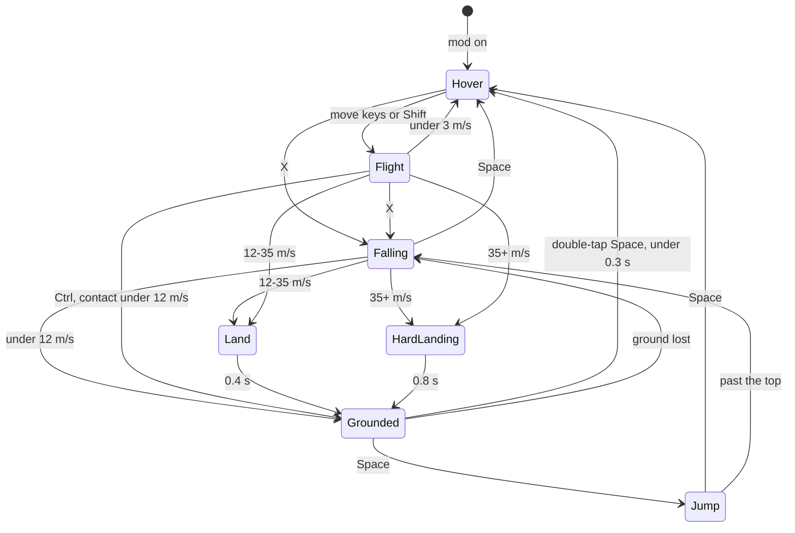
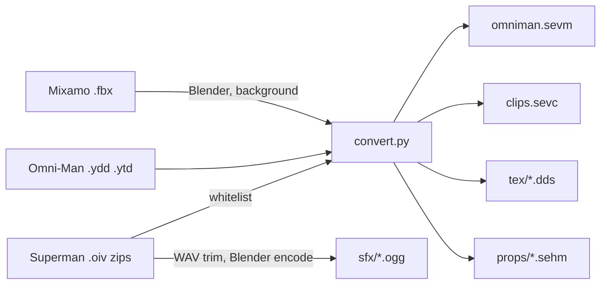

# Mods menu and Viltrumite powers

> Status: Draft · Date: 2026-11-06 · Baseline: 398e841
> Source: the user's request and interview of 2026-11-06, and research against the code at the baseline.
> Not independently reviewed: the user asked for the spec without a review pass.

Line numbers are as of the baseline. Nothing here has been run in the game except where it says so: every
millisecond, lag and feel number is an estimate to check and tune. Another session builds this, step by step,
without asking questions; where the user must act, the section below says what happens meanwhile.

## Summary

The game gets a **Mods** menu listing its installed mods. The first is **Viltrumite powers**, after the show
Invincible: clicking it puts you in a third-person view of Omni-Man, flying at the camera's spot. He flies from
hovering to far past light speed, stops flying and falls under each planet's real gravity, lands, walks, runs and
jumps. Flying through air makes a sonic boom at that planet's speed of sound, and faster still he glows from
aerodynamic heating. Hard landings make craters, and buildings are solid and collapse when he hits them hard.
Clicking the mod again returns to the normal free camera at the same spot. His animations and sounds come from a
GTA 5 Superman mod and his model from an Omni-Man pack, converted once and copied into the project for private use.

## What the user must do

The build is not blocked by any of these; each has a stand-in until it's done.

| # | Step | Until it's done |
|---|---|---|
| U1 | Download 8 clips from mixamo.com (free Adobe login) into `re/viltrumite/mixamo/`, FBX Binary, 30 fps, character Y Bot, "Without Skin", "In Place" ticked where offered. Names to search: an idle (`Idle` or `Breathing Idle`), `Walking`, `Running` (or `Standard Run`), `Fast Run` (or a sprint), `Left Turn 90`, `Right Turn 90`, `Cross Punch`, `Hook Punch`. Save as `idle.fbx`, `walk.fbx`, `run.fbx`, `sprint.fbx`, `turn_left.fbx`, `turn_right.fbx`, `punch_cross.fbx`, `punch_hook.fbx`. | The converter writes simple keyed stand-ins for the walk cycles and idle, and uses `export@nib@thor@heavy_punch_left` and the `uppercut` clip in `nib@batman.ycd` for punches. It warns, and the mod works. Re-running the converter replaces them. |
| U2 | Read the mod author's note on reusing assets, `https://www.patreon.com/JulioNIB/posts/using-my-assets-172960335` (named in `FiveM and mod creators note.txt`; Patreon refused it from here with a 403). | Nothing changes. The copy stays private, never shared or published. If the note forbids even this, tell the building session. |
| U3 | Judge the sounds and how it feels to play. | Numbers stay as tuned by the building session. |

## Goals / Non-goals

**Goals**

- A Mods menu that lists mods found on disk and turns each on or off.
- Viltrumite powers: hover, three flight speeds (cruise, fast, hyper), real falling and orbiting, walking, running,
  super jump, hard landings with craters and dust, punches, a ground punch, a thunderclap shockwave.
- Sonic boom and aerodynamic heating from real physics, per planet.
- Buildings are solid; a hit at speed collapses the whole building; it's back once he's 20 km away.
- A small corner readout. The normal panels are hidden while the mod is on.
- The mod off costs nothing. Nothing builds up: this project's worst slowdown came from a peak of GPU objects
  (CLAUDE.md, "Slowdowns over a session").

**Non-goals (first version)**

- Lasers, freeze breath, super breath, tornado, solar flare, grabbing or carrying, dismemberment. Not Viltrumite powers, and the
  game has no people or vehicles to use them on.
- People, enemies, AI, health, damage to him.
- A plug-in system, scripts, mods added without a rebuild, downloading mods.
- Going underwater (the game has no underwater view).
- Holes in buildings; lasting destruction; a saved list of broken buildings.
- Trees, lamps, benches, cars and orbital stations being solid.
- Controller support, rebindable keys.
- The Blood version of the suit.
- Foot IK (a hook for it is left, see F6).
- Saving his state: the mod is off at next launch.
- A 5-round session test. The user: "no need to test for a simple mod". The fixed-pool rules stay as design rules,
  and the cost numbers are aims rather than gates.

## Users & permissions

| Role | Can | Cannot |
|---|---|---|
| Player | Open Mods, turn a mod on or off, play him | Install mods without a build; turn the mod on while piloting a ship or while a script runs (greyed with the reason) |
| Test run (`--run`) | Everything through dev commands (F11) | Grab the cursor (`settings::scripted`, settings.rs:49); read or write the user's settings |

There are no accounts. The mod author's Patreon login belongs to the mod's compiled code, which this work never
opens or runs.

## Data model

### Files

| Path | What | Lifetime |
|---|---|---|
| `crates/se_engine/assets/mods/viltrumite/mod.cfg` | SE syntax, read with `se_core/src/sc.rs:170`: `Name`, `Description`, `Code "viltrumite"`, repeated `Need "relative path"` | In git, with the game |
| `.../viltrumite/omniman.sevm` | Own binary, `SEVM`, in the style of SEHM (library.rs:533, make_heroes.py:7): bones (parents, inverse binds), one draw per material with a `cutout` flag, 56-byte vertices with joints and weights | Converted once |
| `.../viltrumite/clips.sevc` | Own binary, `SEVC`: 30 fps, i16 quaternions, root translation only; per clip: loop, partial bone mask, `ground_z`, stride speed, event times | Converted once |
| `.../viltrumite/tex/*.dds` | Original BC3, top mips of flat textures dropped | Converted once |
| `.../viltrumite/sfx/*.ogg` | 27 sounds (F10) | Converted once |
| `.../viltrumite/props/*.sehm` | `nibsuper_ground_break1`, `nibsuper_rock1`, `nibsuper_rock2` | Converted once |
| `re/viltrumite/tools/convert.py` | The one-time converter, written in step 2. `python -I`, numpy. Out of git, like `re/megaton_rainfall/tools` | Kept |
| `re/viltrumite/tools/research/` | Working readers from the research: `rsc.py` (RSC7 and resource reader), `ycdlib.py` (clip decoder), `skin.py` (posed him with real clips: `sheet1.png`), `cape.py`, `add.py`, `contact.py`, `punch.py`, `tex1.py`, `ydr1.py`, `wav.py`, `heat.py`, `heat2.py` | Kept, start from these |
| `re/viltrumite/mixamo/*.fbx` | User step U1 | Kept, out of git |

About 50 MB in the project: textures 28, mesh 12, props 4, sprites 3, sounds 2.5, clips 2.

There is no save file. `Snapshot` in settings.rs gets no new field.

### Run-time state

| Name | Holds | Notes |
|---|---|---|
| `ModRegistry` | Each folder's `ModInfo { id, name, description, code, missing: Option<path> }` | Scanned once at start, `asset_dir()/mods` then the manifest fallback as orbital.rs:230 |
| `ModControl` | `active`, `menus`, `aftermath`, `dev` | `aftermath`: pools or broken table still draining after off |
| `ModInput` | One frame's snapshot: move axes, held keys, presses, mouse delta, wheel | Zeroed while a text field has focus |
| `Hero` | `frame: Attached { body, local_pos, local_vel, level } / Free { pos: UPos, vel }`, state, aim, yaw, flight tier, clock | One only, real seconds in `clock` |
| `HeroFrame` | `joints: [[Vec4;3];128]`, `light: PatchLight`, atmosphere values, `key`, `axes`, `centre`, `shadow_plane`, `heat`, `wind`, `town` | One `ShaderBuffer`, written in place with `cast_slice_mut`, as orbital.rs:82,178 |
| `FxRecords` | Cone, ring, shell, trail (256 points), craters (32), dust (64 bursts of up to 64 quads) | One storage buffer, written in place |
| `BrokenTable` | Binding 19 of the scatter: header `count, clock, capsule`, then 16,384 16-byte entries `(x, y, face|model, t0)` in 64 m squares, an entry in each square within 4 m | Made once. 4,096 broken at most |
| `ProbeList` | Binding 20: 1,024 48-byte records, `Inst` plus id; four fixed staging buffers; 8-entry ring of `(camera, body, orient)` by sequence number | Made once |
| `DebrisPool` | 1,024 chunk `Inst`s, CPU gravity | Made once |

### Numbers to tune

All in one `const` block in `viltrumite/tune.rs`.

| Name | Value | Meaning |
|---|---|---|
| `WALK`, `RUN`, `SPRINT` | 1.8, 5, 11 m/s | Sprint after Shift held 1.5 s. Clip rate 0.7-1.5 of stride speed |
| `JUMP` | 28 m/s up, no drag rising | Earth 40 m, Moon about 242 m |
| `FLY` | 20 m/s | WASD alone |
| Shift ramp | 300 m/s at 1 s, 3 km/s at 3 s, 30 km/s at 6 s | Logarithmic; tau 0.35 s |
| Space ramp | Beyond 30 km/s, x2 per Shift second | c after about 13 s more, 1000 c after about 23 s |
| Cap in air | 30 km/s | Below 25 scale heights |
| Cap in space | `max(30 km/s, 3 x distance to the nearest surface per second)` | c at 100,000 km; 1500 c at 1 AU; brake tau 0.2 s when over it |
| Guard | 1e26 m/s | Numeric only |
| Tiers (rising, falling) | Hover under 3; Cruise to 120 (100); Fast to 1,500 (1,200); Hyper above | Clips, F3 |
| Soft landing | under 12 m/s | Grounded at once |
| `LAND` | 12-35 m/s | Land 0.4 s |
| `HARD_LANDING` | 35 m/s and over | HardLanding 0.8 s, crater |
| `BREAK_SPEED` | 35 m/s along the wall's normal | The same as `HARD_LANDING` on purpose: Earth's terminal speed of 45 m/s then breaks a roof. Sprint and `FLY` stay under it |
| Drag `CdA/m` | 0.0078 | Earth terminal 45 m/s. Integrate implicitly, `v / (1 + c|v|dt)`: explicit blows up at speed |
| Attach height | below `min(0.5 R, 300 km)`, leave at 1.2x | |
| Punch reach | 5 m ray | |
| Ground punch | LMB aimed 45+ degrees down, within 15 m | Crater radius 6 m |
| Crater radius | `clamp(0.4 sqrt(v), 2, 60)` m | |
| Thunderclap | RMB held 0.4-2.5 s | Ring radius 30-150 m by charge. Doesn't break buildings |
| Slopes | walk to 50 degrees, slide to 70, wall above | |
| Camera | 6 m; wheel x0.9 a notch, 2.5-200 m; plus `0.8 log10(v/30)` over 30 m/s | |

## Flows

### F1. Mods menu

1. `Mods` button in `toolbar_main` (hud.rs:596-632, at the end of the list, as `tool(ui, "Mods", ...)`), toggling
   `HudState.show_mods`.
2. A window copying Places (hud.rs:1027-1056), `selectable_label` rows (ship/manager.rs:147), name and description.
3. Clicking a row runs `ModControl` on or off. Grey with the reason when: `Missing PATH`; a ship is being piloted;
   a script is running (`ScriptRunner::running`, scripting.rs:328); `Needs a newer build` (unknown `Code`).
4. First enable loads the assets and queues the pipelines, which take seconds. The row reads `Loading` and he
   appears when ready (`pipeline_watch.rs`). Assets then stay loaded and hidden; he is never respawned.

### F2. Turning on

Always flying (D4). Clear `travel`, `follow`, `track`, `hold_agl`. Hero at `cam.pos + forward x 6 m` in the Hover
state. If that's under the ground, lift it 2 m above. If the ground isn't loaded, hold him in the air with no
landing or splash until a level exists. A building box containing him when first seen is ignored until he leaves it.
Grab the cursor (Locked and hidden), hide the panels (F8). Start the paused loops (F10).

### F3. Off

Pose untouched, velocity 0, panels back, cursor back. Within 2 R of a body, bind `Follow::new(nearest, true)` or the
planet leaves (camera.rs:1095). Loops fade over 0.2 s and despawn. `aftermath` keeps the restore and the craters
running until empty, or turning the mod off would pop buildings back (D3). On exit: hand back in `Last`, before
`session::save_on_exit` (as scripting.rs:86). If piloting starts (`flight.active` from camera.rs:884, ship.rs:990, the
Ships window) or a script starts, the mod turns off first.

### F4. State machine

| State | Physics | Clips (main package, prefix `export@nib@super@` unless shown; `bf_` = `basicflight_`) |
|---|---|---|
| Grounded idle | On the ground (F6). Body yaw eases to the aim; over 70 degrees off, a turn clip | Mixamo idle, turn_left, turn_right |
| Walk, Run, Sprint | Accel 12 m/s2; body faces the move direction | Mixamo walk, run, sprint at `speed / stride`, starting on left-foot contact |
| Jump | Fixed impulse, no drag rising; gravity | `export@nib@male@jump_fall_start_stopped`, `export@nib@male@jump_fall_loop` |
| Falling | `gravity_at` plus drag; vacuum coasts and orbits | `fall`, `export@nib@male@jump_fall_down_loop` |
| Land | Short stop | `export@nib@male@jump_fall_land_hard` or `export@nib@land_r` |
| HardLanding | Crater, dust | `land_punch` (contact 0.27 s) |
| Hover | No gravity or drag. Holds still relative to the body | `bf_idle`, `bf_idle_arms_crossed` when still; `bf_idle_fwd_add`, `_bwd_add`, `_left_add`, `_right_add`, `_up_add`, `_down_add` per bone |
| Cruise | No gravity or drag | `bf_idle_combat2` |
| Fast | Same | `bf_fast_botharmsback` and its `_left`, `_right`, `_up`, `_down` |
| Hyper | Same | `bf_fast_rightarmpointingahead` with `bf_fast_left_add`, `_right_add`, `_up_add`, `_down_add`; `bf_hyper_up_rightarmahead` when climbing over 48 degrees |
| Take off | Crouch, launch | `charge_flight_stopped` (0-0.5 s), `bf_idle_to_fast` |
| Stopping | | `bf_break`, `bf_fast_to_idle` |
| Punch | Layered over the body, upper-body mask | Mixamo punch_cross, punch_hook; in flight `flying_grab_punching`, `flying_grab_punching3` |
| Ground punch | Crater, dust | `ground_punch` (contact 0.27 s) |
| Thunderclap | Hold to charge, release to clap | `thunderclap`, `thunderclap_flying` (hold 0.6 s, clap 1.23 s) |

The `_add` clips are absolute partial poses, not deltas (Spine_Root is 91 degrees from identity and 2 from the base
pose): blend them per bone with a mask. No clip has a mover track. Only `SKEL_ROOT`'s position moves; drop other
position tracks (they hold another skeleton's bone lengths: calf 0.407 against his 0.45). The `flightAnim_*` numbers
in the suit `.ini` are IDs inside the compiled code and can't be matched; don't try.

Flight input: W alone holds speed; no keys halves speed per 0.15 s. Above 30 m/s his body points along his velocity;
below, along the aim.

### F5. Frames and time

- `Attached` below the attach height: posed as ship.rs:1710 (velocity = body velocity + spin x r), plus Coriolis and
  centrifugal terms when falling. `Free` above: UPos and velocity with the ship's integration and carry
  (ship.rs:1455-1485). sim.jd's f64 rounding makes planets jump metres (ship.rs:561), so a freely integrated hero
  wobbles against nearby ground: walking must be Attached.
- Real `dt.min(0.1)` throughout, whatever the game clock does: he plays the same at x1000 and when paused, as
  ship.rs:1455. One real-seconds `Hero.clock` for him, effects, collapse and the table's `clock`.
- Reuse, making them `pub(crate)`: `ground_on` ship.rs:2084, `gravity_at` 1423, `reference_velocity` 499,
  `settle_landed` 2095, the air-speed helpers 478 and 534, `planet_shine` system.rs:1341.
- Collision in Free: each step, the segment against every loaded body's attach sphere in rel/shape space; cut there,
  attach, then sphere-trace the rest (step `max(0.8 alt, 1 m)`, 16 at most). Nothing in the game is swept today
  (camera.rs:1185). Known limit: a star not yet loaded can be flown through at 1000 c.

### F6. Ground

- One `support_height(dir)` used by walking, the feet and the shadow: the larger of `surface_sample` (terrain.rs:1282,
  clamps to the sea) and, from step 9, a building slice's top when his feet are within 0.7 m of it.
- Normal: three `ground_on` samples 1.5 m apart (no normal function exists).
- A finer node moves the ground: a visual offset eases out, tau 0.15 s. Same level, a drop over `0.6 m + v dt tan 50`:
  Falling. No level loaded: hold him in the air (F2), never the ellipsoid, because oceans' seabeds and burials follow.
- Feet: capsule on the height; root drops to the lower foot's sample, at most 0.25 m, smoothed; a `post_pose` hook
  stays for two-bone IK later.
- Soil displacement (planet.wesl:255-273, full within 1 km of the camera, measured +-0.8 m on Sahara and Mars,
  docs/missing_features.md:492): hold it down near him. In the vertex shader, `fade *= smoothstep(1.5, 8.0, distance
  to hero)` with the hero in a new `CloudShadow` field (binding 29, set after the reset at volumetric_clouds.rs:1071).
  Work in metres: planet.wesl:258 divides by a scale. The normal maps keep the stones. With the mod off the term
  must be inert and the ground identical.

### F7. Camera

- `aim = cam.rot`. Below `max(0.005 R, atmosphere)`, `horizon_turn` (camera.rs:960) with his own up, because
  `horizon_up` needs `cam.follow` (949); above, free as camera.rs:576.
- Position: head + aim x (0, 0.3, dist), from his exact UPos with no spring, so there's no jitter at any speed.
- Floor at ground + 2.0 m (ship.rs:2151) so `keep_camera_above_ground`'s 1.5 m radial push (terrain.rs:3492,3572)
  never fires. Under 40 m out, from step 9, pull in along the line of sight when `ProbeList`'s boxes cross it.
- Near plane after `sync_camera_transform`: `near.min((dist x 0.05).clamp(0.02, 0.5))`, because `near_plane` is 30 m at
  30 km height and reaches 1000 m (camera.rs:1241). Ship's fix: ship.rs:431,2160.
- Shake: rotation only, after sync_camera_transform (camera.rs:1251), at most 1 degree.

### F8. Input and the screen

One `PreUpdate` system after `InputSystems` (slot: scripting.rs:80) snapshots `ModInput`, then `clear_just_pressed`
(never `reset`, which drops held state: bevy_input button_input.rs:200,234) for Space, X, W, A, S, D; unless `menus`,
both mouse buttons' just-pressed and just-released. `FlightHold` is the wrong tool: `sync_hold` overwrites it each
frame (ship.rs:1314). `travel_and_move` (camera.rs:1090) tests `ModControl`. **`input_controls` is not gated whole**
(camera.rs:365): only the branches in the table.

| Input | While on | Where |
|---|---|---|
| W A S D | His moves | camera.rs:722-723 gated; Shift+A, Shift+D lose their just-pressed (switches.rs:188, camera.rs:800), a side effect of taking those keys |
| Space | Jump, fly up, take off. Doesn't pause | hud.rs:106 sees no press |
| Shift, Ctrl | Run or boost; fly down. Still modifiers for shortcuts | Read from `pressed` |
| X | Stop flying | overlay.rs:549 sees no press |
| Tab | Menus, not with Alt | Unused today |
| Left, right, wheel | Punch, charge, zoom; in `menus`, normal egui | Mouse look reads `pressed` (camera.rs:580-616) and the wheel scrolls (634), so gate those branches; pick_on_click overlay.rs:1536-1545 |
| R, F, Q, E, T, arrows, numpad, middle click, Shift+F, Shift+R | Do nothing: they steer or bind the free camera, which he owns now (T: the review of step 4; tracking is forced off below) | camera.rs:683-685, 724, 626, 804: gate |
| G and its forms, Z | Unchanged: Go To carries him, Z stops; then Hover. WASD cancels a Go To | camera.rs:728, 766 |
| C, End, H, Digits 1-3 and 5, Backspace, Home, PageUp, PageDown, +, - | Unchanged | They turn `cam.rot` (his aim) or change settings |
| Digit 4 | Starts piloting, so the mod goes off first | camera.rs:884 |
| Everything else (F keys, I, J, K, L, O, V, P, M, N...) | Unchanged | |

- While on, force `cam.follow` and `cam.track` off every frame, not once: the Track and bind buttons (hud.rs:727,731)
  and browser travel can set them.
- Tab: `retain` Tab out of `EguiInput` after `EguiPreUpdateSet::ProcessInput`. Otherwise egui focuses a widget
  (egui-0.36.2 memory/mod.rs:596,672), `egui_wants_keyboard_input` turns true (context.rs:2986) and guards like
  hud.rs:71 kill the keys. Zero `ModInput` while a text field has focus.
- In `menus`: mouse to egui, keys stay his, cursor visible.
- Focus loss counts as `menus`. On regain: `None` then `Locked`, swallowing the click and the motion spike. winit's lock
  is a 1x1 rect that focus doesn't reapply (window_state.rs:489-496, event_loop.rs:1025) and the game has no focus
  handling: the hidden cursor can drift to another monitor.
- Panels: gate inside `draw_hud` only (hud.rs:550): `toolbar_main` 596, `toolbar_filters` 633, `toolbar_navigation` 668,
  `toolbar_camera` 749, `info_table` 822. **Never gate `UiSet::Draw`**: it also holds orbits, labels, the pointer
  (overlay.rs:425), grids (grids.rs:109), constellations (constellations.rs:288), toasts (messages.rs:42). In `menus` the
  panels come back.
- Readout after Draw (script_gui.rs:53): speed (m/s, km/s, then multiples of c; own formatter, `format_speed` turns
  to ly/s at 1e4 c, units.rs:60), Mach in air, height above ground, gravity in g, heat bar.

### F9. Air, boom and heat

**Air** (`viltrumite/air.rs`, the only source for drag, the cap, the boom, heat, sound and the readout): `AirCache`
parameters (ship/air.rs:32) with `height_m = 25 H`, because `AtmoParams::state` gives zeros above `height_m` (aero.rs:305)
and the shell's top is only a drawing height (Earth 60 km, Mars 132, Venus 200; at Earth's 60 km, 30 km/s would jump from
nothing to 10,300 K). `T >= 0.25 T0`: Venus lacks Adiabat and floors at 20 K above 60 km (ship/air.rs:69, aero.rs:313).
Giants without `Pressure` (ship/air.rs:62): a fallback of 1 atm at the radius. Stars and bodies with no shell: no air.
Air speed: `vel - body_velocity - spin x rel` (ship.rs:1601). One mean temperature per body, no day and night: accept it.

**Boom:** three states, NoAir, Sub, Super. Air on at `p >= 150 Pa`, off at 100. Sub to Super at Mach 1.0: boom, loudness
by `log q`, 3 s cooldown. Super to Sub at Mach 0.92: `supersonicEnd`, a cone pulse, no boom. From NoAir or on enabling:
silent, so re-entry doesn't fire falsely (Mach reads 0 above the air, aero.rs:196). Top of the boom: Earth 55 km, Mars 16,
Venus 181; a 1 mbar world none.

**Heat:** `q = k sqrt(rho / 0.15) v^3 smoothstep(-7, -5, log10 rho)`, with `k` by molar mass: 40 and over `1.90e-4`, about
29 `1.74e-4`, H2/He `6.6e-5`. `T = min((q / (0.8 sigma))^0.25, T_air (1 + (gamma-1)/2 M^2))`: Sutton-Graves alone gives 800 K
at sea-level Mach 1. Low-pass: rise 0.4 s, fall 1.5 s. Only Earth's `k` was checked by search; the others come from memory
and matter little, since T goes as `k^0.25`.

| km/s to reach | 800 K | 2000 | 3500 | 6000 | 10000 |
|---|---|---|---|---|---|
| Earth, sea level | 1.0 | 1.9 | 2.6 | 4.9 | 9.7 |
| Earth, 60 km | 1.1 | 3.4 | 7.1 | 14.6 | 28.9 |
| Mars, ground | 0.9 | 2.3 | 4.8 | 9.8 | 19.5 |
| Venus, ground | 0.2 | 1.4 | 2.0 | 2.8 | 4.9 |
| 1 mbar | 1.1 | 3.5 | 7.4 | 15.2 | 30.1 |

Stages: dull orange at 800 K, yellow 2000, white and the plasma shell 3500, a blue-white trail 6000. Clamp the look at
10,000 K: 30 km/s at sea level is an absurd 23,300 K, Mach 89; past the clamp only the shell's size and the trail's length grow.

**Looks and where they draw** (one record buffer, no material changed per frame, no depth attachment; `clip.z = 0.5 w`
beats the near plane). Both passes need `clouds_pass`'s `CloudView` filter (volumetric_clouds.rs:1654), or they run on
every camera, and must still run when clouds are off (`clouds_pass` returns early, :1679).

| Effect | Where | How |
|---|---|---|
| Glow on the body | His main-pass material | `HeroFrame.heat` (T in kK, strength), `planck` as ship.wesl:145,269 times a windward term, before bloom |
| Craters | `fx_decals`, before `clouds_pass` | Multiply; reads depth, so it follows the ground, survives node changes, and takes the ground's light and cloud shadow. Bowl from an N.L ratio. A capsule test skips him |
| Shell, cone, rings, trail, dust | `fx_pass`, after `clouds_pass`, before `SolidUpscaleSet` | Soft depth; far parts dim by the clouds' transmittance beyond `trace_dist` (private textures, volumetric_clouds.rs:1441: make them `pub(crate)`) |

Additive meshes in the main pass are out: they write no depth, so every cloud on the ray dims them, even clouds behind
them (volumetric_clouds.wesl:2073). Plumes are the warning, and they change a material per frame (ship.rs:2250): don't copy.

- Cone: visible Mach 0.95-1.6, half-angle `asin(1/M)`, sunlit.
- Ring: rides with him 0.25 s (or the camera passes it in 15 ms), then anchored to the body.
- Trail: 256 body-frame points, spaced `max(4 m, v dt)`, rewritten camera-relative each frame. It runs end-on through a
  chase camera and may barely show: test it, and widen with distance if so.
- Skip shimmer: it needs a copy of the scene.
- HDR: glow 0.3-12, shell 15, trail 6, ring 3 (plumes run 15-20, bloom clamps at luma 50, bloom.rs:127,148). Never T^4 in
  brightness. No full-screen flash over 0.1 s (auto exposure darkens at 5/s and recovers at 1/s, exposure.rs:114-117). Check
  photo 0, 1 and 2.

### F10. Sound

Non-spatial (he's next to the camera and no listener exists), times `SoundSettings` (sound.rs:34). Voices as
engine_sound.rs:85,115-128. Mod sounds guarded by `is_ogg_vorbis` (music.rs:218; bevy_audio audio_source.rs:96-101 panics
on anything else). Loops buffer their decoded samples (fastFlight_loop is 29 s, about 10 MB), so the converter trims each
to 10 s with a crossfaded seam. Removing `AudioSink` alone restarts a sound (sinks.rs:135): despawn to stop. `set_speed`
changes pitch and speed together, which is fine here. On focus loss, fade and pause. One-shots: 8 at most, a quarter of the
volume in vacuum.

**Changed by the user, 2026-11-07:** this table first used `wind_loop`, `superWind_start` and `wind_end` for air rushing past, take
off and X. In the source mod those (with `wind_attack_1`-`3`) are its super breath: the wind he blows out of his mouth. Breath is a
non-goal, so none of them is used, and none is in the copy (a test and the converter refuse them).

| Loop | Volume | Pitch |
|---|---|---|
| `fastFlight_loop` | `log10 q` from 1 to 6: the air going past, at every speed | By Mach, low at low speed so it reads as wind: 0.6 at Mach 0.05 to 1.3 at Mach 20 |
| `fasterFlight_loop` | T from 2500 to 6000 K | |
| `sentry_flightfx_loop` (hum) | 0.12 while flying, and out of the air in every state (D12, "hum only" in Edge cases; the review of step 6), fading as `log10 q` goes 0 to 2 | 0.6 |
| `flightCharge_loop` | Right button held | |

| One-shot | Trigger |
|---|---|
| `supersonicStart`, `sonic_boom_v2` | Boom |
| `supersonicEnd` | Super to Sub |
| `fastFlight_start`, `fastFlight_fadeoff`, `fasterFlight_fadeoff` | Boost starts; boost released; leaving Hyper |
| `fastFlight_start`, at 0.35 of its volume | Take off |
| `superSonic_launch_1` | Shift pressed in Hover |
| `basic_move_sound_short_1` | Jump |
| `jump_exp` | Jump while sprinting |
| `sentry_flightfx_loop_end` | X |
| `flightCharge_start` | Right button down |
| `melee_start_1`, `melee_start_3` | Punch swing |
| `punch_1`, `punch_2`, `punch_3` | Punch |
| `hPunch_1` | Punch hits a building |
| `explode_ground1` | Hard landing. The mod has no splash, so on the sea at pitch 0.6: judge by ear |
| `sentry_tk_Smash_hit1` | Ground punch, a building breaking |
| `thunderclap1`, `thunderclap2`, `thunderclap3` | Thunderclap by charge |
| `sentry_tk_shockwave1` | Under a thunderclap on the ground |

### F11. Impacts and dev commands

- Crater pool 32: anchored to the body as terrain.rs:3548-3555, freed once he and the camera are over
  `FAR_RANGE_M + 500 m` away. **No distance fade before that** (D3: fading at 5 km would show one reappearing). Rims:
  `nibsuper_ground_break1` (4.8 m across, 11,388 triangles), half-sunk, within 2 km, scaled to the radius, `HullMaterial`.
- Dust pool: one, in `fx_pass`, for landings, ground punches, splashes and collapses. 64 stateless bursts of up to 64
  quads, sprites from `nibfx_super.ypt`'s `ptfx_smoke_wispy_anim` if convertible, else the port's own. Busy: steal the farthest.
- Thunderclap: ring, sound, dust kicked up when over the ground. No building break.
- Sea (`has_ocean` terrain.rs:932, surface at height 0): big splash, then Hover 1.5 m up. Never underwater.
- Dev commands, in camera.rs's match (1322) through `commands.queue` (1728): `mods list`, `mods on NAME`, `mods off`,
  `hero keys KEYS SECS`, `hero aim Y P`, `hero state`, `hero break`, which tests must use because `--run` has no real keyboard.

### F12. Solid and breakable buildings

The user was told solid buildings would need a second CPU copy of the city layout. Research found better; behaviour
is unchanged. A CPU mirror would be about 800 lines (372 of city.wesl plus about 200 of scatter.wesl, against about 50 in
city_roads.rs) and couldn't match Earth's placed-once lights patch (gpu.rs:540, earth.rs:104), `town_land`'s drawn height
(scatter.wesl:1079) or GPU rounding. So: **read back what the GPU has placed**. The list is exactly what's drawn; an unplaced
cell isn't drawn either, so a miss is harmless.

1. **Probe.** No new pass. In `cull_building` after the range fade, before the view planes (scatter.wesl:1341-1347;
   cull runs every slot every frame, gpu.rs:813, so buildings behind the camera are seen), behind a header flag: inside a
   capsule from him to `him + v dt (lag + 2)`, radius 40 m + the building's half-diagonal, append `Inst` plus id to
   binding 20, dropping on overflow. Readback as gpu.rs:832-834,862, four fixed staging buffers, never `ReadbackOnce`.
   Lag about 4 frames (estimate): at 300 m/s 20 m, 10 km/s 670 m, 30 km/s 2 km, inside the near range. Boxes don't move and
   the CPU solves against the list every frame, so walking feels no lag. Ranges by Cities setting: near 7/5/3 km, far
   20/14/9 km (scatter.rs:110-114); far cells hold only height 25 m and over (scatter.wesl:439).
2. **Identity by position**, because the record's hash uses cell-local `fc` (scatter.wesl:1358) and differs between near
   and far: face plus face metres x4 as i32 (`cell.tile`, `local + fc * edge`), matching within +-4 m and the same model (lots
   are 12+ m apart, city.wesl:150). Put the face in `Cell`'s spare float (scatter.rs:327). Set `cell.k` for all kinds (scatter.rs:885).
   `urban` and `core` are read at the grid point (scatter.wesl:557, city.wesl:213), so near and far centres and sizes can
   differ slightly: **prove +-4 m first** (step 9).
3. **Hiding.** `if count > 0` in `cull_building`, one branch when off: look up the table. Placement stays untouched, so CLAUDE.md's
   "same decision" rule isn't touched. A skybridge is hidden if its entry or either end's tower matches. An arcology's cleared lots
   stay cleared. A dome breaks alone. Flying lanes are never solid and never break.
4. **Collapse, stateless:** `T = clamp(2.5 + h/200, 2.5, 7)` s; `pos -= up * (h + plinth) * p^2`; scale kept, so facades don't
   squash; the depth test hides what's underground. A negative width (its f16 sign is free) marks a falling building: windows dark,
   emit off. **`scatter_draw.wesl:1186` and `:768` must both take `abs`**: today :1186 discards every such pixel and :768 mirrors the box.
5. **Rubble:** `cull_building` appends the same record as `M_RUBBLE`, a model of the port's own after the cars, with its own draw
   gate (gpu.rs:920): width and depth x1.25, height `min(0.18 h + 1, 30)`, growing with `p`. Its lifetime is the table entry.
6. **Chunks and dust:** `DebrisPool` with `nibsuper_rock1`, `nibsuper_rock2`, appended by a compute pass skipped when empty; dust
   from the one pool (F11).
7. **Restore:** he and the camera both at `FAR_RANGE_M + 500 m` or more: remove the entry, rebuilding the table at most twice a second.
   Use the constant whatever the Cities setting. Full: evict the farthest. Entries hold the body: another active body restores them.
8. **Hits:** sphere 0.45 m swept against the list. Over `BREAK_SPEED` along the normal: the building breaks and he isn't slowed. Under
   it: cancel the normal, slide. Punch ray hits: breaks. Shape: 8 height slices per model, half-extents from the mesh's vertices, for
   towers and hero models. Roof: `support_height` (F6).
9. **Bindings 19 and 20 exist even with the mod off,** and the scatter's pipelines are built at start: a binding error quits the port
   whether or not anyone uses the mod (CLAUDE.md).

About 1,300 new lines: shaders 130, gpu 150, library 120, logic 650, dust 200, tests.

### F13. Drawing him

- **Own bone palette, Cargo.toml unchanged.** Attributes `ATTR_HERO_JOINTS` (Uint8x4), `ATTR_HERO_WEIGHTS` (Unorm8x4); never
  `Mesh::ATTRIBUTE_JOINT_*`, which switch Bevy's pipeline (mesh.rs:3323). `HeroMaterial` binds one `ShaderBuffer`. Bevy's skinning
  would rewrite joint entities every frame for no gain; `bevy_animation` needs a removed feature and always-on systems (lib.rs:1322).
- **Own sampler.** Fixed `[Layer; 4]`: crossfade A and B, masked action, turning. Local nlerp with sign fix, parent-first FK, no
  per-frame allocation. About 50 us.
- **Opaque phase, depth written, no discard**, so clouds and the render scale just work. `cutout` draws (the hair, if its shader
  hash is `ped_hair_cutout_alpha`; 120,560 of 225,011 triangles are hair) use the same material in the alpha-mask phase. The transform is
  identity; the palette is camera-relative from his UPos after `sync_camera_transform`, so he's never compressed at any speed.
  `NoFrustumCulling`. `SHIP_LAYER` (warp.rs:44,173).
- **One lighting path.** Move `star_terms` and `point_light` (scatter_draw.wesl:178) into `ground_light.wesl`, with records and textures as
  arguments; the scatter wraps them. Near a Terrain with `drawn_nodes()`, copy `body_light` and `body_uniform.atm` (as gpu.rs:589,607):
  daylight, terminator, cloud shadow, haze, eclipses, moon and planet shine, ambient. `body_light` goes stale for an unresolved body
  (written at terrain.rs:3267, after the `continue` at 2959). Otherwise fill the same `PatchLight` on the CPU: stars as ship.rs:2208 with
  `sun_sprite_tint`, `planet_shine`, no tables, true metres. Colour: `surface_color`, `street_surface`'s highlight and lamp term
  (:528,530) times a town share (`nearest_settlement`, civilization.rs:306; Earth's patch, earth.rs:210).
- **Shadow.** The game has no shadow maps. Second entity, same meshes, `AlphaMode::Multiply`: vertices projected along the star onto the
  plane from three `support_height` samples 2 m apart, lifted 3 cm. Against double-darkening: depth write on, compare Greater, the fragment
  writes `frag_depth` from pixel and plane through `view.main_pass_viewport` (`frag_coord_to_ndc` is wrong under the render scale,
  view_transformations.wesl:222), so identical bits and the first triangle wins. Factor per channel `(sky + flat) / (sun*ndl + sky + flat)`, so
  clouds, night and eclipse fade it by themselves. Fades out at 10-200 m up; none in space. **If this doesn't hold up, a dark patch like the
  cars' is the fallback.**
- **Cape.** `feet_000_u` (592 vertices, `ped_cloth`) is simulated cloth in GTA: 548 of its vertices hold cloth codes rather than weights, and
  `.yld` holds its cloth. The converter rebinds it to 30 added joints (128 in all); run spring chains in the sampler, pinning its 44 skinned vertices.
  Air speed for the spring clamps at 60 m/s (above that it just streams back); in vacuum no wind, inertia only.
- **Capture views** copy the main camera's layers (capture.rs:201-208, projection.rs:285): he shows in hi-res tiles, the skybox export and
  fisheye faces, and environment cameras skip him (ship/envmap.rs:153, blackholes.rs:924). Accept it. `fx_pass` doesn't run on them.

### F14. Conversion, once

- RSC7 needs no key: a 16-byte header, then raw deflate. All 319 distinct main-package `.ycd` decoded (321 entries; add-ons 49). Decoder: `ycdlib.py`.
- Needed from the pack: `Omniman_MK_Kwabz.ydd` v165 (mesh, weights, shaders, the 98-bone skeleton inside `head_000_r`) and `.ytd` v13 (24 BC3 textures,
  normal maps RGB, negative v so Repeat). Not `.yft`, `.yld`, `.ymt`, not the `BloodVersion` files, not `feet_001`. 165,706 vertices, 225,011 triangles;
  the "med" LOD duplicates "high". Textures 84 MB raw, many flat. Bind pose faces -Y, clips +Y, Z up; 1.88 m; root at the pelvis.
- The route is our own converter, with the format learned from CodeWalker's MIT `Clip.cs`. Blender only for Mixamo FBX and Ogg. Not Sollumz (2.9.0 is installed in
  Blender 5.2, but reads `.ycd` only as XML and other binaries through Cfx.re's licensed PyMateria); not CodeWalker (wants a GTA V folder at startup).
- Zip whitelist. `.oiv` entries used: `.ycd`, `.wav`, `.ydr`, `.ypt`, `.txt`, `.ini`. **Never** open or run `.ndll`, `.asi`, `.dll`. Never touch GTA V's own `.rpf` archives.
- Mixamo retarget: match T-poses by world-rotation deltas (his bind is an A-pose). Hips to `SKEL_ROOT`, translation scaled by hip height; Spine, Spine1, Spine2 to
  `SKEL_Spine1-3`; limbs by name (UpLeg Thigh, Leg Calf, ToeBase Toe0, Shoulder Clavicle). Store stride speed from the planted foot. `RB_` roll bones aren't driven: check the
  forearms for twisting.
- Ogg encode: Blender's `avcodec-62.dll` contains libvorbis (never run yet). **If it fails, no tool download:** turn on Bevy's `wav` feature, store trimmed WAVs under `sfx/`, and
  adjust the guard and the size estimate.

## Edge cases & failure handling

| Case | Expected |
|---|---|
| Mod's file missing or corrupt | Row grey, `Missing PATH` or `Bad PATH`, a log line. Never a panic |
| Mixamo clips missing at conversion | Stand-ins, a warning (U1). Not grey |
| Enabled while a ship's piloted or a script runs | Grey with the reason |
| Starting to pilot, or a script, while on | Mod off first (F3) |
| Spawn underground or in a building | F2 |
| Ground not loaded | Held in the air; no landing, no splash, until a level exists |
| Sea, walking off the shore or falling in | Splash, Hover 1.5 m up; to walk on, fly to land |
| Gas giant | Never Grounded. Floor as terrain.rs:3565, +50 m. The camera's own floor applies only when clouds are active there, so use the same filter for his floor, or the camera is pushed to `ground_height` with clouds off |
| Star | Stops at `R (1 + 3e-6)` plus the camera's distance, since the camera's kept at 2e-6 R (terrain.rs:3536) |
| Black hole, model bodies (67P) | Default sphere stop, as the ship |
| Body with no atmosphere | No boom, no heat, no drag; hum only |
| Atmosphere under 150 Pa | No boom. Heat by density |
| Speed past the cap | Brakes, tau 0.2 s (Numbers to tune) |
| Very high speed near a body | Swept test; attach; eased by the cap |
| Low flight outrunning the ground's detail | The ground stays coarse. Contact uses what's loaded. Accept it |
| Game paused or at x1000 | He runs in real time (F5). Paused: cars and clouds freeze and he doesn't. The collapse clock keeps running |
| Date jump, Go To, body change | Attached is re-resolved; Go To carries him; broken entries of another body restore |
| Broken table full | Evict the farthest |
| Many collapses at once | 64 dust bursts; busy steals the farthest; the building still falls |
| Mod off near a crater or a collapse | `aftermath` keeps them until he's 20 km away |
| Alt-tab, second monitor | F8 |
| Text field focused | `ModInput` zero |
| Other windows open (star browser, Places) | Reached through Tab; they're egui and work as usual; `G` works |
| Cities Off, Vegetation Off | No buildings to hit; the mod still works |
| `scatter off`, `SE_SCATTER=0` | No probe; buildings aren't drawn and aren't solid |
| Domed colonies | The dome breaks alone (F12.3) |
| A window change, MSAA | Pipelines may rebuild; he may vanish for seconds, as the ground does (CLAUDE.md, GPU pipelines) |
| 3D clouds off (Clouds Off, `vclouds 0`), or the flat shells' cross-fade at 40-60 radii | Builder's call after step 7's review, accepted: SE's flat cloud shells write no depth, so his shell, cone and trail draw over a deck that's in front of them (he himself is hidden by depth as usual). Dimming them would need the cover map in `fx_pass`. The same for a crater under such a deck: its decal darkens the deck over it (review of step 8) |
| Exit while on | Hand-back before the session saves (F3); off next launch |

## Security & privacy

| Threat | Handling |
|---|---|
| Running or opening locked code | `Superman V2.ndll`, `.asi`, `.dll` are never read, decompiled, run or copied: the converter's whitelist enforces it, and the powers' logic is the port's own. The Patreon login isn't bypassed |
| Encrypted game files | GTA V Enhanced's archives are never read (the user's rule: don't defeat DRM). That's why walking comes from Mixamo |
| Untrusted downloads | `python -I`, read as data, a separate script folder; zip paths aren't extracted to disk; nothing from them runs |
| Bad asset files crash the game | Parsers in se_core bounds-check and return errors; mod greyed |
| Sound crash | `is_ogg_vorbis` guard before playing |
| Sharing others' work | Private use only: Omni-Man's model (by Kwabz), the mod's animations and sounds. Never shared or published; this repo is never pushed. CLAUDE.md's rule names them |
| Data | No network, no accounts, no personal data, no saved state |

## Integrations

| What | Failure | Handling |
|---|---|---|
| Blender 5.2, background mode, for FBX and Ogg | Missing or changed | Stand-in clips; the `wav` feature |
| mixamo.com | User step; free per secondary sources as of 2026-09, not checked directly | Stand-ins |
| CodeWalker's `Clip.cs` (MIT) | Reference only, nothing linked | |

The game never touches any of them at run time.

## Non-functional requirements

- **Off costs nothing.** Systems `run_if` active or `aftermath`. Non-scatter pipelines queue on first enable. The table check is one `count > 0` branch.
  Ground and forest pixels stay identical with the mod off: check with `.optimize/bench/compare.py`.
- **Nothing builds up.** At most about 8 meshes, one palette buffer, one effects buffer, fixed pools, made once and hidden, never respawned. No material asset is changed per
  frame (CLAUDE.md). No `ReadbackOnce`. New GPU objects: dozens, not a growth. `wgpu_peak` in `SE_PERF` shows it cheaply if in doubt.
- **Cost aims, not gates:** about 1.5 ms a frame on, up to 3 ms briefly at peaks, at Ultra 3440x1440, RTX 5080. Estimates: lit body 0.1 per pass, shell and cone 0.2, trail 0.05, ring 0.1, decals 0.1, CPU 0.1,
  dust peak 1 ms. Unknown until run: 225,011 triangles and hair overdraw with no LOD. If the body is too dear, drop hair triangles at distance in the converter.
- **Memory:** loaded on first enable, stays until quit. About 50 MB plus decoded loops of 10 s each.
- **Logging:** `se.log` on load, grey reasons, stand-ins in use.
- **Undo:** mod off; `SE_MODS=0` hides the button for comparisons, as `SE_ORBITAL=0`.

## Codebase impact

New: `crates/se_engine/src/mods.rs` (registry, window, `ModControl`, `ModInput`); `src/viltrumite/` (`mod.rs`, `tune.rs`, `hero.rs` state machine, `frames.rs`, `ground.rs`, `camera.rs`, `anim.rs`,
`cape.rs`, `draw.rs`, `air.rs`, `fx.rs`, `impact.rs`, `sound.rs`, `breakable.rs`, `readout.rs`); `crates/se_core/src/hero_asset.rs` (SEVM and SEVC parsers, tested); `assets/shaders/hero.wesl`, `hero_fx.wesl`;
`assets/mods/viltrumite/`.

| File | Change |
|---|---|
| `src/main.rs` | Add the plugins |
| `src/hud.rs:19-32, 550, 596-632, 106, 633, 668, 749, 822, 1027` | `show_mods`, button, window; panels gated; Space guard |
| `src/camera.rs:576-634, 683-724, 804, 884, 1090, 1322, 1728` | Gates per F8; dev verbs |
| `src/ship.rs:478, 499, 534, 1423, 2084, 2095` | `pub(crate)`; `flight.active` turns the mod off |
| `src/system.rs:1341` | `planet_shine` `pub(crate)` |
| `src/overlay.rs:549, 1536-1545` | Nothing, if `clear_just_pressed` reaches them: verify. |
| `src/terrain.rs` | Nothing new, unless hero soil data needs it; read-only use of heights |
| `src/volumetric_clouds.rs:394, 1071, 1441, 1654` | `CloudShadow.hero`; `pub(crate)`; pass order for `fx_decals`, `fx_pass` |
| `assets/shaders/planet.wesl:255-273` | Soil hold-down |
| `assets/shaders/ground_light.wesl`, `scatter_draw.wesl:178` | Lighting moved, shared |
| `assets/shaders/scatter.wesl:1341-1347` | Probe, table check, rubble append |
| `assets/shaders/scatter_draw.wesl:768, 1186` | `abs`, dark windows, `M_RUBBLE` |
| `src/scatter.rs:327, 885`, `src/scatter/gpu.rs:813-862, 920`, `src/scatter/library.rs` | Bindings 19, 20; staging; rubble model, keeping `BUILDING_MODELS` and the `S_*` constants in step |
| `.gitignore` | `/re/viltrumite/` (done) |
| `CLAUDE.md` | The asset rule (done), a gotcha per step |
| `README.md`, `PROGRESS.md` | Each step |

Not changed: `Cargo.toml` (no `bevy_gltf`, `gltf_animation`, `bevy_animation`), unless the Ogg fallback adds `wav`. `settings.rs`, `session.rs`. `sync_hold`.

## Implementation order

Each step builds, passes the tests, gets checked with pictures and is committed before the next (CLAUDE.md). At steps 4, 7 and 10, tell the user what to try, then carry on unless they say otherwise.

| # | Step | Shows | Depends on |
|---|---|---|---|
| 1 | Mods menu, `mod.cfg`, registry, grey reasons, `ModControl`, dev commands. An empty mod that toggles | Window with the row; missing file greys | |
| 2 | **End-to-end asset proof first:** one mesh, one clip and one sound from the zips to files. Then `convert.py` in full, with stand-ins | Files, sizes, a contact sheet; a real Ogg plays in a test, or the `wav` fallback | 1 |
| 3 | `HeroMaterial`, palette, one lighting path, `bf_idle` playing, near plane. Pictures of him beside trees: Earth by day, a full-moon night (2026-11-24 14:53, 20 N 137 E), cloud shadow, orbit. Forest and ground pixels unchanged after the move, compared with the baseline | He stands lit correctly in every case | 2 |
| 4 | Flight, frames, camera, input table, focus, panels and readout, the space ramp, X, falling and orbiting, swept collision, sampler and tier clips | Fly from orbit to a planet, stop, fall; Tab; alt-tab; Earth at x1000 and paused | 3 |
| 5 | Walking: Attached ground contact, slopes, jump, landings, sea, giants, stars, soil hold-down, shadow, cape, Mixamo clips | Walks on Earth and the Moon, a jump six times higher, feet on the Sahara | 4 |
| 6 | Sound: `air.rs` drives the loops, one-shots, focus | Levels by air | 4 |
| 7 | Boom and heat: glow, cone, ring, shell, trail, table above | Earth, Mars, Venus and a thin world match the table; a dive from orbit; photo 0, 1, 2 | 4, 6 |
| 8 | Impacts: crater pool, dust pool, punches, ground punch, thunderclap, splash, shake | Each impact, in clouds and clear | 5, 7 |
| 9 | **Probe alone first:** log lag, counts and near-far centre shift flying near-far-near in New York and on a level 3 planet (`SE_CIV_TEST=2 SE_CITY_TEST=1`). If shift exceeds 4 m, widen or change the id here, before anything depends on it. Then stop, slide, roofs, camera pull-in | He stands on a roof and slides along a wall | 5 |
| 10 | Table, hiding, collapse, rubble, chunks, dust, restore, `aftermath`. Dev `hero break`. All building types: boxes, towers, skybridges, arcology, landmarks, huts, domes | A collapse near and far, returning after 20 km with none reappearing in view | 8, 9 |
| 11 | Costs measured with `SE_PERF`, mod-off pixels compared, README, notes | The numbers | all |

Prototype risks in this order: the asset route (step 2), the shared-shader move with a pixel compare (step 3), Attached/Free handover on a turning Earth (step 4), Tab, grab and egui focus together (step 4), building identity (step 9).

## Decisions log

| # | Decision | Alternatives considered | Reason |
|---|---|---|---|
| D1 | Movement and impacts only: walk, run, super jump, hover, three flight speeds, hard landings, ground punch, thunderclap | Movement only; everything in the mod | User's pick. The game has no people or vehicles; Viltrumites don't have lasers or freeze breath |
| D2 | Buildings solid and breakable; whole building collapses over seconds; trees and small objects pass through | Pass through; solid only; holes then collapse; vanish behind a blast | User's pick. Each building is a box with windows painted by a shader, so holes would need new drawing for every kind |
| D3 | Rubble and craters last until he's 20 km away | Until quit; saved for good | User's pick, keeps the least data |
| D4 | Always starts flying at the camera's spot; clicking again returns there | Decided by distance to ground; ask each time | User's pick |
| D5 | Flight overcomes gravity; X gives real falling and orbiting; fixed jump impulse | Gravity always pulls; ground and falling only | Easy to control, real physics otherwise |
| D6 | In air up to 30 km/s; in space past light speed with no limit, easing near bodies | Stop at c; 1% of c | So he can actually go places |
| D7 | Converted once and copied in; no GTA readers in the game; normal suit only | Read from Downloads each launch; both suits; blood after impacts | As Megaton Rainfall. Works if Downloads moves |
| D8 | Mods built in, one folder each | Plug-in system | Keeps the menu simple; a plug-in system would come first otherwise |
| D9 | Real physics for boom and heat, per planet; neither hurts nor slows him | Fixed speeds | User's pick |
| D10 | Controls in F8; keyboard and mouse; fixed keys | Controller; hold left button to aim | Third-person standard |
| D11 | Mixamo clips the user downloads | Public-domain mocap; hand-keyed | Best quality. GTA's own walks are encrypted, off limits |
| D12 | Quiet in space, not silent | Fully silent; same everywhere | User's pick |
| D13 | Panels hidden, small readout, Tab for menus | Keep panels; nothing | User's pick |
| D14 | Sea, giants, stars, ships, no health, off next launch as in Edge cases | Underwater as a later step | User's pick |
| D15 | Off costs nothing; fixed pools; no 5-round test; cost numbers are aims | Gated limits; 1 ms; 3 ms | The user: "no need to test for a simple mod" |
| D16 | (2026-11-07) The controls are those of the user's own Viltrumite mod (`C:\Users\liamw\Desktop\Viltrumite`, its `Flight.cs`, `Stacks.cs`, `Combat.cs`, `ChaseCamera.cs`, `Audio.cs`, `Hud.cs`); this replaces F8's keys for his moves (D10) | F8 as built in step 4 | The user: "i want the controls to be how it is in C:\Users\liamw\Desktop\Viltrumite", plus a shake when he goes supersonic, louder sounds, wind when he's fast in air, and the charge-up on Space |
| T1 | Read back placed buildings instead of a CPU mirror | CPU mirror (what the user was told) | Matches what's drawn including Earth and level 3; about 800 lines fewer of mirrored code; lag is harmless |
| T2 | Own binary format, not glTF | glTF | New crates, per-frame plugins, no BC3 |
| T3 | Own palette and sampler, not Bevy's | Bevy skinning; `bevy_animation` | Costs against D15, a removed feature |
| T4 | Converter of our own | Sollumz; CodeWalker | PyMateria's licence; needs GTA V folder |
| T5 | `BREAK_SPEED` equals `HARD_LANDING`, 35 m/s | Separate 60 m/s | Otherwise a fall on a roof makes a crater but no break, and Earth's terminal speed never breaks anything |
| T6 | Effects in passes after clouds; only the glow in the main pass | Additive main-pass meshes | Clouds dim them wrongly |
| T7 | Run 5, sprint 11 m/s | 7, 14 | Mixamo's run is about 4 m/s, so feet would slide past the 1.5x clip rate |
| T8 | Real-time clock for everything of his | Game clock | Same feel at any speed, works paused |

## Open questions

| # | Question | Owner | Blocks |
|---|---|---|---|
| Q1 | Does the mod author's note allow this private use? | User (U2) | Nothing unless it forbids it |
| Q2 | Is Mixamo still free as described? | User (U1) | Nothing, stand-ins |
| Q3 | Do feel numbers work? | Builder, then user (U3) | Nothing |
| Q4 | Does `Catalogs.pak`'s Jupiter have no `Pressure`? The research couldn't read the pak | Builder, step 7: **settled, it has none, nor have the other three giants** | Nothing; the fallback handles both |
| Q5 | Near and far building centres within 4 m? | Builder, step 9: **settled: measured within 0.25 face m (one unit of the id; 0.15 m true at most) over 919 pairs, worked out about 2.3 face m at the worst (a box's front and back setbacks follow `down`: review of step 9a); the id is kept as specified, matched within +-4 face m. Heights and existence differ more** (Build log, step 9a) | Step 10's design, not its behaviour |
| Q6 | Can hero model shapes (temple, arcology) be slices enough? | Builder, step 9: **measured: yes for the boxes, the arcology, the stepped and tapering towers and the temple; the twisted tower wants turned boxes, the spires their own; the watchtower's and the landmark's open frames fill 4-48 % of their boxes** (Build log, step 9a) | Nothing; coarse boxes are acceptable |
| Q7 | Does the trail read from behind? | Builder, step 7: **settled, not from straight behind; in any turn it does** (Build log) | Nothing |

## Verification claims

| ID | Claim | Where | How to check |
|---|---|---|---|
| C1 | A Mods button and window exist | `src/hud.rs`, `src/mods.rs` | grep `show_mods`, `"Mods"` |
| C2 | Mods are found on disk with no plug-in loader | `src/mods.rs` | grep `asset_dir`, `mods`, `Need`; no `libloading`, Lua or WASM in `Cargo.toml` |
| C3 | No locked code opened | `re/viltrumite/tools/convert.py` | Whitelist present; grep rejects `.ndll`, `.asi`, `.dll`, `.rpf` |
| C4 | No blood suit, no lasers, freeze or breath in the copy | `assets/mods/viltrumite/**` | No `Blood`, `feet_001`, `laser`, `freeze`, `tornado`, `solar`, `wind_`, `superWind`; about 50 MB |
| C5 | No GTA readers in the game | `crates/**/*.rs` | No `RSC7`, `.ycd`, `.ydd` parsers outside `re/` |
| C6 | Own formats, no new Bevy features | `Cargo.toml`, `src/`, `se_core` | `SEVM`, `SEVC` present; no `bevy_gltf`, `gltf_animation`, `bevy_animation`; `wav` only if the fallback was used |
| C7 | Own palette | `src/viltrumite/`, `hero.wesl` | No `SkinnedMesh`, no `ATTRIBUTE_JOINT_`; `ATTR_HERO_JOINTS` present |
| C8 | Written in place | `src/viltrumite/` | `cast_slice_mut`; no `Assets<HeroMaterial>` `get_mut` per frame |
| C9 | One lighting path | shaders | `fn point_light` lives in `ground_light.wesl` |
| C10 | Render-scale-safe shadow | `hero.wesl` | `main_pass_viewport` present; no `frag_coord_to_ndc`; no `discard` in the opaque path |
| C11 | Input by snapshot, without reset or FlightHold | `src/mods.rs` | `clear_just_pressed` present; no `keys.reset`; `sync_hold` unchanged; no new `FlightHold` writers |
| C12 | Tab out of egui | `src/mods.rs` | `EguiInput` Tab `retain` |
| C13 | Panels gated, not UiSet::Draw | `src/hud.rs`, `src/skin.rs` | Gate in `draw_hud`; `skin.rs` has no new `run_if` on `UiSet::Draw` |
| C14 | One air source | `src/viltrumite/air.rs` | Drag, cap, boom, heat, sound and readout all call it |
| C15 | Boom hysteresis and silence on entry | `src/viltrumite/air.rs` or `fx.rs` | States NoAir, Sub, Super; 3 s cooldown; a unit test: re-entry doesn't boom |
| C16 | Heat matches the table | `se_core` or `viltrumite` test | Unit test: Earth, Mars, Venus at the table's speeds within 10% |
| C17 | Passes in order | `src/viltrumite/fx.rs` | `fx_decals.before(clouds_pass)`, `fx_pass.after(clouds_pass).before(SolidUpscaleSet)`; `CloudView` filter |
| C18 | Sound guarded | `src/viltrumite/sound.rs` | `is_ogg_vorbis` |
| C19 | Read back, no mirror | `se_core/src/procgen/city_roads.rs`, `scatter.wesl` | No `ct_building` twin; `broken_at` in `cull_building`, none in `place_building`; probe `MAP_READ` buffers made only at start |
| C20 | Both `abs` | `scatter_draw.wesl:768, 1186` | Read |
| C21 | Rubble model and restore constant | `scatter.wesl`, `scatter_draw.wesl`, `src/viltrumite/breakable.rs` | `M_RUBBLE`; restore and crater freeing use `FAR_RANGE_M` |
| C22 | Off costs nothing | `src/viltrumite/*`, `.optimize/bench/compare.py` | `run_if` on active or `aftermath`; identical pictures with the mod off against the baseline |
| C23 | Rule recorded | `CLAUDE.md` | Names Viltrumite beside Megaton Rainfall |

Later: `/spec-interview --verify docs/spec-mods-viltrumite-powers.md`.

## Build log

One short paragraph per step: what was done, what later steps need, what differs from the spec and why.

**Step 1, Mods menu (commit below this one in `git log`).** `src/mods.rs` holds `ModRegistry`, `ModControl`, the empty
`ModInput`, the window, the grey reasons and the dev commands; `assets/mods/viltrumite/mod.cfg` has no `Need` lines yet, so
each later step adds the files it creates. For later steps: `crate::mods::mod_file(id, rel)` finds a mod's file (beside the
exe, then the source tree, per file); `ModRegistry::mark(id, reason)` greys the row when a parser refuses a file;
`ModControl.loading` makes the row read `Loading` (step 3 sets it); `ModControl::off(&reg, why)` is the one way off, so hang
the hand-back (F3) on it; `dev` says a dev command turned it on. `off_for_pilot_or_script` then `apply_request` run in `Update`
after `ship::ship_input` (Enter, F, the Ships window), `camera::move_mode_keys` (key 4) and `camera::input_controls`, before
`scripting::run_script` (all now `pub(crate)`, with `FlightKeys`);
step 4's hero systems should run after them. `ScriptRunner::starting()` is `running()` or a script requested. `off_on_exit` is
the `Last` hook before `session::save_on_exit`. New dev commands beyond the spec's: `mods window [off]`, `uiclick X Y` (a real
egui click: at the test window's 1600x900 the Mods button is at 30 841, the first row at 930 71), `script PATH`; `SE_UI_OPEN=mods`
also opens the window. Differs from the spec: `ModInfo.fault: Option<GreyReason>` instead of `missing: Option<path>`, because
it also holds `Bad` and the unknown `Code`; `Bad` also covers an empty file, a folder where a file should be and a `Need` path
leaving the mod's folder (deeper checks wait for the parsers); `active` is the mod's folder name, one mod at a time. A row's
description and "No mods found" are `ui.label`, since `ui.weak` is nearly invisible under the skin. A script's `HideAllDialogs`
closes the window (`Dialogs::hide_all`). The one way to pilot not in the order is `ship/persist.rs` `restore_ships`: it runs once at
start, with the mod off, so it needs none. A test drives the plugin's order against the real key 4
(`key_4_turns_the_mod_off_in_the_frame_piloting_starts`; it fails without the `move_mode_keys` line). Learned: pictures before about 1500 frames can be
all black, even the panels, while the pipelines build, whatever the mods do. `refs.sh`'s ground scenes waited 1200 frames, about
8 s on this machine: half the runs caught Earth's ground half loaded, pale, a 55-level difference that looked like a bug and has
nothing to do with mods (the baseline does it too; never at 3000 frames, 10 runs). They now wait 3000. For "unchanged with the mod
off", run the baseline from a folder with no `assets` beside it (`.optimize/scratch/baseline_noassets`, the same exe), so both read
the same files. Earth's noise moves between runs (0.02 to 0.25 mean between the baseline and itself), so compare several; `rsground`
is the sharp test: bit-identical with `SE_MODS=0`, and as played only the toolbar's rectangle differs.

**Step 2, the asset route (commits below this one).** The proof came first, on its own (`convert.py --proof`: the head, `bf_idle`, `punch_1`), read back by the game's parser and played in a
test run; only then the rest. All of it is `re/viltrumite/tools/convert.py` (`python -I`, numpy; `--check-guards`, `--proof`, `--mixamo DIR`, `--out DIR`, `--check-test-fbx`, `--no-sound`, `--only-clips`),
`sheet.py` (the contact sheet, from the converted files alone: `re/viltrumite/sheets/contact_step2.png`) and `make_test_fbx.py`, all out of git. **For step 3, the axes:** model space is metres, **Z up, +Y the way a clip faces,
+X his right hand** (right-handed), origin at the pelvis, ground about -1.0 (`Clip::ground_z`, the lowest sole by real skinning, per clip). The bind pose faces -Y because `SKEL_ROOT`'s rest rotation is exactly 180 degrees about
Z; a full clip's root rotation is about the identity, which turns him to +Y, so nothing needs correcting: start each full clip from the bones' rest locals and overlay its tracks (rest, then tracks, gives +Y). The port's Y-up
is step 3's one fixed rotation (model (x, y, z) to port (x, z, -y) is what SEHM uses). Skinning is `world * inverse_bind * vertex`; rest FK times inverse bind is the identity for all 128 (tested). `HeroAssets` (mods.rs) holds the parsed model and clips from first enable on; parse time is logged (`read in N ms`). **The formats** are in `se_core/src/hero_asset.rs`'s header comment.
`ClipSet::find` takes the real name (`.ycd` stem), `basicflight_idle`, `bf_idle` or `male@jump_fall_loop`; Mixamo's are `idle`, `walk`, `run`, `sprint`, `turn_left`, `turn_right`, `punch_cross`, `punch_hook`, whether real or stand-in (`Clip::stand_in`, logged). Sampling: frames 1/30 s apart, `duration = (frames - 1) / 30`, a loop's last frame equals its first. Track samples are 1 (constant) or `frames`; tracks with the rest pose's value and tracks of the 24 bones that move no vertex are left out, so a *full* clip's missing bone means rest, a *partial* clip's (`_add`, `CLIP_PARTIAL`, `Clip::mask`) means leave the layer below alone. Partial clips carry no root position; a few carry the root's rotation, as authored.
**Clips that aren't plain loops:** the lean clips and `fall` (the review paragraph below). `bf_idle_combat2` plays forward then back, so it's twice as long (a seam of 21 degrees in the left hand's fingers alone: the fist closes and opens, the body's bones close at 0); seams under 5 degrees are taken up over the last 10 frames (`close_loop`). `flying_grab_punching*` are one-shots with `hit` at 0.5 s. **Events:** `land_punch`, `ground_punch` `contact` 0.27; `thunderclap`, `thunderclap_flying` `hold` 0.6, `clap` 1.23; `charge_flight_stopped` `launch` 0.5; punches `hit`; walks `foot_l`, `foot_r` (about where each foot lands: the spec's "start on left-foot contact" is `foot_l`, 0.03 s for the stand-ins). Stride speeds of the stand-ins: walk 2.2, run 4.2, sprint 9.0 m/s; the numbers-to-tune speeds stay in the 0.7-1.5 rate. Some clips turn the root a lot (`land_r` 74 to 20 degrees of root yaw, though his chest starts about straight; the batman punch spins and the thor punch leaps, root height up to 0.84, which the upper-body mask hides): judge in step 5 and 8 which to prefer; nothing was normalised. **Cape:** 5 chains of 6 from bone 98, `CAPE_c_l`, each chain's first joint a child of `SKEL_Spine3` and rigid with it, the others following (`HeroModel::cape_*`, draw flag `DRAW_CAPE`, opaque); a link's bind world rotation is the identity, so its local position is its bind vector. The sheet is a wide diamond (1.47 m at the hips, narrow at the shoulders, a tip at the bottom), and chains fan across it (x over half-width) so the outer ones are longer (1.55 m against 1.1): `sheet.py`'s `pose` eases each link 85% towards hanging, a good start for step 5's rest direction; the hem then has points, as a diamond's would. The cape's two sides are separate coinciding triangles: back-face culling is needed or they fight. **Draws (7):** `lowr_000_r`, `uppr_000_u`, `head_000_r`, opaque; `teef_000_u`, `berd_000_u`, `hair_000_u`, `DRAW_CUTOUT` (all three are `ped_hair_cutout_alpha`; `teef` has no alpha to cut); `feet_000_u`, the cape. `accs_000_u` is one stray triangle, left out. Uv's v is negative, so Repeat. Normal maps are RGB. **Differs from the spec:** the props' `rock.dds`, `rock_N.dds` are in `props/` (the small rocks' own rock textures differ a little; one copy is used) and their uv stay the model's own, `v + 5000` (layer 0), not metres; `sprites/ptfx_smoke_wispy_anim.dds` is a 7 x 7 flipbook read row by row, 1.4 MB against the 3 estimated; identical textures are one file (`berd_spec` is `berd_diff`, `hair_normal` and `teef_normal` are `feet_normal`, so a draw's names can point across parts); a flat texture's top mips go only when the picture really doesn't change, and sharp edges count: the suit's two diffuse maps keep 1024, the flat ones go to 64. **Sizes:** 51.6 MB (estimate 50): textures 31.8 (estimate 28: the beard's 2048 pair alone is 11), mesh 12.0, props 4.4, sprites 1.4, sounds 1.2 (estimate 2.5, at 128 kbit/s), clips 0.6 (estimate 2). **Sound:** Blender's `aud` module writes real Ogg Vorbis (`aud.Sound.write`, container and codec constants), so no `wav` feature and `Cargo.toml` is unchanged. `mods::check_sound` guards, decodes once and catches the decoder's panic; the dev command `mods sound NAME` plays `sfx/NAME.ogg` and logs decoded, playing, finished. The encoder pads a file's end to its block, which would gap a loop: `make_loop` cuts to a whole number of 2048 samples and the test decodes every loop and checks the seam (jumps under 0.016). **Hooks:** `apply_request` looks inside every file on first enable and `ModRegistry::mark` greys the row on a refusal (`Bad omniman.sevm`, picture checked with a cut-short copy beside a copied exe); the `Need` lines are written by the converter (55). **Mixamo route:** Blender imports each FBX and writes world matrices to an .npz; `retarget` builds his T-pose by pointing each mapped bone the way Mixamo's points, then applies world-rotation deltas; axes come from the file's own hips, head and legs. Tested on 8 FBX files Blender wrote itself with Mixamo's names, a T-pose and odd bone rolls: `--check-test-fbx` checks axes, signs, the mapping, the stride and the turn's direction, and the sheet looks right; re-running with the files replaces all 8. Learned: Blender's FBX exporter writes the current frame's pose as the file's rest, and the method needs the rest to be the T-pose, as Mixamo's files are said to have (not checked on a real one: `retarget` warns if not). `RB_` roll bones aren't driven by it: look at the forearms when real clips come. **Not checked:** how anything sounds, how the stand-ins feel in motion (the sheet is stills), the real Mixamo files, the textures on the GPU (step 3).

**Step 3, drawing him (commits below this one).** The shared-shader move came first, alone (`7bfb8fc`): `PointLight`, `star_terms`, `point_light_at` (was `point_light`), `lit_surface` (was `surface_color`) and a new record `LightBody` are in `ground_light.wesl`, the scatter wraps them. **Pixel proof, and how to repeat it:** `.optimize/bench/pixel_scenes.sh`, `freeze_clocks.py`, `pixel_cmp.py`. Two folders, each an exe with `assets/shaders` from `freeze_clocks.py` (every clock in the shaders stopped: `lod2.z`, `street.y`, `globals.time`), `SE_MODS=0`, and `pause` before `timing frame` before `date` (with `date` first the sky moved between runs and the camera with it). Then a forest at 1.7 m, New York by day and night and a generated planet are bit-identical to the baseline's shaders (a few HUD digits apart); Earth from 300 m, Saturn, space and a generated planet's ground differ by what two baseline runs differ by (1.7 %, 3.5 %, 26 % and 2.1 % of pixels by at most a level or two, some bright points). Measure that noise first: one baseline run of New York by night differed from another in 13 % of its pixels. **Then him.** `src/viltrumite/`: `mod.rs` (`Hero`, the plugin, dev commands), `draw.rs` (`HeroMaterial`, `HeroFrameGpu`, the light, first enable), `anim.rs` (`Sampler`: four layers, FK, the cape's static hang, 2 us a frame), `tune.rs`. **For step 4:** `Hero.place` (`Free`, `Rides { target, locked, local }`, `On { body, local }`, `rot` port axes in that frame, `world` the result in the universe) is the simple stand-in for the real frames, and `place_ahead`, `put`, `set_pose`, `ride`, `carried`, `upright`, `keep_standing` and the dev verbs `here`, `stand`, `face` go when they come; `update_hero` is the one place he's worked out each frame, after `terrain::update_node_transforms` and before `CameraUpdateSystems`, so keep the near plane and the palette there. `Hero.sampler.layers` is the `[Layer; 4]`; `Sampler::play`, `advance` (lean clips keep the time they're given), `sample`, `write_palette`. A full clip's layer sends bones under its `mask` without a track to rest; a partial one moves only its tracks. `Hero.clock` is the real-seconds clock (`Time<Real>`, `dt.min(0.1)`). Model space to the port is `model_to_port` (x, z, -y). `ModControl.hero` says the mod that's on is this one (`update_hero` runs on `hero_shown`); `loading` is set by `apply_request` and cleared by `update_hero`. **For step 5:** `hang_cape` is what the springs replace; a link's rotation must be the chain top's rotation first (`arc(rest_dir, want) * top`): the sheet's `pose` turned only by the arc, which leaves the normals pointing into him, since he faces the other way from his bind, and with culling the cape looks pale and see-through. `HeroFrameGpu.shadow_plane`, `wind`, `heat` are there unused. The shadow's own pipeline must go in `HERO_PIPELINES` and its shader in `pipeline_watch::hero_pipeline`. `HeroAssets.model.vertices` and `indices` are emptied once the meshes are made. **For step 7:** the glow belongs in `hero.wesl` `shade`, from `frame.heat`. **Colour:** all seven draws wind counter-clockwise with vertex normals on the visible side, so back-face culling is right; the hair is two-sided with the normal flipped. Normal maps: green points down the image, which is +v, which is `cross(t, n) * w`, as ship.wesl's; found by comparing the curl of the maps each way (ratio 1.15-1.55) and the mesh's dP/dv, after a picture couldn't settle it. Spec maps: red is the strength. **Differs from the spec, and why:** (1) His light is worked out once a frame by a compute pass (`hero_light.wesl`, one dispatch, `HeroLightInput` extracted, its own bind group per frame like the scatter's), and his draws read the result per vertex, flat. Per vertex it would read about 30 textures 165,706 times. That needs a records-only module, `hero_frame.wesl`, since a compute pipeline can't compile the material's bindings. So the textures aren't in `HeroMaterial`, and a change of body changes no material. (2) "Near a Terrain" is: the nearest body, with drawn nodes and `body_uniform`, under its atmosphere's top (`top_radius_m`; 2 % of the radius without air). Above that the CPU's path, since the tables stop at their top (by their horizon the terminator would come about 12 degrees early at 400 km, worked out, not seen) and a body's record doesn't hold its own shine: in orbit the Earth now lights him from below. Earth's top lies between the 90 km and 130 km pictures, and his chest reads the same in both (0.127 linear), so there's no visible jump. (3) The CPU's further lights go in `free_dir`, `free_color`, taken with his own normals in the pixels: `point_light_at` flattens extras onto "level ground" by its `up`, which has no meaning in space. (4) The compute pass takes `CloudShadow` by value and drops the layers below him, each fading as he climbs through it, then the shadow map: the record is for the ground, and in orbit the clouds under him shadowed him. (5) `lit_surface` moved too, so the surface term is shared as well. (6) `Hero`'s `Place` is a stand-in: he rides what carries the free camera (see the review fixes). (7) New dev verbs: `hero here [M]`, `stand [M]`, `face DEG`, `clip NAME`, `light auto|free`, `state`. **Loading:** the real meshes are spawned at first enable under a palette of zeros (every vertex at the camera, no pixel), which makes Bevy build the pipelines; `pipeline_watch` counts them (`GroundPipelines::hero()`), and at `HERO_PIPELINES` (3: opaque, cutout, compute) plus 4 frames he appears whole. It took 0.6 s here, and the row's `[Loading]` is picture-checked. **Checked by eye, each looked at, in `.optimize/scratch/run/s3`:** Black Forest by day at 4-5 m (`day_47.93.png`, `wide.png` at 3440x1440 with Ultra clouds and `levels 3`), New York by day and low sun (`low1`, `nA`), dusk and night with its lamps (`termin`, `n_town`), a full moon over Papua's forest and over the sea at 20 N 137 E (`n_png`, `n_sea`, `photo 2`), overcast Manaus (`cs_-3`), Earth 400 km up with the sun behind him and in front (`o_back`, `o_front`), 3 million km from Mars (`space`), between the stars (`deep`), MSAA with `preset Ultra`, his back and the cape (`back`), off again (`enable`). **Brightness:** cloud shadow, clouds on over off: ground 0.58, him 0.41-0.50 in Manaus, ground 0.79, him 0.87 in the forest (a high sun, thinner). Beside trees his white reads about 0.4 linear against lit ground 0.02 and trunks 0.01-0.02: 20 times. That's albedo, not light, and the same run with his albedo set to the trees' colour (`tree_albedo.png`) shows him at the trees' level. The Earth's forests are the map's dark colour (conifers really are about 4 %), and his suit is 80 %. In a town his white is near the white walls, and at night the same as the cars. **Cost:** at 3440x1440 with Ultra clouds, on and off alternating three times (`.optimize/bench/hero_cost.sh` is one such run): the opaque pass reads 5.38-5.56 ms on and 5.45-5.58 ms off at 3 m, so under the noise (about 0.1 ms) with his hair and all 225,011 triangles; `cpu_main` no change. **Not checked:** an actual eclipse over him (the function is the ground's), two stars, the Sun's neighbourhood beyond one picture against its surface, cutout hair's look at distance, and how any of it feels. **Left as it is:** far from any star he is black (SE's rule for what no star lights: the star nearest is not a loaded body); at night in New York the road by his feet stays almost black, in the baseline too, while he and the cars take the street objects' lamp term (`tune::TOWN_LAMPS`) and show up brightly under auto exposure; under dense trees he stands in full sun.

**Step 2, review fixes.** **For step 4, the leans:** the 14 `CLIP_LEAN` clips (`bf_idle_{fwd,bwd,left,right,up,down}_add`, `bf_fast_{left,right,up,down}_add`, `bf_fast_botharmsback_{left,right,up,down}`) are one-way ramps, 101 frames as authored, and their time is how far he leans: sample at `t = lean * duration`, never by the clock, and let the base clip carry the breathing. Frame 0 is near the base pose, not on it (the fast `_add` 12 degrees over the feet, `bf_idle_fwd_add` 6, `botharmsback_left/right` 15), so the layer's weight must reach 0 with the lean. Shapes to know: `bf_idle_left_add`'s head turn peaks at a third of the clip and is back by its end while the legs go on; `botharmsback_left/right` are full clips that also roll the root 26-29 degrees and move it 0.5 m sideways at full lean, which step 4 may want to take out of the root. `re/viltrumite/sheets/step2_review_leans.png` shows every full lean. **Falling:** F4 names `fall`; play it once (171 frames; it settles in 2.33 s) and go on with the new `fall_loop`, its frames 70-170 as they stand (seam 0.03 degrees), or play `male@jump_fall_down_loop`. `fall`'s last frame is `fall_loop`'s first, so they need no crossfade. Mirrored, the limbs swung 42 degrees out and back every 11 s. **Also in `clips.sevc`:** the stand-in idle got its chest and neck back (`drop_rest_tracks` compared quaternions that weren't unit length, which hid turns up to about 1.4 degrees) and `bf_idle_to_fast`'s left thumb no longer goes right round in 0.2 s (`unwhirl`, 362 degrees of path for 8 of turn; the rule is for the mod's clips only, a sprint's legs would trip it). A comparison with the old file shows nothing else moved. **Gaits are never mirrored:** `close_loop(mirror=False)` takes any seam up over the last frames and `retarget` warns over 5 degrees and now reports the real seam, measured on the bones that move a vertex; a Mixamo idle may still play forward and back. **Failures:** an FBX Blender can't read, one with no animation, a skeleton that isn't Mixamo's and Blender missing or failing each cost only those clips their real versions, with a warning (all tried, `--blender` takes another exe). Sounds differ from the spec's table: a failed encode stops the run with a clear message and the old files unchanged (they're encoded in a scratch folder and moved only when all are good), because the `wav` fallback is a change to `Cargo.toml` no run should make by itself; `--no-sound` keeps what's there. **First enable looks inside everything:** `mods::check_files` runs `parse_dds`, the new `hero_asset::check_sehm` and `check_sound` over all 55 `Need`s (about 0.3 s in test runs, once, on first enable only); a file gone since the scan now says `Missing`, not `Bad`, which needs `ModInfo.needs` and `ModRegistry::mark` (replaces `mark_bad`). `parse_dds` also refuses rubbish mip and layer counts, which would have hung or overflowed its size sums. Not caught, and harmless: rubbish inside a texture's blocks, or in a sound's audio after good headers (it plays shorter or noisier, it can't crash). Checked in test runs: rubbish in a texture, a prop and a sound each greys the row with its own path (picture), and the real mod turns on and two sounds play.

**Step 3, review fixes.** Every finding was checked first; all were real, and each of these was reproduced in a run before its fix unless it says otherwise. **Heights:** the clouds' fade in `hero_light.wesl` and the near-body limit in `update_hero` now use the body's sphere frame (`layer_a` and `top_radius_m` are in it; the radial distance reads 21 km low at Earth's poles, 6,000 km at Saturn's). 60.5 N, 15 km over cumulus, `photo 0`, his white's 95th percentile: 0.395 before, 0.523 after, 0.515 with the 3D clouds off; under the same deck at 1 km, 0.407 on and 0.497 off, so clouds above still shade him. **He stays with the camera:** `Place::Free` (camera bound to nothing), `Place::Rides { target, locked, local }` (the camera's own carrier, `Follow::last_pos` and `last_rot`, so any target works, not only a loaded body), `Place::On` for `hero stand` alone; a change of binding re-bases him where he is (`carried`). Before: 24 km from the camera 0.7 s after turning on at the start of a game. After: 6.00 m in Rotate, Follow and Free, at x1000, read from `hero state`; three unit tests. **Lamps:** `RoadCtx::town_at` (from `Terrain::town_ctx`, the road levelling's own source, without its `SE_ROAD_LEVEL` switch) replaces `nearest_settlement` and Earth's patch, on a worker thread because a map body's reads a lights tile (`town_job`, `HeroDraws::town_task`). It returns the ground's town density, so level 1, the sea and unsuitable land give none, and `TOWN_FULL`, `TOWN_EDGE` went. `hero state` now logs the lamps' light. Seen: New York's street 1.0, Upper Bay 0, 500 m over Manhattan 0.40; WISEPA J090649.36+473538.6 1 at night, a town 0.67, a city 0.90, with `SE_CITY_TEST=1` the land 1.0 and over its sea 0 (found with `shore`: a grid of `surface LAT LON 30; shore 40` tells where coasts are; 25 120 is one); a level 1 village 0. **Off costs nothing:** `lights_cpu` and `earth_lights_at` are gone (`earth.rs` is as it was); `pipeline_watch` recognises his pipelines once, when they first appear (`Seen::hero_ids`), so with the mod off it's one comparison a pipeline. **Full moon:** the new dev command `exposure STOPS` with `photo 2`; Papua's forest at -5.2 140.5, `exposure 3` (`mn_night3`): his white 0.118 linear, trunks 0.0032-0.0044, 27-37 times; by day in the same spot 0.42 against 0.013-0.017, 25-32 times. Same ratio. Also seen, and left: by moonlight he looks flat, because the moon is a further light and `point_light_at` puts those on level ground (the trees too); and the moonlit ground there is about 20 times darker than the trunks while by day it is a little brighter, in the baseline's pixels too. **Giants:** `Terrain::body_light_fresh` (set where `body_light` is written, cleared for an unresolved body) replaces the `drawn_nodes()` test. Checking it showed more: `trace` dropped from the depth everything within 1.002 radii, as the flat bands, so the decks drew over him (and any ship) from 143 km above Jupiter's radius down: it now drops only what lies at the ray's own hit with the radius, and nothing from under it. `put` lifted him to the radius from under a giant (40 km from the camera). Above a flattened giant's pole the CPU's path lit him black, because `sun_sprite_tint`'s sphere called him underground: `star_tint(.., true)` works in each body's sphere frame; the sun's sprite and ships keep the old function, so nothing else changes. Pictures: Jupiter's day side (10 N 180) at +100, +5, -5 and -40 km, Saturn's pole at 3,000 km (lit) and 200 km (polar night). **Capture:** `update_hero` runs before `capture::follow_main`; at 30 km a hi-res shot lost him before and shows him now (flat clouds in it, as known). **`hero clip`** before the first enable warns instead of panicking. **`upright`:** when his up would be along the line to the camera (the fresh start, looking at Earth) he takes the camera's up, or he would stand at a random roll. **Proof, mod off, frozen clocks, baseline against this build:** `town_night` bit-identical, `forest` a few HUD digits; `jupiter` (new, +100 km) 4.26 % of pixels by at most 2 levels against 4.29 % for two baseline runs; `jupiter_deep` (new, -40 km) 0.077 % against 0.080 %; `saturn` 3.4 % against 3.1 %, with new-against-new 4.7 %. **Left as it is:** deep in a giant's decks he stays brighter than the cloud around him (the ground's rule: a cloud shadow's floor is a quarter of the light, and sky light isn't shadowed; step 7 may want a darker rule there). Step 4 should keep the near-plane order, the sphere-frame heights and `star_tint(.., true)`.

**Step 4, flight, frames, camera, input (commits below this one).** `viltrumite/tune.rs` (every number in the table, used or not yet), `hero.rs` (`State`: Hover, Flight, Falling so far; `flight_step`, `tier_at`, `Director`, `hero_move`, the one system that moves him, in `UniverseSet::Camera` after `travel_and_move`), `frames.rs` (`Frame`, `Scene`, pure over its closures so tests run on bodies of their own), `camera.rs`, `air.rs`, `readout.rs`, `ModInput` and the snapshot in `mods.rs`. `Hero.place`, `upright`, `keep_standing` and the verbs `here`, `stand`, `face` are gone. **For step 5:** the ground goes through `hero::ground_at` (`Ground { radial, level }`, a star's surface and a giant's floor already in it, level `None` where nothing is loaded) and `Frame::advance` returns `Outcome::contact` (his speed into the ground, falling): that's where landings hook on; today it means Hover at `tune::STAND_M`. Flying into the ground slides along it. With level `None` he holds his height, falling included (no contact), and the fall goes on when ground loads. `Attached`'s velocity stays relative to the ground in every state, so walking can use it as it is. Change a state before `frame.carry`, never after (`carry`'s comment). **For steps 6, 7:** `AirModel::of` then `.at(height over the ground)`, `.drag`, `.top_m`; `Readout.heat` waits for the bar. **For step 8:** `ModInput.left*`, `right_*`, `wheel` are filled; `Director`'s layers 4 and 5 are free (`LAYERS` is 6: 0 base, 1-3 leans, 4 action, 5 turning). **For the sampler:** a crossfade isn't two running clips: `Sampler::crossfade` freezes the pose as it stands and eases to the layers, so it can't pop however often the base changes, and it takes no slots. A lean moves no root position (`botharmsback_left` and `_right` would swing him 0.5 m), its root's roll stays.

**What the numbers really gave** (traces in `timing frame`, Earth unless it says): Shift 294 m/s at 1 s, 2,988 at 3 s, 30,406 at 6 s; 1.03 c at 19.3 s, 53 c at 25 s, 1,054 c at 29.3 s (spec: about 13 s and 23 s after 6 s). No keys: 486 Gm/s, 243, 122, 61 at 0.15 s apart, from 1,622 c to hover in 4.3 s. W alone holds 3,946 m/s for as long as asked. Cap in air 30,000 m/s below 210 km. Cruise, Fast, Hyper by the table; leans by how the velocity (slow) or the steering (fast) lies in his axes. Falling from 43 km with no speed: 281 m/s at 35 km, down through 218 m/s at 28 km, 44 m/s near the ground (45 is the table's). **The handover:** step in the body's frame minus speed x dt: flying at 3.4 km/s, 0.6 mm; falling Free to Attached 0.5 mm and back 0.1 mm at x1; 0.9 and 0.1 mm at x1000; Jupiter (12.6 km/s of ground) 0.2 and 0.6 mm; neighbouring frames differ by as much (UPos is 1 mm). A date jump of 4.5 years (attached at 303 km): height 303,179.931 before and after. Hovering at x1000 over 3.7 hours of game time, Free at 1,000 km: within 1.2 mm of where he started; attached the same; Jupiter's 1.45 mm a frame at most. **The orbit:** Sirius B (a period of seconds, on his real clock nothing else gives several in a test), 18 periods of 9.05 s: nearest 6,099,894 to 6,099,901 m, farthest 6,908,224 to 6,908,230 m, at 72 km a frame; dipping through the handover (11 of them) at 96 km a frame the ends drift 100 m a period. In a low orbit of Earth the frame steps are 130 m, hundreds of times less: not run for periods (90 real minutes). **Swept:** 128 km/s into the Moon, least height 1.0996 m. **The camera:** his place in the view moves under 1 mm between frames at 1 km/s near the ground, at 1,600 c and in orbit, apart from the speed's slow zoom; no spring, and because `offset_m` adds a fixed rounded offset to his UPos it can't round differently from him.

**Differs from the spec, and why.** (1) `CAP_BRAKE_TAU_S` is 0.08, not 0.2: with the cap at 3 x the distance, 0.2 is underdamped (it needs under 1/12) and he hit Earth at 2 c from a Shift held from 3 million km. Now he arrives at the air's 30 km/s. (2) `Free::vel` is relative to the frame that carries him, not to the universe, and his place is the carrier's real position plus `rel`, not an integrated UPos: the ship's carry takes the body's motion from two ephemeris lookups, whose date rounding would walk him metres a minute; hovering would not stay put. A carrier changes only for a clearly nearer body (`CARRIER_HYSTERESIS`), and falling his universe velocity survives that. (3) Falling, tidal terms only: `a - fade x a_body`, so the Sun doesn't pull him off Earth at 6 mm/s2. (4) F keeps its press from everybody too (`HIS_KEYS`): the table says F does nothing, and `ship_input` would board a ship with it. (5) F3: beyond 2 R of height, what carried him still binds the camera (`Follow`, not turning), so the planet doesn't leave from 4 R either. (6) Tab works while typing in a text field and leaving the menus surrenders the focus, or the keys would stay dead under a locked cursor. (7) Locked, pointer events don't reach egui (`reaches_egui`), or a click at the cursor's last place would press what's under it. The Mods window waits for Tab with the panels; other open windows stay on screen, not clickable until Tab, as the spec says. (The Ships button stayed at first: see the review fixes.) (8) The cursor goes to the window's middle in the `None` frame before every `Locked`: locked outside the window, a test's click landed on another window. (9) The body: `CAM_UP_M` 1.0 above his middle instead of working out his head. Turning on leaves the camera exactly where it was, so he's 6 m ahead and 1 m below its axis. (10) Slow and not going forward (under 30 m/s), the tier's Cruise pose gives way to the idle pose with its leans: at Hover's own under 3 m/s the `_add` clips would never show. (11) The faint light: from the camera, on his further lights, as much as the star's light falls short of `FAINT_FILL` 0.2 (0.03 was invisible on black); also `FAINT_FILL_NIGHT` 0.008 near a body once the star is down, because at night over a dark sea he'd be nowhere, and in its shadow in orbit (from 2 to 50 radii up it grows to the far value, so the top of the air is no step in his brightness). Seen: both pictures, and in orbit and by day he's unchanged. (12) New dev verbs: `hero trace FILE [BODY]`, `hero orbit K`; `hero aim Y P` turns Y about his up and sets pitch P over his level. `hero keys` presses real keys into `ButtonInput` after `InputSystems`, so it tests every reader (Space no longer pausing, X no toast; off, both do). `SE_HERO_GRAB=1` makes a `--run` grab the cursor and take the focus for real.

**Checked in the game:** by real events to the game's own window (a PowerShell helper, keybd_event and mouse_event, only while it's in front; focus moved by a form of its own): Tab opens and closes the menus with the cursor free and locked; W, Space and X act, Space doesn't pause; the mouse turns the aim with the cursor locked; focus lost: panels back, cursor free; focus back: `None` then `Locked`; F3's Find window in the menus: keys read zero while it has the focus, Tab out and W flies; G starts a Go To, W half a second later cancels it where it is (3,500 km up) and Z does the same, and a click selects nothing. By `hero keys`: the keys of F8's table; G carries him to the Moon, Z stops; `uiclick` on the Mods button and row in the menus turns him off; `ship a` and `script` turn him off first, the row greys. Pictures looked at, in `.optimize/scratch/run/s4`: hover (`n1_hover`), arms crossed, Cruise, each lean, crouch, launch, Fast and its bank, Hyper, its turn, arm up, the break, the fall (`sheet_poses.png`), orbit (`d1_b`), the fall from orbit (`d1_fall`), 1 km/s at 40 m (`n1_c`), down on the ground (`n1_landed`), Tab (`k2_menus`, `u1_a`), the Moon at 128 km/s (`c2_slide`), inside Jupiter (`c3_jup`), between the stars at 1,622 c (`r1_fast`), with the faint light (`e3_deep`), x1000 (`n1_x1000`), paused and flying (`n1_paused`), off (`k2_off`). **Mod off:** against the baseline (`baseline_noassets`, release build, generated planet's ground, twice): the only difference over a level is the toolbar's rectangle, the Mods button of step 1, and one pixel; the space view differs as two runs of one exe do. With the mod never on, `hero keys` W moves the camera 111 km in a second, R and Q act; turned off, X gives its toast and Space pauses (`k2_off`). `refs.sh`'s `rsground` can catch the planet not yet found at 170 fps (it took Earth): give it `wait 1000` before the select. **Not checked:** Alt+Tab itself (a form took the focus instead; winit tells both the same way) and a second monitor; how anything feels; `Shift` as a shortcut's modifier beyond the unit test; a star's stop at `R (1 + 3e-6)` flown into (the Sun was approached, not reached; Sirius B's numbers ran 270 km up); a body's ground rising over him in Free (it can't: the attach sphere is over the highest ground).

**Step 4, review fixes.** Every finding was checked against the code first; these were reproduced in a run with the old build and rerun after, unless it says otherwise. **Shift+G, Ctrl+G** cancelled themselves in their first frame (old: `travel None`, flying): `hero_move` counted Shift, Ctrl and Space as move keys. Only W, A, S, D cancel now, and while travelling the keys fly nothing (`FlightIn::default()`) and X does nothing. Shift+G lands him on the Moon (`g1_land`, in `.optimize/scratch/run/s4r`), Ctrl+G too. Found on the way: Ctrl+G into a solid body swung him right round it, because the spot 6 m ahead of a camera nearing the centre passes the centre (he ended on the side of the view's down); a Go To that ends under a body's ground now stops at it (`at_ground`; a plain G from the ground, with the camera on its floor, still leaves). **Turning on** skipped the bound camera's carry that frame, so he appeared a frame of the body's motion off: at 100 km over New York at x1000 he read 689 km, and turned on again 989 km. `travel_and_move` returns early only once `Hero.placed`: now 100,141.7 m both times. **A Go To started while he's on** began from the stale `cam.pos` the same way: `Hero.carrier` (a `Follow` built at the end of `hero_move`) carries the camera for that first frame; the trace climbs 99,973, 103,237, 112,943 m at x1000, no lurch. **The barrel roll:** `level_roll` read a level view of the other quaternion sign as a roll of 2 pi. Hovering 1 km over New York at x1000 for 210 s (2.4 days): with the fix taken out again 85 degrees and 2,455 of 12,608 frames off level, with it 0.0 in all of them. `hero trace` has a new last column, `roll`, and `hero state` says how far over the horizon he looks. **Flying into the ground** kept only the first metre of the step: on the Moon at up to 6.6 km/s along the floor the old build moved a median 1.7 % of his speed, 88 of 97 frames under half; now 100 % in all 75, and his speed the same. **A giant's air** now counts from its radius (`air_height_on`), in drag, the cap, Mach and the readout, whatever the camera's floor: from 20 km over Jupiter at 10 N 180 he levels at 234 m/s and 203 m/s by 5 km; the old build read 219 km up and passed 1,585 m/s; `vclouds 0` gives the same numbers to within a metre. The readout's height on a giant is over its radius, negative under it. Below the radius the air stays 1 atm (`state` clamps): step 7 should look at that. **The cap** works from his place against this frame's bodies (`cam.nearest_galaxy`, new, keeps the galaxies' part): at x1000, 1 km over the Moon, 30.0 km/s. **Space while falling** is F4's Hover at once, as the diagram says (he kept his speed in Flight before); it also resets the ramp (Hover to Flight does), and `to_carried` went. **The camera's speed zoom** eases (`Hero.zoom`, `CAM_ZOOM_TAU_S` 0.3 s): Z at 3 km/s moves it at most 0.07 m a frame, was 1.3 m at once; his place stays exact. **The Find window** took the focus back the frame the menus closed; the snapshot now surrenders any field's focus every frame while he plays (turned on with Find open, and the end of his loading, needed that too) and Find asks for it only with the panels up. Tried both ways round: W reads 1.0 and he flies, in the menus 0.0 with the field focused, Tab out flies again, F3 closes it. **The row's Loading** shows now: the panels stay up while `loading` (`load_a`). **The Ships button** goes with the panels and the readout moves into the corner, under the button in the menus (`find_play`, `find_menus`). **T** does nothing while on, no toast (`k_t`): the table moved it to the "do nothing" row; the Track button in the menus still does nothing, silently. **Alt+X** is the constellation names' again (`k_altx`). By unit tests, not seen in a run: a fall's path traced from where he stood against the ground, not the point `carry` turned back to (with the fix taken out, X on Earth's equator hops 6.75 m west); `trace_ground` when its steps run out on a path slanting past a body (with the fix taken out, 10 c at 0.8 R goes straight through Earth; it now takes the path's lowest point and bisects, 24 halvings; flying he then slides off that way, falling he stops); a crossfade before the first sample; a button's release always reaches egui; the camera's floor looks as far out as `keep_camera_above_ground`, so an asteroid's high ground doesn't read as a teleport; a flattened star's stop stays outside the camera's plain sphere. **Left, on purpose:** Shift+X and Ctrl+X make him fall instead of switching constellation lines and boundaries, and Ctrl+Shift+A is lost as Shift+A is: he holds Shift and Ctrl to boost and fly down, and X and A must act then (the table's own row for X, and its side effect for A). **Rejected:** nothing; every finding was real, though the Ships button was a question for the user and this took the reading closest to D13. **Not checked:** the Alt+Tab and second-monitor cases, as before.

**Step 5, walking (commits below this one).** `viltrumite/ground.rs` (`support_height`, moved from `hero.rs`'s `ground_at`; `footing`, `normal_at`, `ground_triangle`, `walk_step`, `landing_of`, `Soles`, `post_pose`), `cape.rs`; `State` has Grounded, Jump, Land, HardLanding; `Pose` the on-foot clips (`Director::on_foot`). **For step 6:** `Hero.impact` holds the last landing's event; jump, sprint-jump, X have no hook yet beyond `hero.state`'s change: compare the state a frame. **For step 8:** `Hero.impact` (`Impact::Hard`, `Impact::Splash`, body and place in its frame, speed) is the crater's and the splash's hook; `explode_ground1` and the dust hang on it; it's only overwritten. Ground punch can reuse `Pose::LandHard`'s way of starting a clip at its `contact`. **For step 9:** `support_height` is where a building's roof goes; `Scene::footing` must say Land there. **For step 7:** `CapeIn` takes the air's density from `AirModel`; a heat bar isn't touched. New Scene field `footing`; `Outcome` has `flown_into`, `speed`, `along` (a landing keeps its velocity along the ground only when soft). `Layer` has `rate`. `Sampler::rebase_yaw`, `Sampler::world` public.

**What the numbers really gave** (`timing frame`). Jump: capsule height's top 41.24 m on Earth from 1.10 (40.1 m; spec 40), back at 25.4 m/s (drag falling) so a Land; 241.96 m on the Moon (240.9 m; spec 242), 17.2 s up and 17.2 s down, Land at 28 m/s; ratio 6.0. A dive from 60 km by Ctrl+Shift: 29.7 km/s into Earth, HardLanding, and the ground then refines from level 14 to 20 under him, `ease` at most 0.076 m on the Sahara, feet within 3 cm of the ground 0.2 s after contact. **Feet to ground, lower foot, by `hero feet`, metres** (median, then min..max over the gait; the stand-in clips): New York's street (slope 0.4), walk -0.000, -0.018..+0.010; run -0.006, -0.107..+0.006; sprint -0.008, -0.086..+0.055; turn clip 0.000, -0.002..+0.002. Sahara (slope 2.1), walk -0.002, -0.015..+0.008. Forest (2.7), walk -0.017, -0.106..+0.021. Moon (3), walk -0.022, -0.054..+0.008; sprint -0.054, -0.091..+0.031. A hillside of 25-50 degrees, walk -0.253, -0.903..+0.033, sprint -0.233, -1.441..+0.167: the uphill foot sinks (F6's root goes to the lower foot, no IK); from behind it reads as a man leaning up a slope. Runs' -0.1 is the crossfades and the stand-in's toe. These count the terrain's heights, not the soil displacement, whose hold-down keeps it out to within 1.5 m.

**Differs from the spec, and why.** (1) The double tap isn't a timer: the first press jumps at once, and F4's own `Jump --> Hover: Space` makes the second press hover (from about 8 m at 0.3 s); any press later in the jump does too, as the diagram says. (2) A landing's speed is its speed into the ground, but its whole speed over the ground once that's 35 m/s or more: a fast glancing touch is still a crash. (3) Walking off the shore holds Hover until the keys are let go (`keys_up_first`): with Shift down he left at 300 m/s a second later. (4) Sliding (50-70 degrees) has no clip of its own in F4's table: it plays `jump_fall_down_loop`. Short falls (off a ledge, after a jump) play `jump_fall_down_loop`; X from flight plays `fall`, `fall_loop`, as step 4. (5) `LAND_S` 0.4 s plays `jump_fall_land_hard` from 0.12 s at 1.3x, then 0.4 s of crossfade to standing; `land_r` turns his root about 75 degrees and wasn't used. `land_punch` starts at its `contact`, 0.27 s: nothing predicts the contact. (6) On touching down from a head-first dive he comes upright in 0.05 s (`LAND_UPRIGHT_TAU_S`): held, his feet stayed in the air for the whole HardLanding. (7) The shadow leaves out the cutout draws (hair, beard, teeth): over half the triangles, and a cutout needs the texture read. The plane is sampled where the star's ray through him lands (twice, down a slope), not under him: from 100 m up the two differ by a long way at a low sun. (8) Its fade is the record's own `shadow.x`, not a texture. It's hidden, not skipped in the shader, once there's nothing to show. (9) The cape: 5 x 6 points in model space with solved lengths, not springs in the strict sense (Verlet with a position solve, so it can't go unstable), plus a weak pull back to the old hanging pose (`CAPE_REST_K`) so it has a shape in vacuum, limits across the sheet, ten capsules and two boxes on his back (`BACK_BOXES`: no capsule fits the flat of his back, and free-falling his shoulder blades came through). `CAPE_FOLLOW` 0.7: he turns it with his chest, or a turn on the spot left it in front of him like an apron. `CAPE_HEM_LEVEL` 0.85 draws the outer chains in towards the middle chain's length (the skinning's linear, so the cloth just comes closer together): the sheet is cut as a diamond, and as cut the hem hung in two points with a notch, cat's ears when thrown up. A small step stays at each side, where the diamond's corners are. (10) F13's factor alone doesn't fade under clouds: in this game clouds and eclipses scale the sky light with the star's (`point_light_at`, `e_sun`), so the ratio is the same under them (measured: shadow against ground 0.25 in clear air, 0.18 in Manaus's rain). `hero_light.wesl` also writes the share of direct light they let through (`HeroLight.sun.w`), and the shadow's strength takes it, gone at the clouds' floor of a quarter. Night needs nothing. `HeroFrameGpu.wind` stays unused: the cloth is on the CPU. (11) The readout's height is his soles' where he can stand (0 standing, 1.5 m over the sea, 241 m at the top on the Moon), and still over the radius on a giant. (12) A star's stop also adds the camera's distance now (`camera_m`), as the Edge cases say. (13) New dev verbs: `hero feet FILE`, `dist M`, `soil on|off`, `hold on|off`, `shadow on|off`. `pixel_scenes.sh`'s `rsground` waits 1000 frames before its `rs` (at 200 the star wasn't found, and the run took Earth).

**Checked in the game**, each picture looked at, in `.optimize/scratch/run/s5`: Earth's forest walking and sprinting (`a1_walk`, `a1_run`); the Moon by night and by day (`m1_*`, `m2_walk`, `m2_run`, `m2_top` with 241 m in the readout); the Sahara at 2560x1440, feet from the side with the hold-down on and off (`sa_on`, `sa_off`) and Mars the same (`mars_*`): at those spots the stones' height is small, the feet sit on the ground in both, so the hold-down's gain wasn't large where looked at. A temporary shader line raised the ground 1 m where the hold-down acts: a disc of 5 m round his feet (`dbg`), so its distance is right. A very steep hillside (`h1_b`, `h1_c`), New York's street (`ny_b`, `ny_turn`, `tu_*` a turn on the spot, x1000), landings (`lnd_*`), a dive (`dive_*`), the sea from the shore and from the air (`sea*`), Jupiter clouds on and off (`jupon`, `jupoff`: Hover at -75 km and at +1.1 m, never Grounded), the Sun (Hover 2,285 m over its radius), 67P (a fall, Hover on its sphere). Shadow: noon, low sun (long, to the left, the way the light on him says), dusk (gone), a moonlit night (no patch), rain over Manaus (`s3_*`: shadow against ground, linear red, 0.91 in the rain, 0.23 with the clouds off), 3440x1440 under the render scale with Ultra clouds (`wide_*`, at his feet, uniform, no double dark), 4x MSAA (`msaa_a`, clean), the fade looking down from 64 m (faint), 164 m (fainter still, a speck) and over 200 m (none) (`f2_*`). Cape flying (`fl_fast`), at 2,999 c (`kc_a`) and braking from it (`kc_b`, thrown forward over his shoulder), and the unit test `it_never_explodes` on numbers far worse with a 0.1 s hitch. **Mod off:** frozen clocks against the baseline with the frozen shaders, the release build: `rsground` and `town_day` bit-identical; `forest`, `mars` 0.035 %, 0.021 % of pixels by 1-2 levels, all in the HUD's digits. **Cost,** 3440x1440, Ultra clouds, shadow on against off, twice: transparent pass 0.30 and 0.30 ms against 0.29 and 0.30, nothing measurable. **Not checked:** a black hole in the game (the same path as 67P and the Sun); a real Mixamo clip (none yet); the ease on real mountains (0.08 m at most seen on the Sahara, unit test for 2 m); walking by a real keyboard (`hero keys` presses real keys into `ButtonInput`, and step 4 sent real events to the same `ModInput`, but not on the ground); how any of it feels: the walk's speeds, the jump's clips, the landings' lengths, the cape's stiffness. **Left as it is:** the uphill foot on steep ground; he walks through trees, lamps and cars as the spec says; under full moon no shadow from the moon (the star's only); the cape may still cross his thighs at a run's extremes, where a point's link passes a capsule.

**Step 5, review fixes.** All findings were checked against the code first; none was rejected. Reproduced with the step's own build before the fix (f0d76ac, a copy with its shaders beside it) unless it says otherwise; pictures in `.optimize/scratch/run/s5r`. **Flying into the ground:** without Ctrl he slid along it at 3.16 km/s and ended hovering 15.7 m up, no `Hero.impact` (`crash_old`); now HardLanding at the hit (`crash_new`), and at 569 m/s into the sea a Splash and Hover 1.5 m up. `ground::flight_lands` says when: Ctrl on anything, else 12 m/s or more on what he can come down on; under that he skims, and a giant or a star only stops him when asked (not in F4, which only speaks of landings; flown into at speed he'd stop and restart every few frames with keys held). `Outcome::at` is where he hit, since a flight's slide has already gone on, so a crash stays there. **How hard goes by the ground's normal** at the hit, flying and falling (radial stays for what the slide keeps): level into a slope reads speed x sin(slope), which is what makes a mountainside a crash at all. Ctrl's soft contact still takes any `flown_into`. **Ledge:** `fall_starts` skips that frame's `advance`, as CLAUDE.md now says; the fall's first frames move him by exactly his speed (0.184 m a frame at 11 m/s on a planet with 16 m/s of ground; a hop would be 0.27 m more), and a unit test on a body with 465 m/s of ground. **F2:** `flown_into` only where a level exists: just arrived, the old build went Grounded 324 m up with level None, the new one flies on and meets the ground when it loads. **Walls:** `SLOPE_SLIDE_DEG` is used. `walk_step` turns a wall into a Ledge, and, which no reviewer's fix had, `advance_attached` doesn't land him on one (unless he hits it at 35 m/s or more, a crash, which `walk_step` then lets go of) but keeps him going down it at what's left of his speed, or on a height field Ledge and landing would alternate for ever. So he falls past it, not capped by the slide's 25 m/s, and lands where it eases. The test planet's steepest ground is 69 degrees, so it was seen only in a test copy with `SLOPE_SLIDE_DEG` 40 on the hillside (Grounded, Falling down the face, Grounded, repeatedly, keeping his 11 m/s), plus the unit test `above_70_degrees_he_falls_past_a_wall`. **The floor's push:** `FlyCamera::floor_push` (`push_out`, reset each `keep_camera_above_ground`; `find_shore` isn't counted, so it still reads as a jump) is added to `hero.cam_written`. Dropped by X just after arriving, the old build went Falling, Hover at 18 m and stayed; now Grounded at level 20. **The sea:** the shadow's `depth_bias` is 2e10. `seaj_old` shows a flat brown silhouette, `seaj_new` the waves in blue shade. The shadow is easy to miss on the sea, as most of it is near black except the glint. **The shadow's plane:** `fall_over`: `ray_landing` (steps of 0.7 of what the height says, then 6 halvings) for his soles' and head's rays over the real heights; the plane goes through the soles' landing and contains the line to the head's; its turn is eased by 0.08 s (a far end grazing bumps flicked it). Every vertex ends on the plane (what dips under goes straight up to it). Unit tests for the reviewer's case (0.25 m under his feet before; now within 1 cm, 5.07 m as worked out by hand) and the 3-degree overshoot. In pictures the Sahara, Mars, the hillside and a Himalayan slope of 17 degrees look right; none showed the old fault clearly, so this rests on the tests. A plane can't follow bumps between its ends: the shadow is hidden behind a rise and floats a little over a hollow. **The stones:** `HeroSoil` is a line, the same two landings (`hero`, new `hero_end`, last in `CloudShadow`), holding from 1.5 to 8 m round it, with `w` a strength: full until the shadow's strength is down to `SOIL_HOLD_SHARE` 0.3 (about 130 m up), then with it, so nothing changes at any one height (`SOIL_HOLD_UNDER_M` is gone). Seen by a copy raising the ground 1.5 m where it holds: a ridge from under him along the shadow (`cap`). Even with the stones at ten times their height in a copy, the shadow on the Sahara isn't cut, old or new, so the gain wasn't visible at the spots looked at; the reviewer's case is from reading the code. **The cape:** a really fixed step with an accumulator, drawn between the last two steps; scaling the step instead (the first try) still gave 0.47 m off in a 1.43 m swing at 240 Hz, because a position solve loses speed by the step. `it_swings_the_same_at_any_frame_rate` fails on the old step (0.35 m) and passes under 5 %; it compares the first swing only, as later on a point passing a limb by a hair sends it another way (three frame patterns agreed with each other and not with the steady run). **The game clock:** `was_rot`, `last_vel` and also `felt` (its 0.05 s smoothing lagged the turn, 20 degrees at x100,000, not in the finding) go with `carry`'s turn. Standing at x100,000 the cape hangs straight (`x1e5_newb`; `x1e5_olda` has it straight out sideways). **Small:** a shore splash records `WalkOut::speed`; C10's comment reworded. **Also, not asked:** test runs ignore the real mouse and wheel (raw device motion arrives whoever has the focus, and someone using the computer turned a run's view to straight down). **For later steps:** a window minimised during a run (72-byte pictures) renders nothing, so his pipelines never build: `hero state` reads `loading true pipelines (1, 0, 0)`, clips stand still (`Crouch` for 8 s), and it looks like a bug. Check the picture's size first; it came up about one run in ten here. `surface`'s height counts from the radius until the ground has loaded: on a high world he lands at once or falls for kilometres, so use `agl M` and wait. **Mod off:** frozen clocks against the baseline, release build: `town_day` and `rsground` bit-identical, `forest` 0.031 % of pixels by at most 2 levels, all in the HUD's digits, `mars` 0.041 % by 1 level (two runs of the baseline differ by 0.588 %). One run of `rsground` differed from another run of the same exe by 3 %, in a corner of late ground: repeat before believing a difference. **Not checked:** a real wall in the game, as above; the shadow's eased turn in motion (stills only); a black hole; how it feels. A flying crash now ends in `land_punch` on any slope, and a slope of 2 or 3 degrees at 300 m/s is enough: judge whether that's too eager in low flight.

**Step 6, sound (commits below this one).** `viltrumite/sound.rs` (`Cues`, `Voices`, `play_sounds`, `loop_levels`, the verb `hero sound`), and `air.rs` gains `Flow` (q, Mach, `skin_k`: F9's formula, in one place) and `ease_heat`. `Hero.flow` is worked out once a frame in `hero_move`, and `Readout.mach` reads it. **For step 7:** read `Hero.flow` and `Hero.heat_k` (the low-passed K, rise and fall in `tune`), never `AirModel` again; `Readout.heat` is still 0 and `HeroFrameGpu.heat` is unused; `the_heat_matches_the_table` holds C16; the boom's state machine calls `hero.sound.boom(q)` and `hero.sound.supersonic_end()`. **For step 8:** `punch_swing`, `punch`, `punch_hits_building`, `ground_punch`, `thunderclap(charge 0..1)`, `shockwave`. `hard_landing` and `splash` already fire where `Hero.impact` is set. The charge's loop, `flightCharge_start` and its cut on release go by `ModInput.right_button` inside `play_sounds`, so step 8 only adds the clap. **For step 10:** `building_breaks`, `punch_hits_building`. A cue is asked once, the frame it happens; the same sound twice in a frame is one voice at the louder gain, and a repeat inside its gap (`SHOT_GAP_S` 0.1, `WHOOSH_GAP_S` 0.75) is dropped unless it's louder. Nothing else spawns audio. **A new sound:** `sounds!` in `sound.rs`, `convert.py`'s lists, `python -I re/viltrumite/tools/convert.py --only-sounds NAME` (new: encodes just that file, rewrites `mod.cfg`'s `Need` lines, every other file stays byte for byte).

**The user's correction, 2026-11-07 (it changes F10):** "that 'windblowing' was meant for the superman to blow wind out of his mouth btw, not for wind passing by when flying." `wind_loop`, `superWind_start`, `wind_end` (with `wind_attack_1`-`3`) are the source mod's super breath, a non-goal, so they are out of `sfx/`, `mod.cfg`, `convert.py`'s lists, `sound.rs` and `tune.rs`. `convert.py`'s `BANNED_WORDS` now refuses `wind_` and `superwind` (`--check-guards` shows it, and `check_copy` stopped a run while the old files were still there), and the test `no_breath_sounds` fails if one comes back (tried with a copy named `wind_loop.ogg`). F10's tables are updated. **The air going past** is now `fastFlight_loop` alone, volume over `log10 q` 1 to 6, pitch 0.6 at Mach 0.05 to 1.3 at Mach 20. **Take off** is `fastFlight_start` at 0.35 (`TAKE_OFF_GAIN`): measured with `print_sound_levels`, at 0.35 it has an RMS of about 0.03, the loops' level, and lasts 1 s, while `basic_move_sound_short_1` is a 0.27 s thump of RMS 0.16 that is already the jump's sound. Shift in Hover plays the same file in full, as one voice; W then Shift inside the gap still plays the loud one, which is why a louder repeat passes the gap. **X** is `sentry_flightfx_loop_end` (0.63 s, peak 0.41, a clean decay), so the fallback wasn't needed. **It differs from the instruction in one way:** the file was said to be in the Sentry and Void addon; a listing of every `.oiv` by name found it only in `1 - Superman V2.2.oiv`, the main package, so no new archive and no whitelist change were needed. The copy is now 27 sounds, 53 `Need`s, 51.4 MB.

**What the numbers really gave** (`.optimize/bench/hero_sound.sh`, `timing frame`; volume before the 0.3 setting). `hero_sound.py` works out the table on its own and compares every frame's wanted level: worst difference 0.0001 on all of these, levels never moving faster than 5 a second.

| | Hover | 20 m/s | 316 m/s | 3.2 km/s | 28 km/s |
|---|---|---|---|---|---|
| Earth at 200 m: q (Pa), Mach | 0 | 246, 0.06 | 6.15e4, 0.95 | 6.46e6, 9.7 | 4.85e8, 85.6 |
| fast loop, its pitch | 0 | 0.278, 0.62 | 0.758, 0.94 | 1, 1.21 | 1, 1.30 |
| faster loop (heat) | 0 | 0 | 0 | 0.37 rising (3,800 K) | 1 (21,168 K) |
| hum | 0.12 | 0 | 0 | 0 | 0 |
| Mars: q, Mach | 0 | 2.0, 0.09 | 505, 1.36 | 5.27e4, 13.9 | 4.08e6, 122 |
| fast loop, its pitch | 0 | 0, 0.66 | 0.341, 0.98 | 0.744, 1.26 | 1, 1.30 |
| faster loop | 0 | 0 | 0 | 0 (2,221 K) | 1 (11,886 K) |
| hum | 0.12 | 0.102 | 0 | 0 | 0 |
| Moon, and Earth from 400 km | hum 0.12 | hum 0.12 | hum 0.12 | hum 0.12 | hum 0.12 |

Right button held: the charge loop 1.0 in air, 0.25 in vacuum. One-shots 1.0 in air, 0.25 on the Moon and in orbit. x1000 and paused give the same speed, q, Mach, heat and levels to every digit printed (Earth). The sinks say the same (`hero sound`: volume, speed, paused, position). **Really playing:** a loop's position advances and passes its length, and rodio divides by `rate x speed`, so it advances 1.00 s a wall second at speed 0.6 only if the samples are consumed at 0.6x (1.67 otherwise): the pitch does change.

**One-shots** (`.optimize/bench/hero_shots.sh NAME FPS`, the new `timing frame FPS`): X, a jump, a sprint's jump (`jump_exp`), Space held 3 s (one jump), a double tap, a take-off, Shift in Hover (`superSonic_launch_1` and `fastFlight_start` once), a dive (`explode_ground1` once), letting Shift go, leaving Hyper, the right button held (once). Same list, in order, at 60 and 240 frames a second, and at 20 up to the mashing, where only the run's own timing differs: a command takes a frame, so W's cycle is 0.75 s at 20 Hz (the gap itself, so each press fires) and 0.70 s at 60 Hz (every other). The sea: `explode_ground1` at pitch 0.6 once. Mashing Shift 20 times and W 10 times: at most 8 one-shots, and every trigger function fired through `hero sound cue` plus all 23 one-shots 2 frames apart: 12 entities at most with real sinks, 4 again after they end, no panic. Every file decodes (`every_sound_is_there_and_decodes`, and `check_files` on first enable, since every sound must be a `Need`: `every_sound_is_a_need_of_the_mod`).

**Nothing stays:** never turned on, `hero sound` says 0 entities and no sound is loaded. 31 times on and off, with 3 and 40 frames between: 4 entities on, 0 after the fade, one load of the files. **Focus, for real** (`SE_HERO_GRAB=1`, a form of its own took the focus for 4 s): the fade took 0.20 s down and 0.18 s back; a playing hum stopped at 6.264 s, stayed there, and went on from it (no restart). Losing the focus also lets go of the keys, so he slows meanwhile. **Cost:** `play_sounds` median 6 us, 99 % about 40 us, worst 212 us a frame, 4 loops and at most 8 one-shots. With the mod off, one run condition.

**Differs from the spec, and why.** (1) The user's correction, above. (2) The charge loop takes the one-shots' quarter in vacuum: the table gives it no curve, and at full level beside its own `flightCharge_start` at a quarter it would break D12. (3) The splash's loudness goes with his speed, 0.15 at 2 m/s to 1 at 35: walking off a shore shouldn't be an explosion. (4) The hum is for Hover and Flight only, the table's "while flying", so falling in vacuum after X has no loop at all, only one-shots: judge this against D12. (Undone by the review, below: it broke D12.) (5) `flightCharge_start` is cut (0.2 s) when the button is let go, or its 4.76 s would run on past the clap. (6) Each voice's volume is sent only when it changes by over 1e-4, and a voice under that is paused. **For later steps:** `timing frame` usually runs faster than real time while sound still plays in real time, so a test's `shots` column reads higher at 60 Hz than in play. A foreground command over about 180 s is moved to the background here: run long test series in pieces. Don't trust `grep -q $'\r'` for a file's line endings in this shell: it called `mods.rs` LF, and it's CRLF. Count them in Python, and compare with `git show HEAD:FILE`. `mods.rs`'s own tests hold the sound counts (27 sounds, 53 `Need`s), and a filter like `viltrumite::` doesn't run them: run the whole suite before committing. **Not checked:** a machine with no audio device (every unit test runs with no sink, as bevy_audio leaves it with no device, whose `play_queued_audio_system` returns at once, and nothing at start has changed; but it was never run that way); the real right mouse button and keyboard in this step (`hero keys` presses real keys into `ButtonInput`, and step 4 sent real events to the same `ModInput`); moving the Sound effects setting during play (the code reads it each frame; 0 is a unit test); walking off a shore in the game (a unit test for the gain); how any of it sounds.

**For the user to listen for (U3):** (a) Does `fastFlight_loop` at low pitch read as air going past at 20-100 m/s, or as something slowed down? It's also quiet there (`FAST_LOG_Q`, `FAST_PITCH` in `tune.rs`). (b) `fasterFlight_loop` is about four times quieter in its file (RMS 0.018 against 0.071) than the fast loop it's layered on: can you hear it come in past 2,500 K? (c) The take-off whoosh at 0.35: too much for a tap of W? (d) `sentry_flightfx_loop_end` on X: right for stopping flying? (e) `explode_ground1` at pitch 0.6 as a splash (the mod has none): plausible, or an explosion under water? (f) The right button: `flightCharge_start` swells to its loudest around 2 s while the loop is already at full: too thick? (g) Quiet enough in space: hum 0.12 and one-shots at a quarter (D12)? And the hum while he stands or walks on the Moon, the one place it might feel out of place? (h) Do the loops' 10 s seams show? (i) Does the pitch change smoothly when accelerating? It's applied at rodio's next span, tens of ms.

**Step 6, review fixes.** Every finding was checked against the code first and reproduced with the step's own build (`.optimize/bench/hero_sound_cases.sh`, numbers in `.optimize/scratch/run/s6r_before`, `s6r_after`); none was rejected. **Silence in vacuum (two reviewers):** on the Moon, in orbit and on any airless body every state but Hover and Flight had no loop at all, which is D12's rejected "fully silent". Now `loop_levels` gives the hum `1 - air_k(pressure)` when he isn't flying, `air_k` being the pressure curve the one-shots' quarter already goes by. So it's by the air, not a list of states: 0.12 falling, jumping, standing and walking on the Moon and coasting at 400 km; nothing changes in real air (Earth's and Mars's falls and feet have no hum, as before), and there's no step on the way down. **One reviewer wanted the on-foot states left out; they're in,** because Edge cases says "body with no atmosphere: hum only" with no exception, and "vacuum" is then the one rule, as for the one-shots: U3(g) asks the user. `Reading.flying` keeps its meaning, only the hum minds. **Leaving Hyper:** `Director.tier` follows the speed in every state, so the fadeoff fired in a fall with no flight at all (X with 2 km/s of sideways speed at 60 km: once, when the air took it under 1,200 m/s) and came seconds late after X. Now it's `hero::leaves_hyper` on `flying_hyper` (Flight and tier Hyper, taken after `turn_on` and before the frame's keys): once when slowing in flight, at X (with `sentry_flightfx_loop_end`, since X ends Hyper flight), Z, a Go To, the sea's stop; never in a fall, nor when Space stops a fall. **Ctrl against a stop:** reproduced on Jupiter's floor, `fastFlight_start` 13 times in 10 s. Now `Hero.ctrl_up_first`: he stays in Hover while Ctrl is held. The reviewer's fix was `keys_up_first`, as the sea, but that also ignores W until every key is up: dived with Ctrl+W, letting go of Ctrl alone would leave him stuck. With Ctrl he couldn't move along the floor before either. Each new press of Ctrl there is still one quiet take-off. Flying away checked on Jupiter's floor and the Sun's stop. **Carried by a Go To:** `Hero.flow` read speed 0 all the way down. Now, while travelling, the speed through the air is how far the camera moved in the body's frame per real second (`Hero.carried_from`), for `Hero.flow` and `Readout.speed`; `speed` in `hero_move` stays 0, so his poses and tier are as before. **Beside the findings:** `hero orbit` above the attach height gave 29.9 km/s over Earth, not 7.68, since `carry` takes the body's motion off a new carrier's fall (test verb only). **For step 7:** a Go To's speeds are real and huge: Shift+G from 400 km on Earth reads 300 km/s high up, 160 km/s at 8.6 Pa, 7.6 km/s at 74,000 Pa, 1.1 km/s near the sea, a low-passed 26,000 K at its peak. D9 says real physics, so the boom and heat could just follow it, but look at it first (`Hero.carried` says when): the fast and faster loops now run full through the descent for about 3 s. **Also for step 7:** what's about Hyper flight goes by `flying_hyper`, not `Director.tier`. **Checked by logs and pictures:** every case above; `hero_shots.sh` at 60 Hz gives step 6's list with `fasterFlight_fadeoff` once; `hero_sound.sh` on Earth gives step 6's table to the digit; `hero_sound.py` works out the new hum on its own (worst difference 0.0001). **Not checked:** how the hum sounds on the Moon; a Go To's whoosh by ear; an elliptical orbit crossing 1,500 m/s (half a period is hours of run; the rule ignores a fall outright, unit test `only_a_flight_leaves_hyper`).

**Step 7, boom and heat (commits below this one).** `viltrumite/fx.rs` (`FxState` between frames, `FxRecordsGpu`, `update_fx`, `fx_pass`), `assets/shaders/hero_fx.wesl`, `air.rs` `Boom`, `BoomState`, `BoomEvent`; the glow is in `hero.wesl` `shade`. **For step 8:** the records `craters` (32) and `dust` (64) wait in `FxRecordsGpu` and `hero_fx.wesl` `FxRecords`, unused; the dust is a new draw at the marked place in `fx_pass`, and a new blend state if it isn't additive; `fx_decals` goes `.before(CloudsPassSet)`, as `fx_pass` goes `.after(CloudsPassSet).before(SolidUpscaleSet)` (C17: `clouds_pass` itself stays private, it takes a dozen private types); `Hero.fx.add_ring(obj, local, normal, clock, show)` is the thunderclap's ring (4 slots, the oldest gives way). A draw is an `instance_index` (`FX_*`, both sides), a vertex comes from the records. **New dev verbs:** `hero cruise V [M] | off` (level at V m/s and M m over the ground, the way he looked when it started, whatever the view does: `hero aim` then goes round him for side views; he plays Fast or Hyper as with keys), `hero boom FILE | off`, `hero air`. Scripts: `.optimize/bench/hero_fx.sh` (a run with `@` for the picture folder), `hero_stages.sh` (a line of the table, a sheet from behind, 20 degrees off and the side), `hero_dive.sh`, `hero_heat_table.sh`, `hero_fx_cost.sh`.

**Settled.** **Q4:** Catalogs.pak's Jupiter has no `Pressure`, nor have Saturn, Uranus or Neptune: `hero air` says "fallback's" for all four, so 1 atm at the radius, 150 Pa at 157 km on Jupiter. **Q7:** from straight behind the trail doesn't read: all of it but the few metres to the camera lies behind the camera, as feared. Widening doesn't help there, nothing can. It shows as soon as the view is off his line (20 degrees: a streak from the shell to the edge of the screen, `*_t.png`), so in any turn, and from the side or from far back; `TRAIL_WIDEN_RAD` keeps it from going thin far off (at 2.5 km it's a clear line). From behind the shell is what reads, so that's fine. **A Go To:** boom and heat follow it (D9, real physics: he is going through the air at that speed), but his skin goes by at most the air's cap, 30 km/s (D6): the Go To's 300 km/s high up is ten times what he can fly there and no real reading. Shift+G from 400 km: `NoAir` to `Super` at 52 km silently, heat peaks at 16,455 K (it was about 26,000) at 6 km and 17 km/s, where it's real, `Super` to `Sub` with `End` at 100 m, then he stands there cooling for 5 s. The look is clamped at 10,000 K in any case and nothing covers the screen, so no flash. **Deep in a giant:** two things, both now fixed. He stayed at his full light (his white 0.47 linear) from the tops to -120 km, where the deck round him falls from 0.5 to 0.014: the ground's rule, a floor of a quarter, isn't a deck's. `draw.rs` `deck_light` is fitted to the decks' measured brightness and goes in `HeroFrame.point.w`: now his white and the deck are about level all the way (0.25 against 0.18 at -20 km, 0.12 against 0.05 at -40, 0.02 against 0.014 at -100). The black at -200 km wasn't night (10 N 180 is the day side) and wasn't the decks' thickness (6 m of the deep deck is T 0.99, and below it there's none): `giant_dark` in the clouds' shader fades the whole view to black from -120 to -160 km, on purpose, and that covered him as well. It now leaves out what's within 250-400 m of the camera (with the mod off nothing is there, so nothing else changes), and with no light left a faint light from the camera (`FAINT_FILL_DEEP`) keeps him just visible. His heat shows there at full strength (`j4_hot.png`).

**What the numbers really gave** (`hero_heat_table.sh`, the game's real air, level at 300 m over the ground or at 60 km; the table's speed gives). The game's air: Earth 1 atm, 281.6 K, 28.92, g 9.80, adiabat 0.28; Mars 0.00638 atm, 214.1 K, 43.6, 3.71; Venus 92 atm, 788.8 K, 43.45, 8.87. Worked out for it (`hero air`), km/s to reach the table's temperatures: Earth ground 1.1, 1.9, 2.6, 4.9, 9.7; Earth 60 km 1.2, 3.5, 7.3, 14.9, 29.4; Mars ground 1.0, 2.3, 4.8, 9.9, 19.5; Venus ground 0.2, 1.4, 2.1, 2.9, 5.0. In flight, skin at the table's speeds: Earth at the sea 766 K (table 800, -4.3%), 2037, 3570, 5989, 9996; Earth at 60 km 744 (-7.0%), 1986, 3450, 5925, 9888; Mars 2011, 3493, 5960, 9989 (its 0.9 km/s by the unit test: the height hold had added speed to the run's); Venus 811, 2066, 3402, 5917, 9985; heat equals skin to within 5 K after 170 frames. Mars at 21 km (96 Pa, about 1 mbar's density; no solar system body has 1 mbar) at the 1 mbar line's speeds: 2177, 3820, 6544, 10,904, within 9.1%, no boom at Mach 128. Pluto (1 Pa): 23.9 km/s gives the 6,000 K it should, no boom at Mach 197. **Top of the boom:** climbing straight up, `Super` to `NoAir` under 100 Pa at 57.2 km on Earth, 20.5 on Mars, 194.8 on Venus; `NoAir` to `Super` over 150 Pa coming down at 53.6 km on Earth (the table's 55), 15.95 on Mars (16), 187.7 on Venus (181: this Venus is 29 K hotter), with no boom on any (`hero_heat_table.sh top`). **The dive** (`hero_dive.sh`, 400 km, 30 degrees down, W+Shift): 800 K at 134 km, 2,700 at 121, 4,200 at 108, 5,500 at 96, 6,600 at 83, 8,000 at 71, 9,700 at 58, the barrier `NoAir` to `Super` at 53.6 km with no boom, into the sea at 30 km/s and 22,000 K, one `End`. **Booms:** crossing Mach 1 at sea level `supersonicStart` and `sonic_boom_v2` fire once, gain 1.0, q 71,000 Pa. Under auto exposure the sky's level across the boom stays 0.524 to 0.526 (`p2_*`), and the same over the dive in clear air (`d3`) and by night (`d4`: he and the shell are all there is, p95 climbing as the shell does, no jump; `d5` photo 1 the same).

**Cost** (3440x1440, Ultra clouds, High levels, over the sea, `hero_fx_cost.sh`, the log's limit lowered for it): `hero_fx/elapsed_gpu` 0.01 ms at every stage, from behind and from the side; none while cold or off (its span isn't there: `fx_wanted` says no, one resource check). `cpu_main` 5.2-5.4 ms cold, 5.6-6.0 ms hot, flying at 10 km/s over the sea, which loads ground as it goes. **Mod off:** frozen clocks (`pixel_scenes.sh`, `SE_MODS=0`, release build) against the baseline: `town_day` and `rsground` bit-identical, `forest` 0.028 % and `mars` 0.017 % of pixels by 1 level, all in the HUD's digits (as steps 5 and 6), `jupiter_deep` (-40 km) 0.082 % by 1 level as before; `jupiter_floor` (new, -190 km, where `giant_dark` changed) 0.19 % of a nearly black picture by 1 level, against 0.009 % for two baseline runs: visible to nobody, and it may be `giant_dark`'s near exemption catching a few texels. None of `fx.rs` runs with the mod never on: one `resource_exists`, one run condition per pass.

**Differs from the spec, and why.** (1) The glow's colour is SE's black body worked out once a frame on the CPU (`crate::blackholes::planck_rgb`, what ship.wesl's table holds) and put in the record, not a table read in the pixels: one temperature, and no new binding. (2) F9's stages are named by how they read, and the black body doesn't read so: `planck_rgb` has no green at all under about 1,300 K (out of sRGB's gamut, clipped), and red at 1,000 K isn't dull orange. So `heat_colour` raises it to a power (0.42 at 800 K, 0.6 at 2,000 K, 1 from 6,000 K) with a least green of 0.22: 800 K (1, 0.22, 0), 2,000 K (1, 0.45, 0.05), 3,500 K (1, 0.67, 0.38), 6,000 K (1, 0.90, 0.88), 10,000 K (0.61, 0.70, 1). The tone mapping does the rest: anything over about 1.5 reads white. (3) `HeroFrame.wind`, unused, is gone: `heat` (windward light, w on), `heat_lee`, `heat_dir`. The lee side, all the chase camera sees, has the colour of 0.8 T at 0.35 of the light, at most 1.6 (`GLOW_LEE*`), plus a rim of hot gas (half the windward light at his outline) and the suit's own lightness as a factor: without them he's a flat white shape from 3,500 K on. (4) The HDR limits are limits: the shell's light is 0.8-3.0 (twice that at its nose, 15 at the very most), the trail's 1.5-5. At the 7 first tried he vanished into white. (5) **The shell and the trail go by the gas, not his skin** (`FxState::gas_k`): the air's own temperature, no higher than his low-passed heat, falling in 0.2 s. On the low-pass alone a shell stood round him at a stop for seconds after a Go To. His skin keeps F9's 1.5 s fall. (6) The shell is a paraboloid, soft where seen edge-on, with flames going back; the nose's limb still reads as a bow shock from the side. Its radius and nose are held under 0.7 of the camera's distance, so it can't close over the camera. (7) The cone's side is 3.2 m long from his shoulders, not an open-ended cone: at 9 m it filled the screen with grey. It's 90 degrees (a flat disc) up to Mach 1, as `asin(1/M)` needs. By night it's nearly gone, being sunlit; the ring has a faint light of its own, 0.015. Thin air shows them less (`AIR_SHOW`, 0.35 at log q 1.5). (8) F9's trail is 256 points: 255 kept and his own place as the head, whose light is 0, so it starts faint inside the shell. Width goes by the metres behind him and a point's age, as a wake, not by age alone: at 6 km/s a metre behind him is 0.2 ms old. Its colour is the black body's at 1.6 T: at T itself it's white at 6,000 K, not blue-white. (9) `AirModel::of` takes the body's gravity from its mass: the climate's completion says 9.81 for Titan, whose air then ended 8 times too low (150 Pa at 20 km). The ship's `AirCache` is unchanged. (10) A jump of the camera by something else (Places, a dev command) resets the barrier and the effects; a Go To doesn't. **`hero cruise` is a test's:** he doesn't turn with terrain beyond a slow height hold, and flew into a Mars hillside at 19.5 km/s.

**Checked by eye**, in `.optimize/scratch/run/s7`, each looked at, from behind and from the side unless it says: Earth at the sea's table speeds with the view 20 degrees off too (`e0_sheet`), Mars by night and by day (`m0_sheet`, `md_sheet`, its 19.5 km/s from 5 km `u3_a`, `u3_b`), Venus by night and by day (`v0_sheet`, `vd2_sheet`), Pluto (`pl_sheet`), Mars at 21 km (`u3_c`), the cone (`b2_c1`, `b2_c2`), the ring on its first frames from behind (`r1_a`), at 60 m (`r2_sheet`) and at 25 m from the side (`r3_sheet`), the pulse Super to Sub (`r3_d`), a dive from orbit by day in photo 0 and 2 (`d2_sheet`, `d3_sheet`), by night in photo 2 and 1 (`d4_sheet`, `d5_sheet`), at 3440x1440 Ultra (`u1_*`), with 4x MSAA by `preset Ultra` (`u2_*`), over and under Manaus's clouds (`c1_sheet`; `c2_sheet`: from 2.5 km off above the deck the trail shows only through its holes, flown over the deck all of it, clouds off all of it), Jupiter from +100 km to -199 km, cold and hot (`j4_sheet`). **Not checked:** how any of it looks in motion (stills and logs only, so the flames' speed, the ring's speed and the trail's popping as points die are for the user); a real turn by keyboard (the trail off his line was a fixed 20 degrees); a Go To's pictures in mid-flight (the numbers only, the pictures caught him on landing, cooling); the sound by ear; lightning or rain with him hot; a hot giant's own glow against his; Venus's upper air by day. **Seen, not this step's:** clouds overhead look blocky when flying at several km/s under them (see PROGRESS.md); the cape's long streaks at speed cross the shell as dark shapes, being less bright than it; at 1 m over the Gulf of Guinea the sea is near black, as it was (`g1_sheet`).

**Step 7, review fixes.** Every finding was checked against the code first, and each that shows in the game was reproduced with step 7's own build (a copy with its shaders, `.optimize/scratch/s7r_old`) beside the fixed one; pictures and logs in `.optimize/scratch/run/s7`. None was rejected outright. **A Go To's skin (high, against D9):** the cap at 30 km/s was the builder's, not the user's, so it's gone: the skin follows the real speed through the air, F9's look clamp and `HEAT_PAST_MAX` limit what shows. Shift+G from 400 km now peaks at 26,400 K (16,455 with the cap) at 17.6 km and 46 km/s, the look stays at 10,000 K until just after `End` at 100 m, and once landed he cools in about 2 s. A plain G from 500 m leaves the air at 580 km/s (13 km up after one frame): the boom as before, a moment at 32,000 K, then his glow fades out in space over about 2 s (the shell and trail go in 0.2 s, by the gas). U3: is that too much? **The body's turn at x1000 (low):** real for a plain G or Ctrl+G, whose path holds still in the universe's axes; not for the reviewer's Shift+G, since Land on turns with the body. `hero.rs` `carried_velocity` turns `from` on by the body's turn past x1 (a difference of turning vectors is a chord: at x1000 over a frame it read 280 m/s too much). G from 500 m over the equator: x1 and x1000 now log the same to the sixth digit; step 7's build read 744 km/s at x1000 against 580. **The cone in near vacuum (medium, four reviewers):** real: at 150 km at Mach 1.2 step 7's build drew a sunlit cone against black space (`cv_sheet`). `fx::air_show` takes the pressure and fades to nothing from 150 to 100 Pa, the barrier's own limits, for the cone, its pulse and the ring. **The trail vanishing at once (medium, three):** real: at 9.7 km/s, let go, and step 7's build dropped every point 1.1 s later, when the newest died (`tb_sheet`, left). `FxState::alive_until` says whether any point lives; `trail_records` (the walk, out of `update_fx` so it can be tested) keeps a dead point at no light and ends one point past the oldest living one; now they die in turn (`tb_sheet`, right). **The ring and the frame rate (low):** real. Differs from F9's `max(4 m, v dt)`: a point is also at least `max(its life, the longest life left) / 254` after the last, so the ring holds a life at 60, 165 and 240 Hz (tests), and a ring that runs out still ends at no light. **End-on pile-up (low):** real, a small bright blob where the trail runs to, looking back along it from ahead (`en_zoom`, left). A segment fades within about 9 degrees of end-on (`hero_fx.wesl` `END_ON`, the sine 0.15); from a chase camera 20 degrees off his line none is dimmed. **`pow` of a negative (low):** clamped in the shell, the cone and `hero.wesl`'s rim and Fresnel (step 3's Fresnel had the same). **Flat clouds with the 3D clouds off (low):** real, accepted rather than fixed (dimming would need the cover map in `fx_pass`): a row in Edge cases. **Under a giant's radius (low, step 4's hand-over):** the air went on at 1 atm and 165 K all the way down. Now `air.rs` `AirModel::deep` goes on along SE's polytrope, `T0 (1 - a h / H)` with `p0 (T / T0)^(1/a)`, meeting the air above with the same slope: Jupiter 17.3 atm and 1.44 kg/m3 at -100 km, where he falls at 63 m/s (190 m/s at every depth before), 73 atm at -185 km; at -150 km 423 K and 43 atm, the Galileo probe's 425 K and 22 bar. **Tests (low, two):** `the_heat_goes_by_the_gas` (F9's `k` by molar mass, directly and in the reading), `the_heat_fades_in_with_the_density` (log rho -7.5, -6, -4.5), `a_giants_air_goes_on_under_its_radius`, `no_cone_above_the_boom`, `the_trail_dies_point_by_point`, `the_trail_is_as_long_at_any_frame_rate`, `a_go_to_reads_the_air_as_at_x1`. **Not checked:** a Go To's pictures in mid-flight (a run's command queue waits while one lasts: logs only); the trail dying in a real turn by keyboard. With the mod off none of this runs (`viltrumite/` and the hero's shaders only).

**Step 8, impacts (commit below this one).** `viltrumite/impact.rs` (the actions, `Blast`s, the pools `Impacts`, the rims and `RimMaterial`, the shake), `assets/shaders/hero_rim.wesl`; `hero_fx.wesl` gains `decal_vertex`/`decal_fragment`, `dust_vertex`/`dust_fragment` and the compute `dust_tint`; `fx.rs` gains `fx_decals` (`.before(CloudsPassSet)`, C17 complete), `fx_dust_tint`, `upload` (the one buffer write, after the impacts), `FxCraterGpu`, `FxDustGpu`, `RingShape` (a ring's size, life, ride and travel); `scatter/library.rs` `sehm_from_bytes`. **For step 9:** a building hit by a punch goes in `impact.rs` `punch_lands`, before the ground (the ray is `ray_hits`, `PUNCH_REACH_M` from his shoulders along the aim; `hero.sound.punch_hits_building()` is ready). **For step 10:** a collapse's dust is `hero.blasts.push(Blast { kind: BlastKind::Dust(size, Style::Plume), .. })`, the same pool, the farthest giving way; the restore uses `tune::CRATER_FREE_M` (the buildings' `FAR_RANGE_M` + 500, whatever the Cities setting); **`ModControl::aftermath` is now "the pools hold something", written by `update_impacts` every frame it runs, also while he's on** (or turning him off would stop the systems before they were marked): step 10 must OR its broken table into that line, not write the flag elsewhere, or each overwrites the other; `impacts_running` in `mod.rs` is the run condition to extend. The decals leave alone whatever stands up (walls: a building's lower floors in a crater stay clean), and anything over `decal_tall` above or under the crater's plane. Nothing placed from `hero_move` may use `Hero.world` (last frame's place against this frame's bodies: the clap's dust landed 480 m away on Earth): use `hero.frame.world(scene, ..)` or the attached `local_pos`.

**What the numbers really gave.** A fall from 300 m on Earth lands at 43.5 m/s: a crater of 2.6 m. Dives with Shift: 119 m/s (4.4 m), about 1,600-1,850 m/s from 1.5 km (15.9-17.2 m). Into the sea from 200 m: 411 m/s, a 12.2 m splash; a fall from 60 m, 24.8 m/s, 3.3 m. The punch's ray at 40 degrees down lands 2.4 m from his shoulders; the ground punch's crater is 6 m, its contact 0.27 s in; claps of 0.61, 1.45 and 2.6 s give charges 0.1, 0.5 and 1 (rings of 42, 93 and 150 m, their dust 6.7 to 24 m). **Kept and freed** (`hero_keep.sh`, log): 3 km away and back, 10 km away and back, the craters stay (from above, on the ground, with their rims, after the ground's nodes changed under them); away again: "crater 0 freed: 20.51 km from the camera, 20.55 km from him", gone on the way back; one more, `mods off`: it stays and is drawn (`p1_off`), the camera moved 9,541 km away: freed by the camera alone. **Cost** (`hero_impact_cost.sh`, 3440x1440, Ultra clouds, levels 3, perf.rs's limit lowered for the run; the window was capped at 60 fps from outside, so the card may have run below full clocks and these read high): `fx_decals` 0.18 ms with six craters in view, 0.24-0.25 ms with seven (one of 40 m), the dust of a 40 m crater at its thickest 0.05 ms (`hero_fx`), a full clap's rings and dust 0.30 ms, `hero_fx_dust_tint` 0.01 ms; once the mod is off and the pools freed, none of these spans exists. **Mod off** (frozen clocks, release build against the baseline, `SE_MODS=0`): `town_day` and `rsground` bit-identical; `forest` 0.052 % of pixels, all in the HUD (the info digits and the Full info button's outline); `mars` 0.52 %, exactly what two runs of the baseline differ by here (the same pixels).

**Differs from the spec, and why.** (1) **The rims aren't `HullMaterial`** but `RimMaterial` (`hero_rim.wesl`): `lit_surface` with his light record of the frame, as the ground's objects take theirs. `HullMaterial` takes the stars alone: under Manaus's rain clouds its rocks stood sunlit, tan, on grey ground (`r1` before the change). Nothing in it changes a frame, so the material-change rule holds better than the spec's plan of relighting on change. (2) The rim is 0.8 of the crater's diameter across (`RIM_ACROSS_SHARE`: the bowl's wall and lip show round it) and its height scales by the square root of that: uniformly, a 12 m crater's slabs reached his chest. (3) **The dust's colour comes from the scene**: `fx_dust_tint` reads the lit ground on a ring round each burst after the main pass (12 points, those the depth says are the ground), so grass, sand, snow, asphalt and regolith each get their own dust, in the ground's own light, night and cloud shadow; paler (`x1.6`, a third grey) and lit from above. Spray keeps its own white. A fixed colour put brown dust on snow. (4) The converted smoke flipbook works: no sprites of the port's own. (5) **The thunderclap's ring travels ahead** twice its radius over its life: from a chase camera a ring round his hands is round the camera at once and never seen. Over the ground a second ring lies along it at 0.4 of the light (a bright line on the ground read as paint), and the dust is a ring thrown out along the ground, thinner than a plume. Out of the air the ring keeps `AIR_SHOW.0` of its light, a sign that he clapped, where physics would show none. (6) A ground punch from the air takes him down to the ground by its contact (faster and faster), held in Hover; the crater is 0.7 m ahead of his feet. (7) A ground punch and the clap hold his keys while they last (the spec doesn't say: the stance plays out). The charge holds the clip at its `hold`; let go under 0.4 s and nothing happens (the layer fades back); held past 2.5 s it stays at full. A punch can chain the other arm 0.12 s after its hit; a new action over one still showing (a chained punch, a charge over a punch) crossfades from the pose as it stands (`Sampler::crossfade`), so the layer's clip changing never pops. (8) The crater's decal is a screen rectangle per crater, not a box mesh (each pixel once, the camera inside or not). Its bowl is the ratio of his light on the turned normal to the level ground's (so cloud shadow and night come from the scene it multiplies); its burnt bowl, a lighter lip and ragged rays of thrown-out ground beyond are in `tune.rs`. (9) His capsule is `CAPSULE_HALF_M` 0.55 and 0.5 m round his middle: at 0.85 and 0.7 it reached under his soles and left a light disc at his feet. (10) The splash's size is `clamp(0.6 sqrt(v), 0.6, 60)` m; F11 gives none. (11) New dev verbs: `hero crater [R]`, `hero dust [S]`, `hero splash [S]`, `hero impacts`.

**Checked by eye**, in `.optimize/scratch/run/s8`, each looked at, from behind and the side: real dives onto Kansas farmland (`a2_*`), Irish grass in a town by day and at night (`g1_*`, `g2_sheet`, `g1_night`), the Sahara (`d1_sheet`), the Moon with the sun 40 degrees up (`m1_sheet`: the bowl's shaded wall reads), Greenland's snow (`n1_sheet`), each with its dust and cleared; all actions in clear air (`k1_ground`, `k1_air`) and under Manaus's rain clouds (`r1_ground`, `r1_air`), in a cloud at 1.3 km (`c1_sheet`: grey all round, he and the ring hidden by it as everything is), splashes from a fall and a dive in sun and under rain (`w1_sheet`, `w2_sheet`, `w3_sheet`), kept and freed (`p1_sheet`), his feet in a crater (`cap1_sheet`). **Not checked:** anything in motion (stills only: the billow, the shake's feel, the ring's travel); the sounds by ear (the cues fire: `punch_swing`, `punch`, `ground_punch`, `thunderclap`, `shockwave`, `hard_landing`, `splash`); real Mixamo punches; a crater on a steep hillside; the pools stealing when full (unit tests only); the Moon's dust after its first 0.2 s; craters on a body with no terrain (no ground to put them on: the blasts need an attached frame). **Seen, and left:** the stand-in punches raise the arm (an uppercut more than a punch) and `flying_grab_punching` raises it overhead; the rim's rock is the same warm grey on every world; a crater only darkens (on the Moon a fresh one's thrown-out ground would be lighter); the dust's puffs show the sprite's round edges; a full clap's dust fills the view from a camera 22 m away; cars drive through craters, trees stand in them.

**Step 8, review fixes.** Every finding was checked against the code first, and each that shows in the game was run with step 8's own build (a copy with its shaders, `.optimize/scratch/old8`) beside the fixed one; pictures and logs `.optimize/scratch/run/s8/rv*`. Duplicates merged; none rejected; two left. **A ground punch from a jump or a fall (medium, two):** real: the carry had turned him back by the ground's spin for a ballistic step, then the punch held him (Hover) and the step that turns him forward never came (`Frame::carry`'s own warning). `impact::start` now runs before the carry, by last frame's aim; jumped and punched the ground in Kansas, his place before the jump and after the punch differ by 3 mm (`rv3`, `hero state` now logs his place). **The aftermath's light (medium, four):** real: off at noon beside a crater, step 8's rocks stayed lit by the frozen record, bluish at dusk and plainly visible in a black night (`rv2old_dusk`, `rv2old_night`). `draw::aftermath_light`, chained between `update_impacts` and `fx::upload`, works the light record out at the crater or dust nearest the camera (`Impacts::light_spot`; `light_record`, shared with `update_hero`), keeps the light pass on while there's one and sets `fx.sun`; now the rocks take dusk's low orange sun and are as black as the ground at night (`rv2_dusk`, `rv2_night`). **The warm-up rim (high, three):** real. The speck shows, and its count runs, only while he's on; `hand_back` hides it (`Impacts::hide_warm_rim`; on and off in 200 frames: "399 frames of it left"). The rims also lose `UPosition`: `update_impacts` sets their `Transform` from the camera as the floating origin would, so hidden ones cost nothing (the floating origin rewrote all 32 every frame, the mod off too). **Craters on craters (medium):** real: ground punches where he stands multiplied 0.42 again each time. A crater whose middle lands within `CRATER_MERGE` (0.75) of the larger radius of a live one on the same body grows that one (`crater_under`, a test); three punches on a spot: one crater, one rim (`rv1_merged`). **His capsule (medium):** real in the code; the stand-in ground punch keeps its fist out at the side, so no picture shows it (`rv6_crop`: both builds alike). Replaced by capsules round his bones as posed this frame: `impact::BODY_PARTS` (14) and the cape's side and middle chains in two pieces each, 20 of `fx::PARTS` (24), placed by `BodyParts::place` in `update_hero`, tested within 3 m of him by `hero_fx.wesl` `in_him`; `CAPSULE_*` are gone, `decal.z` is now the sea's margin. **The charge's sound (medium):** real: `charging` now follows `Action::Charge`, not the button (F10's two charge rows now mean the charge). **Low:** the clap starts from the charge's own time (`t.min(hold)`), never jumping ahead; with no carrier (far out in space) the clap's ring goes in the nearest body's frame: 2 million km from Earth ("free, carried by none") the ring shows and the shake is 0.33 degrees (`rv4_space`); a `Shake` blast is measured where it is, not on the ground below; `ModInput::mouse_lost` (the menus, the frames of a returning focus, a text field) ends a charge with no clap (Tab while charging in a run: no clap's dust); both buttons in one frame crossfade (no early return); README's ring is 30 to 150 m in radius; `lip_band` squares instead of `pow` of a negative. **The sea under a decal (low):** real: each crater's record has the sea's up and its middle's height over the sea (`FxCraterGpu::sea`, `sea_record`, from `ground_on`'s ellipsoid: the water is drawn on it, so the height is good to a millimetre), and the decal leaves alone what stands under `CRATER_SEA_M` (1 cm) over it. A first try at 10 cm took a Florida beach's crater away (its land 3.6 cm over the sea); now its marsh pools are left alone and the land darkened (`rv5_low` against `rv5old_low`). **The clouds' shake (low):** real: `volumetric_clouds::ViewShake`, written by `apply_shake`, turns the clouds' view (`update_cloud_view`) only in a frame it was written. Under Manaus's clouds a cloud now moves with the buildings (12, -12 px against 9, -9; 3, 8 against 4, 7, its drift taken off), where step 8's build left it still (`rv7`). **Left:** craters under SE's flat cloud shells (3D clouds off) darken the deck over them: the same as the accepted edge case for `fx_pass` (it needs the cover map in the decal pass), and on Ultra clouds the shells draw only past 40 radii, where every crater has long been freed. A crater 10-20 km away darkens the haze over it as well: it needs the transmittance to each crater, which only the light pass has, for one point; for step 11 or U3. **For step 10:** `Impacts::light_spot` counts craters and dust; a collapse's dust is in the pool, so its light follows in the aftermath too.

**Step 9a, the buildings' probe alone (commit below this one).** `scatter/probe.rs` (`ProbeAsk`, `ask_probe`, the 8-entry ring, `receive_probe`, `BuildingProbe`, `ProbeStats`), `scatter/gpu.rs` (bindings 19 and 20, made at start with the mod off too: `scatter_broken` 48 + 16,384 x 16 bytes, empty; `scatter_probe` 48 + 1,024 x 48; four `scatter_probe_staging` buffers (six since the review fixes), `probe_readback` in `Cleanup`), `scatter.wesl` (`BrokenTable`, `ProbeList`, `probe_building` called from `cull_building`), `viltrumite/breakable.rs` (`probe_ask`, the verbs), `tune.rs` (`PROBE_*`); `Cell` carries its face in its spare float and its metric for every kind. Bench scripts: `.optimize/bench/probe_flight.sh` (near-far-near with the capsule anchored), `probe_counts.sh` (hovering, walking, 300 m/s, 3 and 30 km/s). **For step 9b and 10:** `BuildingProbe::list` is the newest list, taken in `First`, so `hero_move` uses it the same frame; each `ProbeBuilding` is in the body frame `Frame::Attached` uses (m from the body's centre, its axes): `foot` (the plinth's bottom), `up`, `xa`, `size` (width along `xa`, depth along `cross(xa, up)` as `vertex_building`'s `za`, height from the foot, plinth included), `id` (face metres x 4 from the face's corner), `face`, `model` (`city.wesl` `M_*` from the box), `kind` (1 near, 2 far), `k`; `body` is the body's entity; `age_frames()` says how old it is now (`lag_frames` is only its lag when it came), and the list goes when the scatter stops taking the asks (the review fixes below); `ProbeBuilding::box_distance` is a point's distance outside a box. The list is the boxes as drawn in the frame it was asked, on that frame's drawn ground: a near and a far record of one building differ in foot height by up to 9 m (the far one taken from afar, over coarse ground), and a ground node splitting moves the next list. The capsule is `breakable::probe_ask`'s: from `hero.world` along `hero.last_vel` (over the ground) for the newest list's lag + 2 frames. He still passes through buildings: nothing is solid yet. **Verbs:** `hero probe log [N]`, `list` (the newest list and the three boxes nearest him: how far, which way from the view, how high his middle stands over their foot), `trace FILE|off` (a line per list), `stats on|off|reset`, `stats` (the report), `anchor [R]|off` (the capsule held at a point, R m round it), `both on|off` (measuring: the near and far lists in full, whatever the camera's distance; as drawn the far list only starts at 85 % of the near range). **Learned:** a runtime-sized array's binding must be at least its header plus one element (48 failed validation and quit the port at start: 64 and 96 now); `meta` is a reserved word in WGSL; `timing frame` steps `Time<Real>` too (Bevy's `TimeUpdateStrategy`), so lag in milliseconds is only real in runs without it; Earth's buildings come from the lights patch round the camera, which a 30 km/s flight leaves within a second: nothing is drawn ahead, so nothing is listed (and nothing can be hit, as T1 says); flying 30 m up at 30 km/s he hits the coarse ground ahead and crashes, so `probe_counts.sh` flies that one 150 m up. **Differs from the spec:** the probe's flag is `body.street.z` (0 off, 1 as drawn, 2 measuring), a uniform the cull reads anyway, not a storage header read by every thread; the header still holds `seq`, `cap`, `mode` and the capsule, written each frame it's on; the record's last 16 bytes are `id` (2 x i32), `tag` (face, model << 8, kind << 16) and the cell's metric; the broken table's header is `count, clock`, two pads, then the capsule's ends `a, b` (a.w the margin), its entries `x, y, face_model, t0`, so step 10 needn't change a layout; the capsule's lag is the measured one (at most `PROBE_LAG_MAX` 8; `PROBE_LAG_FRAMES` 4 until a list comes).

| Measure | Result (Cities Ultra: near 7 km, far 20 km) |
|---|---|
| (a) Lag, his position to the list in the main world | 3 to 5 frames whatever the frame rate. Real time: 1600x900 High with vsync (about 130 fps) 3-5 frames, mean 31 ms; the Ultra preset there (85 fps) 5 frames, 59 ms; 3440x1440 High (100 fps) 5 frames, 50 ms; 3440x1440 Ultra (51 fps) 5 frames, mean 98 ms, max 113. Without vsync 3-4 frames: 29, 45, 40, 83 ms. Under `timing frame` 3 frames (4-5 in the first seconds of a heavy scene). No list's frame ever left the ring (8). |
| (b) Buildings a list, the live capsule | New York, Midtown to Harlem, 30 m up: hovering 5, walking 6, sprinting 10, 300 m/s mean 17 (max 45), 3 km/s 39 (81); 30 km/s 60 m over Manhattan up to 297 (mean 70 over the lists with any), then none (the lights patch left behind). Level 3 city with `SE_CITY_TEST`: 8, 5, 300 m/s 6.5 (16), 3 km/s 11 (54), 30 km/s 150 m up 4 (20). No overflow in play; the measuring capsules of 700 m overflowed on purpose (up to 2,013 counted). |
| (c) Near-far centre shift: near-far-near flights at 1 km/s out to 17 km and back, the capsule anchored 300-700 m round a spot | **New York** (Earth's lights patch): 498 pairs, id shift at most 0.25 face m (one unit of the id: 451 at 0, 47 at 0.25), true distance at most 0.06 m. **Level 3** (`SE_CIV_TEST=2 SE_CITY_TEST=1`, 2MASSW J1338261+414034 4.3): 341 pairs, at most 0.25 face m, 0.15 m true; among them all four megatowers (6, 6, 7, 7), a skybridge (0.00) and an arcology (0.00). The landmark wasn't met; it's placed at its district's middle by hash and core alone, as the arcology, so its id agrees by construction. **Domed colony** (SDSS J212413.88+010000.2 3): 80 pairs, at most 0.25, the 6 domes 0.00. **Village** (RS 8514-928-8-5906585-158 3, `SE_CIV_TEST=1`): 512 huts and longhouses, all under 25 m, so never in the far list: no pairs (no temple met). No shift near 4 m anywhere: the id stays as specified (a +-4 face m window is 16 times the measured shift; worked out, the worst case is about 2.3 face m, up to 4.2 only if a town's density went from thin to dense inside one lot: the review fixes below). |
| (c) What does differ | Heights and existence most (places a little, along the lot's depth: the review fixes below): `core` and `urban` are read at each cell's own grid point (8.9 m apart near, 35.6 m far), so the tower decision (`h.z < 0.75 core`) and the storeys' rounding can flip. Matched pairs' heights differ in 27 of 498 (New York) and 294 of 341 (level 3, with its 1.4 stretch), p90 under 0.5 m, max 99 m (a tower in one list, a low block in the other). 2 of 500 far buildings in New York and 2 of 342 on level 3 have no near one at all (an empty lot in the near layout); 115 of 664 near buildings of 25 m or more in New York (158 of 538 on level 3) have no far one (under 25 m there, or not a tower there). For step 10: hide by id and model in both lists, so a building broken from one list hides its twin of another height; one with no twin leaves nothing to hide. Making near and far agree would mean reading both at one point, which changes the far skyline with the mod off: not done. |
| Placement against what's drawn | Landed on a Midtown street, the nearest box 15.4 m away at 19 degrees: walked that way 7.5 s, it read 1.91 m and the picture shows the wall beside him (`walk_a`); 2 s on, 0.00 m and he stands inside it (`walk_b`, its walls culled from inside). Across frames a building's place in the body frame stays put through the ring: the near-far flights compare places taken 17 km and hundreds of frames apart within 0.15 m, where a one-frame mismatch at 1 km/s would be 16 m. Pictures and logs in `.optimize/scratch/run/s9`. |
| (d) Id collisions | None: no two ids of one model within 4 face m, in any one list or among all the buildings seen (New York 1,807 near and 500 far, level 3 1,334 and 342, village 512, colony 148 and 80). |
| Cost | Mod off: the scatter's GPU span 0.31-0.32 ms against 0.33 for step 8's build (New York 300 m up, 3440x1440, Ultra, alternated twice): nothing measurable. On: a 49 KB copy a frame and the capsule test, not measured apart (step 11). |
| Mod off, pictures | Frozen clocks, `SE_MODS=0`, release build against the baseline (`pixel_scenes.sh`): `town_day` and `rsground` bit-identical, `forest` 0.011 % of pixels (the HUD's digits). `town_night` differs in 13.4 % of pixels (0.7 % by more than 2 levels: a fine grain over the facades and the windows' edges), and exactly as much against a build of HEAD before this step (262d8c3), which this build matches bit for bit: the change came with step 8's review fixes (step 8's first commit fa0a982 gives the baseline's picture bit for bit), not from this step; not looked into further. Two runs of the baseline differ by 0.43 % there. **Settled before step 9b: a flake, not a change** (the paragraph after the review fixes). |

**Q6, the models as 8 height slices** (`cargo test -p se_engine --release print_building_slices -- --ignored --nocapture`; per slice the box from the mesh's points in it, and how much of that box the cross-section fills): the box, the future box and the skybridge 100 %; the tapering tower 90-94 % and the arcology 76-97 % except their top slice (25-26 %: the spire); the stepped tower 71-100 % where a step falls inside a slice, its top slice 1 % (the spire over the last roof); the round tower 72-75 % (a 20-gon in its square), the dome 61-78 %, the temple 39-80 % (15 % at its tip); the hut 25-77 % and the longhouse 33-100 % (the roofs; the hut's eaves reach 1.24 times its footprint); the twisted tower only 19-71 % (each slice's box is in the face's axes round a turned square: give each slice the twist's turn at its middle, from `Section.a`, and it fills like the tapering one); the watchtower 4-5 % below (four legs round empty space) and 31-33 % above; the landmark 5-48 % (86 % at its waist). So slices work, but split them at the models' own section heights rather than in even eighths, give the spires a thin box of their own (or he stands up to 5 % of a tower's height above its roof), turn the twisted tower's slices, and take coarse boxes for the watchtower and the landmark (the spec allows it) or several boxes for their legs and frame.

**Step 9a, review fixes.** Every finding was checked against the code first; all six were real, none rejected. **The list kept for good:** when the scatter stopped taking the asks (`scatter off`, Cities and Vegetation off, no body, not drawing) `ask_probe` returned without touching `BuildingProbe`, so the last list stayed with `arrived` true and nothing aged it. Now an ask the scatter can't take drops the list (`drop_list`: the list, its body, `arrived`, and the lists still on their way): at once when the scatter is off or has no body (its cells are gone), after `UNSERVED_FRAMES` (3) frames otherwise, so a frame or two without drawing keeps it (the boxes stand where they stood). `age_frames()` is the list's age now (frames from its ask: its lag when it came plus the frames since; `list_frame` is kept privately). Checked in New York: `scatter off` empties the list the same frame and the buildings are gone from the picture; `scatter on` brings a list back within 30 frames, `mods off` empties it (`fix_stale` in `.optimize/scratch/run/s9`). **Off costs nothing:** `ask_probe` runs only while the mod asks and the frame after (`probe_asked`: a capsule or last frame's `ScatterFrame::probe`, which it must take out), `receive_probe` only while the probe is on (`BuildingProbe::on`, from the first ask to `clear`); the frame count runs only then too, which is all the lag needs. The render world's `probe_readback` stays ungated: with the mod off its work is the six atomic loads a run condition would do itself (no poll, no map). **The clock:** `receive_probe` now runs after Bevy's `TimeSystems` (both in `First`, unordered before, so the lag in ms could miss a frame's time). **Skipped copies:** a frame with no idle staging buffer is counted (`ProbeMail::skipped`, from the render world; `BuildingProbe::skipped`, and `lost` for lists back after their frame left the ring), and `hero probe stats` now reports asks against lists back, skipped and lost; six staging buffers instead of four (still made at start, C19), idle up to a lag of 7, the ring's last. Measured: New York at 1600x900 under `timing frame` 3 frames, every ask back; 3440x1440 Ultra preset in real time, 300 m/s, 716 asks, 716 lists, lag 3-5 frames (436 at 5), mean 53 ms, none skipped or lost. **The id:** the reviewer was right that a box's middle is not exact between near and far: `ct_building`'s front and back setbacks follow `down` (`core` and `urban` read at the placing grid point), which moves the middle along the lot's depth by 0.5 |f0 - b0| x (change of `down`) / k face m, |f0 - b0| at most 5 (the sides are symmetric: no shift across). Bound: the core's share of `down` is 0.45 x dense, so the core can move it by at most 0.45 (the noise's slope over the at most 70 face m between two points of one lot gets near that only at a core's edge); the town's density is km-scale. So about 2.5 x 0.55 / k: 2.3 face m at a cube corner (k 0.6), 1.1 at a face's middle (k 1.27); 4.2 only if `dense` went from 0 to 1 inside one lot. The measured spots had k 0.80-1.17 and gave at most 0.25 face m; none near a cube corner was measured. Kept the id and the +-4 face m match: the margin is about 2x at the worst realistic case. **For step 10:** match by id within `MATCH_UNITS` and the model as planned; if a corner case ever misses, match by footprint (one record's middle inside the other's box, same model and face) instead, which tolerates any setback. Mod off: `town_day` with frozen clocks bit-identical to the step's build but for a HUD button's hover outline. Docs corrected: this entry's rows, Q5, CLAUDE.md, `probe.rs`.

**The night flake (settled before step 9b).** `town_night` (frozen clocks, `SE_MODS=0`) was run three times with the baseline (`.optimize/scratch/px_base`) and three times with step 9a's release build (`px_cur`, fd46f09), alternated, and every pair compared: each picture is one of two states, bit for bit (state A: baseline runs 1 and 3, current runs 1 and 2; state B: baseline run 2, current run 3), and A against B is exactly 13.447 % of pixels, 0.706 % by more than 2 levels, max 78, whichever exe. So both exes give both pictures: step 8's review fixes changed nothing with the mod off, and the 13.4 % that step 3 saw between two baseline runs is the same flake. How to tell: a difference of exactly that size; run the scene three or more times and look for a bit-for-bit pair (CLAUDE.md). Pictures in `.optimize/scratch/flake`.

**The user's controls (2026-11-07, built by the main session after step 9b, D16).** The user asked mid-plan for the controls of their own
Viltrumite mod, a shake when he goes supersonic, louder sounds, the wind at speed, and Space's charge-up; and for the main session to
finish the plan itself. New `viltrumite/controls.rs` (Space's tap or charge `SpaceHold`, double taps, `fast_step`, `dive_step`,
`launch_speed`, `launch_dir`, the stacks, `prompt` for the line of keys), new constants at the end of `tune.rs`. As in the mod: Space taps
(take off on the ground, drop hovering) and charges (1.4 s; a launch into fast flight, a full one past the barrier; past it 0.7 s for a
boost stack, x1.5 and a boom, up to 5), W twice into fast flight and S twice out, W and S its speed (W climbs the old Shift ramp, so D6's
light speed stays), no keys hold it, the mouse steers (3.2/s, past the barrier 3.8 x (1 + 0.6 stacks)), Ctrl dives (let go: pull up into
a hover), Shift + W twice a super run (80 m/s, boom at its start; Space off it is fast flight at its speed), the left button a combo
(`punch_cross`, `punch_hook`, `punch_cross`, `flying_grab_punching`: the mod's own `punch_jab_right` is a mirror and `punch_straight_left`
comes from a .ycd not in the Superman package, so these stand in) and a charged punch (held 0.55-2.2 s, wind-up `charge_attack`, a blast
where it lands: a crater of 2.5-10 m where that's near the ground). The camera kicks (shake 0.8 x the kick, the view 14 degrees wider at a
kick of 1, 12 degrees at fast flight's top speed, 3 a stack) on a boom, a launch, a stack, a charged punch, and trembles while Space
charges. New clips `charge_attack` and `thor@chargeflight_no_hammer_air` (the hover's charge pose), new sounds `bPunch_1`, `bPunch_2`,
`hPunch_2`, `melee_start_2`, `melee_start_4` (convert.py's lists; 58 files now). **Choices made, closest to the user's decisions:**
(1) D1's super jump moved to Ctrl+Space on the ground (Space alone takes off now). (2) X stays, as an alias for the drop. (3) Shift no
longer boosts in the air (the mod has no such key; W in fast flight is the ramp). (4) Fast flight skims along the ground instead of
landing or crashing (the mod's `Touchdown`); only the dive (Ctrl) comes down hard, and slow hover flight lands as before. (5) The
boost stacks' booms and the super run's are effects outside F9's barrier (sound, ring, kick), so C15's silence on entry still holds.
(6) The hero's shake may reach 1.5 degrees (F7 said 1): the user asked for a shake at the boom. (7) Every sound of his x2
(`SOUND_GAIN`) and the boom's quietest x2 (0.6); the fast loop plays through fast flight under the barrier (0.35-0.85) and the roar
(`fasterFlight_loop`, 0.6-1.0, + 0.08 a stack, pitched up as much) past it, in air, as the mod plays them; the earlier curves by q and by
heat stay as floors. (8) Hovering about is silent (the mod; the take-off whoosh on WASD is gone; a tap's take-off plays `jump_exp`).
**Checked:** the tests (397), and in the game over Kansas: a full ground charge launched him past Mach 1 with the boom, and a full
charge past the barrier gave boost stack 1 (436 to 654 m/s) with its own boom; the line of keys, the cross and the readout show
(`.optimize/scratch/run/ctl/launch3.png`). **Not judged:** how any of it feels and sounds (the user tests: U3).

**Step 9b, finished by the main session (2026-11-07).** The step 9b agent was stopped by the user's request with its work uncommitted;
the main session took it over (af470a5): `viltrumite/solid.rs` (each building model as up to 8 height slices from the library's own
meshes, the twisted tower's turned, the dome a shell; walls slid along, roofs stood on, F2's let-alone rule), `ground::with_roof`, the
camera pulled in when a building crosses the line of sight under 40 m, the punch ray against the buildings (`Hero.punched` for step 10),
`hero solid stats|reset|log`. Two tests' expectations were wrong (a path that reached the other wall first; a tolerance finer than the
slices' 1/64 grid) and were corrected. Checked: dropped from 250 m over Midtown he lands and stands on a roof
(`.optimize/scratch/run/s9b/roof1.png`). The wall-sliding flights were cut short when the user asked to move on; the walls rest on the
unit tests.
