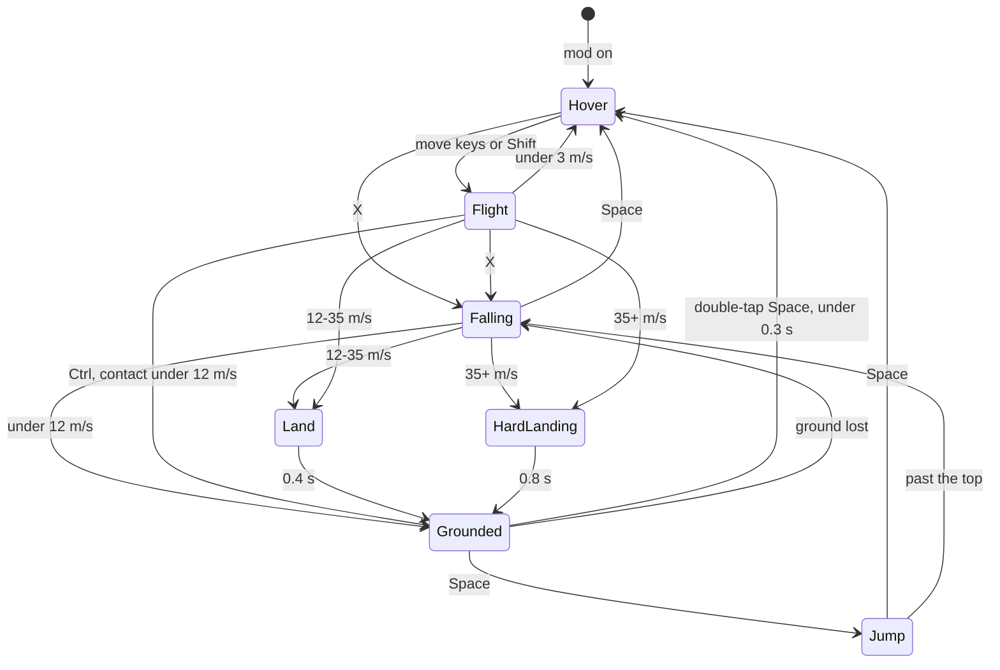
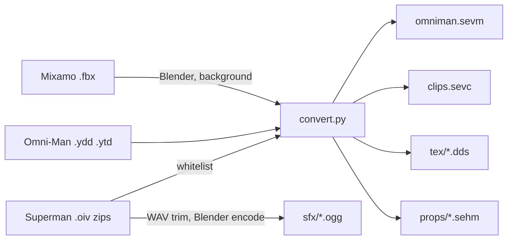

# Mods menu and Viltrumite powers

> Status: Draft · Date: 2026-11-06 · Baseline: 398e841
> Source: the user's request and interview of 2026-11-06, and research against the code at the baseline.
> Not independently reviewed: the user asked for the spec without a review pass.

Line numbers are as of the baseline. Nothing here has been run in the game except where it says so: every
millisecond, lag and feel number is an estimate to check and tune. Another session builds this, step by step,
without asking questions; where the user must act, the section below says what happens meanwhile.

## Summary

The game gets a **Mods** menu listing its installed mods. The first is **Viltrumite powers**, after the show
Invincible: clicking it puts you in a third-person view of Omni-Man, flying at the camera's spot. He flies from
hovering to far past light speed, stops flying and falls under each planet's real gravity, lands, walks, runs and
jumps. Flying through air makes a sonic boom at that planet's speed of sound, and faster still he glows from
aerodynamic heating. Hard landings make craters, and buildings are solid and collapse when he hits them hard.
Clicking the mod again returns to the normal free camera at the same spot. His animations and sounds come from a
GTA 5 Superman mod and his model from an Omni-Man pack, converted once and copied into the project for private use.

## What the user must do

The build is not blocked by any of these; each has a stand-in until it's done.

| # | Step | Until it's done |
|---|---|---|
| U1 | Download 8 clips from mixamo.com (free Adobe login) into `re/viltrumite/mixamo/`, FBX Binary, 30 fps, character Y Bot, "Without Skin", "In Place" ticked where offered. Names to search: an idle (`Idle` or `Breathing Idle`), `Walking`, `Running` (or `Standard Run`), `Fast Run` (or a sprint), `Left Turn 90`, `Right Turn 90`, `Cross Punch`, `Hook Punch`. Save as `idle.fbx`, `walk.fbx`, `run.fbx`, `sprint.fbx`, `turn_left.fbx`, `turn_right.fbx`, `punch_cross.fbx`, `punch_hook.fbx`. | The converter writes simple keyed stand-ins for the walk cycles and idle, and uses `export@nib@thor@heavy_punch_left` and the `uppercut` clip in `nib@batman.ycd` for punches. It warns, and the mod works. Re-running the converter replaces them. |
| U2 | Read the mod author's note on reusing assets, `https://www.patreon.com/JulioNIB/posts/using-my-assets-172960335` (named in `FiveM and mod creators note.txt`; Patreon refused it from here with a 403). | Nothing changes. The copy stays private, never shared or published. If the note forbids even this, tell the building session. |
| U3 | Judge the sounds and how it feels to play. | Numbers stay as tuned by the building session. |

## Goals / Non-goals

**Goals**

- A Mods menu that lists mods found on disk and turns each on or off.
- Viltrumite powers: hover, three flight speeds (cruise, fast, hyper), real falling and orbiting, walking, running,
  super jump, hard landings with craters and dust, punches, a ground punch, a thunderclap shockwave.
- Sonic boom and aerodynamic heating from real physics, per planet.
- Buildings are solid; a hit at speed collapses the whole building; it's back once he's 20 km away.
- A small corner readout. The normal panels are hidden while the mod is on.
- The mod off costs nothing. Nothing builds up: this project's worst slowdown came from a peak of GPU objects
  (CLAUDE.md, "Slowdowns over a session").

**Non-goals (first version)**

- Lasers, freeze breath, tornado, solar flare, grabbing or carrying, dismemberment. Not Viltrumite powers, and the
  game has no people or vehicles to use them on.
- People, enemies, AI, health, damage to him.
- A plug-in system, scripts, mods added without a rebuild, downloading mods.
- Going underwater (the game has no underwater view).
- Holes in buildings; lasting destruction; a saved list of broken buildings.
- Trees, lamps, benches, cars and orbital stations being solid.
- Controller support, rebindable keys.
- The Blood version of the suit.
- Foot IK (a hook for it is left, see F6).
- Saving his state: the mod is off at next launch.
- A 5-round session test. The user: "no need to test for a simple mod". The fixed-pool rules stay as design rules,
  and the cost numbers are aims rather than gates.

## Users & permissions

| Role | Can | Cannot |
|---|---|---|
| Player | Open Mods, turn a mod on or off, play him | Install mods without a build; turn the mod on while piloting a ship or while a script runs (greyed with the reason) |
| Test run (`--run`) | Everything through dev commands (F11) | Grab the cursor (`settings::scripted`, settings.rs:49); read or write the user's settings |

There are no accounts. The mod author's Patreon login belongs to the mod's compiled code, which this work never
opens or runs.

## Data model

### Files

| Path | What | Lifetime |
|---|---|---|
| `crates/se_engine/assets/mods/viltrumite/mod.cfg` | SE syntax, read with `se_core/src/sc.rs:170`: `Name`, `Description`, `Code "viltrumite"`, repeated `Need "relative path"` | In git, with the game |
| `.../viltrumite/omniman.sevm` | Own binary, `SEVM`, in the style of SEHM (library.rs:533, make_heroes.py:7): bones (parents, inverse binds), one draw per material with a `cutout` flag, 56-byte vertices with joints and weights | Converted once |
| `.../viltrumite/clips.sevc` | Own binary, `SEVC`: 30 fps, i16 quaternions, root translation only; per clip: loop, partial bone mask, `ground_z`, stride speed, event times | Converted once |
| `.../viltrumite/tex/*.dds` | Original BC3, top mips of flat textures dropped | Converted once |
| `.../viltrumite/sfx/*.ogg` | About 29 sounds (F10) | Converted once |
| `.../viltrumite/props/*.sehm` | `nibsuper_ground_break1`, `nibsuper_rock1`, `nibsuper_rock2` | Converted once |
| `re/viltrumite/tools/convert.py` | The one-time converter, written in step 2. `python -I`, numpy. Out of git, like `re/megaton_rainfall/tools` | Kept |
| `re/viltrumite/tools/research/` | Working readers from the research: `rsc.py` (RSC7 and resource reader), `ycdlib.py` (clip decoder), `skin.py` (posed him with real clips: `sheet1.png`), `cape.py`, `add.py`, `contact.py`, `punch.py`, `tex1.py`, `ydr1.py`, `wav.py`, `heat.py`, `heat2.py` | Kept, start from these |
| `re/viltrumite/mixamo/*.fbx` | User step U1 | Kept, out of git |

About 50 MB in the project: textures 28, mesh 12, props 4, sprites 3, sounds 2.5, clips 2.

There is no save file. `Snapshot` in settings.rs gets no new field.

### Run-time state

| Name | Holds | Notes |
|---|---|---|
| `ModRegistry` | Each folder's `ModInfo { id, name, description, code, missing: Option<path> }` | Scanned once at start, `asset_dir()/mods` then the manifest fallback as orbital.rs:230 |
| `ModControl` | `active`, `menus`, `aftermath`, `dev` | `aftermath`: pools or broken table still draining after off |
| `ModInput` | One frame's snapshot: move axes, held keys, presses, mouse delta, wheel | Zeroed while a text field has focus |
| `Hero` | `frame: Attached { body, local_pos, local_vel, level } / Free { pos: UPos, vel }`, state, aim, yaw, flight tier, clock | One only, real seconds in `clock` |
| `HeroFrame` | `joints: [[Vec4;3];128]`, `light: PatchLight`, atmosphere values, `key`, `axes`, `centre`, `shadow_plane`, `heat`, `wind`, `town` | One `ShaderBuffer`, written in place with `cast_slice_mut`, as orbital.rs:82,178 |
| `FxRecords` | Cone, ring, shell, trail (256 points), craters (32), dust (64 bursts of up to 64 quads) | One storage buffer, written in place |
| `BrokenTable` | Binding 19 of the scatter: header `count, clock, capsule`, then 16,384 16-byte entries `(x, y, face|model, t0)` in 64 m squares, an entry in each square within 4 m | Made once. 4,096 broken at most |
| `ProbeList` | Binding 20: 1,024 48-byte records, `Inst` plus id; four fixed staging buffers; 8-entry ring of `(camera, body, orient)` by sequence number | Made once |
| `DebrisPool` | 1,024 chunk `Inst`s, CPU gravity | Made once |

### Numbers to tune

All in one `const` block in `viltrumite/tune.rs`.

| Name | Value | Meaning |
|---|---|---|
| `WALK`, `RUN`, `SPRINT` | 1.8, 5, 11 m/s | Sprint after Shift held 1.5 s. Clip rate 0.7-1.5 of stride speed |
| `JUMP` | 28 m/s up, no drag rising | Earth 40 m, Moon about 242 m |
| `FLY` | 20 m/s | WASD alone |
| Shift ramp | 300 m/s at 1 s, 3 km/s at 3 s, 30 km/s at 6 s | Logarithmic; tau 0.35 s |
| Space ramp | Beyond 30 km/s, x2 per Shift second | c after about 13 s more, 1000 c after about 23 s |
| Cap in air | 30 km/s | Below 25 scale heights |
| Cap in space | `max(30 km/s, 3 x distance to the nearest surface per second)` | c at 100,000 km; 1500 c at 1 AU; brake tau 0.2 s when over it |
| Guard | 1e26 m/s | Numeric only |
| Tiers (rising, falling) | Hover under 3; Cruise to 120 (100); Fast to 1,500 (1,200); Hyper above | Clips, F3 |
| Soft landing | under 12 m/s | Grounded at once |
| `LAND` | 12-35 m/s | Land 0.4 s |
| `HARD_LANDING` | 35 m/s and over | HardLanding 0.8 s, crater |
| `BREAK_SPEED` | 35 m/s along the wall's normal | The same as `HARD_LANDING` on purpose: Earth's terminal speed of 45 m/s then breaks a roof. Sprint and `FLY` stay under it |
| Drag `CdA/m` | 0.0078 | Earth terminal 45 m/s. Integrate implicitly, `v / (1 + c|v|dt)`: explicit blows up at speed |
| Attach height | below `min(0.5 R, 300 km)`, leave at 1.2x | |
| Punch reach | 5 m ray | |
| Ground punch | LMB aimed 45+ degrees down, within 15 m | Crater radius 6 m |
| Crater radius | `clamp(0.4 sqrt(v), 2, 60)` m | |
| Thunderclap | RMB held 0.4-2.5 s | Ring radius 30-150 m by charge. Doesn't break buildings |
| Slopes | walk to 50 degrees, slide to 70, wall above | |
| Camera | 6 m; wheel x0.9 a notch, 2.5-200 m; plus `0.8 log10(v/30)` over 30 m/s | |

## Flows

### F1. Mods menu

1. `Mods` button in `toolbar_main` (hud.rs:596-632, at the end of the list, as `tool(ui, "Mods", ...)`), toggling
   `HudState.show_mods`.
2. A window copying Places (hud.rs:1027-1056), `selectable_label` rows (ship/manager.rs:147), name and description.
3. Clicking a row runs `ModControl` on or off. Grey with the reason when: `Missing PATH`; a ship is being piloted;
   a script is running (`ScriptRunner::running`, scripting.rs:328); `Needs a newer build` (unknown `Code`).
4. First enable loads the assets and queues the pipelines, which take seconds. The row reads `Loading` and he
   appears when ready (`pipeline_watch.rs`). Assets then stay loaded and hidden; he is never respawned.

### F2. Turning on

Always flying (D4). Clear `travel`, `follow`, `track`, `hold_agl`. Hero at `cam.pos + forward x 6 m` in the Hover
state. If that's under the ground, lift it 2 m above. If the ground isn't loaded, hold him in the air with no
landing or splash until a level exists. A building box containing him when first seen is ignored until he leaves it.
Grab the cursor (Locked and hidden), hide the panels (F8). Start the paused loops (F10).

### F3. Off

Pose untouched, velocity 0, panels back, cursor back. Within 2 R of a body, bind `Follow::new(nearest, true)` or the
planet leaves (camera.rs:1095). Loops fade over 0.2 s and despawn. `aftermath` keeps the restore and the craters
running until empty, or turning the mod off would pop buildings back (D3). On exit: hand back in `Last`, before
`session::save_on_exit` (as scripting.rs:86). If piloting starts (`flight.active` from camera.rs:884, ship.rs:990, the
Ships window) or a script starts, the mod turns off first.

### F4. State machine

| State | Physics | Clips (main package, prefix `export@nib@super@` unless shown; `bf_` = `basicflight_`) |
|---|---|---|
| Grounded idle | On the ground (F6). Body yaw eases to the aim; over 70 degrees off, a turn clip | Mixamo idle, turn_left, turn_right |
| Walk, Run, Sprint | Accel 12 m/s2; body faces the move direction | Mixamo walk, run, sprint at `speed / stride`, starting on left-foot contact |
| Jump | Fixed impulse, no drag rising; gravity | `export@nib@male@jump_fall_start_stopped`, `export@nib@male@jump_fall_loop` |
| Falling | `gravity_at` plus drag; vacuum coasts and orbits | `fall`, `export@nib@male@jump_fall_down_loop` |
| Land | Short stop | `export@nib@male@jump_fall_land_hard` or `export@nib@land_r` |
| HardLanding | Crater, dust | `land_punch` (contact 0.27 s) |
| Hover | No gravity or drag. Holds still relative to the body | `bf_idle`, `bf_idle_arms_crossed` when still; `bf_idle_fwd_add`, `_bwd_add`, `_left_add`, `_right_add`, `_up_add`, `_down_add` per bone |
| Cruise | No gravity or drag | `bf_idle_combat2` |
| Fast | Same | `bf_fast_botharmsback` and its `_left`, `_right`, `_up`, `_down` |
| Hyper | Same | `bf_fast_rightarmpointingahead` with `bf_fast_left_add`, `_right_add`, `_up_add`, `_down_add`; `bf_hyper_up_rightarmahead` when climbing over 48 degrees |
| Take off | Crouch, launch | `charge_flight_stopped` (0-0.5 s), `bf_idle_to_fast` |
| Stopping | | `bf_break`, `bf_fast_to_idle` |
| Punch | Layered over the body, upper-body mask | Mixamo punch_cross, punch_hook; in flight `flying_grab_punching`, `flying_grab_punching3` |
| Ground punch | Crater, dust | `ground_punch` (contact 0.27 s) |
| Thunderclap | Hold to charge, release to clap | `thunderclap`, `thunderclap_flying` (hold 0.6 s, clap 1.23 s) |

The `_add` clips are absolute partial poses, not deltas (Spine_Root is 91 degrees from identity and 2 from the base
pose): blend them per bone with a mask. No clip has a mover track. Only `SKEL_ROOT`'s position moves; drop other
position tracks (they hold another skeleton's bone lengths: calf 0.407 against his 0.45). The `flightAnim_*` numbers
in the suit `.ini` are IDs inside the compiled code and can't be matched; don't try.

Flight input: W alone holds speed; no keys halves speed per 0.15 s. Above 30 m/s his body points along his velocity;
below, along the aim.

### F5. Frames and time

- `Attached` below the attach height: posed as ship.rs:1710 (velocity = body velocity + spin x r), plus Coriolis and
  centrifugal terms when falling. `Free` above: UPos and velocity with the ship's integration and carry
  (ship.rs:1455-1485). sim.jd's f64 rounding makes planets jump metres (ship.rs:561), so a freely integrated hero
  wobbles against nearby ground: walking must be Attached.
- Real `dt.min(0.1)` throughout, whatever the game clock does: he plays the same at x1000 and when paused, as
  ship.rs:1455. One real-seconds `Hero.clock` for him, effects, collapse and the table's `clock`.
- Reuse, making them `pub(crate)`: `ground_on` ship.rs:2084, `gravity_at` 1423, `reference_velocity` 499,
  `settle_landed` 2095, the air-speed helpers 478 and 534, `planet_shine` system.rs:1341.
- Collision in Free: each step, the segment against every loaded body's attach sphere in rel/shape space; cut there,
  attach, then sphere-trace the rest (step `max(0.8 alt, 1 m)`, 16 at most). Nothing in the game is swept today
  (camera.rs:1185). Known limit: a star not yet loaded can be flown through at 1000 c.

### F6. Ground

- One `support_height(dir)` used by walking, the feet and the shadow: the larger of `surface_sample` (terrain.rs:1282,
  clamps to the sea) and, from step 9, a building slice's top when his feet are within 0.7 m of it.
- Normal: three `ground_on` samples 1.5 m apart (no normal function exists).
- A finer node moves the ground: a visual offset eases out, tau 0.15 s. Same level, a drop over `0.6 m + v dt tan 50`:
  Falling. No level loaded: hold him in the air (F2), never the ellipsoid, because oceans' seabeds and burials follow.
- Feet: capsule on the height; root drops to the lower foot's sample, at most 0.25 m, smoothed; a `post_pose` hook
  stays for two-bone IK later.
- Soil displacement (planet.wesl:255-273, full within 1 km of the camera, measured +-0.8 m on Sahara and Mars,
  docs/missing_features.md:492): hold it down near him. In the vertex shader, `fade *= smoothstep(1.5, 8.0, distance
  to hero)` with the hero in a new `CloudShadow` field (binding 29, set after the reset at volumetric_clouds.rs:1071).
  Work in metres: planet.wesl:258 divides by a scale. The normal maps keep the stones. With the mod off the term
  must be inert and the ground identical.

### F7. Camera

- `aim = cam.rot`. Below `max(0.005 R, atmosphere)`, `horizon_turn` (camera.rs:960) with his own up, because
  `horizon_up` needs `cam.follow` (949); above, free as camera.rs:576.
- Position: head + aim x (0, 0.3, dist), from his exact UPos with no spring, so there's no jitter at any speed.
- Floor at ground + 2.0 m (ship.rs:2151) so `keep_camera_above_ground`'s 1.5 m radial push (terrain.rs:3492,3572)
  never fires. Under 40 m out, from step 9, pull in along the line of sight when `ProbeList`'s boxes cross it.
- Near plane after `sync_camera_transform`: `near.min((dist x 0.05).clamp(0.02, 0.5))`, because `near_plane` is 30 m at
  30 km height and reaches 1000 m (camera.rs:1241). Ship's fix: ship.rs:431,2160.
- Shake: rotation only, after sync_camera_transform (camera.rs:1251), at most 1 degree.

### F8. Input and the screen

One `PreUpdate` system after `InputSystems` (slot: scripting.rs:80) snapshots `ModInput`, then `clear_just_pressed`
(never `reset`, which drops held state: bevy_input button_input.rs:200,234) for Space, X, W, A, S, D; unless `menus`,
both mouse buttons' just-pressed and just-released. `FlightHold` is the wrong tool: `sync_hold` overwrites it each
frame (ship.rs:1314). `travel_and_move` (camera.rs:1090) tests `ModControl`. **`input_controls` is not gated whole**
(camera.rs:365): only the branches in the table.

| Input | While on | Where |
|---|---|---|
| W A S D | His moves | camera.rs:722-723 gated; Shift+A, Shift+D lose their just-pressed (switches.rs:188, camera.rs:800), a side effect of taking those keys |
| Space | Jump, fly up, take off. Doesn't pause | hud.rs:106 sees no press |
| Shift, Ctrl | Run or boost; fly down. Still modifiers for shortcuts | Read from `pressed` |
| X | Stop flying | overlay.rs:549 sees no press |
| Tab | Menus, not with Alt | Unused today |
| Left, right, wheel | Punch, charge, zoom; in `menus`, normal egui | Mouse look reads `pressed` (camera.rs:580-616) and the wheel scrolls (634), so gate those branches; pick_on_click overlay.rs:1536-1545 |
| R, F, Q, E, arrows, numpad, middle click, Shift+F, Shift+R | Do nothing: they steer or bind the free camera, which he owns now | camera.rs:683-685, 724, 626, 804: gate |
| G and its forms, Z | Unchanged: Go To carries him, Z stops; then Hover. WASD cancels a Go To | camera.rs:728, 766 |
| C, End, T, H, Digits 1-3 and 5, Backspace, Home, PageUp, PageDown, +, - | Unchanged | They turn `cam.rot` (his aim) or change settings |
| Digit 4 | Starts piloting, so the mod goes off first | camera.rs:884 |
| Everything else (F keys, I, J, K, L, O, V, P, M, N...) | Unchanged | |

- While on, force `cam.follow` and `cam.track` off every frame, not once: the Track and bind buttons (hud.rs:727,731)
  and browser travel can set them.
- Tab: `retain` Tab out of `EguiInput` after `EguiPreUpdateSet::ProcessInput`. Otherwise egui focuses a widget
  (egui-0.36.2 memory/mod.rs:596,672), `egui_wants_keyboard_input` turns true (context.rs:2986) and guards like
  hud.rs:71 kill the keys. Zero `ModInput` while a text field has focus.
- In `menus`: mouse to egui, keys stay his, cursor visible.
- Focus loss counts as `menus`. On regain: `None` then `Locked`, swallowing the click and the motion spike. winit's lock
  is a 1x1 rect that focus doesn't reapply (window_state.rs:489-496, event_loop.rs:1025) and the game has no focus
  handling: the hidden cursor can drift to another monitor.
- Panels: gate inside `draw_hud` only (hud.rs:550): `toolbar_main` 596, `toolbar_filters` 633, `toolbar_navigation` 668,
  `toolbar_camera` 749, `info_table` 822. **Never gate `UiSet::Draw`**: it also holds orbits, labels, the pointer
  (overlay.rs:425), grids (grids.rs:109), constellations (constellations.rs:288), toasts (messages.rs:42). In `menus` the
  panels come back.
- Readout after Draw (script_gui.rs:53): speed (m/s, km/s, then multiples of c; own formatter, `format_speed` turns
  to ly/s at 1e4 c, units.rs:60), Mach in air, height above ground, gravity in g, heat bar.

### F9. Air, boom and heat

**Air** (`viltrumite/air.rs`, the only source for drag, the cap, the boom, heat, sound and the readout): `AirCache`
parameters (ship/air.rs:32) with `height_m = 25 H`, because `AtmoParams::state` gives zeros above `height_m` (aero.rs:305)
and the shell's top is only a drawing height (Earth 60 km, Mars 132, Venus 200; at Earth's 60 km, 30 km/s would jump from
nothing to 10,300 K). `T >= 0.25 T0`: Venus lacks Adiabat and floors at 20 K above 60 km (ship/air.rs:69, aero.rs:313).
Giants without `Pressure` (ship/air.rs:62): a fallback of 1 atm at the radius. Stars and bodies with no shell: no air.
Air speed: `vel - body_velocity - spin x rel` (ship.rs:1601). One mean temperature per body, no day and night: accept it.

**Boom:** three states, NoAir, Sub, Super. Air on at `p >= 150 Pa`, off at 100. Sub to Super at Mach 1.0: boom, loudness
by `log q`, 3 s cooldown. Super to Sub at Mach 0.92: `supersonicEnd`, a cone pulse, no boom. From NoAir or on enabling:
silent, so re-entry doesn't fire falsely (Mach reads 0 above the air, aero.rs:196). Top of the boom: Earth 55 km, Mars 16,
Venus 181; a 1 mbar world none.

**Heat:** `q = k sqrt(rho / 0.15) v^3 smoothstep(-7, -5, log10 rho)`, with `k` by molar mass: 40 and over `1.90e-4`, about
29 `1.74e-4`, H2/He `6.6e-5`. `T = min((q / (0.8 sigma))^0.25, T_air (1 + (gamma-1)/2 M^2))`: Sutton-Graves alone gives 800 K
at sea-level Mach 1. Low-pass: rise 0.4 s, fall 1.5 s. Only Earth's `k` was checked by search; the others come from memory
and matter little, since T goes as `k^0.25`.

| km/s to reach | 800 K | 2000 | 3500 | 6000 | 10000 |
|---|---|---|---|---|---|
| Earth, sea level | 1.0 | 1.9 | 2.6 | 4.9 | 9.7 |
| Earth, 60 km | 1.1 | 3.4 | 7.1 | 14.6 | 28.9 |
| Mars, ground | 0.9 | 2.3 | 4.8 | 9.8 | 19.5 |
| Venus, ground | 0.2 | 1.4 | 2.0 | 2.8 | 4.9 |
| 1 mbar | 1.1 | 3.5 | 7.4 | 15.2 | 30.1 |

Stages: dull orange at 800 K, yellow 2000, white and the plasma shell 3500, a blue-white trail 6000. Clamp the look at
10,000 K: 30 km/s at sea level is an absurd 23,300 K, Mach 89; past the clamp only the shell's size and the trail's length grow.

**Looks and where they draw** (one record buffer, no material changed per frame, no depth attachment; `clip.z = 0.5 w`
beats the near plane). Both passes need `clouds_pass`'s `CloudView` filter (volumetric_clouds.rs:1654), or they run on
every camera, and must still run when clouds are off (`clouds_pass` returns early, :1679).

| Effect | Where | How |
|---|---|---|
| Glow on the body | His main-pass material | `HeroFrame.heat` (T in kK, strength), `planck` as ship.wesl:145,269 times a windward term, before bloom |
| Craters | `fx_decals`, before `clouds_pass` | Multiply; reads depth, so it follows the ground, survives node changes, and takes the ground's light and cloud shadow. Bowl from an N.L ratio. A capsule test skips him |
| Shell, cone, rings, trail, dust | `fx_pass`, after `clouds_pass`, before `SolidUpscaleSet` | Soft depth; far parts dim by the clouds' transmittance beyond `trace_dist` (private textures, volumetric_clouds.rs:1441: make them `pub(crate)`) |

Additive meshes in the main pass are out: they write no depth, so every cloud on the ray dims them, even clouds behind
them (volumetric_clouds.wesl:2073). Plumes are the warning, and they change a material per frame (ship.rs:2250): don't copy.

- Cone: visible Mach 0.95-1.6, half-angle `asin(1/M)`, sunlit.
- Ring: rides with him 0.25 s (or the camera passes it in 15 ms), then anchored to the body.
- Trail: 256 body-frame points, spaced `max(4 m, v dt)`, rewritten camera-relative each frame. It runs end-on through a
  chase camera and may barely show: test it, and widen with distance if so.
- Skip shimmer: it needs a copy of the scene.
- HDR: glow 0.3-12, shell 15, trail 6, ring 3 (plumes run 15-20, bloom clamps at luma 50, bloom.rs:127,148). Never T^4 in
  brightness. No full-screen flash over 0.1 s (auto exposure darkens at 5/s and recovers at 1/s, exposure.rs:114-117). Check
  photo 0, 1 and 2.

### F10. Sound

Non-spatial (he's next to the camera and no listener exists), times `SoundSettings` (sound.rs:34). Voices as
engine_sound.rs:85,115-128. Mod sounds guarded by `is_ogg_vorbis` (music.rs:218; bevy_audio audio_source.rs:96-101 panics
on anything else). Loops buffer their decoded samples (fastFlight_loop is 29 s, about 10 MB), so the converter trims each
to 10 s with a crossfaded seam. Removing `AudioSink` alone restarts a sound (sinks.rs:135): despawn to stop. `set_speed`
changes pitch and speed together, which is fine here. On focus loss, fade and pause. One-shots: 8 at most, a quarter of the
volume in vacuum.

| Loop | Volume | Pitch |
|---|---|---|
| `wind_loop` | `log10 q` from 1 to 4 | |
| `fastFlight_loop` | `log10 q` from 3.5 to 6 | By Mach |
| `fasterFlight_loop` | T from 2500 to 6000 K | |
| `sentry_flightfx_loop` (hum) | 0.12 while flying, fading as `log10 q` goes 0 to 2 | 0.6 |
| `flightCharge_loop` | Right button held | |

| One-shot | Trigger |
|---|---|
| `supersonicStart`, `sonic_boom_v2` | Boom |
| `supersonicEnd` | Super to Sub |
| `fastFlight_start`, `fastFlight_fadeoff`, `fasterFlight_fadeoff` | Boost starts; boost released; leaving Hyper |
| `superWind_start` | Take off |
| `superSonic_launch_1` | Shift pressed in Hover |
| `basic_move_sound_short_1` | Jump |
| `jump_exp` | Jump while sprinting |
| `wind_end` | X |
| `flightCharge_start` | Right button down |
| `melee_start_1`, `melee_start_3` | Punch swing |
| `punch_1`, `punch_2`, `punch_3` | Punch |
| `hPunch_1` | Punch hits a building |
| `explode_ground1` | Hard landing. The mod has no splash, so on the sea at pitch 0.6: judge by ear |
| `sentry_tk_Smash_hit1` | Ground punch, a building breaking |
| `thunderclap1`, `thunderclap2`, `thunderclap3` | Thunderclap by charge |
| `sentry_tk_shockwave1` | Under a thunderclap on the ground |

### F11. Impacts and dev commands

- Crater pool 32: anchored to the body as terrain.rs:3548-3555, freed once he and the camera are over
  `FAR_RANGE_M + 500 m` away. **No distance fade before that** (D3: fading at 5 km would show one reappearing). Rims:
  `nibsuper_ground_break1` (4.8 m across, 11,388 triangles), half-sunk, within 2 km, scaled to the radius, `HullMaterial`.
- Dust pool: one, in `fx_pass`, for landings, ground punches, splashes and collapses. 64 stateless bursts of up to 64
  quads, sprites from `nibfx_super.ypt`'s `ptfx_smoke_wispy_anim` if convertible, else the port's own. Busy: steal the farthest.
- Thunderclap: ring, sound, dust kicked up when over the ground. No building break.
- Sea (`has_ocean` terrain.rs:932, surface at height 0): big splash, then Hover 1.5 m up. Never underwater.
- Dev commands, in camera.rs's match (1322) through `commands.queue` (1728): `mods list`, `mods on NAME`, `mods off`,
  `hero keys KEYS SECS`, `hero aim Y P`, `hero state`, `hero break`, which tests must use because `--run` has no real keyboard.

### F12. Solid and breakable buildings

The user was told solid buildings would need a second CPU copy of the city layout. Research found better; behaviour
is unchanged. A CPU mirror would be about 800 lines (372 of city.wesl plus about 200 of scatter.wesl, against about 50 in
city_roads.rs) and couldn't match Earth's placed-once lights patch (gpu.rs:540, earth.rs:104), `town_land`'s drawn height
(scatter.wesl:1079) or GPU rounding. So: **read back what the GPU has placed**. The list is exactly what's drawn; an unplaced
cell isn't drawn either, so a miss is harmless.

1. **Probe.** No new pass. In `cull_building` after the range fade, before the view planes (scatter.wesl:1341-1347;
   cull runs every slot every frame, gpu.rs:813, so buildings behind the camera are seen), behind a header flag: inside a
   capsule from him to `him + v dt (lag + 2)`, radius 40 m + the building's half-diagonal, append `Inst` plus id to
   binding 20, dropping on overflow. Readback as gpu.rs:832-834,862, four fixed staging buffers, never `ReadbackOnce`.
   Lag about 4 frames (estimate): at 300 m/s 20 m, 10 km/s 670 m, 30 km/s 2 km, inside the near range. Boxes don't move and
   the CPU solves against the list every frame, so walking feels no lag. Ranges by Cities setting: near 7/5/3 km, far
   20/14/9 km (scatter.rs:110-114); far cells hold only height 25 m and over (scatter.wesl:439).
2. **Identity by position**, because the record's hash uses cell-local `fc` (scatter.wesl:1358) and differs between near
   and far: face plus face metres x4 as i32 (`cell.tile`, `local + fc * edge`), matching within +-4 m and the same model (lots
   are 12+ m apart, city.wesl:150). Put the face in `Cell`'s spare float (scatter.rs:327). Set `cell.k` for all kinds (scatter.rs:885).
   `urban` and `core` are read at the grid point (scatter.wesl:557, city.wesl:213), so near and far centres and sizes can
   differ slightly: **prove +-4 m first** (step 9).
3. **Hiding.** `if count > 0` in `cull_building`, one branch when off: look up the table. Placement stays untouched, so CLAUDE.md's
   "same decision" rule isn't touched. A skybridge is hidden if its entry or either end's tower matches. An arcology's cleared lots
   stay cleared. A dome breaks alone. Flying lanes are never solid and never break.
4. **Collapse, stateless:** `T = clamp(2.5 + h/200, 2.5, 7)` s; `pos -= up * (h + plinth) * p^2`; scale kept, so facades don't
   squash; the depth test hides what's underground. A negative width (its f16 sign is free) marks a falling building: windows dark,
   emit off. **`scatter_draw.wesl:1186` and `:768` must both take `abs`**: today :1186 discards every such pixel and :768 mirrors the box.
5. **Rubble:** `cull_building` appends the same record as `M_RUBBLE`, a model of the port's own after the cars, with its own draw
   gate (gpu.rs:920): width and depth x1.25, height `min(0.18 h + 1, 30)`, growing with `p`. Its lifetime is the table entry.
6. **Chunks and dust:** `DebrisPool` with `nibsuper_rock1`, `nibsuper_rock2`, appended by a compute pass skipped when empty; dust
   from the one pool (F11).
7. **Restore:** he and the camera both at `FAR_RANGE_M + 500 m` or more: remove the entry, rebuilding the table at most twice a second.
   Use the constant whatever the Cities setting. Full: evict the farthest. Entries hold the body: another active body restores them.
8. **Hits:** sphere 0.45 m swept against the list. Over `BREAK_SPEED` along the normal: the building breaks and he isn't slowed. Under
   it: cancel the normal, slide. Punch ray hits: breaks. Shape: 8 height slices per model, half-extents from the mesh's vertices, for
   towers and hero models. Roof: `support_height` (F6).
9. **Bindings 19 and 20 exist even with the mod off,** and the scatter's pipelines are built at start: a binding error quits the port
   whether or not anyone uses the mod (CLAUDE.md).

About 1,300 new lines: shaders 130, gpu 150, library 120, logic 650, dust 200, tests.

### F13. Drawing him

- **Own bone palette, Cargo.toml unchanged.** Attributes `ATTR_HERO_JOINTS` (Uint8x4), `ATTR_HERO_WEIGHTS` (Unorm8x4); never
  `Mesh::ATTRIBUTE_JOINT_*`, which switch Bevy's pipeline (mesh.rs:3323). `HeroMaterial` binds one `ShaderBuffer`. Bevy's skinning
  would rewrite joint entities every frame for no gain; `bevy_animation` needs a removed feature and always-on systems (lib.rs:1322).
- **Own sampler.** Fixed `[Layer; 4]`: crossfade A and B, masked action, turning. Local nlerp with sign fix, parent-first FK, no
  per-frame allocation. About 50 us.
- **Opaque phase, depth written, no discard**, so clouds and the render scale just work. `cutout` draws (the hair, if its shader
  hash is `ped_hair_cutout_alpha`; 120,560 of 225,011 triangles are hair) use the same material in the alpha-mask phase. The transform is
  identity; the palette is camera-relative from his UPos after `sync_camera_transform`, so he's never compressed at any speed.
  `NoFrustumCulling`. `SHIP_LAYER` (warp.rs:44,173).
- **One lighting path.** Move `star_terms` and `point_light` (scatter_draw.wesl:178) into `ground_light.wesl`, with records and textures as
  arguments; the scatter wraps them. Near a Terrain with `drawn_nodes()`, copy `body_light` and `body_uniform.atm` (as gpu.rs:589,607):
  daylight, terminator, cloud shadow, haze, eclipses, moon and planet shine, ambient. `body_light` goes stale for an unresolved body
  (written at terrain.rs:3267, after the `continue` at 2959). Otherwise fill the same `PatchLight` on the CPU: stars as ship.rs:2208 with
  `sun_sprite_tint`, `planet_shine`, no tables, true metres. Colour: `surface_color`, `street_surface`'s highlight and lamp term
  (:528,530) times a town share (`nearest_settlement`, civilization.rs:306; Earth's patch, earth.rs:210).
- **Shadow.** The game has no shadow maps. Second entity, same meshes, `AlphaMode::Multiply`: vertices projected along the star onto the
  plane from three `support_height` samples 2 m apart, lifted 3 cm. Against double-darkening: depth write on, compare Greater, the fragment
  writes `frag_depth` from pixel and plane through `view.main_pass_viewport` (`frag_coord_to_ndc` is wrong under the render scale,
  view_transformations.wesl:222), so identical bits and the first triangle wins. Factor per channel `(sky + flat) / (sun*ndl + sky + flat)`, so
  clouds, night and eclipse fade it by themselves. Fades out at 10-200 m up; none in space. **If this doesn't hold up, a dark patch like the
  cars' is the fallback.**
- **Cape.** `feet_000_u` (592 vertices, `ped_cloth`) is simulated cloth in GTA: 548 of its vertices hold cloth codes rather than weights, and
  `.yld` holds its cloth. The converter rebinds it to 30 added joints (128 in all); run spring chains in the sampler, pinning its 44 skinned vertices.
  Air speed for the spring clamps at 60 m/s (above that it just streams back); in vacuum no wind, inertia only.
- **Capture views** copy the main camera's layers (capture.rs:201-208, projection.rs:285): he shows in hi-res tiles, the skybox export and
  fisheye faces, and environment cameras skip him (ship/envmap.rs:153, blackholes.rs:924). Accept it. `fx_pass` doesn't run on them.

### F14. Conversion, once

- RSC7 needs no key: a 16-byte header, then raw deflate. All 319 distinct main-package `.ycd` decoded (321 entries; add-ons 49). Decoder: `ycdlib.py`.
- Needed from the pack: `Omniman_MK_Kwabz.ydd` v165 (mesh, weights, shaders, the 98-bone skeleton inside `head_000_r`) and `.ytd` v13 (24 BC3 textures,
  normal maps RGB, negative v so Repeat). Not `.yft`, `.yld`, `.ymt`, not the `BloodVersion` files, not `feet_001`. 165,706 vertices, 225,011 triangles;
  the "med" LOD duplicates "high". Textures 84 MB raw, many flat. Bind pose faces -Y, clips +Y, Z up; 1.88 m; root at the pelvis.
- The route is our own converter, with the format learned from CodeWalker's MIT `Clip.cs`. Blender only for Mixamo FBX and Ogg. Not Sollumz (2.9.0 is installed in
  Blender 5.2, but reads `.ycd` only as XML and other binaries through Cfx.re's licensed PyMateria); not CodeWalker (wants a GTA V folder at startup).
- Zip whitelist. `.oiv` entries used: `.ycd`, `.wav`, `.ydr`, `.ypt`, `.txt`, `.ini`. **Never** open or run `.ndll`, `.asi`, `.dll`. Never touch GTA V's own `.rpf` archives.
- Mixamo retarget: match T-poses by world-rotation deltas (his bind is an A-pose). Hips to `SKEL_ROOT`, translation scaled by hip height; Spine, Spine1, Spine2 to
  `SKEL_Spine1-3`; limbs by name (UpLeg Thigh, Leg Calf, ToeBase Toe0, Shoulder Clavicle). Store stride speed from the planted foot. `RB_` roll bones aren't driven: check the
  forearms for twisting.
- Ogg encode: Blender's `avcodec-62.dll` contains libvorbis (never run yet). **If it fails, no tool download:** turn on Bevy's `wav` feature, store trimmed WAVs under `sfx/`, and
  adjust the guard and the size estimate.

## Edge cases & failure handling

| Case | Expected |
|---|---|
| Mod's file missing or corrupt | Row grey, `Missing PATH` or `Bad PATH`, a log line. Never a panic |
| Mixamo clips missing at conversion | Stand-ins, a warning (U1). Not grey |
| Enabled while a ship's piloted or a script runs | Grey with the reason |
| Starting to pilot, or a script, while on | Mod off first (F3) |
| Spawn underground or in a building | F2 |
| Ground not loaded | Held in the air; no landing, no splash, until a level exists |
| Sea, walking off the shore or falling in | Splash, Hover 1.5 m up; to walk on, fly to land |
| Gas giant | Never Grounded. Floor as terrain.rs:3565, +50 m. The camera's own floor applies only when clouds are active there, so use the same filter for his floor, or the camera is pushed to `ground_height` with clouds off |
| Star | Stops at `R (1 + 3e-6)` plus the camera's distance, since the camera's kept at 2e-6 R (terrain.rs:3536) |
| Black hole, model bodies (67P) | Default sphere stop, as the ship |
| Body with no atmosphere | No boom, no heat, no drag; hum only |
| Atmosphere under 150 Pa | No boom. Heat by density |
| Speed past the cap | Brakes, tau 0.2 s (Numbers to tune) |
| Very high speed near a body | Swept test; attach; eased by the cap |
| Low flight outrunning the ground's detail | The ground stays coarse. Contact uses what's loaded. Accept it |
| Game paused or at x1000 | He runs in real time (F5). Paused: cars and clouds freeze and he doesn't. The collapse clock keeps running |
| Date jump, Go To, body change | Attached is re-resolved; Go To carries him; broken entries of another body restore |
| Broken table full | Evict the farthest |
| Many collapses at once | 64 dust bursts; busy steals the farthest; the building still falls |
| Mod off near a crater or a collapse | `aftermath` keeps them until he's 20 km away |
| Alt-tab, second monitor | F8 |
| Text field focused | `ModInput` zero |
| Other windows open (star browser, Places) | Reached through Tab; they're egui and work as usual; `G` works |
| Cities Off, Vegetation Off | No buildings to hit; the mod still works |
| `scatter off`, `SE_SCATTER=0` | No probe; buildings aren't drawn and aren't solid |
| Domed colonies | The dome breaks alone (F12.3) |
| A window change, MSAA | Pipelines may rebuild; he may vanish for seconds, as the ground does (CLAUDE.md, GPU pipelines) |
| Exit while on | Hand-back before the session saves (F3); off next launch |

## Security & privacy

| Threat | Handling |
|---|---|
| Running or opening locked code | `Superman V2.ndll`, `.asi`, `.dll` are never read, decompiled, run or copied: the converter's whitelist enforces it, and the powers' logic is the port's own. The Patreon login isn't bypassed |
| Encrypted game files | GTA V Enhanced's archives are never read (the user's rule: don't defeat DRM). That's why walking comes from Mixamo |
| Untrusted downloads | `python -I`, read as data, a separate script folder; zip paths aren't extracted to disk; nothing from them runs |
| Bad asset files crash the game | Parsers in se_core bounds-check and return errors; mod greyed |
| Sound crash | `is_ogg_vorbis` guard before playing |
| Sharing others' work | Private use only: Omni-Man's model (by Kwabz), the mod's animations and sounds. Never shared or published; this repo is never pushed. CLAUDE.md's rule names them |
| Data | No network, no accounts, no personal data, no saved state |

## Integrations

| What | Failure | Handling |
|---|---|---|
| Blender 5.2, background mode, for FBX and Ogg | Missing or changed | Stand-in clips; the `wav` feature |
| mixamo.com | User step; free per secondary sources as of 2026-09, not checked directly | Stand-ins |
| CodeWalker's `Clip.cs` (MIT) | Reference only, nothing linked | |

The game never touches any of them at run time.

## Non-functional requirements

- **Off costs nothing.** Systems `run_if` active or `aftermath`. Non-scatter pipelines queue on first enable. The table check is one `count > 0` branch.
  Ground and forest pixels stay identical with the mod off: check with `.optimize/bench/compare.py`.
- **Nothing builds up.** At most about 8 meshes, one palette buffer, one effects buffer, fixed pools, made once and hidden, never respawned. No material asset is changed per
  frame (CLAUDE.md). No `ReadbackOnce`. New GPU objects: dozens, not a growth. `wgpu_peak` in `SE_PERF` shows it cheaply if in doubt.
- **Cost aims, not gates:** about 1.5 ms a frame on, up to 3 ms briefly at peaks, at Ultra 3440x1440, RTX 5080. Estimates: lit body 0.1 per pass, shell and cone 0.2, trail 0.05, ring 0.1, decals 0.1, CPU 0.1,
  dust peak 1 ms. Unknown until run: 225,011 triangles and hair overdraw with no LOD. If the body is too dear, drop hair triangles at distance in the converter.
- **Memory:** loaded on first enable, stays until quit. About 50 MB plus decoded loops of 10 s each.
- **Logging:** `se.log` on load, grey reasons, stand-ins in use.
- **Undo:** mod off; `SE_MODS=0` hides the button for comparisons, as `SE_ORBITAL=0`.

## Codebase impact

New: `crates/se_engine/src/mods.rs` (registry, window, `ModControl`, `ModInput`); `src/viltrumite/` (`mod.rs`, `tune.rs`, `hero.rs` state machine, `frames.rs`, `ground.rs`, `camera.rs`, `anim.rs`,
`cape.rs`, `draw.rs`, `air.rs`, `fx.rs`, `impact.rs`, `sound.rs`, `breakable.rs`, `readout.rs`); `crates/se_core/src/hero_asset.rs` (SEVM and SEVC parsers, tested); `assets/shaders/hero.wesl`, `hero_fx.wesl`;
`assets/mods/viltrumite/`.

| File | Change |
|---|---|
| `src/main.rs` | Add the plugins |
| `src/hud.rs:19-32, 550, 596-632, 106, 633, 668, 749, 822, 1027` | `show_mods`, button, window; panels gated; Space guard |
| `src/camera.rs:576-634, 683-724, 804, 884, 1090, 1322, 1728` | Gates per F8; dev verbs |
| `src/ship.rs:478, 499, 534, 1423, 2084, 2095` | `pub(crate)`; `flight.active` turns the mod off |
| `src/system.rs:1341` | `planet_shine` `pub(crate)` |
| `src/overlay.rs:549, 1536-1545` | Nothing, if `clear_just_pressed` reaches them: verify. |
| `src/terrain.rs` | Nothing new, unless hero soil data needs it; read-only use of heights |
| `src/volumetric_clouds.rs:394, 1071, 1441, 1654` | `CloudShadow.hero`; `pub(crate)`; pass order for `fx_decals`, `fx_pass` |
| `assets/shaders/planet.wesl:255-273` | Soil hold-down |
| `assets/shaders/ground_light.wesl`, `scatter_draw.wesl:178` | Lighting moved, shared |
| `assets/shaders/scatter.wesl:1341-1347` | Probe, table check, rubble append |
| `assets/shaders/scatter_draw.wesl:768, 1186` | `abs`, dark windows, `M_RUBBLE` |
| `src/scatter.rs:327, 885`, `src/scatter/gpu.rs:813-862, 920`, `src/scatter/library.rs` | Bindings 19, 20; staging; rubble model, keeping `BUILDING_MODELS` and the `S_*` constants in step |
| `.gitignore` | `/re/viltrumite/` (done) |
| `CLAUDE.md` | The asset rule (done), a gotcha per step |
| `README.md`, `PROGRESS.md` | Each step |

Not changed: `Cargo.toml` (no `bevy_gltf`, `gltf_animation`, `bevy_animation`), unless the Ogg fallback adds `wav`. `settings.rs`, `session.rs`. `sync_hold`.

## Implementation order

Each step builds, passes the tests, gets checked with pictures and is committed before the next (CLAUDE.md). At steps 4, 7 and 10, tell the user what to try, then carry on unless they say otherwise.

| # | Step | Shows | Depends on |
|---|---|---|---|
| 1 | Mods menu, `mod.cfg`, registry, grey reasons, `ModControl`, dev commands. An empty mod that toggles | Window with the row; missing file greys | |
| 2 | **End-to-end asset proof first:** one mesh, one clip and one sound from the zips to files. Then `convert.py` in full, with stand-ins | Files, sizes, a contact sheet; a real Ogg plays in a test, or the `wav` fallback | 1 |
| 3 | `HeroMaterial`, palette, one lighting path, `bf_idle` playing, near plane. Pictures of him beside trees: Earth by day, a full-moon night (2026-11-24 14:53, 20 N 137 E), cloud shadow, orbit. Forest and ground pixels unchanged after the move, compared with the baseline | He stands lit correctly in every case | 2 |
| 4 | Flight, frames, camera, input table, focus, panels and readout, the space ramp, X, falling and orbiting, swept collision, sampler and tier clips | Fly from orbit to a planet, stop, fall; Tab; alt-tab; Earth at x1000 and paused | 3 |
| 5 | Walking: Attached ground contact, slopes, jump, landings, sea, giants, stars, soil hold-down, shadow, cape, Mixamo clips | Walks on Earth and the Moon, a jump six times higher, feet on the Sahara | 4 |
| 6 | Sound: `air.rs` drives the loops, one-shots, focus | Levels by air | 4 |
| 7 | Boom and heat: glow, cone, ring, shell, trail, table above | Earth, Mars, Venus and a thin world match the table; a dive from orbit; photo 0, 1, 2 | 4, 6 |
| 8 | Impacts: crater pool, dust pool, punches, ground punch, thunderclap, splash, shake | Each impact, in clouds and clear | 5, 7 |
| 9 | **Probe alone first:** log lag, counts and near-far centre shift flying near-far-near in New York and on a level 3 planet (`SE_CIV_TEST=2 SE_CITY_TEST=1`). If shift exceeds 4 m, widen or change the id here, before anything depends on it. Then stop, slide, roofs, camera pull-in | He stands on a roof and slides along a wall | 5 |
| 10 | Table, hiding, collapse, rubble, chunks, dust, restore, `aftermath`. Dev `hero break`. All building types: boxes, towers, skybridges, arcology, landmarks, huts, domes | A collapse near and far, returning after 20 km with none reappearing in view | 8, 9 |
| 11 | Costs measured with `SE_PERF`, mod-off pixels compared, README, notes | The numbers | all |

Prototype risks in this order: the asset route (step 2), the shared-shader move with a pixel compare (step 3), Attached/Free handover on a turning Earth (step 4), Tab, grab and egui focus together (step 4), building identity (step 9).

## Decisions log

| # | Decision | Alternatives considered | Reason |
|---|---|---|---|
| D1 | Movement and impacts only: walk, run, super jump, hover, three flight speeds, hard landings, ground punch, thunderclap | Movement only; everything in the mod | User's pick. The game has no people or vehicles; Viltrumites don't have lasers or freeze breath |
| D2 | Buildings solid and breakable; whole building collapses over seconds; trees and small objects pass through | Pass through; solid only; holes then collapse; vanish behind a blast | User's pick. Each building is a box with windows painted by a shader, so holes would need new drawing for every kind |
| D3 | Rubble and craters last until he's 20 km away | Until quit; saved for good | User's pick, keeps the least data |
| D4 | Always starts flying at the camera's spot; clicking again returns there | Decided by distance to ground; ask each time | User's pick |
| D5 | Flight overcomes gravity; X gives real falling and orbiting; fixed jump impulse | Gravity always pulls; ground and falling only | Easy to control, real physics otherwise |
| D6 | In air up to 30 km/s; in space past light speed with no limit, easing near bodies | Stop at c; 1% of c | So he can actually go places |
| D7 | Converted once and copied in; no GTA readers in the game; normal suit only | Read from Downloads each launch; both suits; blood after impacts | As Megaton Rainfall. Works if Downloads moves |
| D8 | Mods built in, one folder each | Plug-in system | Keeps the menu simple; a plug-in system would come first otherwise |
| D9 | Real physics for boom and heat, per planet; neither hurts nor slows him | Fixed speeds | User's pick |
| D10 | Controls in F8; keyboard and mouse; fixed keys | Controller; hold left button to aim | Third-person standard |
| D11 | Mixamo clips the user downloads | Public-domain mocap; hand-keyed | Best quality. GTA's own walks are encrypted, off limits |
| D12 | Quiet in space, not silent | Fully silent; same everywhere | User's pick |
| D13 | Panels hidden, small readout, Tab for menus | Keep panels; nothing | User's pick |
| D14 | Sea, giants, stars, ships, no health, off next launch as in Edge cases | Underwater as a later step | User's pick |
| D15 | Off costs nothing; fixed pools; no 5-round test; cost numbers are aims | Gated limits; 1 ms; 3 ms | The user: "no need to test for a simple mod" |
| T1 | Read back placed buildings instead of a CPU mirror | CPU mirror (what the user was told) | Matches what's drawn including Earth and level 3; about 800 lines fewer of mirrored code; lag is harmless |
| T2 | Own binary format, not glTF | glTF | New crates, per-frame plugins, no BC3 |
| T3 | Own palette and sampler, not Bevy's | Bevy skinning; `bevy_animation` | Costs against D15, a removed feature |
| T4 | Converter of our own | Sollumz; CodeWalker | PyMateria's licence; needs GTA V folder |
| T5 | `BREAK_SPEED` equals `HARD_LANDING`, 35 m/s | Separate 60 m/s | Otherwise a fall on a roof makes a crater but no break, and Earth's terminal speed never breaks anything |
| T6 | Effects in passes after clouds; only the glow in the main pass | Additive main-pass meshes | Clouds dim them wrongly |
| T7 | Run 5, sprint 11 m/s | 7, 14 | Mixamo's run is about 4 m/s, so feet would slide past the 1.5x clip rate |
| T8 | Real-time clock for everything of his | Game clock | Same feel at any speed, works paused |

## Open questions

| # | Question | Owner | Blocks |
|---|---|---|---|
| Q1 | Does the mod author's note allow this private use? | User (U2) | Nothing unless it forbids it |
| Q2 | Is Mixamo still free as described? | User (U1) | Nothing, stand-ins |
| Q3 | Do feel numbers work? | Builder, then user (U3) | Nothing |
| Q4 | Does `Catalogs.pak`'s Jupiter have no `Pressure`? The research couldn't read the pak | Builder, step 7 | Nothing; the fallback handles both |
| Q5 | Near and far building centres within 4 m? | Builder, step 9 | Step 10's design, not its behaviour |
| Q6 | Can hero model shapes (temple, arcology) be slices enough? | Builder, step 9 | Nothing; coarse boxes are acceptable |
| Q7 | Does the trail read from behind? | Builder, step 7 | Nothing |

## Verification claims

| ID | Claim | Where | How to check |
|---|---|---|---|
| C1 | A Mods button and window exist | `src/hud.rs`, `src/mods.rs` | grep `show_mods`, `"Mods"` |
| C2 | Mods are found on disk with no plug-in loader | `src/mods.rs` | grep `asset_dir`, `mods`, `Need`; no `libloading`, Lua or WASM in `Cargo.toml` |
| C3 | No locked code opened | `re/viltrumite/tools/convert.py` | Whitelist present; grep rejects `.ndll`, `.asi`, `.dll`, `.rpf` |
| C4 | No blood suit, no lasers or freeze in the copy | `assets/mods/viltrumite/**` | No `Blood`, `feet_001`, `laser`, `freeze`, `tornado`, `solar`; about 50 MB |
| C5 | No GTA readers in the game | `crates/**/*.rs` | No `RSC7`, `.ycd`, `.ydd` parsers outside `re/` |
| C6 | Own formats, no new Bevy features | `Cargo.toml`, `src/`, `se_core` | `SEVM`, `SEVC` present; no `bevy_gltf`, `gltf_animation`, `bevy_animation`; `wav` only if the fallback was used |
| C7 | Own palette | `src/viltrumite/`, `hero.wesl` | No `SkinnedMesh`, no `ATTRIBUTE_JOINT_`; `ATTR_HERO_JOINTS` present |
| C8 | Written in place | `src/viltrumite/` | `cast_slice_mut`; no `Assets<HeroMaterial>` `get_mut` per frame |
| C9 | One lighting path | shaders | `fn point_light` lives in `ground_light.wesl` |
| C10 | Render-scale-safe shadow | `hero.wesl` | `main_pass_viewport` present; no `frag_coord_to_ndc`; no `discard` in the opaque path |
| C11 | Input by snapshot, without reset or FlightHold | `src/mods.rs` | `clear_just_pressed` present; no `keys.reset`; `sync_hold` unchanged; no new `FlightHold` writers |
| C12 | Tab out of egui | `src/mods.rs` | `EguiInput` Tab `retain` |
| C13 | Panels gated, not UiSet::Draw | `src/hud.rs`, `src/skin.rs` | Gate in `draw_hud`; `skin.rs` has no new `run_if` on `UiSet::Draw` |
| C14 | One air source | `src/viltrumite/air.rs` | Drag, cap, boom, heat, sound and readout all call it |
| C15 | Boom hysteresis and silence on entry | `src/viltrumite/air.rs` or `fx.rs` | States NoAir, Sub, Super; 3 s cooldown; a unit test: re-entry doesn't boom |
| C16 | Heat matches the table | `se_core` or `viltrumite` test | Unit test: Earth, Mars, Venus at the table's speeds within 10% |
| C17 | Passes in order | `src/viltrumite/fx.rs` | `fx_decals.before(clouds_pass)`, `fx_pass.after(clouds_pass).before(SolidUpscaleSet)`; `CloudView` filter |
| C18 | Sound guarded | `src/viltrumite/sound.rs` | `is_ogg_vorbis` |
| C19 | Read back, no mirror | `se_core/src/procgen/city_roads.rs`, `scatter.wesl` | No `ct_building` twin; `broken_at` in `cull_building`, none in `place_building`; probe `MAP_READ` buffers made only at start |
| C20 | Both `abs` | `scatter_draw.wesl:768, 1186` | Read |
| C21 | Rubble model and restore constant | `scatter.wesl`, `scatter_draw.wesl`, `src/viltrumite/breakable.rs` | `M_RUBBLE`; restore and crater freeing use `FAR_RANGE_M` |
| C22 | Off costs nothing | `src/viltrumite/*`, `.optimize/bench/compare.py` | `run_if` on active or `aftermath`; identical pictures with the mod off against the baseline |
| C23 | Rule recorded | `CLAUDE.md` | Names Viltrumite beside Megaton Rainfall |

Later: `/spec-interview --verify docs/spec-mods-viltrumite-powers.md`.

## Build log

One short paragraph per step: what was done, what later steps need, what differs from the spec and why.

**Step 1, Mods menu (commit below this one in `git log`).** `src/mods.rs` holds `ModRegistry`, `ModControl`, the empty
`ModInput`, the window, the grey reasons and the dev commands; `assets/mods/viltrumite/mod.cfg` has no `Need` lines yet, so
each later step adds the files it creates. For later steps: `crate::mods::mod_file(id, rel)` finds a mod's file (beside the
exe, then the source tree, per file); `ModRegistry::mark(id, reason)` greys the row when a parser refuses a file;
`ModControl.loading` makes the row read `Loading` (step 3 sets it); `ModControl::off(&reg, why)` is the one way off, so hang
the hand-back (F3) on it; `dev` says a dev command turned it on. `off_for_pilot_or_script` then `apply_request` run in `Update`
after `ship::ship_input` (Enter, F, the Ships window), `camera::move_mode_keys` (key 4) and `camera::input_controls`, before
`scripting::run_script` (all now `pub(crate)`, with `FlightKeys`);
step 4's hero systems should run after them. `ScriptRunner::starting()` is `running()` or a script requested. `off_on_exit` is
the `Last` hook before `session::save_on_exit`. New dev commands beyond the spec's: `mods window [off]`, `uiclick X Y` (a real
egui click: at the test window's 1600x900 the Mods button is at 30 841, the first row at 930 71), `script PATH`; `SE_UI_OPEN=mods`
also opens the window. Differs from the spec: `ModInfo.fault: Option<GreyReason>` instead of `missing: Option<path>`, because
it also holds `Bad` and the unknown `Code`; `Bad` also covers an empty file, a folder where a file should be and a `Need` path
leaving the mod's folder (deeper checks wait for the parsers); `active` is the mod's folder name, one mod at a time. A row's
description and "No mods found" are `ui.label`, since `ui.weak` is nearly invisible under the skin. A script's `HideAllDialogs`
closes the window (`Dialogs::hide_all`). The one way to pilot not in the order is `ship/persist.rs` `restore_ships`: it runs once at
start, with the mod off, so it needs none. A test drives the plugin's order against the real key 4
(`key_4_turns_the_mod_off_in_the_frame_piloting_starts`; it fails without the `move_mode_keys` line). Learned: pictures before about 1500 frames can be
all black, even the panels, while the pipelines build, whatever the mods do. `refs.sh`'s ground scenes waited 1200 frames, about
8 s on this machine: half the runs caught Earth's ground half loaded, pale, a 55-level difference that looked like a bug and has
nothing to do with mods (the baseline does it too; never at 3000 frames, 10 runs). They now wait 3000. For "unchanged with the mod
off", run the baseline from a folder with no `assets` beside it (`.optimize/scratch/baseline_noassets`, the same exe), so both read
the same files. Earth's noise moves between runs (0.02 to 0.25 mean between the baseline and itself), so compare several; `rsground`
is the sharp test: bit-identical with `SE_MODS=0`, and as played only the toolbar's rectangle differs.

**Step 2, the asset route (commits below this one).** The proof came first, on its own (`convert.py --proof`: the head, `bf_idle`, `punch_1`), read back by the game's parser and played in a
test run; only then the rest. All of it is `re/viltrumite/tools/convert.py` (`python -I`, numpy; `--check-guards`, `--proof`, `--mixamo DIR`, `--out DIR`, `--check-test-fbx`, `--no-sound`, `--only-clips`),
`sheet.py` (the contact sheet, from the converted files alone: `re/viltrumite/sheets/contact_step2.png`) and `make_test_fbx.py`, all out of git. **For step 3, the axes:** model space is metres, **Z up, +Y the way a clip faces,
+X his right hand** (right-handed), origin at the pelvis, ground about -1.0 (`Clip::ground_z`, the lowest sole by real skinning, per clip). The bind pose faces -Y because `SKEL_ROOT`'s rest rotation is exactly 180 degrees about
Z; a full clip's root rotation is about the identity, which turns him to +Y, so nothing needs correcting: start each full clip from the bones' rest locals and overlay its tracks (rest, then tracks, gives +Y). The port's Y-up
is step 3's one fixed rotation (model (x, y, z) to port (x, z, -y) is what SEHM uses). Skinning is `world * inverse_bind * vertex`; rest FK times inverse bind is the identity for all 128 (tested). `HeroAssets` (mods.rs) holds the parsed model and clips from first enable on; parse time is logged (`read in N ms`). **The formats** are in `se_core/src/hero_asset.rs`'s header comment.
`ClipSet::find` takes the real name (`.ycd` stem), `basicflight_idle`, `bf_idle` or `male@jump_fall_loop`; Mixamo's are `idle`, `walk`, `run`, `sprint`, `turn_left`, `turn_right`, `punch_cross`, `punch_hook`, whether real or stand-in (`Clip::stand_in`, logged). Sampling: frames 1/30 s apart, `duration = (frames - 1) / 30`, a loop's last frame equals its first. Track samples are 1 (constant) or `frames`; tracks with the rest pose's value and tracks of the 24 bones that move no vertex are left out, so a *full* clip's missing bone means rest, a *partial* clip's (`_add`, `CLIP_PARTIAL`, `Clip::mask`) means leave the layer below alone. Partial clips carry no root position; a few carry the root's rotation, as authored.
**Clips that aren't plain loops:** the lean clips and `fall` (the review paragraph below). `bf_idle_combat2` plays forward then back, so it's twice as long (a seam of 21 degrees in the left hand's fingers alone: the fist closes and opens, the body's bones close at 0); seams under 5 degrees are taken up over the last 10 frames (`close_loop`). `flying_grab_punching*` are one-shots with `hit` at 0.5 s. **Events:** `land_punch`, `ground_punch` `contact` 0.27; `thunderclap`, `thunderclap_flying` `hold` 0.6, `clap` 1.23; `charge_flight_stopped` `launch` 0.5; punches `hit`; walks `foot_l`, `foot_r` (about where each foot lands: the spec's "start on left-foot contact" is `foot_l`, 0.03 s for the stand-ins). Stride speeds of the stand-ins: walk 2.2, run 4.2, sprint 9.0 m/s; the numbers-to-tune speeds stay in the 0.7-1.5 rate. Some clips turn the root a lot (`land_r` 74 to 20 degrees of root yaw, though his chest starts about straight; the batman punch spins and the thor punch leaps, root height up to 0.84, which the upper-body mask hides): judge in step 5 and 8 which to prefer; nothing was normalised. **Cape:** 5 chains of 6 from bone 98, `CAPE_c_l`, each chain's first joint a child of `SKEL_Spine3` and rigid with it, the others following (`HeroModel::cape_*`, draw flag `DRAW_CAPE`, opaque); a link's bind world rotation is the identity, so its local position is its bind vector. The sheet is a wide diamond (1.47 m at the hips, narrow at the shoulders, a tip at the bottom), and chains fan across it (x over half-width) so the outer ones are longer (1.55 m against 1.1): `sheet.py`'s `pose` eases each link 85% towards hanging, a good start for step 5's rest direction; the hem then has points, as a diamond's would. The cape's two sides are separate coinciding triangles: back-face culling is needed or they fight. **Draws (7):** `lowr_000_r`, `uppr_000_u`, `head_000_r`, opaque; `teef_000_u`, `berd_000_u`, `hair_000_u`, `DRAW_CUTOUT` (all three are `ped_hair_cutout_alpha`; `teef` has no alpha to cut); `feet_000_u`, the cape. `accs_000_u` is one stray triangle, left out. Uv's v is negative, so Repeat. Normal maps are RGB. **Differs from the spec:** the props' `rock.dds`, `rock_N.dds` are in `props/` (the small rocks' own rock textures differ a little; one copy is used) and their uv stay the model's own, `v + 5000` (layer 0), not metres; `sprites/ptfx_smoke_wispy_anim.dds` is a 7 x 7 flipbook read row by row, 1.4 MB against the 3 estimated; identical textures are one file (`berd_spec` is `berd_diff`, `hair_normal` and `teef_normal` are `feet_normal`, so a draw's names can point across parts); a flat texture's top mips go only when the picture really doesn't change, and sharp edges count: the suit's two diffuse maps keep 1024, the flat ones go to 64. **Sizes:** 51.6 MB (estimate 50): textures 31.8 (estimate 28: the beard's 2048 pair alone is 11), mesh 12.0, props 4.4, sprites 1.4, sounds 1.2 (estimate 2.5, at 128 kbit/s), clips 0.6 (estimate 2). **Sound:** Blender's `aud` module writes real Ogg Vorbis (`aud.Sound.write`, container and codec constants), so no `wav` feature and `Cargo.toml` is unchanged. `mods::check_sound` guards, decodes once and catches the decoder's panic; the dev command `mods sound NAME` plays `sfx/NAME.ogg` and logs decoded, playing, finished. The encoder pads a file's end to its block, which would gap a loop: `make_loop` cuts to a whole number of 2048 samples and the test decodes every loop and checks the seam (jumps under 0.016). **Hooks:** `apply_request` looks inside every file on first enable and `ModRegistry::mark` greys the row on a refusal (`Bad omniman.sevm`, picture checked with a cut-short copy beside a copied exe); the `Need` lines are written by the converter (55). **Mixamo route:** Blender imports each FBX and writes world matrices to an .npz; `retarget` builds his T-pose by pointing each mapped bone the way Mixamo's points, then applies world-rotation deltas; axes come from the file's own hips, head and legs. Tested on 8 FBX files Blender wrote itself with Mixamo's names, a T-pose and odd bone rolls: `--check-test-fbx` checks axes, signs, the mapping, the stride and the turn's direction, and the sheet looks right; re-running with the files replaces all 8. Learned: Blender's FBX exporter writes the current frame's pose as the file's rest, and the method needs the rest to be the T-pose, as Mixamo's files are said to have (not checked on a real one: `retarget` warns if not). `RB_` roll bones aren't driven by it: look at the forearms when real clips come. **Not checked:** how anything sounds, how the stand-ins feel in motion (the sheet is stills), the real Mixamo files, the textures on the GPU (step 3).

**Step 2, review fixes.** **For step 4, the leans:** the 14 `CLIP_LEAN` clips (`bf_idle_{fwd,bwd,left,right,up,down}_add`, `bf_fast_{left,right,up,down}_add`, `bf_fast_botharmsback_{left,right,up,down}`) are one-way ramps, 101 frames as authored, and their time is how far he leans: sample at `t = lean * duration`, never by the clock, and let the base clip carry the breathing. Frame 0 is near the base pose, not on it (the fast `_add` 12 degrees over the feet, `bf_idle_fwd_add` 6, `botharmsback_left/right` 15), so the layer's weight must reach 0 with the lean. Shapes to know: `bf_idle_left_add`'s head turn peaks at a third of the clip and is back by its end while the legs go on; `botharmsback_left/right` are full clips that also roll the root 26-29 degrees and move it 0.5 m sideways at full lean, which step 4 may want to take out of the root. `re/viltrumite/sheets/step2_review_leans.png` shows every full lean. **Falling:** F4 names `fall`; play it once (171 frames; it settles in 2.33 s) and go on with the new `fall_loop`, its frames 70-170 as they stand (seam 0.03 degrees), or play `male@jump_fall_down_loop`. `fall`'s last frame is `fall_loop`'s first, so they need no crossfade. Mirrored, the limbs swung 42 degrees out and back every 11 s. **Also in `clips.sevc`:** the stand-in idle got its chest and neck back (`drop_rest_tracks` compared quaternions that weren't unit length, which hid turns up to about 1.4 degrees) and `bf_idle_to_fast`'s left thumb no longer goes right round in 0.2 s (`unwhirl`, 362 degrees of path for 8 of turn; the rule is for the mod's clips only, a sprint's legs would trip it). A comparison with the old file shows nothing else moved. **Gaits are never mirrored:** `close_loop(mirror=False)` takes any seam up over the last frames and `retarget` warns over 5 degrees and now reports the real seam, measured on the bones that move a vertex; a Mixamo idle may still play forward and back. **Failures:** an FBX Blender can't read, one with no animation, a skeleton that isn't Mixamo's and Blender missing or failing each cost only those clips their real versions, with a warning (all tried, `--blender` takes another exe). Sounds differ from the spec's table: a failed encode stops the run with a clear message and the old files unchanged (they're encoded in a scratch folder and moved only when all are good), because the `wav` fallback is a change to `Cargo.toml` no run should make by itself; `--no-sound` keeps what's there. **First enable looks inside everything:** `mods::check_files` runs `parse_dds`, the new `hero_asset::check_sehm` and `check_sound` over all 55 `Need`s (about 0.3 s in test runs, once, on first enable only); a file gone since the scan now says `Missing`, not `Bad`, which needs `ModInfo.needs` and `ModRegistry::mark` (replaces `mark_bad`). `parse_dds` also refuses rubbish mip and layer counts, which would have hung or overflowed its size sums. Not caught, and harmless: rubbish inside a texture's blocks, or in a sound's audio after good headers (it plays shorter or noisier, it can't crash). Checked in test runs: rubbish in a texture, a prop and a sound each greys the row with its own path (picture), and the real mod turns on and two sounds play.
