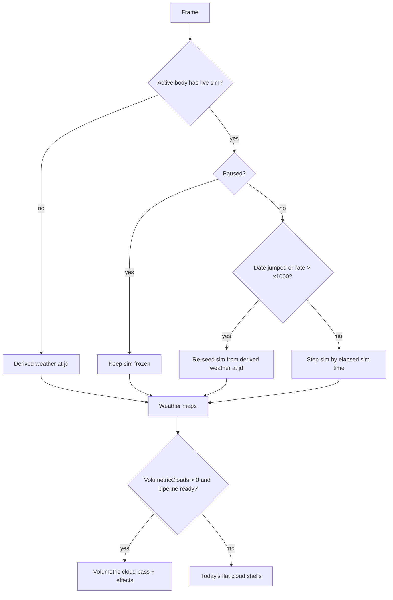

# Volumetric clouds and weather

> Status: Draft · Date: 2026-11-02 · Baseline: `45276ff` plus the uncommitted surface-speed work
> (`planet.wesl` vertex noise, `camera.rs` `preset` command) carried over from version 1
> Source: conversation with the user (spec interview, 2026-11-02)

## Summary

Version 2 of the SpaceEngine Rust port replaces the flat cloud shells with ray-marched volumetric
clouds driven by a weather system, on every world with an atmosphere, gas giants included. Weather is
hybrid: a coarse live simulation runs for the planet the player is at, re-seeded from a time-derived
weather model whenever time jumps or runs too fast, and each planet's SE data (its cloud layers,
generator parameters and cloud maps) sets the climate so worlds keep their SE character. Rain and
snow, lightning, fog and dust storms come with it. The aim is a big visual step for the player while
keeping the port's frame rate on the user's machine.

## Goals / Non-goals

**Goals**

| # | Goal |
|---|---|
| G1 | 3D clouds seen from the ground, while flying through them, and from orbit, with seamless transitions. |
| G2 | All bodies with an atmosphere and clouds: Earth-like, desert, thin-air, haze worlds (Venus, Titan), and gas giants, whose cloud decks the camera can descend through into dark depths. |
| G3 | Weather that moves and evolves: wind belts, fronts, cyclones, daily convection, seasons, storms; hybrid live simulation near the player, time-derived elsewhere. |
| G4 | Weather effects: rain and snow (distant shafts, near-camera particles), lightning, fog and haze, dust storms (dust devils to planet-wide storms). |
| G5 | Each planet keeps its SE identity: SE's cloud layers and generator parameters steer its climate; Earth's real cloud map (and other catalog maps) seeds where clouds are. |
| G6 | Quality by graphics preset: Ultra traces at half resolution, High at quarter, Medium/Low/Potato keep today's flat clouds. |
| G7 | Version 2 keeps its own settings folder (copied from version 1 on first run). |

**Non-goals (this version)**

| # | Out of scope | Why / when |
|---|---|---|
| N1 | Removing or changing time control | The user kept time control; weather must cope with any time speed and date jumps. |
| N2 | Real-world Earth weather from the internet | The game stays offline (decision D8). |
| N3 | Cloud reflections in water | Later (open question Q1). |
| N4 | Venus/Titan cloud chemistry beyond thick haze decks | Later (Q2). |
| N5 | VR, SE's editors | Out of scope for the whole port (CLAUDE.md). |
| N6 | Weather affecting gameplay (ship flight, sound) | Visual only in this version. |

## Users & permissions

A single-player desktop game; there are no accounts or roles.

| Role | Can | Cannot |
|---|---|---|
| Player | See the weather; pick a graphics preset; switch clouds and each weather effect on or off in the Settings window; use time control as today. | Edit weather directly (no weather editor in this version). |
| Scripts and automated tests (`--run`, `.se` scripts) | Use the dev commands `date`, `pause`, `preset`, `perf` to get repeatable weather and measurements. | Change the user's saved settings (scripted runs skip them, `settings.rs:49`). |

## Data model

| Entity | What it holds | Owner / lifetime |
|---|---|---|
| `ClimateParams` (per body) | From SE data: cloud layers (`se_core/src/climate.rs:1003` `CloudGen`: height, relief, wind), SE's cloud generator parameters (`terrain.rs:2946` `se_cloud_uniform`: cloudsFreq, octaves, stripes, cyclones, Randomize, tidal lock), catalog cloud maps (`TerrainLayers::clouds`), plus physical data: radius, rotation period and sense, axial tilt, orbit, surface temperature, pressure, atmosphere height, water/ice presence, ocean fraction, giant band parameters (`surface_tex.rs:604` `giant_uniform`). | Built when a body's terrain is set up; dropped with it. Read-only; nothing from the install is copied (CLAUDE.md rule). |
| Derived weather | A pure function `(ClimateParams, place on the body, jd) -> weather` giving cloud cover and type per layer, precipitation, convection/lightning likelihood, dust load, fog, wind. Deterministic: the same date always gives the same weather. | No stored state. |
| `WeatherSim` (live) | A coarse GPU grid around the active body (suggested: cube-sphere, 6 faces of 64x64 cells, a few vertical levels): wind, temperature, humidity, cloud water/ice, dust, storm cells. | One body at a time (the one the camera is at). Created on arrival, seeded from derived weather, stepped while time runs at up to x1000, re-seeded on date jumps and above x1000, frozen while paused, dropped on leaving. Not saved (re-seeded from the date on load). |
| Weather maps (GPU) | Per frame, for the active body: 2D cover/type/precip maps feeding the cloud pass, from the live sim near the camera and derived weather elsewhere. | Render-world textures, rebuilt as needed. |
| Cloud noise volumes | Tiling 3D noise textures (shape and detail) and a curl-noise texture for the ray-march. | Built once at start-up (or first use). |
| Settings keys | Graphics: `VolumetricClouds` (0 off, 1 quarter res, 2 half res), set by the presets (Ultra 2, High 1, others 0). Filters (`switches.rs`): `ShowClouds` (exists, `:18`), new `ShowRain`, `ShowLightning`, `ShowFog`, `ShowDust`. | `%APPDATA%\SpaceEngine-rs-v2\settings.cfg`. |
| Version 2 settings folder | `%APPDATA%\SpaceEngine-rs-v2` (settings, log, saved session, places). | Created on the first run of version 2 by copying `%APPDATA%\SpaceEngine-rs` when the v2 folder does not exist yet; never written back. |

## Flows

### F1. First run of version 2 (settings folder)
1. On start, if `%APPDATA%\SpaceEngine-rs-v2` does not exist and `%APPDATA%\SpaceEngine-rs` does, copy its files into the new folder.
2. From then on version 2 reads and writes only the v2 folder (`settings.rs:54` `user_file`, `:60` `settings_path`, and the log file and session paths).
3. If the copy fails (locked file, no space): log a warning and start with defaults; never touch the version 1 folder.

### F2. Arriving at a body
1. The terrain is set up as today (`terrain.rs`); `ClimateParams` is built from the body's data.
2. Far away (the body a few pixels to a few hundred pixels across), clouds come from the derived weather only.
3. Within the live-sim range (suggested: 20 body radii) and with time running at up to x1000, `WeatherSim` is created and seeded from the derived weather at the current date, then stepped each frame on the GPU.
4. Leaving the range drops the sim; another body becomes active only when the camera is at it.

### F3. Each frame (volumetric path)
1. Weather maps for the active body are updated from the sim (or derived weather).
2. After the opaque pass, a depth-downsample step reads the view's depth (MSAA-aware) at the cloud resolution.
3. The cloud pass ray-marches the cloud layers (and gas giant decks) between the camera and the scene depth, at quarter (High) or half (Ultra) resolution, with blue-noise jitter. Lighting: the star through the atmosphere (`atmosphere_common.wesl` `atm_transmittance_sun`), sky light (`atm_irradiance`), multiple-scattering approximation, the planet's, rings' and eclipses' shadows (`eclipse.wesl`), lightning, and aerial perspective (`atm_apply_aerial`).
4. Temporal reprojection accumulates the jittered samples; rejection on disocclusion and fast camera motion.
5. Upscale and composite into the HDR scene before bloom and tone mapping (as `bloom.rs:164-181` runs its pass `.before(tonemapping)` in `Core3d`).
6. Weather effects draw: rain/snow shafts in the cloud pass; near-camera particles, fog and dust as their own passes; lightning flashes light the cloud pass and the ground.
7. Cloud shadows reach the ground through a shadow map from the weather maps (replacing the cloud-map shadow, `planet.wesl:122` `clouds_tex`, `terrain.rs:1448`).

### F4. Time control
1. Normal speeds (up to x1000): the sim steps by the elapsed simulation time with a fixed sub-step; weather drifts and evolves smoothly.
2. Above x1000, or any jump in date (Go to date, `date`, Now button, loading a place): the sim is re-seeded from the derived weather at the new date every frame (above x1000) or once (jumps).
3. Paused: everything weather-related freezes (sim, drift, lightning timers); `date X; pause` must give the same picture on every run.

### F5. Descending into a gas giant
1. From orbit: volumetric bands, belts and storms (Great Red Spot-like vortices) driven by SE's giant parameters (`giant_uniform`), drifting with differential band winds.
2. Below the top deck: stacked cloud decks (e.g. an upper haze, a main deck and a deep deck) with lightning in the deep storms; light dims and reddens with depth.
3. At a depth limit (suggested: where the top-down light falls under 1e-4): the view fades to dark; the camera may go on but sees nothing more.

### F6. Preset or setting change
1. Picking a preset sets `VolumetricClouds`; individual effect toggles stay as the user set them.
2. Switching volumetric off shows the flat shells at once; switching on shows the flat shells until the cloud pipelines are compiled, then the volumetric clouds.

## Edge cases & failure handling

| Case | Expected behaviour |
|---|---|
| Cloud shaders still compiling (first use; big shaders take seconds) | Flat shells meanwhile; no missing sky, no hitch beyond today's. |
| Cloud pipeline fails (shader error, unsupported limit) | Log once, fall back to flat shells for the session. |
| Camera inside a cloud | Dense fog around the camera, lit consistently; no popping when entering or leaving. |
| Fast travel through the atmosphere / warp | Temporal history rejected on large motion; clouds stay stable, at worst softer for a few frames. |
| Time speed crossing x1000 either way | No visible jump beyond the weather catching up (re-seed blends over ~0.5 s of real time). |
| Date jump (years) | Re-seed at once; the new weather appears in the same frame. |
| Paused | Weather fully frozen; repeated runs with `date X; pause` give identical screenshots. |
| Body without atmosphere or clouds | No cloud pass work for it. |
| Thin atmosphere (e.g. RSN 0-7-460129-1254-197-12 4) | Clouds only if SE gives it cloud layers; dust storms allowed if dry and windy. |
| Planet-wide cloud deck (Venus, Titan haze) | Thick volumetric deck; from inside, uniform murk; the surface below lit through it. |
| Tidally locked world | Substellar storm and clear night side, as today's terra clouds do (`clouds.wesl:343` `se_terra_clouds`, `se[2].w`). |
| Catalog body with a cloud map (Earth) | The map seeds cloud cover; weather evolves it; never paints a frozen map. |
| Several bodies in view (moon over a cloudy planet) | Only the active body has a live sim; the others use derived weather. |
| Night side | Clouds dark except lightning, aurora above them (`aurora.rs`), city light from below on Earth-like worlds if available. |
| Eclipses and ring shadows | Cloud lighting darkens by the same shadows as the ground. |
| HD screenshots (tiles) and projection modes (cube faces) | Rendered without temporal reuse (enough samples per frame, or accumulated over extra frames per tile) so tiles match (`capture.rs`, `projection.rs`). |
| Very large window or low-end GPU | Presets cap the cost; Medium and below keep flat shells. |
| Version 1 settings folder missing on first run | Version 2 starts with defaults. |
| Version 2 settings folder already exists | Never overwritten from version 1. |

## Security & privacy

| Threat / concern | Handling |
|---|---|
| Network access | None added. No HTTP client crates; the game stays offline (D8). |
| Reading install data | Read-only through the existing VFS; nothing copied into the project (CLAUDE.md). |
| Settings copy on first run | Copies only from `%APPDATA%\SpaceEngine-rs` to `%APPDATA%\SpaceEngine-rs-v2`, only when the destination does not exist; never deletes or rewrites the version 1 folder. |
| Malformed settings values | New keys parsed with clamping to valid ranges; bad values fall back to defaults. |
| GPU hangs from runaway loops | Every ray-march and sim loop has a fixed upper step count. |

## Integrations

| Integration | Use | Failure mode |
|---|---|---|
| SpaceEngine install (read only) | Cloud layer definitions, cloud maps (`planet_tiles`), generator parameters, giant parameters. | Missing data: derived defaults from the body's physical data; no crash. |
| Bevy 0.20 render schedule (`Core3d`) | New passes: depth downsample, cloud ray-march, temporal accumulation, upscale/composite, effects; sim as compute. | Pipeline not ready: flat shells (F6). |
| Existing atmosphere tables | Transmittance, irradiance, inscatter (`atmosphere.rs`, `atmosphere_common.wesl`). | Body without tables: no aerial perspective, as today. |
| Existing eclipse, ring, aurora, terrain systems | Shadows on clouds, cloud shadows on the ground. | Disabled feature: treated as no shadow. |

## Non-functional requirements

| Requirement | Target |
|---|---|
| GPU cost, Ultra, 3440x1440, RTX 5080 (the user's setup) | Clouds and weather effects together about 12 ms or less, worst view (looking up under full cloud on RSN 0-7-460129-1254-197-12 2). Today's flat clouds cost 17-24 ms there. |
| GPU cost, High, same setup | About 6 ms or less. |
| GPU cost, Medium and below | Unchanged from today (flat shells). |
| CPU cost | Weather under 1 ms per frame (simulation on the GPU). |
| Video memory | Under 512 MB for all cloud and weather resources. |
| Stability | No flicker or crawling at rest; temporal ghosting only during very fast camera turns. |
| Determinism | Derived weather and `date` + `pause` screenshots repeatable bit for bit on the same build. |
| Start-up | No more than 1 s added before the first frame; shader compiles off the main thread. |
| Measuring | `SE_PERF=FILE` segments (`perf.rs`) and `.optimize/bench/rsn_ultra.sh` at `preset Ultra`, `--size 3440x1440`. |

## Codebase impact

All paths are in the version 2 folder (`C:\Users\liamw\Desktop\SpaceEngine Rust Port Version 2`).

| File | Today | Change |
|---|---|---|
| `crates/se_engine/src/settings.rs:54` `user_file`, `:60` `settings_path`; `log_file.rs`; `session.rs` | `%APPDATA%\SpaceEngine-rs` | Version 2 folder `SpaceEngine-rs-v2`, first-run copy (F1). |
| `crates/se_engine/src/graphics.rs:23` `PRESET_NAMES`, `:26` `MAPPED`, `:45-90` `Quality` | No cloud quality; `VolumResolution` read but unused (`:51`) | Add `VolumetricClouds` per preset (Ultra 2, High 1, others 0). |
| `crates/se_engine/src/switches.rs:18,:66,:93` | `ShowClouds` | Add `ShowRain`, `ShowLightning`, `ShowFog`, `ShowDust`. |
| `crates/se_engine/src/settings_window.rs` | Graphics and filter settings | The new settings, with the presets. |
| `crates/se_engine/src/terrain.rs:699` `CloudLayer`, `:747` `generated`, `:790` `cloud_proc`, `:1436` `drawn_clouds`, `:1448` shadow layer, `:1813` cloud shell meshes, `:1871` `CloudNode`, `:2318` cloud materials, `:2946` `se_cloud_uniform`, `:2967` `CloudUniform`, `:3013` `CloudMaterial` | Flat cloud shells, one patch per terrain node | Keep as the fallback and the Medium/Low path; skip spawning them when the volumetric path is ready and on; feed `ClimateParams`. |
| `crates/se_engine/assets/shaders/clouds.wesl:343` `se_terra_clouds`, `:388` `proc_clouds` | Per-pixel 2D cloud cover | Unchanged for the fallback; its noise functions are the starting point for derived cloud cover so planets keep their look. |
| `crates/se_engine/assets/shaders/planet.wesl:122` `clouds_tex`; gas giant colour from about `:440` to `:540` (`biomes.giant`) | Cloud-map shadow on the ground; giant bands painted on the surface | Cloud shadows from the weather maps; giant surface stays as the far look, volumetric decks over it near the giant. |
| `crates/se_core/src/climate.rs:1003` `CloudGen`, `:1014` `CloudsIn`, `:1035` `cloud_layers` | SE's cloud layer generation | Source of `ClimateParams`; new climate/weather derivation module in `se_core` (pure, unit-tested). |
| `crates/se_engine/src/surface_tex.rs:604` `giant_uniform` | Giant band and cyclone parameters | Source for gas giant weather. |
| `crates/se_engine/src/atmosphere.rs:489` `SkyMaterial`; `assets/shaders/atmosphere_common.wesl` | Sky shell and atmosphere tables | Cloud lighting and aerial perspective reuse them; draw order: clouds after the sky shell. |
| `crates/se_engine/src/bloom.rs:164-181` | Pattern for a `Core3d` pass before tone mapping | Model for the new passes. |
| `crates/se_engine/src/render_scale.rs:130` | Solid resolution and upscale chain | The cloud pass works with the solid resolution (its "half/quarter" are of the solid target). |
| `crates/se_engine/src/capture.rs`, `projection.rs` | Offscreen views (HD tiles, cube faces) | Volumetric clouds without temporal reuse there. |
| `crates/se_engine/src/universe.rs:13` `SimTime` (`jd`, `rate`) | Simulation clock | Drives the sim step, re-seed and pause rules (F4). |
| New: `crates/se_engine/src/weather.rs` (sim, maps, rules), `volumetric_clouds.rs` (passes), `weather_fx.rs` (rain, snow, lightning, fog, dust), shaders `volumetric_clouds.wesl`, `weather_sim.wesl`, `weather_fx.wesl` | | The feature. |
| `README.md`, `docs/missing_features.md`, `PROGRESS.md`, `CLAUDE.md` | | Document the feature, settings, measuring scene and any gotchas. |

## Implementation order

Each step builds, passes the tests and is checked in the running port before the next starts.

| # | Step | Depends on | Done when |
|---|---|---|---|
| 1 | Version 2 settings folder with first-run copy (F1). | none | V2 reads and writes only `SpaceEngine-rs-v2`; version 1 untouched. |
| 2 | Settings and presets: `VolumetricClouds`, effect toggles, settings window. | 1 | Presets set the key; toggles save and load. |
| 3 | Render skeleton: depth downsample, a cloud pass ray-marching one fixed test layer, temporal accumulation, upscale, composite before tone mapping, fallback to flat shells while compiling or when off. | 2 | A test layer renders at quarter/half res on Ultra/High, flat shells elsewhere; no regressions in screenshots of cloudless scenes. |
| 4 | Cloud volumes for solid worlds from SE's layers: heights and thickness from `CloudGen`, cover from SE's cloud generator (`se_terra_clouds`) and cloud maps, cloud types by height and cover, full lighting (star through atmosphere, sky, multiple scattering, shadows, aerial perspective), cloud shadows on the ground. | 3 | Earth and RSN 0-7-460129-1254-197-12 2 show volumetric clouds matching their current cover from orbit; budget met. |
| 5 | Derived weather in `se_core`: wind belts, fronts, cyclones, daily convection, seasons, as a deterministic function of body, place and date; feeds the maps. | 4 | Unit tests: determinism, seasons and latitude belts; clouds drift and evolve with time. |
| 6 | Live simulation on the GPU for the active body: seed, step, re-seed and pause rules (F4). | 5 | Weather evolves live at normal speeds; date jumps and fast time re-seed; paused runs repeatable. |
| 7 | Weather effects: rain and snow (shafts and near particles), lightning, fog and haze, dust storms. | 6 | Each effect seen in its conditions and switchable. |
| 8 | Gas giants: volumetric bands and storms, descent through decks to the dark limit (F5). | 4, 5 | Jupiter and a procedural giant from orbit and while descending. |
| 9 | Integration: eclipses, rings, aurora, night side, HD screenshots, projection modes. | 4-8 | Edge-case table checked. |
| 10 | Performance pass and documentation. | all | Budgets met at Ultra and High on the user's setup; docs updated. |

## Decisions log

| # | Decision | Alternatives considered | Reason |
|---|---|---|---|
| D1 | All worlds with an atmosphere, gas giants included, with descent through giant cloud decks. | Solid worlds first; giants outside-view only. | User's choice. |
| D2 | Hybrid weather with fallback: live GPU sim for the active body up to x1000, re-seeded from derived weather on jumps and faster time. | Time-derived only; live sim only. | User wanted hybrid realism; time control stays, so the sim needs a fallback. |
| D3 | Time control unchanged. | Real-time clock only (time control removed). | Removing it was more work than wanted. |
| D4 | Cost by preset: Ultra half res, High quarter res, Medium and below flat shells. | Fixed ~6 ms quarter res; ~12 ms half res. | User's choice; keeps lower presets as today. |
| D5 | Effects in this version: rain and snow, lightning, fog and haze, dust storms. | Clouds only. | User's choice. |
| D6 | SE data steers each planet's climate; cloud maps seed cover. | One new physical model ignoring SE's data. | Keeps each planet's SE character, Earth's familiar cloud picture. |
| D7 | Version 2 gets its own settings folder, copying version 1's on first run. | Keep sharing the folder. | Version 1 could drop version 2's new keys; the two must not overwrite each other. |
| D8 | Weather is simulated everywhere, Earth included; no internet data. | Real Earth weather now or later. | The game stays offline; no outside service to depend on. |
| D9 | Flat cloud shells kept as fallback and for Medium and below. | Remove them. | Shader compile time, failures and lower presets need them. |
| D10 | Clouds drawn as screen-space passes after the opaque pass, composited before bloom/tone mapping. | A mesh material like the nebula ray-march (`nebula_raymarch.rs:151`). | Low-res tracing, temporal reuse and scene-depth stops need full-screen passes. |

## Open questions

| # | Question | Owner | Blocks |
|---|---|---|---|
| Q1 | Should clouds and weather show in water reflections? | User | Nothing in this version (non-goal N3). |
| Q2 | How far to go with Venus/Titan chemistry (colour, sulphuric acid rain, methane rain)? | User | Nothing; haze decks first. |
| Q3 | Exact live-sim thresholds (x1000, 20 radii) and grid size: tune by measurement. | Implementer | Step 6 tuning only. |
| Q4 | Should weather ever affect ships or sound (turbulence, rain on the canopy, thunder)? | User | Nothing (non-goal N6). |
| Q5 | Should SE add-on packs be able to define their own weather? | User | Nothing; add-ons come later. |

## Verification claims

| ID | Claim | Where | How to check |
|---|---|---|---|
| C1 | Version 2 keeps its settings in `%APPDATA%\SpaceEngine-rs-v2`. | `crates/se_engine/src/settings.rs`, `log_file.rs`, `session.rs` | grep `SpaceEngine-rs-v2`; run once and look in the folder. |
| C2 | First run copies version 1's folder only when the v2 folder does not exist, and never writes to version 1's. | `settings.rs` | Unit test with temp folders. |
| C3 | Presets map `VolumetricClouds`: Ultra 2, High 1, Medium/Low/Potato 0. | `crates/se_engine/src/graphics.rs` | Unit test of the preset table. |
| C4 | The flat cloud shells remain and draw when volumetric is off or not ready. | `terrain.rs`, `clouds.wesl` | Run with `preset Medium`; run Ultra and screenshot in the first frames. |
| C5 | The cloud passes run in `Core3d` before tone mapping. | `crates/se_engine/src/volumetric_clouds.rs` | grep `.before(tonemapping)`. |
| C6 | Derived weather is a pure function of body, place and date. | `crates/se_core/src/` (new weather module) | Unit test: same inputs give identical output; different dates differ. |
| C7 | The live sim re-seeds on date jumps and above x1000, and freezes when paused. | `crates/se_engine/src/weather.rs` | Unit or integration test of the rules; two `date X; pause` runs give identical screenshots. |
| C8 | Only one body has a live sim at a time. | `weather.rs` | Code review; log line on create/drop. |
| C9 | Clouds and effects cost about 12 ms or less on Ultra and 6 ms or less on High at 3440x1440 on the worst view of RSN 0-7-460129-1254-197-12 2. | running port | `SE_PERF` segments via `.optimize/bench/rsn_ultra.sh` (with the planet number and a view looking up). |
| C10 | Weather costs under 1 ms of CPU per frame. | running port | `SE_PERF` / trace build. |
| C11 | Cloud and weather GPU resources stay under 512 MB. | `volumetric_clouds.rs`, `weather.rs` | Sum of texture/buffer sizes logged at creation. |
| C12 | No network crates are added. | `Cargo.toml`, `Cargo.lock` | grep for `reqwest`, `ureq`, `hyper`, `http`. |
| C13 | Earth's cloud map seeds Earth's cover. | `weather` seeding code | Earth from orbit at a fixed date resembles its cloud map at re-seed. |
| C14 | Gas giants show volumetric bands and can be descended into, fading to dark at the depth limit. | `volumetric_clouds.wesl` | Screenshot sequence descending into Jupiter. |
| C15 | HD screenshot tiles and projection cube faces render clouds without temporal reuse, and tiles join without seams. | `capture.rs`, `projection.rs`, `volumetric_clouds.rs` | HD screenshot of a cloudy sky; inspect tile joins. |
| C16 | Rain, snow, lightning, fog and dust can each be switched off and stay off after a restart. | `switches.rs`, `settings_window.rs` | Toggle, restart, check. |
| C17 | Clouds cast shadows on the ground; eclipses and rings shadow the clouds. | shaders | Screenshots at a cloudy terminator and during an eclipse. |
| C18 | Every ray-march and sim loop has a fixed upper bound. | new shaders | Code review: no unbounded `loop`. |
| C19 | Tests and the release build pass. | workspace | `cargo test -p se_core`, `cargo test -p se_engine --release`, `cargo build --release`. |
| C20 | README, `docs/missing_features.md`, PROGRESS.md and CLAUDE.md describe the feature and its settings. | docs | Read them. |
